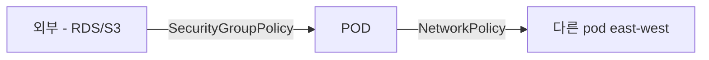

# K8s Network Policy

> namespace / label 기반 east-west traffic 제어. K8s 표준 객체. AWS VPC CNI 가 native 지원 (2023+), Calico / Cilium 도 가능.

## 1. 비교

| | AWS VPC CNI Policy | Calico | Cilium |
| --- | --- | --- | --- |
| Plugin 추가 | ✗ (CNI 가 native) | ✓ | ✓ |
| 학습 곡선 | 중 | 중 | ↑ |
| L7 (HTTP/gRPC) | ✗ | ✗ | ✓ |
| FQDN | ✗ | ✓ (Enterprise) | ✓ |
| Observability | CloudWatch | Calico Cloud | Hubble (강력) |
| 권장 | 시작 | 추가 기능 필요 시 | full mesh |

## 2. 기본 — 모든 traffic 차단 default

```yaml
apiVersion: networking.k8s.io/v1
kind: NetworkPolicy
metadata:
  name: deny-all
  namespace: prod
spec:
  podSelector: {}      # 모든 pod
  policyTypes: [Ingress, Egress]
```

→ namespace 안의 모든 pod 의 모든 in/out 차단. Allow 는 별도 rule.

## 3. Ingress allow — specific pods

```yaml
apiVersion: networking.k8s.io/v1
kind: NetworkPolicy
metadata:
  name: api-ingress
  namespace: prod
spec:
  podSelector:
    matchLabels: { app: api }
  policyTypes: [Ingress]
  ingress:
    - from:
        - podSelector:
            matchLabels: { app: web }
        - namespaceSelector:
            matchLabels: { name: monitoring }
          podSelector:
            matchLabels: { app: prometheus }
      ports:
        - protocol: TCP
          port: 8080
```

## 4. Egress allow

```yaml
apiVersion: networking.k8s.io/v1
kind: NetworkPolicy
metadata:
  name: api-egress
  namespace: prod
spec:
  podSelector:
    matchLabels: { app: api }
  policyTypes: [Egress]
  egress:
    # DNS
    - to:
        - namespaceSelector: { matchLabels: { name: kube-system } }
          podSelector: { matchLabels: { k8s-app: kube-dns } }
      ports:
        - protocol: UDP
          port: 53
        - protocol: TCP
          port: 53
    # DB
    - to:
        - ipBlock: { cidr: 10.0.10.0/24 }     # RDS subnet
      ports:
        - protocol: TCP
          port: 3306
    # 외부 API (HTTPS)
    - to:
        - ipBlock: { cidr: 0.0.0.0/0 }
      ports:
        - protocol: TCP
          port: 443
```

## 5. AWS VPC CNI Policy 활성

```bash
kubectl set env daemonset aws-node -n kube-system \
  ENABLE_NETWORK_POLICY=true

# 또는 add-on 옵션
aws eks update-addon --cluster-name bkurs-prod --addon-name vpc-cni \
  --configuration-values '{"enableNetworkPolicy":"true"}'
```

→ Calico / Cilium 없이 native 적용.

## 6. Calico

```bash
kubectl apply -f https://raw.githubusercontent.com/projectcalico/calico/v3.27.0/manifests/calico-policy-only.yaml
```

추가 기능:
```yaml
# GlobalNetworkPolicy (cluster 전역)
apiVersion: crd.projectcalico.org/v1
kind: GlobalNetworkPolicy
metadata: { name: deny-egress-to-metadata }
spec:
  selector: all()
  egress:
    - action: Deny
      destination:
        nets: [169.254.169.254/32]
```

→ pod 에서 IMDS 접근 차단 (SSRF 방어).

## 7. Cilium — eBPF + L7

```bash
helm install cilium cilium/cilium --version 1.16.0 \
  -n kube-system \
  --set eni.enabled=true \
  --set ipam.mode=eni \
  --set egressMasqueradeInterfaces=eth0 \
  --set routingMode=native
```

CiliumNetworkPolicy (CRD):
```yaml
apiVersion: cilium.io/v2
kind: CiliumNetworkPolicy
metadata: { name: api-l7 }
spec:
  endpointSelector: { matchLabels: { app: api } }
  ingress:
    - fromEndpoints:
        - matchLabels: { app: web }
      toPorts:
        - ports: [{ port: "8080", protocol: TCP }]
          rules:
            http:
              - method: "GET"
                path: "/api/v1/.*"
```

→ L7 HTTP method / path 까지 차단.

FQDN 기반:
```yaml
egress:
  - toFQDNs:
      - matchName: "api.openai.com"
      - matchPattern: "*.googleapis.com"
```

## 8. Hubble (Cilium observability)

```bash
hubble observe --pod prod/api-xyz --follow
# 2026-05-22T16:30:00Z prod/api-xyz:8080 <> prod/web-abc:46322 to-endpoint FORWARDED
# 2026-05-22T16:30:01Z prod/api-xyz:46322 <> 10.0.10.5:3306 to-endpoint FORWARDED
# 2026-05-22T16:30:02Z prod/api-xyz:46322 <> 169.254.169.254:80 DROPPED (Policy denied)
```

## 9. 실제 패턴 — bkurs-be

```yaml
# namespace 마다 deny-all default
# api → db (3306) allow
# api → cache (6379) allow
# api → 외부 API (443) allow
# web → api (8080) allow
# ingress controller → api / web allow
# kube-dns 53 allow
```

## 10. Topology Aware Hints

같은 AZ pod 로 traffic 우선 (cross-AZ 비용 ↓):
```yaml
apiVersion: v1
kind: Service
metadata:
  name: api
  annotations:
    service.kubernetes.io/topology-aware-hints: auto
```

## 11. SG per Pod vs Network Policy



| | SecurityGroupPolicy | NetworkPolicy |
| --- | --- | --- |
| AWS resource (RDS/S3) 격리 | ✓ | ✗ |
| Pod-to-pod 격리 | △ | ✓ |
| FQDN | ✗ | Cilium / Calico |
| L7 | ✗ | Cilium |

→ 둘 다 같이 사용.

## 12. 흔한 함정

| 함정 | 회피 |
| --- | --- |
| ENABLE_NETWORK_POLICY=false | 활성 |
| DNS 차단 → cluster broken | kube-dns egress 명시 |
| IMDS 차단 안 함 → SSRF | Calico GlobalNetworkPolicy deny 169.254.169.254 |
| default deny 없음 → 누구나 누구든 | namespace 마다 deny-all |
| Cilium + AWS VPC CNI 충돌 | 둘 중 하나만 또는 chaining |

## 13. 다음

- ▶ [[../04-operations/01-autoscaling-cas-karpenter]]
- ▶ [[../04-operations/02-observability-cloudwatch-prom]]
- ▶ [[../05-security/01-irsa-pod-identity]]

## 14. 영상 / 자료

| 자료 |
| --- |
| [Network Policy 공식](https://kubernetes.io/docs/concepts/services-networking/network-policies/) |
| [Cilium](https://cilium.io) |
| [Hubble](https://docs.cilium.io/en/stable/gettingstarted/hubble/) |

## 15. 참고

- [[../eks]]
- [[01-vpc-cni-and-pod-network]]
- [[02-security-group-per-pod]]
