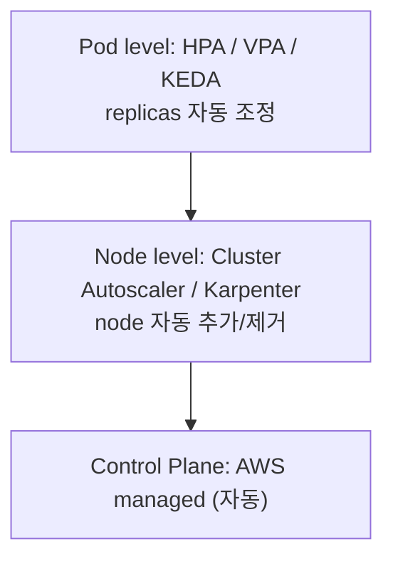
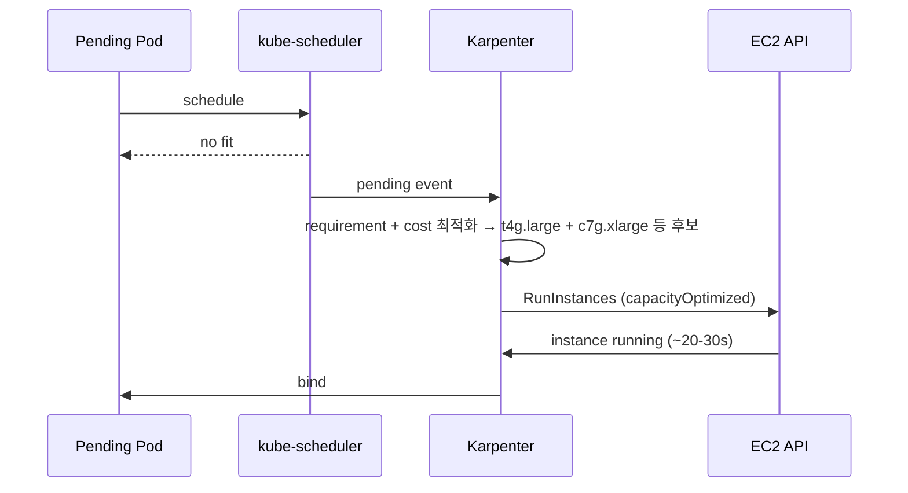

# EKS Autoscaling

> 3 layer: Pod (HPA/VPA/KEDA) / Node (CAS/Karpenter) / Cluster (control plane 자동). Karpenter 권장.

## 1. 3 layer



## 2. Cluster Autoscaler (CAS) — legacy

ASG 기반. ASG 마다 deployment.

```bash
helm install cluster-autoscaler autoscaler/cluster-autoscaler \
  -n kube-system \
  --set autoDiscovery.clusterName=bkurs-prod \
  --set awsRegion=ap-northeast-2 \
  --set rbac.serviceAccount.annotations."eks\.amazonaws\.com/role-arn"=arn:...:role/CASRole
```

ASG 에 tag:
```
k8s.io/cluster-autoscaler/enabled=true
k8s.io/cluster-autoscaler/bkurs-prod=owned
```

### 한계
- ASG 단위 → instance type 제한 (mixed instance policy 만)
- scale-out ~5분 (ASG capacity 발견)
- bin-packing 미세 조정 어려움
- EOL 추세 (EKS 가 Karpenter 적극 추천)

## 3. Karpenter (★ 권장)

ASG 없이 EC2 직접 호출. just-in-time provisioning.

### 설치
```bash
helm install karpenter oci://public.ecr.aws/karpenter/karpenter \
  --version 1.0.0 \
  -n karpenter \
  --set "settings.clusterName=bkurs-prod" \
  --set "serviceAccount.annotations.eks\.amazonaws\.com/role-arn=arn:aws:iam::...:role/KarpenterControllerRole"
```

### NodePool + NodeClass

```yaml
apiVersion: karpenter.sh/v1
kind: NodePool
metadata: { name: default }
spec:
  template:
    metadata:
      labels: { workload: general }
    spec:
      requirements:
        - key: kubernetes.io/arch
          operator: In
          values: ["arm64"]
        - key: karpenter.k8s.aws/instance-category
          operator: In
          values: ["m", "c", "r"]
        - key: karpenter.k8s.aws/instance-generation
          operator: Gt
          values: ["6"]
        - key: karpenter.sh/capacity-type
          operator: In
          values: ["on-demand", "spot"]
        - key: topology.kubernetes.io/zone
          operator: In
          values: ["ap-northeast-2a","ap-northeast-2b","ap-northeast-2c"]
      nodeClassRef:
        group: karpenter.k8s.aws
        kind: EC2NodeClass
        name: default
      expireAfter: 720h
  limits:
    cpu: "1000"
    memory: "1000Gi"
  disruption:
    consolidationPolicy: WhenEmptyOrUnderutilized
    consolidateAfter: 1m
---
apiVersion: karpenter.k8s.aws/v1
kind: EC2NodeClass
metadata: { name: default }
spec:
  amiFamily: AL2023
  amiSelectorTerms:
    - alias: al2023@latest
  role: KarpenterNodeRole
  subnetSelectorTerms:
    - tags: { karpenter.sh/discovery: bkurs-prod }
  securityGroupSelectorTerms:
    - tags: { karpenter.sh/discovery: bkurs-prod }
  tags:
    karpenter.sh/discovery: bkurs-prod
    environment: prod
  blockDeviceMappings:
    - deviceName: /dev/xvda
      ebs: { volumeType: gp3, volumeSize: 50Gi, encrypted: true, deleteOnTermination: true }
  metadataOptions:
    httpTokens: required
    httpPutResponseHopLimit: 2
```

### 동작



### Consolidation
- `WhenEmpty` — 빈 node 30s 후 종료
- `WhenEmptyOrUnderutilized` — 다른 node 에 합쳐서 절감
- `WhenUnderutilized` (EOL) — 항상 합치기

## 4. CAS vs Karpenter 비교

| | CAS | Karpenter |
| --- | --- | --- |
| 기반 | ASG | EC2 직접 |
| scale-out 속도 | ~5분 | ~30초 |
| instance type 선택 | ASG 정의된 만 | 100+ 자유 |
| bin-packing | 보통 | ★★★ |
| Spot interruption | 수동 | 자동 |
| Consolidation | △ | ✓ |
| Multi-region/multi-cloud 통일성 | ✗ | △ |
| 운영 | 단순 | 단순 |
| **권장** | EOL | ★ |

## 5. Pod Level — HPA

[[../02-workload/01-pod-deployment]] §HPA 참조.

> HPA + Karpenter 가 가장 powerful 한 콤보: HPA 가 pod 늘림 → pending → Karpenter 가 node 즉시.

## 6. KEDA — event-driven autoscaling

SQS / Kafka / CloudWatch / Prometheus / Cron / DynamoDB 등 30+ source:

```yaml
apiVersion: keda.sh/v1alpha1
kind: ScaledObject
metadata: { name: worker }
spec:
  scaleTargetRef:
    name: worker-deploy
  minReplicaCount: 0
  maxReplicaCount: 50
  triggers:
    - type: aws-sqs-queue
      authenticationRef: { name: aws-keda-trigger-auth }
      metadata:
        queueURL: https://sqs.../bkurs-jobs
        queueLength: "5"     # 5 message / pod
        awsRegion: ap-northeast-2
```

→ 0 → N → 0 (queue 비면 완전 종료, Karpenter 가 node 제거).

## 7. VPA (Vertical Pod Autoscaler)

```yaml
apiVersion: autoscaling.k8s.io/v1
kind: VerticalPodAutoscaler
metadata: { name: api-vpa }
spec:
  targetRef:
    apiVersion: apps/v1
    kind: Deployment
    name: api
  updatePolicy:
    updateMode: Auto    # Off (recommend only) / Initial / Auto
  resourcePolicy:
    containerPolicies:
      - containerName: app
        minAllowed: { cpu: 200m, memory: 256Mi }
        maxAllowed: { cpu: 2,    memory: 2Gi }
```

→ Pod 의 request/limit 자동 right-sizing.

> HPA + VPA 동시 사용 시 metric 충돌 주의 — VPA `Off` 권장 + 수동 조정 참조.

## 8. PDB (Pod Disruption Budget)

[[../02-workload/01-pod-deployment]] §PDB 참조. autoscaling 시 무중단 보장.

## 9. Topology Spread + Affinity

Multi-AZ 분산 + 같은 node 회피 — [[../02-workload/01-pod-deployment]] §Affinity.

## 10. Drift Detection (Karpenter)

EC2NodeClass 변경 (AMI / Userdata) 시 자동 node refresh.

```yaml
amiSelectorTerms:
  - alias: al2023@latest      # 새 AMI 출시 시 자동 drift detect → rolling replace
```

## 11. Best Practice

```yaml
# 1. NodePool 2개 — Spot + OnDemand
# 2. Critical workload 에 nodeSelector: workload=critical (OnDemand pool)
# 3. Batch / fungible 에 spot
# 4. PDB 설정 (Spot interruption 대비)
# 5. Consolidation 활성
# 6. Karpenter Controller 자체는 Fargate 권장 (node 사라져도 안전)
```

## 12. 흔한 함정

| 함정 | 회피 |
| --- | --- |
| CAS 그대로 사용 | Karpenter |
| NodePool requirements 너무 좁음 | category + generation > 6 + arch |
| PDB 없음 → Consolidation 시 down | PDB |
| Karpenter Controller 가 자체 node 에 | Fargate 분리 |
| Spot interruption 대비 안 함 | 2 pool + capacityOptimized |
| min=0 cold start | KEDA + warm pool 또는 min ≥ 1 |

## 13. 다음

- ▶ [[02-observability-cloudwatch-prom]]
- ▶ [[03-troubleshooting]]
- ▶ [[../practice/02-karpenter-and-alb-ingress]]

## 14. 영상 / 자료

| 자료 |
| --- |
| [Karpenter Deep Dive](https://www.youtube.com/watch?v=2I9qZQKoTKE) |
| [공식 Karpenter](https://karpenter.sh) |
| [KEDA](https://keda.sh) |

## 15. 참고

- [[../eks]]
- [[../01-fundamentals/03-node-types]]
- [[../02-workload/01-pod-deployment]]
