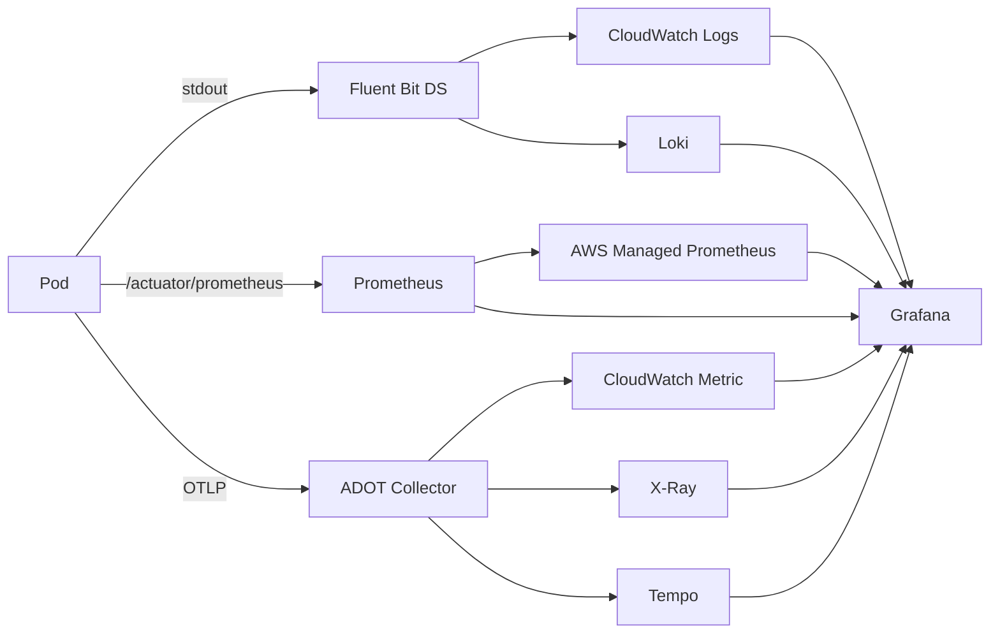

# EKS Observability

> Metric (CloudWatch / Prometheus) + Log (CloudWatch Logs / Loki) + Trace (X-Ray / Tempo) + Dashboard (Grafana).

## 1. 표준 stack



## 2. CloudWatch Container Insights — 가장 단순

```bash
# Managed Add-on
aws eks create-addon --cluster-name bkurs-prod \
  --addon-name amazon-cloudwatch-observability \
  --service-account-role-arn arn:aws:iam::...:role/ContainerInsightsRole
```

자동:
- Fluent Bit DaemonSet → log
- CloudWatch Agent → metric
- Application Signals (Java / .NET / Python OTel 자동 주입)

비용: $1.50/cluster/일 + log ingestion + metric storage.

## 3. Prometheus + AWS Managed Prometheus (AMP)

AMP = AWS hosted Prometheus.

```bash
helm install prometheus prometheus-community/prometheus \
  -n monitoring \
  --set server.remoteWrite[0].url=https://aps-workspaces.ap-northeast-2.amazonaws.com/workspaces/ws-xxx/api/v1/remote_write \
  --set server.remoteWrite[0].sigv4.region=ap-northeast-2
```

→ scrape 는 cluster 안, 저장은 AMP (managed, no maintenance).

### Service Monitor (Prometheus Operator)

```yaml
apiVersion: monitoring.coreos.com/v1
kind: ServiceMonitor
metadata: { name: api }
spec:
  selector: { matchLabels: { app: api } }
  endpoints:
    - port: http
      path: /actuator/prometheus
      interval: 30s
```

## 4. AWS Managed Grafana (AMG)

```bash
aws grafana create-workspace --workspace-name bkurs-grafana \
  --account-access-type CURRENT_ACCOUNT \
  --authentication-providers AWS_SSO \
  --permission-type SERVICE_MANAGED \
  --data-sources PROMETHEUS CLOUDWATCH XRAY
```

→ 5분만에 Grafana 인스턴스. CloudWatch / AMP / X-Ray 자동 datasource.

## 5. ADOT (AWS Distro for OpenTelemetry)

OpenTelemetry collector — metric / log / trace 통합:

```yaml
apiVersion: opentelemetry.io/v1alpha1
kind: OpenTelemetryCollector
metadata: { name: adot }
spec:
  mode: daemonset
  config: |
    receivers:
      otlp:
        protocols:
          grpc: { endpoint: 0.0.0.0:4317 }
          http: { endpoint: 0.0.0.0:4318 }
    processors:
      batch: {}
      resourcedetection:
        detectors: [env, eks]
    exporters:
      awsemf:
        region: ap-northeast-2
        log_group_name: /aws/eks/metrics
      awsxray:
        region: ap-northeast-2
    service:
      pipelines:
        metrics:
          receivers: [otlp]
          processors: [batch]
          exporters: [awsemf]
        traces:
          receivers: [otlp]
          processors: [batch]
          exporters: [awsxray]
```

Application 에서:
```yaml
env:
  - name: OTEL_EXPORTER_OTLP_ENDPOINT
    value: http://adot-collector.observability:4317
```

## 6. Logs — Fluent Bit + CloudWatch

```bash
# Managed Add-on 또는 helm
helm install fluent-bit fluent/fluent-bit \
  -n logging \
  --set serviceAccount.annotations."eks\.amazonaws\.com/role-arn"=arn:...:role/FluentBitRole \
  --set config.outputs="..."
```

Output 옵션:
- CloudWatch Logs (`/aws/eks/bkurs-prod/...`)
- Loki (Grafana 와 결합)
- Elasticsearch / OpenSearch
- S3 archive

## 7. Logs Insights query

```
fields @timestamp, kubernetes.pod_name, log
| filter kubernetes.namespace_name = "prod"
| filter log like /ERROR/
| stats count() by kubernetes.pod_name, bin(5m)
```

## 8. X-Ray / Tempo (Distributed Tracing)

Java application:
```xml
<dependency>
  <groupId>io.opentelemetry.javaagent</groupId>
  <artifactId>opentelemetry-javaagent</artifactId>
  <version>2.5.0</version>
</dependency>
```

JVM:
```
JAVA_TOOL_OPTIONS=-javaagent:/otel-javaagent.jar
OTEL_EXPORTER_OTLP_ENDPOINT=http://adot:4317
OTEL_SERVICE_NAME=bkurs-be
OTEL_TRACES_EXPORTER=otlp
```

→ X-Ray Console 에서 service map / latency.

## 9. Dashboard 예 (Grafana)

```
Bkurs Production:
- Cluster CPU / Memory / Node count
- Pod count per namespace
- HTTP RPS (per service)
- HTTP 5xx rate
- HTTP P95 / P99 latency
- HPA replicas + target metric
- Karpenter pending / provisioning
- ALB target health
- RDS connections
- Spot interruption events
```

## 10. Alerting

```yaml
# Prometheus AlertManager
groups:
  - name: api
    rules:
      - alert: APIHighErrorRate
        expr: rate(http_requests_total{status=~"5.."}[5m]) > 5
        for: 5m
        labels: { severity: warning }
        annotations:
          summary: "API 5xx rate exceeded"
```

→ Discord / Slack / PagerDuty 통합.

## 11. K8s Events 의 CloudWatch 통합

```bash
helm install eventrouter heptio/eventrouter \
  -n kube-system \
  --set sink=cloudwatchlogs
```

→ `Pod Evicted`, `FailedScheduling` 같은 K8s event 가 CloudWatch Logs.

## 12. Cost Visibility — Kubecost

```bash
helm install kubecost kubecost/cost-analyzer -n kubecost \
  --set kubecostToken="xxx"
```

→ namespace / service / pod 별 정확한 cost. node / EBS / DT 분배.

## 13. 흔한 함정

| 함정 | 회피 |
| --- | --- |
| Container Insights OFF | enable |
| audit log volume 폭주 | sampling / 비용 모니터 |
| Prometheus scrape interval 너무 짧음 (5s) | 30s 권장 |
| Grafana self-host 운영 부담 | AMG |
| Logs retention 무한 | 30일 default |
| Cost visibility 없음 | Kubecost |

## 14. 다음

- ▶ [[03-troubleshooting]]
- ▶ [[../05-security/01-irsa-pod-identity]]
- ▶ [[../../observability/cloudwatch/cloudwatch]]

## 15. 영상 / 자료

| 자료 |
| --- |
| [ADOT — AWS](https://aws.amazon.com/otel/) |
| [AMP](https://aws.amazon.com/prometheus/) |
| [AMG](https://aws.amazon.com/grafana/) |
| [Kubecost](https://www.kubecost.com) |

## 16. 참고

- [[../eks]]
- [[../../ecs/04-operations/02-container-insights]]
