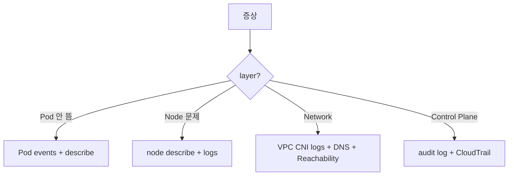

# EKS Troubleshooting

> Pod / Node / Network / Control Plane layer 진단 흐름.

## 1. 진단 흐름



## 2. Pod 진단 명령

```bash
# 전체 상황
kubectl get pod -n prod -o wide
kubectl describe pod api-xyz -n prod
kubectl logs api-xyz -n prod --previous   # 이전 컨테이너
kubectl logs api-xyz -n prod -c init-migrate   # init container
kubectl exec -it api-xyz -n prod -- /bin/sh
kubectl top pod -n prod
```

## 3. Pod Pending 원인

```bash
kubectl describe pod | grep -A 5 Events
```

| Event | 원인 | 해결 |
| --- | --- | --- |
| `0/3 nodes are available: insufficient cpu` | Resource 부족 | Karpenter 가 새 node 만들도록 |
| `had untolerated taint` | node taint | toleration 추가 |
| `did not match node selector` | nodeSelector / affinity | label 일치 |
| `no nodes match this pod's topology spread` | topology spread | maxSkew ↑ |
| `failed to create network interface` | VPC CNI ENI 부족 | Prefix Delegation |
| `MountVolume.SetUp failed` | EBS CSI / EFS CSI 권한 | IRSA |

## 4. ImagePullBackOff / ErrImagePull

```bash
kubectl describe pod | grep -A 5 "Failed"
```

| 원인 | 해결 |
| --- | --- |
| ECR 권한 없음 | Node IAM role 또는 IRSA |
| Image tag 없음 | 정확한 tag |
| Private registry credential 없음 | imagePullSecrets |
| Region 다름 | 같은 region 또는 cross-region ECR |
| Platform mismatch | ARM/x86 일치 |

## 5. CrashLoopBackOff

```bash
kubectl logs api-xyz --previous
kubectl describe pod api-xyz | grep "Exit Code"
```

| Exit Code | 의미 |
| --- | --- |
| 0 | 정상 종료 (왜 죽었나?) |
| 1 | application error |
| 137 | OOMKilled (memory limit) |
| 139 | SIGSEGV |
| 143 | SIGTERM (graceful) |

## 6. Node NotReady

```bash
kubectl get nodes
kubectl describe node ip-10-0-1-50.ap-northeast-2.compute.internal | head -30
```

Conditions 체크:
- `MemoryPressure` — node 메모리 부족
- `DiskPressure` — EBS root 부족
- `NetworkUnavailable` — CNI 문제
- `Ready=False` — kubelet 연결 끊김

Node 안 진단 (SSM):
```bash
aws ssm start-session --target i-xxx
sudo journalctl -u kubelet -n 200
sudo cat /var/log/aws-routed-eni/ipamd.log | tail -100
```

## 7. Network 진단

### DNS 안 됨
```bash
kubectl run -i --rm --restart=Never busybox --image=busybox -- nslookup kubernetes
kubectl run -i --rm --restart=Never busybox --image=busybox -- nslookup api.bkurs.com

# CoreDNS 자체
kubectl logs -n kube-system -l k8s-app=kube-dns
kubectl get cm coredns -n kube-system -o yaml
```

### Pod-to-Pod 연결 안 됨
```bash
kubectl exec api-xyz -- ping web-svc
kubectl exec api-xyz -- nc -zv web-svc 8080

# NetworkPolicy 적용?
kubectl get networkpolicy -A
```

### Pod-to-RDS 안 됨
- SG (Pod SG / RDS SG)
- NACL
- Network Policy
- DNS

### VPC CNI 로그
```bash
kubectl logs -n kube-system -l k8s-app=aws-node
# 또는 node 안
sudo cat /var/log/aws-routed-eni/plugin.log
```

## 8. Ingress / ALB Controller 문제

```bash
kubectl describe ingress bkurs -n prod
kubectl logs -n kube-system deployment/aws-load-balancer-controller

# ALB 자체
aws elbv2 describe-target-health --target-group-arn arn:...:tg/...
```

흔한 원인:
- IRSA 권한 누락 → ALB 생성 실패
- group.name 충돌 → 같은 그룹의 다른 Ingress 와 listener 충돌
- ACM cert region 불일치
- Health check path 응답 X

## 9. Persistent Volume 문제

```bash
kubectl get pvc -A
kubectl describe pvc data -n prod

# CSI Driver 로그
kubectl logs -n kube-system -l app=ebs-csi-controller
```

흔한 원인:
- AZ mismatch (volumeBindingMode 미설정)
- IAM 권한 (CSI Role)
- KMS Key grant 누락
- StorageClass 의 parameter 오타

## 10. Control Plane 문제

```bash
# Audit log
aws logs filter-log-events \
  --log-group-name /aws/eks/bkurs-prod/cluster \
  --filter-pattern '{ $.verb = "delete" && $.objectRef.resource = "pods" }'
```

CloudTrail — EKS API call audit.

흔한:
- Control plane endpoint public access 차단됨 (private 만)
- aws-auth 잘못 → cluster admin 권한 손실 (복구 어려움)
- API server throttling (대량 watch)

## 11. aws-auth 복구

aws-auth ConfigMap 망가져 admin 잃었을 때:
```bash
# 새 IAM user/role 로 emergency admin 부여 (cluster creator IAM 가 처음에 자동 admin)
aws eks update-cluster-config --name bkurs-prod \
  --resources-vpc-config endpointPublicAccess=true
# 또는 Access Entries (2023+) 활용 → console / CLI 로 추가 (aws-auth 의존 X)
```

자세히 → [[../05-security/02-rbac-and-aws-auth]]

## 12. Karpenter 문제

```bash
kubectl logs -n karpenter -l app.kubernetes.io/name=karpenter | tail -100
kubectl get nodeclaims      # Karpenter 의 node 요청
kubectl get nodepools
```

흔한:
- IAM Role permission
- Subnet/SG tag 누락 (`karpenter.sh/discovery=bkurs-prod`)
- requirements 너무 좁음 → 후보 없음
- limits 도달

## 13. 흔한 trace

| 증상 | 1차 확인 |
| --- | --- |
| Pod Pending | describe pod Events |
| ImagePullBackOff | ECR 권한 + tag |
| CrashLoopBackOff | logs --previous + exit code |
| OOMKilled | memory limit ↑ |
| Service 안 됨 | endpoint 확인 |
| DNS 안 됨 | CoreDNS replica + log |
| Ingress 외부 ✗ | ALB Controller log + ACM + group |
| Volume mount ✗ | CSI Driver log + AZ + IAM |
| Node NotReady | kubelet log via SSM |
| Karpenter 안 만들음 | requirements + subnet tag |

## 14. 도구

- **stern** — multi-pod log tail
- **kubectl-debug** — running pod 의 sidecar 디버깅
- **kube-no-trouble (kubent)** — deprecated API
- **eksctl utils describe-stacks**
- **CloudWatch Logs Insights**
- **X-Ray service map**

## 15. 다음

- ▶ [[../05-security/01-irsa-pod-identity]]
- ▶ [[../05-security/02-rbac-and-aws-auth]]
- ▶ [[../practice/01-cluster-with-fargate]]

## 16. 영상 / 자료

| 자료 |
| --- |
| [EKS Best Practices — Reliability](https://aws.github.io/aws-eks-best-practices/reliability/docs/) |
| [stern](https://github.com/stern/stern) |

## 17. 참고

- [[../eks]]
- [[01-autoscaling-cas-karpenter]]
- [[02-observability-cloudwatch-prom]]
