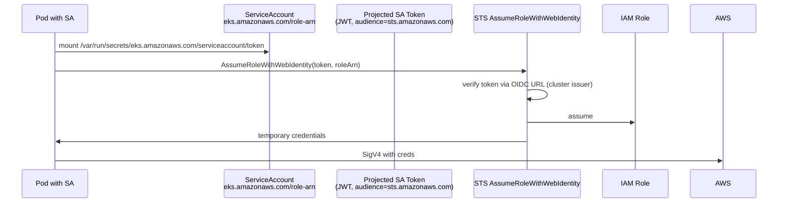

# IRSA / Pod Identity

> Pod 가 AWS API 호출할 때 IAM Role 사용. 2 방식: **IRSA** (OIDC, 2018+) / **Pod Identity** (Agent, 2023+, 권장).

## 1. 비교

| | IRSA (OIDC) | Pod Identity |
| --- | --- | --- |
| 출시 | 2018 | 2023 |
| 구조 | OIDC provider + ServiceAccount annotation | Pod Identity Agent DaemonSet |
| Cross-account | 복잡 | 간단 (Association API) |
| Cluster 마다 OIDC URL | ✓ (등록 필요) | ✗ |
| Cluster 마다 trust policy | ✓ | ✗ (한 Role 여러 cluster) |
| Fargate | ✓ | ✓ (2024+) |
| 비용 | 무료 | 무료 |
| 권장 | legacy / cross-cloud | ★ 신규 |

## 2. IRSA 동작



## 3. IRSA 설정

### 1) OIDC provider
```bash
eksctl utils associate-iam-oidc-provider --cluster bkurs-prod --approve

# 또는 aws iam create-open-id-connect-provider ...
```

### 2) IAM Role + Trust Policy
```json
{
  "Version": "2012-10-17",
  "Statement": [{
    "Effect": "Allow",
    "Principal": {
      "Federated": "arn:aws:iam::123:oidc-provider/oidc.eks.ap-northeast-2.amazonaws.com/id/XXXX"
    },
    "Action": "sts:AssumeRoleWithWebIdentity",
    "Condition": {
      "StringEquals": {
        "oidc.eks.ap-northeast-2.amazonaws.com/id/XXXX:sub": "system:serviceaccount:prod:api-sa",
        "oidc.eks.ap-northeast-2.amazonaws.com/id/XXXX:aud": "sts.amazonaws.com"
      }
    }
  }]
}
```

### 3) ServiceAccount annotation
```yaml
apiVersion: v1
kind: ServiceAccount
metadata:
  name: api-sa
  namespace: prod
  annotations:
    eks.amazonaws.com/role-arn: arn:aws:iam::123:role/BkursAPIRole
```

### 4) Pod 에 SA 지정
```yaml
spec:
  serviceAccountName: api-sa
  containers: [...]
```

## 4. eksctl 한 줄

```bash
eksctl create iamserviceaccount --cluster bkurs-prod \
  --namespace prod --name api-sa \
  --role-name BkursAPIRole \
  --attach-policy-arn arn:aws:iam::aws:policy/AmazonS3ReadOnlyAccess \
  --approve
```

## 5. Pod Identity (2023+)

### 1) Pod Identity Agent Add-on
```bash
aws eks create-addon --cluster-name bkurs-prod --addon-name eks-pod-identity-agent
```

### 2) Trust Policy
```json
{
  "Version": "2012-10-17",
  "Statement": [{
    "Effect": "Allow",
    "Principal": { "Service": "pods.eks.amazonaws.com" },
    "Action": ["sts:AssumeRole", "sts:TagSession"]
  }]
}
```

### 3) Association API
```bash
aws eks create-pod-identity-association --cluster-name bkurs-prod \
  --namespace prod \
  --service-account api-sa \
  --role-arn arn:aws:iam::123:role/BkursAPIRole
```

### 4) ServiceAccount (no annotation 필요)
```yaml
apiVersion: v1
kind: ServiceAccount
metadata: { name: api-sa, namespace: prod }
```

→ Pod Identity Agent (`169.254.170.23`) 가 credential 발급.

## 6. Pod Identity 장점

| | IRSA | Pod Identity |
| --- | --- | --- |
| Trust policy 가 cluster-specific OIDC | ✓ | ✗ (한 role → 여러 cluster) |
| 새 cluster 마다 trust 수정 | ✓ | ✗ |
| Annotation 필요 | ✓ | ✗ |
| Cross-account | 복잡 | 간단 |
| Audit (CloudTrail) | role 이름만 | + cluster + namespace + SA tag |

## 7. Session Tag (Pod Identity)

자동 session tag:
- `eks-cluster-arn`
- `kubernetes-namespace`
- `kubernetes-service-account`
- `kubernetes-pod-name`

```json
"Condition": {
  "StringEquals": {
    "aws:RequestTag/kubernetes-namespace": "prod"
  }
}
```

→ namespace 별 권한 ABAC.

## 8. Java/Spring 사용

```yaml
# Deployment
spec:
  template:
    spec:
      serviceAccountName: api-sa
      containers:
        - name: app
          image: bkurs-be:v1
          env:
            - name: AWS_REGION
              value: ap-northeast-2
```

Java SDK 자동 — `DefaultCredentialsProvider` 가 ContainerCredentialsProvider (Pod Identity) 또는 WebIdentityTokenCredentialsProvider (IRSA) 사용.

## 9. 흔한 Use Case

| Workload | 권한 |
| --- | --- |
| ALB Controller | elasticloadbalancing:*, ec2:*, acm:* (관리됨) |
| External DNS | route53:* |
| EBS CSI | ec2:CreateVolume, ec2:Attach* |
| Karpenter | ec2:RunInstances, iam:PassRole, sqs:* |
| Cluster Autoscaler | autoscaling:* |
| FluentBit | logs:CreateLog*, logs:PutLogEvents |
| Spring Boot api | s3:GetObject, secretsmanager:GetSecretValue |

## 10. IRSA → Pod Identity Migration

```bash
# 둘 다 동시 활성 가능 — annotation + Association
# 점진적으로 Association 추가 후 annotation 제거
```

## 11. 흔한 함정

| 함정 | 회피 |
| --- | --- |
| OIDC provider 등록 안 함 | eksctl utils associate-iam-oidc-provider |
| sub 의 SA name 오타 | system:serviceaccount:NS:SA |
| audience 누락 | sts.amazonaws.com |
| SA 의 serviceAccountName 누락 | spec.serviceAccountName |
| Permission boundary 없음 | escalation 차단 |
| Pod Identity Agent add-on 미설치 | enable |
| IRSA + Node Role (legacy) 혼용 | node role 의 권한 축소 |

## 12. Audit

```bash
aws cloudtrail lookup-events \
  --lookup-attributes AttributeKey=EventName,AttributeValue=AssumeRoleWithWebIdentity \
  --max-items 50

aws cloudtrail lookup-events \
  --lookup-attributes AttributeKey=Username,AttributeValue=BkursAPIRole
```

## 13. 다음

- ▶ [[02-rbac-and-aws-auth]]
- ▶ [[03-image-and-runtime]]
- ▶ [[../practice/03-irsa-app-end-to-end]]

## 14. 영상 / 자료

| 자료 |
| --- |
| [IRSA 공식](https://docs.aws.amazon.com/eks/latest/userguide/iam-roles-for-service-accounts.html) |
| [Pod Identity 발표](https://aws.amazon.com/blogs/containers/amazon-eks-pod-identity-a-new-way-for-applications-on-eks-to-obtain-iam-credentials/) |

## 15. 참고

- [[../eks]]
- [[../../iam/iam]]
- [[../../ec2/05-security/01-iam-instance-profile]]
