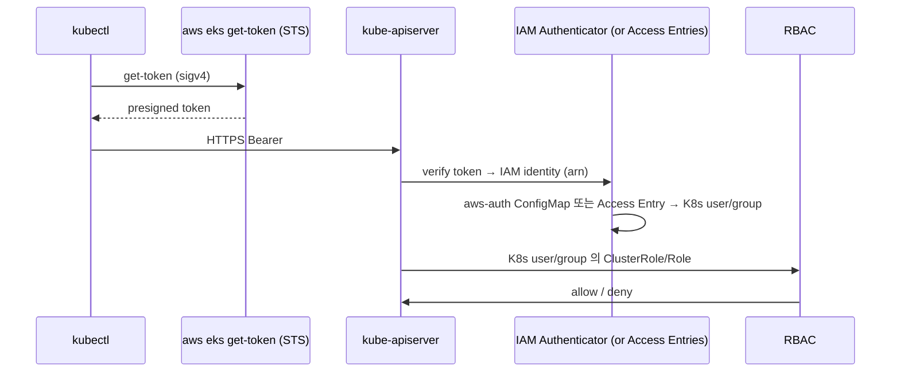

# K8s RBAC + AWS IAM → EKS Access

> K8s 표준 RBAC + IAM ↔ K8s user 매핑. **Access Entries (2023+)** 가 aws-auth (legacy) 대체.

## 1. 인증 흐름



## 2. K8s RBAC 객체

| 객체 | scope | 역할 |
| --- | --- | --- |
| **ClusterRole** | cluster | API 권한 (cluster-wide) |
| **Role** | namespace | API 권한 (namespace) |
| **ClusterRoleBinding** | cluster | ClusterRole ↔ User/Group |
| **RoleBinding** | namespace | Role / ClusterRole ↔ User/Group |

```yaml
# ClusterRole
apiVersion: rbac.authorization.k8s.io/v1
kind: ClusterRole
metadata: { name: viewer }
rules:
  - apiGroups: [""]
    resources: [pods, services]
    verbs: [get, list, watch]
---
# RoleBinding (namespace)
apiVersion: rbac.authorization.k8s.io/v1
kind: RoleBinding
metadata: { name: viewer-prod, namespace: prod }
subjects:
  - kind: Group
    name: dev-readonly
    apiGroup: rbac.authorization.k8s.io
roleRef:
  kind: ClusterRole
  name: viewer
  apiGroup: rbac.authorization.k8s.io
```

## 3. aws-auth ConfigMap (legacy)

`kube-system/aws-auth`:
```yaml
apiVersion: v1
kind: ConfigMap
metadata: { name: aws-auth, namespace: kube-system }
data:
  mapRoles: |
    - rolearn: arn:aws:iam::123:role/eks-node-role
      username: system:node:{{EC2PrivateDNSName}}
      groups: [system:bootstrappers, system:nodes]
    - rolearn: arn:aws:iam::123:role/Developer
      username: developer-{{SessionName}}
      groups: [dev-readonly]
  mapUsers: |
    - userarn: arn:aws:iam::123:user/alice
      username: alice
      groups: [cluster-admin-mirror]
```

### 단점
- ConfigMap 망가지면 **모든 admin 잃음** (복구 어려움)
- IAM admin 이 K8s admin 자동 ✗
- 권한 변경 시 ConfigMap 편집 (typo 위험)
- audit 빈약

## 4. EKS Access Entries (2023+)

aws-auth 대체:
```bash
aws eks create-access-entry --cluster-name bkurs-prod \
  --principal-arn arn:aws:iam::123:role/Developer \
  --type STANDARD \
  --kubernetes-groups dev-readonly

aws eks associate-access-policy --cluster-name bkurs-prod \
  --principal-arn arn:aws:iam::123:role/Developer \
  --policy-arn arn:aws:eks::aws:cluster-access-policy/AmazonEKSViewPolicy \
  --access-scope type=namespace,namespaces=prod
```

### 장점
- API / Console 로 변경 (ConfigMap 망가질 일 X)
- AWS managed policy (4종) 즉시 사용
- Namespace scope 제한
- CloudTrail audit 자동

## 5. AWS managed access policies

| Policy | 권한 |
| --- | --- |
| `AmazonEKSClusterAdminPolicy` | cluster admin (모든 API) |
| `AmazonEKSAdminPolicy` | namespace 내 admin |
| `AmazonEKSEditPolicy` | namespace 내 read/write |
| `AmazonEKSViewPolicy` | namespace 내 read-only |
| `AmazonEMRJobPolicy` | EMR on EKS job 실행 |

→ K8s RBAC manifest 안 만들어도 됨.

## 6. Authentication Mode (2023+)

```bash
aws eks update-cluster-config --name bkurs-prod \
  --access-config "authenticationMode=API_AND_CONFIG_MAP"
```

| Mode | 의미 |
| --- | --- |
| `CONFIG_MAP` | aws-auth 만 (legacy) |
| `API_AND_CONFIG_MAP` | 둘 다 (Migration) |
| `API` | Access Entries 만 (권장) |

> 신규 cluster = `API` 권장.

## 7. Cluster Creator 권한

Cluster 생성한 IAM principal 이 **자동으로** Access Entry `AmazonEKSClusterAdminPolicy`. CloudFormation / IaC 로 만든 경우 그 Role 이 admin.

## 8. SSO / IAM Identity Center 통합

```yaml
# Access Entry 의 principal 은 IAM role / user 둘 다 OK
# SSO PermissionSet → IAM Role (assume)
# Access Entry: arn:aws:iam::123:role/aws-reserved/sso.amazonaws.com/AWSReservedSSO_Developer_xxx
```

## 9. 흔한 RBAC 패턴

```yaml
# 1. Developer (namespace 한정)
#    - prod namespace 의 pod/log 만 read
#    - dev namespace 의 모든 권한
# 2. SRE (cluster-wide)
#    - 모든 namespace read + cluster node 관리
# 3. CI/CD Service Account
#    - 특정 namespace 의 deploy update
# 4. Audit user
#    - 모든 namespace read-only
```

## 10. Group → K8s ClusterRole

```yaml
# dev-readonly group 에 모든 namespace read
apiVersion: rbac.authorization.k8s.io/v1
kind: ClusterRoleBinding
metadata: { name: dev-readonly-binding }
subjects:
  - kind: Group
    name: dev-readonly
    apiGroup: rbac.authorization.k8s.io
roleRef:
  kind: ClusterRole
  name: view     # K8s default ClusterRole
  apiGroup: rbac.authorization.k8s.io
```

K8s default ClusterRole: `cluster-admin`, `admin`, `edit`, `view`.

## 11. ServiceAccount 의 RBAC

```yaml
# Pod 가 K8s API 호출할 때 (예: 카르펜터 Controller)
apiVersion: rbac.authorization.k8s.io/v1
kind: ClusterRoleBinding
metadata: { name: karpenter-binding }
subjects:
  - kind: ServiceAccount
    name: karpenter
    namespace: karpenter
roleRef:
  kind: ClusterRole
  name: karpenter
  apiGroup: rbac.authorization.k8s.io
```

## 12. Audit log

```bash
# Control plane audit log → CloudWatch /aws/eks/bkurs-prod/cluster
aws logs filter-log-events \
  --log-group-name /aws/eks/bkurs-prod/cluster \
  --filter-pattern '{ $.user.username = "kubernetes-admin" && $.verb = "delete" }'
```

→ 누가 어떤 K8s 리소스 삭제했는지 추적.

## 13. 흔한 함정

| 함정 | 회피 |
| --- | --- |
| aws-auth 망가짐 = admin 잃음 | Access Entries 로 이전 |
| Cluster creator IAM 분실 | secondary admin 사전 등록 |
| `cluster-admin` 남발 | namespace 단위 권한 |
| SA 가 default → 자동 token | automountServiceAccountToken: false |
| Audit log 비활성 | 활성 필수 |
| Group 이름 typo | sub 정확히 |

## 14. SSO Best practice

```
SSO Permission Set:    "Developer", "Admin", "SRE"
  ↓ (assume)
IAM Role:              AWSReservedSSO_Developer_xxx
  ↓ (Access Entry)
K8s Group:             dev-readonly
  ↓ (RBAC)
ClusterRole/Role
```

## 15. 다음

- ▶ [[03-image-and-runtime]]
- ▶ [[../practice/03-irsa-app-end-to-end]]
- ▶ [[../../iam/iam]]

## 16. 영상 / 자료

| 자료 |
| --- |
| [Access Entries 발표](https://aws.amazon.com/blogs/containers/amazon-eks-introduces-eks-access-entries/) |
| [K8s RBAC 공식](https://kubernetes.io/docs/reference/access-authn-authz/rbac/) |

## 17. 참고

- [[../eks]]
- [[01-irsa-pod-identity]]
- [[../04-operations/03-troubleshooting]]
