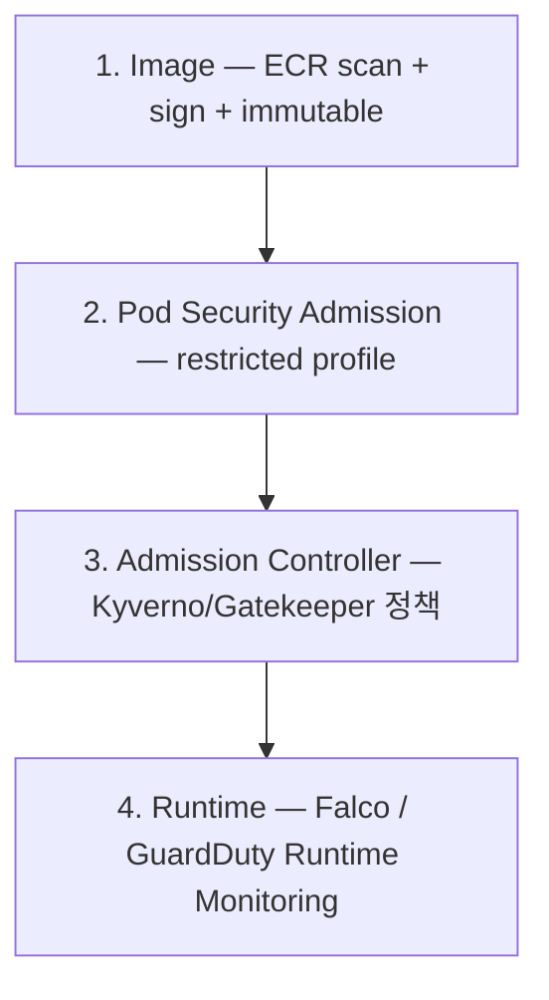

# EKS Image + Runtime Security

> Image (ECR + sign + scan) + Pod Security (PSA) + Admission Controller (Kyverno/Gatekeeper) + Runtime (Falco/GuardDuty).

## 1. layer



## 2. Image — ECR

[[../../ecs/05-security/04-image-security]] 와 동일 원칙:
- ECR `scanOnPush=true` + Enhanced (Inspector)
- IMMUTABLE tag
- Cosign sign + verify
- distroless / chainguard 베이스
- non-root user
- SBOM (syft + grype)

EKS 에서 verify:
```yaml
# Kyverno policy
apiVersion: kyverno.io/v1
kind: ClusterPolicy
metadata: { name: verify-signature }
spec:
  validationFailureAction: enforce
  rules:
    - name: verify
      match:
        any:
          - resources: { kinds: [Pod] }
      verifyImages:
        - imageReferences: ["123.dkr.ecr.ap-northeast-2.amazonaws.com/*"]
          attestors:
            - entries:
                - keys:
                    publicKeys: |-
                      -----BEGIN PUBLIC KEY-----
                      ...
                      -----END PUBLIC KEY-----
```

## 3. Pod Security Admission (PSA)

K8s 1.25+ default — PSP 의 후속.

```yaml
apiVersion: v1
kind: Namespace
metadata:
  name: prod
  labels:
    pod-security.kubernetes.io/enforce: restricted
    pod-security.kubernetes.io/audit: restricted
    pod-security.kubernetes.io/warn: restricted
```

3 profile:
- `privileged` — 제한 없음
- `baseline` — 합리적 default
- `restricted` — 가장 엄격 (production 권장)

`restricted` 의 강제:
- runAsNonRoot
- readOnlyRootFilesystem (권장)
- no privileged
- no hostPath
- seccompProfile RuntimeDefault
- ALL capabilities drop

## 4. Kyverno — policy engine

```bash
helm install kyverno kyverno/kyverno -n kyverno --create-namespace
```

```yaml
# Image 가 회사 ECR 만 허용
apiVersion: kyverno.io/v1
kind: ClusterPolicy
metadata: { name: allowed-registries }
spec:
  validationFailureAction: enforce
  rules:
    - name: validate-registries
      match: { any: [{ resources: { kinds: [Pod] } }] }
      validate:
        message: "Only images from company ECR are allowed."
        pattern:
          spec:
            containers:
              - image: "123.dkr.ecr.ap-northeast-2.amazonaws.com/*"
---
# Resource limits 필수
apiVersion: kyverno.io/v1
kind: ClusterPolicy
metadata: { name: require-resources }
spec:
  validationFailureAction: enforce
  rules:
    - name: validate-resources
      match: { any: [{ resources: { kinds: [Pod] } }] }
      validate:
        message: "Resources are required."
        pattern:
          spec:
            containers:
              - resources:
                  requests:
                    cpu: "?*"
                    memory: "?*"
                  limits:
                    cpu: "?*"
                    memory: "?*"
```

## 5. OPA Gatekeeper

```bash
helm install gatekeeper gatekeeper/gatekeeper -n gatekeeper-system --create-namespace
```

```yaml
# ConstraintTemplate
apiVersion: templates.gatekeeper.sh/v1
kind: ConstraintTemplate
metadata: { name: k8srequiredlabels }
spec:
  crd:
    spec:
      names: { kind: K8sRequiredLabels }
      validation:
        openAPIV3Schema:
          type: object
          properties:
            labels:
              type: array
              items: { type: string }
  targets:
    - target: admission.k8s.gatekeeper.sh
      rego: |
        package k8srequiredlabels
        violation[{"msg": msg}] {
          required := input.parameters.labels
          missing := required[_]
          not input.review.object.metadata.labels[missing]
          msg := sprintf("missing label: %v", [missing])
        }
---
apiVersion: constraints.gatekeeper.sh/v1beta1
kind: K8sRequiredLabels
metadata: { name: require-owner }
spec:
  match:
    kinds: [{ apiGroups: [""], kinds: [Namespace] }]
  parameters:
    labels: ["owner", "environment"]
```

## 6. Kyverno vs Gatekeeper

| | Kyverno | Gatekeeper |
| --- | --- | --- |
| 언어 | YAML | Rego (학습 필요) |
| 시작 | 빠름 | 가파름 |
| Mutating webhook | ✓ | ✗ (validate only) |
| Image verify | native | 별도 |
| 권장 | 시작 / 일반 | 큰 cluster + 복잡 정책 |

## 7. Runtime — Falco

eBPF 기반 runtime intrusion detection:
```bash
helm install falco falcosecurity/falco -n falco --create-namespace \
  --set driver.kind=ebpf \
  --set tty=true
```

기본 rule:
- Container 안에서 shell 실행
- Sensitive file 접근 (/etc/shadow, ~/.aws/credentials)
- crypto miner pattern
- 비정상 network outbound
- 권한 escalation

## 8. GuardDuty Runtime Monitoring

```bash
aws guardduty update-organization-configuration --auto-enable NEW \
  --features '[{"Name":"RUNTIME_MONITORING","Status":"ENABLED","AdditionalConfiguration":[{"Name":"EKS_ADDON_MANAGEMENT","Status":"ENABLED"}]}]'
```

→ AWS native runtime threat detection (Falco 대안).

## 9. Image Pull Secret 최소화

ECR + IRSA → imagePullSecrets 불필요. private 외부 registry 일 때만:
```yaml
imagePullSecrets:
  - name: ghcr-secret
```

## 10. Network Policy 와 결합

[[../03-networking/03-network-policy]] — east-west traffic 차단 + Calico GlobalNetworkPolicy 로 IMDS (169.254.169.254) 차단 (SSRF 방어).

## 11. Sealed Secrets / External Secrets

K8s Secret 의 base64 만 사용 → git 노출 위험. 대안:

### External Secrets Operator (권장)
```yaml
apiVersion: external-secrets.io/v1beta1
kind: SecretStore
metadata: { name: aws-secrets, namespace: prod }
spec:
  provider:
    aws:
      service: SecretsManager
      region: ap-northeast-2
      auth:
        jwt:
          serviceAccountRef: { name: external-secrets-sa }
---
apiVersion: external-secrets.io/v1beta1
kind: ExternalSecret
metadata: { name: db-secret, namespace: prod }
spec:
  secretStoreRef: { name: aws-secrets, kind: SecretStore }
  target: { name: db-secret }
  data:
    - secretKey: DB_PASSWORD
      remoteRef: { key: bkurs-be/prod/db, property: password }
```

→ Secrets Manager → K8s Secret 자동 sync.

### AWS Secrets Manager + Parameter Store CSI Driver
```bash
helm install secrets-store-csi-driver-provider-aws secrets-store-csi-driver-provider-aws/secrets-store-csi-driver-provider-aws
```

```yaml
volumeMounts:
  - name: secrets
    mountPath: /mnt/secrets
volumes:
  - name: secrets
    csi:
      driver: secrets-store.csi.k8s.io
      readOnly: true
      volumeAttributes:
        secretProviderClass: bkurs-secrets
```

## 12. seccomp / AppArmor / SELinux

```yaml
securityContext:
  seccompProfile: { type: RuntimeDefault }
  runAsNonRoot: true
  runAsUser: 10001
  fsGroup: 10001
  readOnlyRootFilesystem: true
  allowPrivilegeEscalation: false
  capabilities: { drop: ["ALL"] }
```

→ Pod 의 syscall / capabilities 제한.

## 13. CIS Benchmark

```bash
kube-bench run --targets node,policies,managedservices
```

→ CIS EKS Benchmark 자동 검증.

## 14. 흔한 함정

| 함정 | 회피 |
| --- | --- |
| `privileged: true` 남발 | restricted PSA |
| Image scan ✗ | ECR Enhanced + admission verify |
| Secret 평문 K8s Secret | External Secrets + KMS encryption-config |
| Runtime monitoring ✗ | Falco 또는 GuardDuty |
| RuntimeClass 미설정 | gVisor / Kata 옵션 |
| automountServiceAccountToken=true 모든 pod | false 명시 |

## 15. 다음

- ▶ [[../practice/01-cluster-with-fargate]]
- ▶ [[../practice/02-karpenter-and-alb-ingress]]
- ▶ [[../practice/03-irsa-app-end-to-end]]

## 16. 영상 / 자료

| 자료 |
| --- |
| [Kyverno](https://kyverno.io) |
| [Falco](https://falco.org) |
| [Pod Security Admission](https://kubernetes.io/docs/concepts/security/pod-security-admission/) |
| [External Secrets Operator](https://external-secrets.io) |

## 17. 참고

- [[../eks]]
- [[01-irsa-pod-identity]]
- [[02-rbac-and-aws-auth]]
- [[../../ecs/05-security/04-image-security]]
