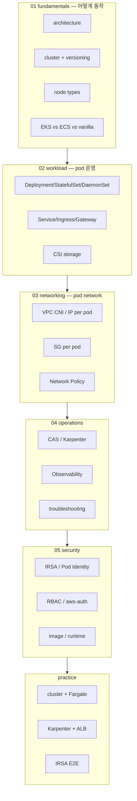
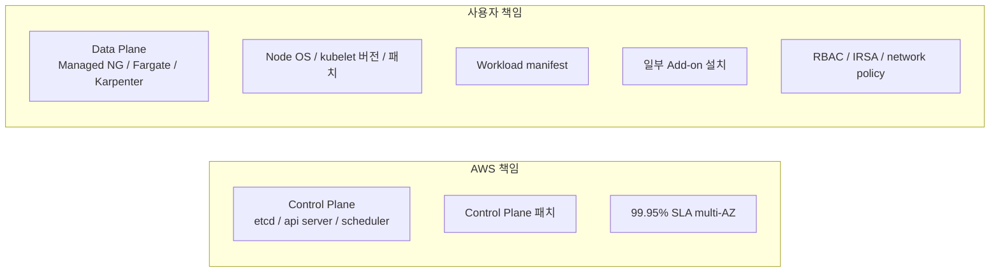
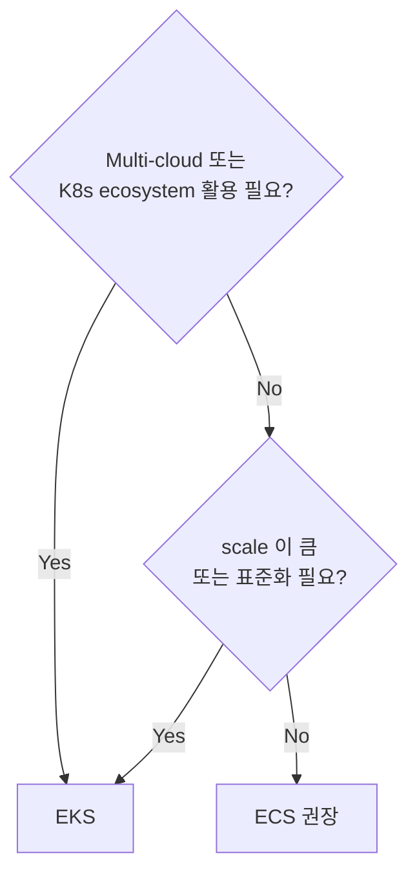

# AWS EKS — Elastic Kubernetes Service

> **Managed Kubernetes** control plane + 사용자가 정한 data plane (EC2 / Fargate / Karpenter). vanilla K8s 와 100% API 호환.

**[[../compute|↑ Compute]]** · **[[../../cloud-aws|↑↑ AWS]]**

---

## 1. 한 줄

```
EKS Control Plane (Managed, multi-AZ, AWS 운영)
   ├─ etcd / kube-apiserver / scheduler / controller-manager
   └─ AWS 가 패치 / 백업 / 가용성 99.95% SLA

Data Plane (사용자가 정함)
   ├─ Managed Node Group (EC2)
   ├─ Self-managed Node (EC2 직접)
   ├─ Fargate (serverless pod)
   └─ Karpenter (just-in-time provisioning)
```

## 2. 학습 roadmap



## 3. Sub-directory index

### [[01-fundamentals/01-architecture]] — Control plane + Data plane + 통신
Managed control plane (multi-AZ etcd / api server), VPC ENI 로 cluster 와 통신.

### [[01-fundamentals/02-cluster-and-versioning]] — Version skew / Upgrade / Add-ons
K8s release cycle / EKS 14개월 지원 / version skew 정책 / EKS managed add-on.

### [[01-fundamentals/03-node-types]] — Managed Node Group / Self / Fargate / Karpenter
4 옵션 비교 + 권장 (Karpenter + Fargate 혼합).

### [[01-fundamentals/04-eks-vs-ecs-vs-vanilla-k8s]] — 결정 기준
ecosystem / cost / 운영 부담 / multi-cloud 관점.

### [[02-workload/01-pod-deployment]] — Deployment / StatefulSet / DaemonSet / Job
workload type + replica / rolling / canary (Argo Rollouts / Flagger).

### [[02-workload/02-service-and-ingress]] — Service / AWS Load Balancer Controller / Gateway API
ClusterIP / NodePort / LoadBalancer + Ingress (ALB controller) + Gateway API.

### [[02-workload/03-storage-csi]] — EBS CSI / EFS CSI / S3 CSI / FSx CSI
PersistentVolume / StorageClass / dynamic provisioning.

### [[03-networking/01-vpc-cni-and-pod-network]] — VPC CNI / ENI Trunking / Prefix Delegation
pod 가 VPC IP 직접 (no overlay), Trunking 으로 dense placement.

### [[03-networking/02-security-group-per-pod]] — SecurityGroupPolicy CRD
pod 마다 SG 분리 (sensitive workload).

### [[03-networking/03-network-policy]] — Calico / Cilium
namespace / label 기반 east-west 차단.

### [[04-operations/01-autoscaling-cas-karpenter]] — Cluster Autoscaler vs Karpenter
ASG-based CAS (legacy) vs Karpenter (just-in-time, 권장).

### [[04-operations/02-observability-cloudwatch-prom]] — Container Insights / ADOT / Prometheus
metric / log / trace 통합.

### [[04-operations/03-troubleshooting]] — Pod / Node / Network 문제
kubectl describe + Events + node logs + VPC CNI debug.

### [[05-security/01-irsa-pod-identity]] — IRSA (OIDC) vs Pod Identity (2023)
service account → IAM role mapping 2 방식.

### [[05-security/02-rbac-and-aws-auth]] — K8s RBAC + EKS Access Entries
aws-auth ConfigMap (legacy) → Access Entries (2023+).

### [[05-security/03-image-and-runtime]] — ECR + admission control + runtime
sig verify / Kyverno / Gatekeeper / Falco.

### [[practice/01-cluster-with-fargate]] — eksctl + Fargate Profile (30분)
첫 cluster, Fargate Profile, kubectl get pods.

### [[practice/02-karpenter-and-alb-ingress]] — Karpenter + ALB Ingress (60분)
Karpenter 설치 + NodePool + 부하 → just-in-time provisioning + ALB Ingress.

### [[practice/03-irsa-app-end-to-end]] — Spring Boot + IRSA + RDS (90분)
OIDC provider + ServiceAccount + S3/RDS 통합.

## 4. 핵심 개념

| 개념 | 1줄 |
| --- | --- |
| Control Plane | Managed (etcd / api server / scheduler / controller) |
| Data Plane | EC2 / Fargate / Karpenter 선택 |
| Cluster | 1 EKS cluster = 1 K8s 환경 (control + data) |
| Pod | 1+ container, 같은 IP / volume 공유 |
| Node | Pod 가 실행되는 EC2 (또는 Fargate microVM) |
| Service | Pod 묶음의 가상 IP (ClusterIP / NodePort / LB) |
| Ingress | HTTP layer 7 → ALB Controller 로 ALB 자동 생성 |
| Namespace | 리소스 격리 (RBAC quota network policy) |
| Add-on | AWS managed VPC CNI / CoreDNS / kube-proxy / EBS CSI |
| IRSA | ServiceAccount ↔ IAM Role OIDC mapping |
| Pod Identity | IRSA 의 후속 (2023, agent 기반) |

## 5. EKS 의 책임 분담



> Managed Node Group 으로 일부 책임 위임. Fargate 가 가장 많이 위임.

## 6. EKS vs ECS

| | EKS | ECS |
| --- | --- | --- |
| 표준 | Kubernetes | AWS 독자 |
| 학습 곡선 | 가파름 | 완만 |
| Multi-cloud | ✓ | ✗ |
| Ecosystem | 거대 (Helm / Argo / Istio) | AWS 한정 |
| 비용 | $0.10/cluster·h + node | cluster free + node |
| 운영 부담 | ↑↑ | ↓ |
| 권장 | scale 이 큼 / multi-cloud / 표준화 | 작음~중간 / AWS 만 |

자세히 → [[01-fundamentals/04-eks-vs-ecs-vs-vanilla-k8s]] / [[../ecs/01-fundamentals/04-ecs-vs-eks-vs-lambda]]

## 7. 비용 구조

| 항목 | 가격 |
| --- | --- |
| Control Plane | $0.10/cluster/h ($73/월) |
| Node (EC2) | EC2 가격 + EBS |
| Fargate Pod | vCPU + RAM 시간 ([[../ecs/01-fundamentals/03-fargate-deep]]) |
| Extended Support (구버전) | $0.50/h 추가 ($365/월) |
| NAT / ALB / Logs | 각각 |

> 24x7 production = control plane만 $73/월 부담. dev/staging share 권장.

## 8. EKS Auto Mode (2024+)

**Karpenter + Pod Identity + managed add-on 통합 모드** — AWS 가 node lifecycle 까지 관리.

```bash
eksctl create cluster --name auto-cluster --enable-auto-mode
```

장점: 운영 부담 ↓↓. 단점: 일부 customization 제한.

## 9. bkurs-be 의 EKS 선택?



bkurs-be 현재: **ECS Fargate 권장** (작은 팀, AWS 한정, ecosystem 불필요).

> EKS 가 의미 있는 시점: 다른 cluster (GKE / on-prem) 가 있거나, Argo / Istio / KEDA 같은 K8s 전용 도구가 필요할 때.

## 10. 영상 / 자료

| 자료 |
| --- |
| [EKS Deep Dive — re:Invent](https://www.youtube.com/watch?v=2nMhd6JJG2A) |
| [EKS Auto Mode 발표](https://aws.amazon.com/blogs/aws/streamline-kubernetes-cluster-management-with-new-amazon-eks-auto-mode/) |
| [Kubernetes 공식 documentation](https://kubernetes.io/docs/) |
| [EKS Workshop](https://www.eksworkshop.com/) |

## 11. 관련 hub

- [[../compute]]
- [[../ecs/ecs]] — 대안
- [[../lambda/lambda]] — 대안
- [[../ec2/ec2]] — node 토대
- [[../ecr/ecr]] — image
- [[../../network/vpc/vpc]]
- [[../../iam/iam]]
