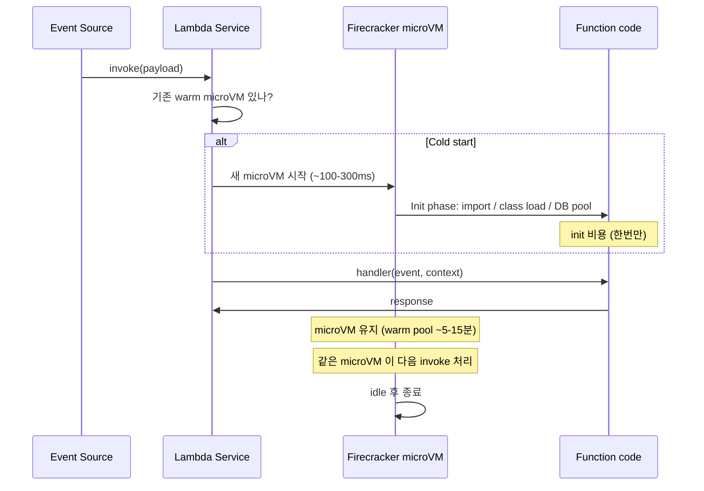
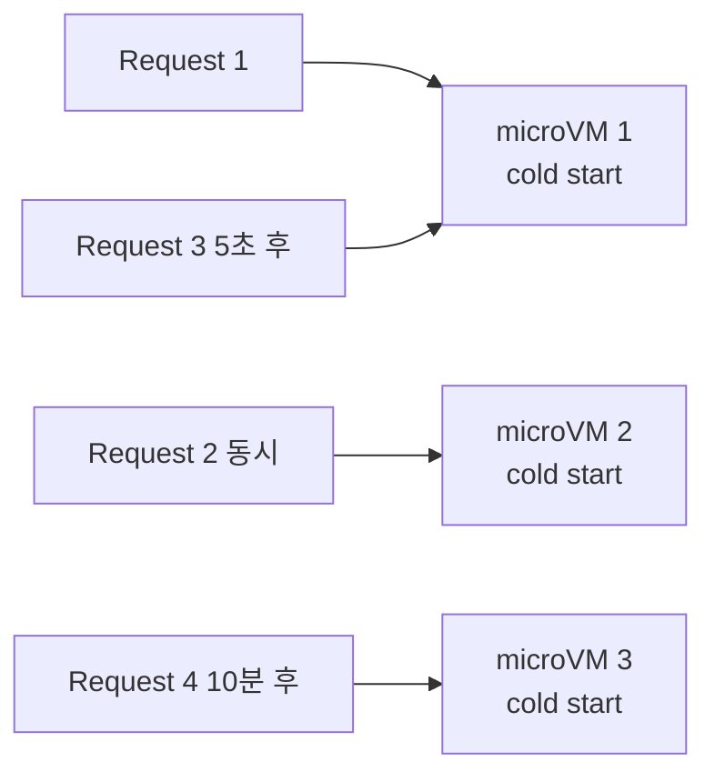
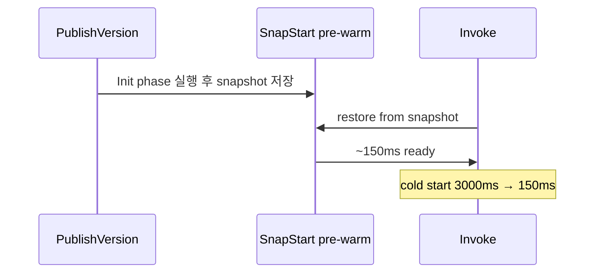

# Lambda Execution Model

> Firecracker microVM + Init phase + Invoke phase. Cold start vs Warm 의 의미 + SnapStart 로 Java cold start 10배 감소.

## 1. Lifecycle



## 2. Cold Start 구성

```
Cold start = Download code + Init runtime + Init function code

전형적 시간:
- Node.js / Python:   100-500ms
- Java / .NET:        500-3000ms (JVM 시작)
- Container image:    1-5s (image pull + extract)
- Java + SnapStart:   < 200ms (snapshot restore)
```

## 3. Warm Start

```
같은 concurrency 안에서 다음 invoke = microVM 재사용
- 글로벌 변수 / DB connection 유지됨
- /tmp 도 유지됨 (~5분-15분, AWS 가 idle 종료)
```

→ **Best practice — 글로벌 scope 에 무거운 init (DB connection / SDK client)**.

```python
# /tmp 와 module scope 의 차이
import boto3
s3 = boto3.client("s3")        # cold start 시 한번만 (좋음)

def handler(event, context):
    obj = s3.get_object(...)    # 매 invoke (정상)
```

## 4. Firecracker microVM

Open source KVM-based hypervisor. AWS 가 발명.

| Firecracker | 일반 VM | Container |
| --- | --- | --- |
| 시작 시간 | ~125ms | ~10s | ~50ms |
| 격리 | hardware | hardware | namespace |
| memory overhead | ~5MB | ~50MB | ~5MB |
| 보안 | ★★★ | ★★★ | ★★ |

→ ECS Fargate 도 Firecracker 위.

## 5. Concurrency 영향



→ Concurrent 요청마다 새 microVM. 같은 시점 N 동시 = N cold start.

## 6. SnapStart (Java 한정)

> Firecracker snapshot + restore — Init phase 의 결과 (loaded class / objects) 를 snapshot → restore 100ms.

```bash
aws lambda update-function-configuration --function-name bkurs-job \
  --snap-start ApplyOn=PublishedVersions
```



> Spring Boot + AWS SDK = SnapStart 효과 매우 큼. 다만 `random` / DB connection / 시계 의존 코드 대응 필요 (Runtime hook).

## 7. Init 시점 의 글로벌 작업

```java
public class Handler {
    static AmazonS3 s3;
    static DataSource ds;

    static {
        s3 = AmazonS3ClientBuilder.standard().build();
        ds = HikariDataSource(...);   // SnapStart 시 connection 재생성 필요
    }

    public Response handle(Request event, Context ctx) {
        ...
    }
}
```

> SnapStart 시 `static` 블록은 snapshot 시 1번 + restore 시 hook 으로 갱신 가능.

## 8. /tmp 의 활용

- 512MB ~ 10GB (configurable)
- microVM 살아있는 동안 유지
- 다른 invocation 에서도 같은 /tmp (warm)
- 새 microVM = 빈 /tmp

```python
import os
CACHE = "/tmp/cache.pkl"

def handler(event, context):
    if not os.path.exists(CACHE):
        # 큰 file S3 에서 download
        s3.download_file(..., CACHE)
    ...
```

## 9. 메모리 / CPU 비례

Lambda 의 CPU 는 memory 비례:
```
128 MB ≈ 0.08 vCPU
1769 MB = 1 vCPU
10240 MB ≈ 6 vCPU
```

CPU intensive 작업: memory ↑ = 빠름 = 비용 비슷 (시간 줄어듦).

→ Lambda Power Tuning (tool) 으로 최적 memory 자동 찾기.

## 10. Init phase 한도

```
Init phase max:  10초 (timeout 강제)
Init phase 비용: provisioned concurrency 일 때만 과금
Init phase 무료: on-demand (cold start) — Init 비용 무료 (boot 시간)
```

> on-demand cold start 의 Init 시간은 client 가 기다리지만 과금은 0 (Invoke 만).

## 11. Provisioned Concurrency

미리 warm:
```bash
aws lambda put-provisioned-concurrency-config --function-name bkurs-api \
  --qualifier 1 --provisioned-concurrent-executions 5
```

- cold start = 0
- 비용 = $0.0000041667/GB-s (사용 안 해도)

자세히 → [[../03-runtime/01-concurrency-and-scaling]]

## 12. 흔한 함정

| 함정 | 회피 |
| --- | --- |
| Java cold start 3s+ | SnapStart |
| 글로벌 scope 안 활용 | client / pool 글로벌화 |
| /tmp 가 비어있다고 가정 | warm 시 재사용 가능성 / 매번 check |
| Init 비용 무시 | 무거운 import 줄이기 |
| Provisioned Concurrency 24x7 | 적시 schedule + ECS 비교 |
| SnapStart 시 random 고정 | restore hook 으로 reseed |

## 13. 다음

- ▶ [[02-runtime-and-deployment]]
- ▶ [[03-pricing-and-limits]]
- ▶ [[../03-runtime/01-concurrency-and-scaling]]

## 14. 영상 / 자료

| 자료 |
| --- |
| [Lambda Internals Firecracker — re:Invent](https://www.youtube.com/watch?v=0_jfH6qijVY) |
| [SnapStart 발표](https://aws.amazon.com/blogs/aws/new-accelerate-your-lambda-functions-with-lambda-snapstart/) |
| [Lambda Power Tuning](https://github.com/alexcasalboni/aws-lambda-power-tuning) |

## 15. 참고

- [[../lambda]]
- [[../../ecs/01-fundamentals/03-fargate-deep]]
