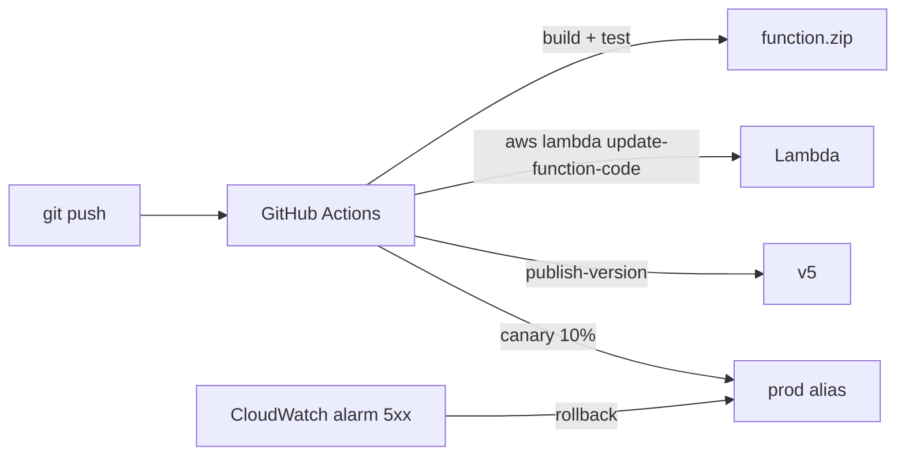

# Lambda Runtime + Deployment

> Managed runtime 7+ / Custom runtime / Container image (up to 10GB). zip + Layers / SAM / CDK / Terraform.

## 1. Managed runtime

| 종류 | EOL 정책 |
| --- | --- |
| Node.js 20 / 22 | Active |
| Python 3.10 / 3.11 / 3.12 / 3.13 | Active |
| Java 17 / 21 | Active |
| .NET 8 | Active |
| Ruby 3.3 | Active |
| Go (provided.al2) | custom runtime |
| Rust | custom runtime |

> 일반 = managed runtime + zip. Java SnapStart 가능.

```bash
aws lambda create-function --function-name bkurs-job \
  --runtime python3.12 \
  --handler app.lambda_handler \
  --role arn:aws:iam::...:role/lambda-role \
  --zip-file fileb://function.zip \
  --memory-size 512 --timeout 30 \
  --architectures arm64
```

## 2. ARM64 (Graviton)

```bash
--architectures arm64
```

- ARM64 = x86 대비 -20% 가격 + 19% 빠름
- 거의 모든 Python / Node / Java 호환
- native binary (Rust / Go) 는 ARM 빌드 필요

## 3. Custom runtime

`/var/runtime/bootstrap` 가 직접 Runtime API 호출:
```bash
#!/bin/sh
while true
do
  EVENT=$(curl -s http://$AWS_LAMBDA_RUNTIME_API/2018-06-01/runtime/invocation/next)
  RESULT=$(./my-rust-app "$EVENT")
  curl -X POST -d "$RESULT" http://$AWS_LAMBDA_RUNTIME_API/2018-06-01/runtime/invocation/$REQ_ID/response
done
```

활용: Rust / OCaml / Lua / shell.

## 4. Container Image

```dockerfile
FROM public.ecr.aws/lambda/python:3.12

COPY requirements.txt .
RUN pip install -r requirements.txt

COPY app.py ${LAMBDA_TASK_ROOT}

CMD ["app.lambda_handler"]
```

```bash
aws ecr get-login-password | docker login --username AWS --password-stdin 123.dkr.ecr...
docker build -t bkurs-fn:v1 .
docker tag bkurs-fn:v1 123.dkr.ecr.../bkurs-fn:v1
docker push 123.dkr.ecr.../bkurs-fn:v1

aws lambda create-function --function-name bkurs-fn \
  --package-type Image \
  --code ImageUri=123.dkr.ecr.../bkurs-fn:v1 \
  --role arn:... \
  --memory-size 1024 --timeout 60
```

| | zip | Container |
| --- | --- | --- |
| 한도 | 50 MB (zip) / 250 MB (unzip) | 10 GB |
| Layer | ✓ | ✗ |
| OS package | ✗ | ✓ |
| Cold start | 빠름 | ~1-5초 첫 호출 |
| 권장 | 일반 | 큰 dep / ML / native binary |

## 5. Lambda Layers

공통 dependency / runtime / library 를 별도 zip:

```bash
# Layer 만들기 (Python)
mkdir python && cd python
pip install -r requirements.txt -t .
cd ..
zip -r layer.zip python

aws lambda publish-layer-version --layer-name bkurs-common \
  --description "Spring + JDBC" \
  --zip-file fileb://layer.zip \
  --compatible-runtimes python3.12 \
  --compatible-architectures arm64

# Function 에 attach
aws lambda update-function-configuration --function-name bkurs-fn \
  --layers arn:aws:lambda:ap-northeast-2:123:layer:bkurs-common:1
```

한도:
- Function 당 5 Layer
- Layer + function zip 합쳐서 250 MB unzipped

활용:
- 공통 dependency 재사용
- Lambda Extension (DataDog / Splunk / AWS Powertools)
- 별도 SDK 버전

## 6. Lambda Extensions

External process 가 main handler 와 lifecycle 공유 — `/opt/extensions/` 위치:
```bash
#!/bin/sh
# Extension lifecycle
REQUEST=$(curl ... /2020-01-01/extension/register)
EXTENSION_ID=$(echo $REQUEST | jq -r ...)

while true
do
  EVENT=$(curl -s -H "Lambda-Extension-Identifier: $EXTENSION_ID" \
    http://$AWS_LAMBDA_RUNTIME_API/2020-01-01/extension/event/next)
  # ... log forward / monitoring
done
```

활용:
- 외부 monitoring (Datadog / NewRelic / Splunk)
- Secret cache
- Configuration

## 7. Versioning + Alias

```bash
# 새 version 발행 (immutable)
aws lambda publish-version --function-name bkurs-fn

# Alias
aws lambda create-alias --function-name bkurs-fn --name prod --function-version 5

# Alias 의 weighted routing (canary)
aws lambda update-alias --function-name bkurs-fn --name prod \
  --function-version 5 \
  --routing-config "AdditionalVersionWeights={\"6\"=0.1}"
```

→ 10% traffic 을 version 6 로 (canary).

## 8. Deployment 도구

### AWS SAM

```yaml
AWSTemplateFormatVersion: '2010-09-09'
Transform: AWS::Serverless-2016-10-31
Resources:
  Function:
    Type: AWS::Serverless::Function
    Properties:
      Handler: app.lambda_handler
      Runtime: python3.12
      MemorySize: 512
      Architectures: [arm64]
      Timeout: 30
      Environment:
        Variables: { LOG_LEVEL: INFO }
      Events:
        Api:
          Type: HttpApi
          Properties: { Path: /, Method: ANY }
        Cron:
          Type: Schedule
          Properties: { Schedule: rate(5 minutes) }
      Policies:
        - S3ReadPolicy: { BucketName: bkurs-data }
```

```bash
sam build
sam deploy --guided
```

### Serverless Framework
```yaml
service: bkurs
provider:
  name: aws
  runtime: python3.12
  architecture: arm64
functions:
  hello:
    handler: app.handler
    events:
      - httpApi: '*'
```

### CDK
```typescript
new lambda.Function(this, 'Fn', {
  runtime: lambda.Runtime.PYTHON_3_12,
  architecture: lambda.Architecture.ARM_64,
  handler: 'app.lambda_handler',
  code: lambda.Code.fromAsset('src'),
  memorySize: 512,
  timeout: cdk.Duration.seconds(30),
  layers: [layer],
  tracing: lambda.Tracing.ACTIVE,
});
```

### Terraform
```hcl
resource "aws_lambda_function" "fn" {
  function_name    = "bkurs-fn"
  filename         = "function.zip"
  handler          = "app.lambda_handler"
  runtime          = "python3.12"
  architectures    = ["arm64"]
  memory_size      = 512
  timeout          = 30
  role             = aws_iam_role.lambda.arn
  source_code_hash = filebase64sha256("function.zip")
}
```

## 9. CI/CD 패턴



## 10. SAM Accelerate (dev)

```bash
sam sync --watch --stack-name bkurs-dev
```

→ code 변경 시 자동 deploy (수초). dev only.

## 11. 흔한 함정

| 함정 | 회피 |
| --- | --- |
| zip > 250MB | container image |
| Java cold start | SnapStart + arm64 |
| Layer 의 path 오타 (`python/` prefix) | runtime 별 path 따름 |
| version publish 없이 alias | 항상 publish-version |
| arm64 미사용 | 호환 시 ARM |
| Extension 비용 인지 못함 | duration 늘어남 |

## 12. 다음

- ▶ [[03-pricing-and-limits]]
- ▶ [[04-lambda-vs-ecs-vs-stepfn]]
- ▶ [[../03-runtime/02-environment-and-layers]]

## 13. 영상 / 자료

| 자료 |
| --- |
| [SAM 공식](https://docs.aws.amazon.com/serverless-application-model/) |
| [Lambda Container Image](https://docs.aws.amazon.com/lambda/latest/dg/images-create.html) |
| [Powertools](https://docs.powertools.aws.dev) |

## 14. 참고

- [[../lambda]]
- [[01-execution-model]]
