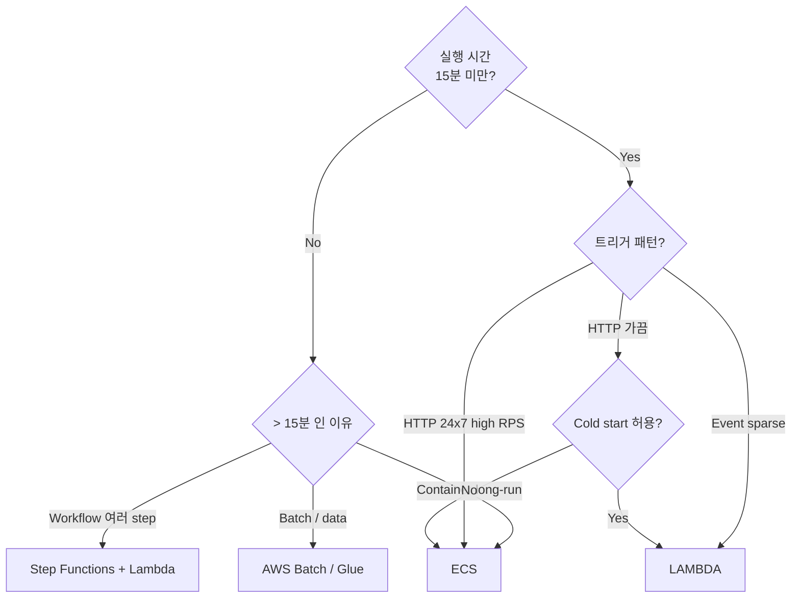
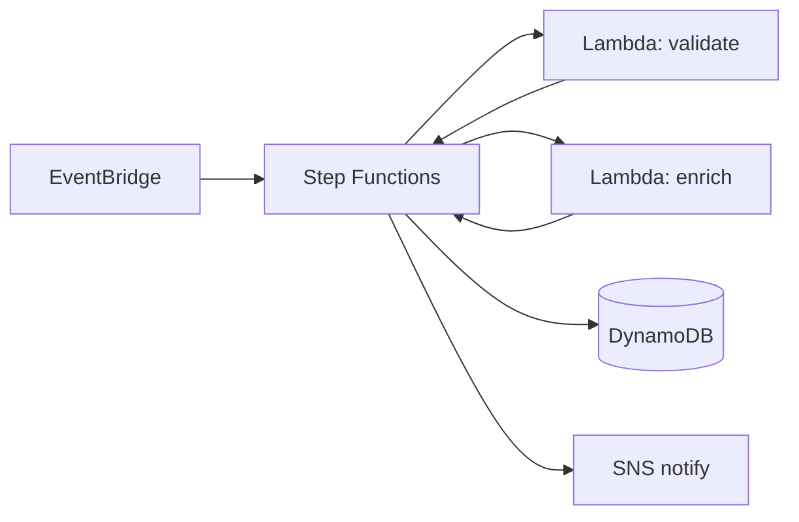

# Lambda vs ECS vs Step Functions

> 짧고 단순 = Lambda / 24x7 HTTP = ECS / 복잡한 workflow = Step Functions + Lambda.

## 1. 결정 트리



## 2. 비교 표

| | Lambda | ECS Fargate | Step Functions |
| --- | --- | --- | --- |
| 단위 | function | container | state machine |
| 최대 시간 | 15분 | ∞ | Standard 1년 / Express 5분 |
| 패키지 한도 | 250 MB zip / 10 GB image | image (수 GB) | — (Lambda dependent) |
| Cold start | 100-3000ms | 30-120s startup | — |
| 가격 모델 | invocation + GB-s | vCPU/RAM 시간 | state transition |
| 동시 처리 | 1000+ (regional) | task 수 | distributed map 무제한 |
| HTTP 지원 | API GW / ALB / FunctionURL | ALB direct | API GW 통합 |
| WebSocket | API GW WebSocket | ALB sticky / native | ✗ |
| Stateful | ✗ | ✗ (외부 DB) | ✓ (state machine) |

## 3. 시나리오별

### 시나리오 A — REST API (RPS 100, latency p99 < 200ms)

**ECS Fargate 권장**:
- 24x7 부하 → ECS 가 싸다
- Cold start 0
- Connection pool / cache 유지
- Lambda + Provisioned Concurrency 도 가능하지만 비용 동등

### 시나리오 B — Image resize on S3 upload

**Lambda 권장**:
- 이벤트 sparse
- 짧은 시간 (~수초)
- 자동 scaling

### 시나리오 C — Order processing pipeline (validate → charge → ship → notify)

**Step Functions + Lambda 권장**:
- 각 step 이 별도 lambda
- retry / error handling 선언적
- visual workflow
- 1년 까지 long-running OK

### 시나리오 D — ML training (4시간 GPU)

**ECS Fargate / EC2 / SageMaker**:
- Lambda 15분 한도
- GPU 필요
- Step Functions 로 SageMaker job 호출도 가능

### 시나리오 E — Cron 매일 03:00 backup

**Lambda + EventBridge**:
- 간단
- 무료 tier 가까움
- 큰 dataset 이면 ECS Fargate Task scheduled

### 시나리오 F — Daily ETL (S3 → DDB)

**Glue / Step Functions Distributed Map + Lambda**:
- 큰 dataset 분산 처리
- Lambda 단독은 timeout 위험

## 4. 비용 비교 (실제)

### 시나리오 A — 100 RPS sustained 24x7
```
Lambda 100ms × 256MB:
  100 × 86400 × 30 × 0.1s × 0.25 GB × $0.0000133333
  = $86.4
+ 260M req × $0.20/1M = $52
= $138/월

ECS Fargate 2 vCPU + 4GB × 2 task:
  2 × ($0.04048 + $0.004445) × 2 task × 730h = $130/월

거의 동일. 단, latency 는 ECS 가 ↓.
```

### 시나리오 B — Image resize, 1M event/월
```
Lambda 1s × 512MB:
  1M × 1s × 0.5GB × $0.0000133333 = $6.7
+ 1M - 1M free = $0
= $6.7/월

ECS Fargate 0.5 vCPU × 2 task 24x7:
  2 × $19 = $38/월

Lambda 압승.
```

## 5. 운영 부담

| | Lambda | ECS | Step Functions |
| --- | --- | --- | --- |
| 인프라 관리 | 0 | 중 | 0 |
| Scaling | 자동 | Application Auto Scaling | 자동 |
| 모니터링 | CloudWatch 기본 | Container Insights | Step Functions Console |
| 배포 | sam / cdk | task definition + service | state machine |
| 학습 곡선 | ↓ | 중 | 중 (ASL 또는 visual) |

## 6. Step Functions 의 강점

```json
{
  "StartAt": "Validate",
  "States": {
    "Validate": {
      "Type": "Task",
      "Resource": "arn:aws:states:::lambda:invoke",
      "Parameters": { "FunctionName": "validate", "Payload.$": "$" },
      "Retry": [{ "ErrorEquals": ["States.ALL"], "MaxAttempts": 3, "BackoffRate": 2 }],
      "Catch": [{ "ErrorEquals": ["States.ALL"], "Next": "Notify-Error" }],
      "Next": "Choice"
    },
    "Choice": {
      "Type": "Choice",
      "Choices": [
        { "Variable": "$.kind", "StringEquals": "express", "Next": "ChargeImmediate" }
      ],
      "Default": "ChargeAsync"
    },
    "ChargeImmediate": { ... },
    "ChargeAsync":     { ... }
  }
}
```

→ Lambda 만으로 짜기 복잡한 흐름이 declarative.

## 7. Express vs Standard Workflow

| | Standard | Express |
| --- | --- | --- |
| 시간 | 1년 | 5분 |
| 비용 | state transition 단위 | execution duration + memory |
| Replay (history) | ✓ | △ (CloudWatch log) |
| 활용 | long-running orchestration | high-volume short workflow |

## 8. Lambda + Step Functions 패턴



## 9. bkurs-be 의 권장

```
API (HTTP request response):     ECS Fargate
S3 image resize:                  Lambda (S3 trigger)
일주일 통계:                       Lambda (EventBridge cron)
회원가입 workflow (verify → notify):  Step Functions + Lambda
admin webhook:                     Lambda + API Gateway
audit archive (daily):             Lambda + EventBridge
DLQ retry:                         Lambda + SQS
```

→ 적재적소. **모든 것을 Lambda 만 / ECS 만 하지 않기**.

## 10. 흔한 잘못

| 잘못 | 사실 |
| --- | --- |
| "Lambda 가 무조건 싸다" | 24x7 high RPS = ECS 가 싸다 |
| "Lambda 만 쓰면 서버리스" | API GW / DDB / SNS / SQS 도 다 서버리스 |
| "Step Functions 는 비싸다" | Express + Distributed Map 으로 효율적 |
| "Lambda 는 microservice" | function 1 ≠ microservice 1 |
| "Lambda 가 Cold start 때문에 못 씀" | SnapStart / Provisioned Concurrency |

## 11. 다음

- ▶ [[../02-triggers/01-async-trigger]]
- ▶ [[../02-triggers/02-sync-trigger]]
- ▶ [[../02-triggers/03-stream-poller]]

## 12. 영상 / 자료

| 자료 |
| --- |
| [Step Functions 공식](https://docs.aws.amazon.com/step-functions/) |
| [Express vs Standard](https://docs.aws.amazon.com/step-functions/latest/dg/concepts-standard-vs-express.html) |

## 13. 참고

- [[../lambda]]
- [[../../ecs/01-fundamentals/04-ecs-vs-eks-vs-lambda]]
- [[../../eks/01-fundamentals/04-eks-vs-ecs-vs-vanilla-k8s]]
