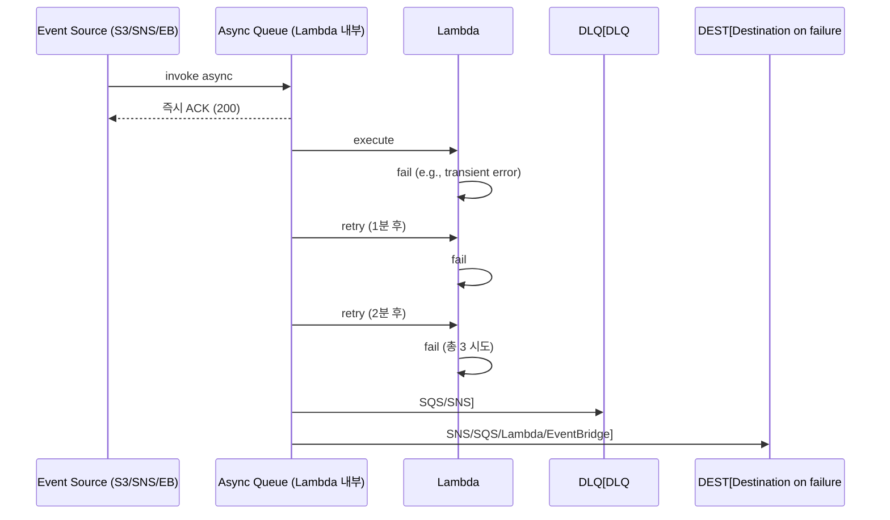

# Lambda Async Trigger

> S3 / SNS / EventBridge / SES / CloudWatch Logs — Lambda 가 invoke 받고 즉시 ACK. **2 retry + DLQ + Destination**.

## 1. Async invocation 의 동작



| 옵션 | 의미 |
| --- | --- |
| Retry max | 0 / 1 / 2 (default 2) |
| Max event age | 60-6시간 (default 6h) |
| DLQ | failed event 마지막 dump (SQS / SNS) |
| Destination | 성공/실패 시 다음 service 호출 |

## 2. S3 Event

```bash
aws lambda add-permission --function-name image-resize \
  --statement-id s3-trigger --action lambda:InvokeFunction \
  --principal s3.amazonaws.com \
  --source-arn arn:aws:s3:::bkurs-uploads

aws s3api put-bucket-notification-configuration --bucket bkurs-uploads \
  --notification-configuration '{
    "LambdaFunctionConfigurations": [{
      "LambdaFunctionArn": "arn:aws:lambda:...:function:image-resize",
      "Events": ["s3:ObjectCreated:*"],
      "Filter": { "Key": { "FilterRules": [
        { "Name": "prefix", "Value": "raw/" },
        { "Name": "suffix", "Value": ".jpg" }
      ]}}
    }]
  }'
```

### Lambda 코드 (Python)
```python
import boto3
s3 = boto3.client("s3")

def lambda_handler(event, context):
    for record in event["Records"]:
        bucket = record["s3"]["bucket"]["name"]
        key    = record["s3"]["object"]["key"]
        # 처리
```

### 한계
- S3 → 1 Lambda per event 보장 X (rare duplicate)
- Object Key 의 URL encoding 주의
- 큰 bucket = throttle 가능

## 3. EventBridge (CloudWatch Events 후속)

```bash
aws events put-rule --name nightly-cron \
  --schedule-expression "cron(0 18 * * ? *)" \
  --description "nightly 03:00 KST (UTC 18:00)"

aws events put-targets --rule nightly-cron \
  --targets "Id=1,Arn=arn:lambda:...:function:nightly-job"

aws lambda add-permission --function-name nightly-job \
  --statement-id eb-cron --action lambda:InvokeFunction \
  --principal events.amazonaws.com \
  --source-arn arn:aws:events:...:rule/nightly-cron
```

### 활용
- Cron (`cron(...)` / `rate(5 minutes)`)
- AWS service event (EC2 state, CodePipeline, GuardDuty, ...)
- Custom event (PutEvents API)
- SaaS partner event (Datadog, Salesforce, ...)

### Event Pattern
```yaml
EventPattern:
  source: [aws.ec2]
  detail-type: ["EC2 Instance State-change Notification"]
  detail:
    state: ["stopped", "terminated"]
Targets:
  - Arn: arn:lambda:...:function:notify-discord
```

### EventBridge Pipes
Source (SQS / Kinesis / DDB / MQ) → Filter → Enrich (Lambda / Step Functions) → Target (Lambda / SNS / SQS / Logs)

```bash
aws pipes create-pipe --name bkurs-pipe \
  --source arn:sqs:... --target arn:lambda:... \
  --source-parameters '{"filterCriteria":{"filters":[{"pattern":"{\"body\":{\"type\":[\"order\"]}}"}]}}'
```

## 4. SNS

```bash
aws sns subscribe --topic-arn arn:sns:...:bkurs-events \
  --protocol lambda --notification-endpoint arn:lambda:...:function:event-handler

aws lambda add-permission --function-name event-handler \
  --statement-id sns --action lambda:InvokeFunction \
  --principal sns.amazonaws.com \
  --source-arn arn:sns:...:bkurs-events
```

### Lambda 코드
```python
def lambda_handler(event, context):
    for record in event["Records"]:
        msg = json.loads(record["Sns"]["Message"])
        # 처리
```

### SNS message attribute filtering
Subscription 의 filter policy:
```json
{ "type": ["order", "refund"] }
```

→ Lambda 는 type=order/refund 인 메시지만 받음.

## 5. SES

이메일 수신 시 Lambda 호출:
```
SES Receiving Rule → S3 + Lambda
```

활용: 이메일 자동 처리 (auto-reply / ticket 생성).

## 6. CloudWatch Logs Subscription

```bash
aws logs put-subscription-filter \
  --log-group-name /aws/lambda/bkurs-api \
  --filter-name ErrorFilter \
  --filter-pattern "ERROR" \
  --destination-arn arn:lambda:...:function:error-handler
```

→ Log 의 ERROR pattern → Lambda → Discord 알림.

## 7. DLQ

```bash
# SQS DLQ 생성
aws sqs create-queue --queue-name lambda-dlq

# Lambda 에 attach
aws lambda put-function-event-invoke-config --function-name image-resize \
  --destination-config "OnFailure={Destination=arn:sqs:...:lambda-dlq}"
```

failed event payload + error 가 DLQ 로 → 수동 처리 / 재시도.

## 8. Destination

Success / Failure 각각 다음 step:
```bash
aws lambda put-function-event-invoke-config --function-name image-resize \
  --destination-config '{
    "OnSuccess": { "Destination": "arn:sns:...:image-success" },
    "OnFailure": { "Destination": "arn:sqs:...:image-failure" }
  }'
```

## 9. Idempotency

같은 event 가 여러 번 invoke 될 수 있음:
```python
# Powertools idempotency
from aws_lambda_powertools.utilities.idempotency import idempotent
@idempotent
def lambda_handler(event, context):
    ...
```

→ DDB 에 idempotency key 기록 → 중복 무시.

## 10. Retry behavior 차이

| Trigger | Lambda async retry | Source retry |
| --- | --- | --- |
| S3 | 2회 | ✗ (event 한번만 발행) |
| SNS | 2회 + retries-by-SNS (subscription 별) | yes |
| EventBridge | 2회 + retries-by-EB (24h, retry policy) | yes |
| SES / SES Pipe | 2회 | ✗ |

## 11. EventBridge vs SNS

| | SNS | EventBridge |
| --- | --- | --- |
| 패턴 매칭 | message attribute 필터 | rich event pattern |
| Cross-account | ✓ | ✓ |
| Cross-region | manual replication | ✓ (Global Endpoint) |
| Schema registry | ✗ | ✓ |
| Throughput | 매우 ↑ | 매우 ↑ |
| 가격 | $0.50/1M | $1/1M custom + AWS event 무료 |
| 권장 | fan-out, simple | event-driven, complex routing |

## 12. 흔한 함정

| 함정 | 회피 |
| --- | --- |
| Retry 2회 끝 → 사일런트 손실 | DLQ + alarm |
| Idempotency 안 함 → 중복 부작용 | Powertools idempotency |
| S3 URL-encoded key | URL decode |
| Lambda permission 누락 → SourceArn 검증 | add-permission |
| EventBridge cron UTC | 한국 KST -9h |
| Async timeout 6시간 모름 | max event age |

## 13. 다음

- ▶ [[02-sync-trigger]]
- ▶ [[03-stream-poller]]
- ▶ [[../03-runtime/01-concurrency-and-scaling]]

## 14. 영상 / 자료

| 자료 |
| --- |
| [Async invocation 공식](https://docs.aws.amazon.com/lambda/latest/dg/invocation-async.html) |
| [EventBridge 공식](https://docs.aws.amazon.com/eventbridge/) |
| [Lambda Powertools Idempotency](https://docs.powertools.aws.dev/lambda/python/latest/utilities/idempotency/) |

## 15. 참고

- [[../lambda]]
- [[../../messaging/eventbridge/eventbridge]]
- [[../../messaging/sns/sns]]
