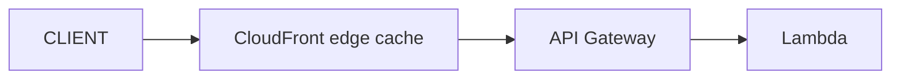

# Lambda Sync Trigger

> 3 HTTP endpoint: **API Gateway** (full feature) / **ALB** (간단) / **Function URL** (가장 단순). 동기 응답 6 MB 한도.

## 1. 3 옵션 비교

| | API Gateway | ALB | Function URL |
| --- | --- | --- | --- |
| Setup 복잡도 | ↑↑ | 중 | ↓ |
| Auth | Cognito / IAM / Lambda Authorizer | Cognito / OIDC | IAM / NONE |
| Throttling | per stage / per API key | ✗ | ✗ |
| Routing | path + method 정교 | path 기반 | 단일 endpoint |
| WebSocket | ✓ (별도 API) | ✗ | ✗ |
| Caching | ✓ | ✗ | ✗ |
| Edge (CloudFront 통합) | ✓ | ✗ | ✗ |
| Request Validation | ✓ (JSON Schema) | ✗ | ✗ |
| Usage Plan | ✓ | ✗ | ✗ |
| 비용 | $3.5/M REST / $1/M HTTP | ALB $20+ /월 + LCU | 무료 (Lambda 만) |
| 권장 | 외부 API / 복잡 | internal API + 다른 LB target 도 | 단순 internal |

## 2. API Gateway — HTTP API (modern)

```bash
aws apigatewayv2 create-api --name bkurs-api --protocol-type HTTP \
  --target arn:lambda:ap-northeast-2:...:function:bkurs-fn

# Route 추가
aws apigatewayv2 create-route --api-id xxx \
  --route-key "GET /api/v1/users/{id}" \
  --target integrations/integration-id
```

### SAM 으로
```yaml
Resources:
  Api:
    Type: AWS::Serverless::HttpApi
    Properties:
      StageName: prod
      CorsConfiguration:
        AllowOrigins: ["https://bkurs.com"]
        AllowHeaders: ["*"]
        AllowMethods: ["GET","POST"]
  Function:
    Type: AWS::Serverless::Function
    Properties:
      Handler: app.handler
      Events:
        Default:
          Type: HttpApi
          Properties:
            ApiId: !Ref Api
            Path: /api/v1/{proxy+}
            Method: ANY
```

## 3. API Gateway — REST API (full feature)

| 기능 | HTTP API | REST API |
| --- | --- | --- |
| 가격 | $1/M | $3.5/M |
| Latency | ↓ | ↑ |
| Lambda Authorizer | ✓ | ✓ |
| Resource Policy | ✓ | ✓ |
| Request validation | ✗ | ✓ |
| Caching | ✗ | ✓ |
| Method-level throttling | ✗ | ✓ |
| API Key + Usage Plan | ✗ | ✓ |
| Mock integration | ✗ | ✓ |
| WAF (직접) | ✗ | ✓ |
| Edge optimized | ✗ | ✓ |

> 일반 = HTTP API. 외부 paid API / 복잡 control = REST API.

### Lambda Authorizer
```python
def authorizer(event, context):
    token = event["headers"]["authorization"]
    if verify_jwt(token):
        return {
            "principalId": "user123",
            "policyDocument": {
                "Version": "2012-10-17",
                "Statement": [{
                    "Action": "execute-api:Invoke",
                    "Effect": "Allow",
                    "Resource": event["methodArn"]
                }]
            },
            "context": { "userId": "u123" }
        }
    raise Exception("Unauthorized")
```

## 4. ALB Lambda Target

```bash
aws elbv2 create-target-group --name bkurs-lambda \
  --target-type lambda

aws elbv2 register-targets --target-group-arn arn:... \
  --targets "Id=arn:lambda:...:function:bkurs-fn"

aws lambda add-permission --function-name bkurs-fn \
  --statement-id alb --action lambda:InvokeFunction \
  --principal elasticloadbalancing.amazonaws.com \
  --source-arn arn:...:targetgroup/bkurs-lambda/...
```

### 활용
- 같은 ALB 의 일부 path → Lambda, 나머지 → ECS
- internal endpoint
- VPC private ALB

### Lambda event (ALB)
```json
{
  "requestContext": { "elb": { "targetGroupArn": "..." } },
  "httpMethod": "GET",
  "path": "/api/v1/test",
  "queryStringParameters": {},
  "headers": {},
  "body": "...",
  "isBase64Encoded": false
}
```

### 응답 형식
```python
return {
    "statusCode": 200,
    "statusDescription": "200 OK",
    "isBase64Encoded": False,
    "headers": { "Content-Type": "application/json" },
    "body": json.dumps({"result": "ok"})
}
```

## 5. Function URL — 가장 단순

```bash
aws lambda create-function-url-config --function-name bkurs-fn \
  --auth-type NONE \
  --cors '{
    "AllowOrigins": ["https://bkurs.com"],
    "AllowMethods": ["GET","POST"]
  }'

# 결과
# https://abcdef123.lambda-url.ap-northeast-2.on.aws/
```

### Auth Mode
- `NONE` — public
- `AWS_IAM` — SigV4

### Response Stream (20 MB)
```python
def lambda_handler(event):
    yield "chunk1\n"
    yield "chunk2\n"
```

→ 일반 6 MB 한도 우회. ChatGPT-like streaming 응답.

## 6. CORS

```yaml
# HTTP API
CorsConfiguration:
  AllowOrigins: ["https://bkurs.com"]
  AllowMethods: ["GET","POST"]
  AllowHeaders: ["*"]
  AllowCredentials: false
  MaxAge: 600
```

> ALB / Function URL 도 같은 설정. preflight (OPTIONS) 자동 처리.

## 7. Throttling

### API Gateway HTTP API
```yaml
RouteSettings:
  /api/v1/users:
    ThrottlingBurstLimit: 100
    ThrottlingRateLimit: 50
```

### Account-level throttle
```
Lambda concurrent execution 1000 (default)
→ API Gateway 가 1000+ 초과 시 429 또는 500
```

→ Reserved Concurrency 로 critical lambda 보호 ([[../03-runtime/01-concurrency-and-scaling]]).

## 8. Request / Response 한도

| | sync (API GW / ALB / Function URL) |
| --- | --- |
| Request payload | 6 MB |
| Response payload | 6 MB |
| Function URL stream | 20 MB |
| API GW timeout | 29초 (REST/HTTP API) |
| ALB timeout | 4000초 (대기) 그러나 Lambda 15분 한도 |

> sync 호출이 15분 끝나면 client 가 끊김. async 또는 Step Functions.

## 9. CloudFront + API Gateway



→ static 응답 캐싱, edge 에서 응답.

## 10. WebSocket (API Gateway)

```yaml
Type: AWS::ApiGatewayV2::Api
Properties:
  Name: bkurs-ws
  ProtocolType: WEBSOCKET
  RouteSelectionExpression: $request.body.action
```

Lambda 가 `$connect` / `$disconnect` / custom action 처리.

## 11. Custom domain

```bash
aws apigatewayv2 create-domain-name \
  --domain-name api.bkurs.com \
  --domain-name-configurations CertificateArn=arn:acm:...

aws apigatewayv2 create-api-mapping --domain-name api.bkurs.com \
  --api-id xxx --stage prod
```

+ Route 53 A record (alias).

## 12. 흔한 함정

| 함정 | 회피 |
| --- | --- |
| ALB 의 statusDescription 누락 | 명시 |
| 6 MB 초과 응답 | Function URL stream 또는 S3 presigned |
| 29초 timeout (API GW) | 짧은 async 또는 Step Functions |
| binary 응답 base64 encode 안 함 | isBase64Encoded: true |
| WAF 없이 public | AWS WAF + API GW 통합 |
| Lambda 가 cold start → timeout | Provisioned Concurrency |
| Resource Policy 만 사용 (Lambda permission 누락) | 둘 다 |

## 13. 다음

- ▶ [[03-stream-poller]]
- ▶ [[../03-runtime/01-concurrency-and-scaling]]
- ▶ [[../04-operations/01-observability]]

## 14. 영상 / 자료

| 자료 |
| --- |
| [API Gateway HTTP vs REST](https://docs.aws.amazon.com/apigateway/latest/developerguide/http-api-vs-rest.html) |
| [Lambda Function URL](https://docs.aws.amazon.com/lambda/latest/dg/lambda-urls.html) |

## 15. 참고

- [[../lambda]]
- [[../../network/alb/alb]]
