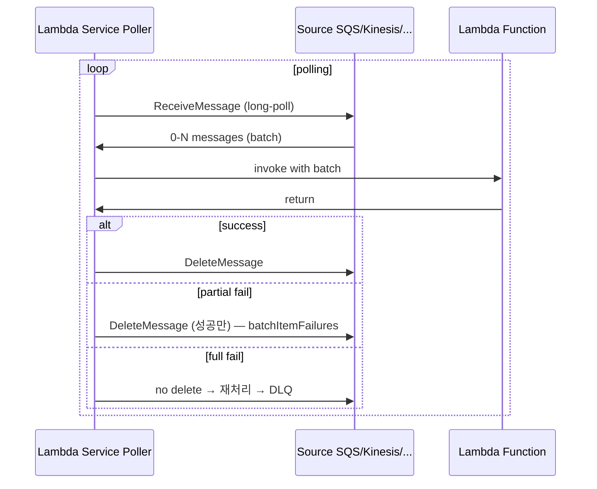

# Lambda Stream / Poller Trigger

> Lambda 가 **poll** 해서 batch 로 invoke. SQS / Kinesis / DDB Streams / Kafka / MSK / MQ.

## 1. 동작



> **사용자가 따로 poll 하지 않음**. Lambda Service 가 대신.

## 2. SQS Trigger

```bash
aws lambda create-event-source-mapping \
  --function-name worker \
  --event-source-arn arn:sqs:ap-northeast-2:...:bkurs-jobs \
  --batch-size 10 \
  --maximum-batching-window-in-seconds 5 \
  --function-response-types ReportBatchItemFailures
```

| 옵션 | 의미 |
| --- | --- |
| `batch-size` | 한 invoke 의 message 수 (max 10 standard / 10000 FIFO) |
| `maximum-batching-window-in-seconds` | batch 채우기 대기 (0-300) |
| `function-response-types` | `ReportBatchItemFailures` — partial 성공 |
| `maximum-concurrency` | SQS source 별 concurrency limit |

### batchItemFailures (partial success)
```python
def lambda_handler(event, context):
    failures = []
    for record in event["Records"]:
        try:
            process(record)
        except Exception:
            failures.append({"itemIdentifier": record["messageId"]})
    return {"batchItemFailures": failures}
```

→ 성공한 message 만 SQS 에서 삭제, 실패한 것은 재시도 / DLQ.

## 3. Kinesis / DDB Streams

```bash
aws lambda create-event-source-mapping \
  --function-name analytics \
  --event-source-arn arn:kinesis:...:stream/bkurs-events \
  --batch-size 100 \
  --starting-position LATEST \
  --parallelization-factor 10 \
  --maximum-batching-window-in-seconds 5 \
  --function-response-types ReportBatchItemFailures \
  --tumbling-window-in-seconds 60 \
  --maximum-retry-attempts 3 \
  --bisect-batch-on-function-error
```

| 옵션 | 의미 |
| --- | --- |
| `starting-position` | LATEST / TRIM_HORIZON / AT_TIMESTAMP |
| `parallelization-factor` | shard 당 lambda 수 (1-10) |
| `tumbling-window-in-seconds` | 시간 window aggregate |
| `bisect-batch-on-function-error` | 실패 시 batch 반으로 나눠 재시도 |

### shard ↔ Lambda
```
Kinesis 10 shard × parallelization 5 = 50 lambda 동시
DDB Streams 동일
```

### Tumbling Window (aggregate)
```python
def lambda_handler(event, context):
    if event.get("state"):
        # 이전 invoke 의 결과 (window 진행 중)
        sum_so_far = event["state"]["sum"]
    else:
        sum_so_far = 0

    for record in event["Records"]:
        sum_so_far += int(record["kinesis"]["data"]...)

    if event.get("isFinalInvokeForWindow"):
        # window 종료 → 결과 저장
        ddb.put_item(...)
        return {}
    else:
        # 다음 batch 로 state 넘김
        return { "state": { "sum": sum_so_far } }
```

→ 1분 window aggregate 효율적.

## 4. Kafka / MSK / Self-managed

```bash
aws lambda create-event-source-mapping \
  --function-name kafka-worker \
  --event-source-arn arn:aws:kafka:...:cluster/bkurs-msk/... \
  --topics bkurs-events \
  --batch-size 100 \
  --starting-position LATEST
```

Self-managed Kafka (AWS 외):
```bash
--self-managed-event-source 'Endpoints={KAFKA_BOOTSTRAP_SERVERS=[kafka-1:9092,kafka-2:9092]}' \
--source-access-configurations 'Type=BASIC_AUTH,URI=arn:secretsmanager:...:secret:kafka-creds' \
--topics bkurs-events
```

## 5. FIFO SQS / FIFO message group

```bash
aws lambda create-event-source-mapping \
  --event-source-arn arn:sqs:...:bkurs-jobs.fifo \
  --batch-size 10
```

→ message group 별 ordered, group 끼리는 parallel.

## 6. MQ (RabbitMQ / ActiveMQ)

```bash
aws lambda create-event-source-mapping \
  --event-source-arn arn:aws:mq:...:broker:bkurs-mq:b-xxx \
  --queues bkurs-jobs \
  --source-access-configurations 'Type=BASIC_AUTH,URI=arn:secretsmanager:...'
```

## 7. DLQ + Destinations

| Source | DLQ |
| --- | --- |
| SQS | SQS Redrive Policy → DLQ |
| Kinesis / DDB Streams | Destination on failure |
| Kafka / MSK | Destination on failure (SNS/SQS) |
| MQ | Destination on failure |

## 8. Throttle 동작

| Source | Lambda throttle 시 |
| --- | --- |
| SQS | poll 멈추고 backoff, message 보존 |
| Kinesis | shard iterator 멈춤, 데이터 보존 (24h~7일) |
| DDB Streams | 같음 |
| Kafka | offset 멈춤 |

→ source 가 자연스러운 buffer.

## 9. Partial Success — best practice

```python
from aws_lambda_powertools.utilities.batch import (
    BatchProcessor, EventType, process_partial_response
)
processor = BatchProcessor(event_type=EventType.SQS)

def record_handler(record):
    process(record.body)

def lambda_handler(event, context):
    return process_partial_response(
        event=event, record_handler=record_handler, processor=processor, context=context
    )
```

## 10. Concurrency 계산

### SQS
```
Lambda concurrency = active polled batches
Max = 1000 (account) / `maximum-concurrency` (per source)
```

### Kinesis / DDB
```
Lambda concurrency = shards × parallelization_factor
```

## 11. Polling 비용

Lambda Service 가 poll 하는 비용 = Lambda 사용자가 안 냄 (AWS managed). 단 source (SQS) 의 request 비용은 있음.

## 12. 흔한 함정

| 함정 | 회피 |
| --- | --- |
| ReportBatchItemFailures 안 함 → 1 fail = 전체 retry | partial 활성 |
| SQS visibility timeout < Lambda timeout × 6 | visibility timeout 충분히 |
| Kinesis 1 shard 한도 (1MB/s, 1000 rec/s) | shard 증가 또는 parallelization |
| DDB Streams TRIM_HORIZON 으로 첫 deploy → 옛 데이터 다 처리 | LATEST 로 시작 |
| Kafka credentials Secrets Manager 권한 누락 | Execution Role 의 secretsmanager:GetSecretValue |
| Tumbling window 의 state 무한 누적 | 시간 제한 |

## 13. 다음

- ▶ [[../03-runtime/01-concurrency-and-scaling]]
- ▶ [[../03-runtime/02-environment-and-layers]]
- ▶ [[../05-security/01-execution-role]]

## 14. 영상 / 자료

| 자료 |
| --- |
| [Event source mapping 공식](https://docs.aws.amazon.com/lambda/latest/dg/invocation-eventsourcemapping.html) |
| [Kinesis Tumbling Window](https://docs.aws.amazon.com/lambda/latest/dg/services-kinesis-windows.html) |
| [Powertools Batch](https://docs.powertools.aws.dev/lambda/python/latest/utilities/batch/) |

## 15. 참고

- [[../lambda]]
- [[../../messaging/sqs/sqs]]
