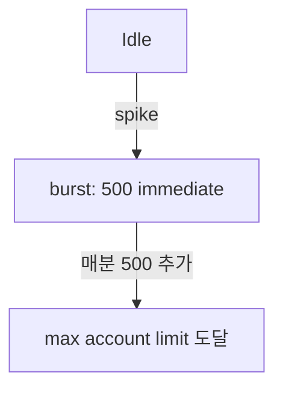

# Lambda Concurrency + Scaling

> 3 종류: **Unreserved** (default) / **Reserved** (격리) / **Provisioned** (warm). Account 한도 1000 + burst.

## 1. 개념

```
Concurrency = 같은 시점 실행 중인 Lambda 인스턴스 수
= sum(over all functions)
```

| 종류 | 의미 |
| --- | --- |
| **Account concurrent limit** | 1000 (soft, 증액 가능) |
| **Unreserved Concurrency** | account 한도 - reserved 합계 |
| **Reserved Concurrency** | function 별 예약 (격리 + 한도) |
| **Provisioned Concurrency** | 미리 warm 보장 (cold start 0) |

## 2. Reserved Concurrency

```bash
aws lambda put-function-concurrency --function-name critical-api \
  --reserved-concurrent-executions 100
```

효과:
- 이 함수만 최대 100 동시 (다른 함수 다 throttle 돼도 보장)
- 동시에 — **다른 함수 사용 가능 unreserved 가 100 줄어듦** (account-wide pool)

### 0 설정 → 함수 비활성
```bash
aws lambda put-function-concurrency --function-name old-fn \
  --reserved-concurrent-executions 0
```

→ 호출 시 throttle (긴급 차단).

## 3. Provisioned Concurrency (PC)

```bash
# version publish 먼저
aws lambda publish-version --function-name bkurs-api
# Version 5

# Alias
aws lambda create-alias --function-name bkurs-api --name prod --function-version 5

# PC 설정 (alias 또는 version 단위)
aws lambda put-provisioned-concurrency-config --function-name bkurs-api \
  --qualifier prod --provisioned-concurrent-executions 10
```

→ 10 microVM 이 항상 warm. cold start = 0.

### Auto Scaling for PC
```bash
aws application-autoscaling register-scalable-target \
  --service-namespace lambda \
  --resource-id function:bkurs-api:prod \
  --scalable-dimension lambda:function:ProvisionedConcurrency \
  --min-capacity 5 --max-capacity 50

aws application-autoscaling put-scaling-policy \
  --policy-name pc-cpu \
  --service-namespace lambda \
  --resource-id function:bkurs-api:prod \
  --scalable-dimension lambda:function:ProvisionedConcurrency \
  --policy-type TargetTrackingScaling \
  --target-tracking-scaling-policy-configuration '{
    "TargetValue": 0.7,
    "PredefinedMetricSpecification": {
      "PredefinedMetricType": "LambdaProvisionedConcurrencyUtilization"
    }
  }'
```

→ utilization 70% 목표로 자동 증감 (5-50).

## 4. Burst Concurrency (regional)

신규 요청 spike 시 immediate scale-up:
```
ap-northeast-2: 500 burst per minute
us-east-1:       3000 burst per minute
```



→ 1500 동시 invoke 가 갑자기 들어오면:
- 0~500: 즉시
- 501~1000: 1분 후
- 1001~1500: 2분 후

> burst 한도 초과 시 throttle.

## 5. SQS / Kinesis 의 동작

SQS:
```
Lambda max concurrency = max(reserved, default 1000)
SQS poller 가 자동 scale-up — 60초 내 5 batches → 더 빨리 poll
```

Kinesis:
```
Concurrency = shards × parallelization_factor (1-10)
```

## 6. 비용 시뮬레이션

```
ARM64, 256 MB, 100ms avg, 1M req/월

Unreserved:
  - $0 (concurrency 자체 비용 0)
  - 1M req × 100ms × 0.25 GB × $0.0000133333 = $0.33
  - 1M req × $0.20/1M (free tier 차감) = $0
  = $0.33 / 월

Provisioned 10 (24x7):
  - 10 × 0.25 GB × 730h × 3600s × $0.0000033333 (idle ARM)
  = $0.22 (idle, 활용해도 비슷)
  + Invocation 비용 별도

→ 24x7 sparse 호출 = unreserved 가 훨씬 싸다
→ critical low-latency = PC
```

## 7. Throttle / 502 / 429

| 증상 | 원인 |
| --- | --- |
| `429 TooManyRequestsException` | concurrency 초과 |
| `Rate Exceeded` | invocation/sec limit |
| `502 Bad Gateway` (API GW) | Lambda timeout / error |
| Cold start latency p99 spike | first invoke after idle |

## 8. CloudWatch metric

| Metric | 의미 |
| --- | --- |
| `Invocations` | 호출 수 |
| `Errors` | function error (sync return error) |
| `Duration` | execution time |
| `Throttles` | concurrency limit 초과 |
| `IteratorAge` (stream) | 폴링 지연 |
| `ConcurrentExecutions` | 현재 동시 |
| `ProvisionedConcurrencyUtilization` | PC 활용도 |
| `ProvisionedConcurrencySpilloverInvocations` | PC 넘침 (cold start 발생) |

## 9. Alarm 표준

```bash
aws cloudwatch put-metric-alarm --alarm-name bkurs-throttle \
  --metric-name Throttles --namespace AWS/Lambda \
  --statistic Sum --period 60 --evaluation-periods 5 \
  --threshold 10 --comparison-operator GreaterThanThreshold \
  --dimensions Name=FunctionName,Value=bkurs-api

# IteratorAge (Kinesis 처리 지연)
aws cloudwatch put-metric-alarm --alarm-name bkurs-kinesis-lag \
  --metric-name IteratorAge --namespace AWS/Lambda \
  --statistic Average --period 60 --evaluation-periods 3 \
  --threshold 60000  # 60초 lag
```

## 10. Quotas (account level)

```bash
aws service-quotas get-service-quota --service-code lambda \
  --quota-code L-B99A9384  # Concurrent executions

aws service-quotas request-service-quota-increase \
  --service-code lambda \
  --quota-code L-B99A9384 --desired-value 5000
```

## 11. Best practice — Reserved Concurrency 설정 패턴

```
critical-api:         200  (격리 + 보장)
batch-fn:              50  (peak 시 fixed)
admin-fn:              10
public-webhook:        20
─────────────────────────
sum reserved:         280
unreserved (account): 1000 - 280 = 720
```

→ 어느 함수도 critical-api 의 200 을 침범 못 함.

## 12. SnapStart + PC

Java 함수 = SnapStart (publishVersion 후 자동) + PC 적용 (alias 에).
```bash
aws lambda update-function-configuration --function-name bkurs-java \
  --snap-start ApplyOn=PublishedVersions
aws lambda publish-version --function-name bkurs-java
aws lambda create-alias --function-name bkurs-java --name prod --function-version 1
aws lambda put-provisioned-concurrency-config --function-name bkurs-java \
  --qualifier prod --provisioned-concurrent-executions 5
```

## 13. 흔한 함정

| 함정 | 회피 |
| --- | --- |
| Reserved 합계 > account limit → 다른 함수 throttle | 합계 모니터 |
| PC 24x7 (sparse traffic) | schedule-based PC 또는 PC 없이 |
| burst 한도 모름 → spike 실패 | 사전 warm-up |
| Throttle alarm 없음 | 위 alarm |
| SQS partial fail 없음 → 1 fail = 전체 retry | ReportBatchItemFailures |
| Kinesis IteratorAge 무시 | alarm + parallelization 증가 |

## 14. 다음

- ▶ [[02-environment-and-layers]]
- ▶ [[03-vpc-and-networking]]
- ▶ [[../04-operations/01-observability]]

## 15. 영상 / 자료

| 자료 |
| --- |
| [Concurrency 공식](https://docs.aws.amazon.com/lambda/latest/dg/lambda-concurrency.html) |
| [Provisioned Concurrency](https://docs.aws.amazon.com/lambda/latest/dg/provisioned-concurrency.html) |

## 16. 참고

- [[../lambda]]
- [[../01-fundamentals/01-execution-model]]
