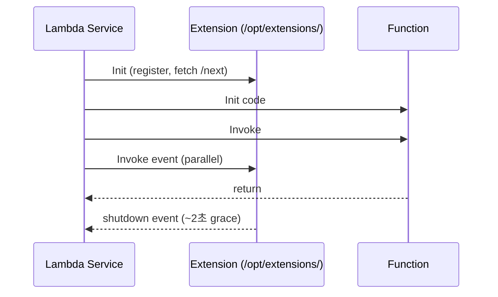

# Lambda Environment + Layers + Extensions

> Env var 4KB / Layer 5 (250 MB 합) / Extension (sidecar like). 공통 dependency 재사용 + monitoring 통합.

## 1. Environment Variables

```bash
aws lambda update-function-configuration --function-name bkurs-fn \
  --environment "Variables={LOG_LEVEL=INFO,DB_HOST=...,STAGE=prod}"
```

```python
import os
LOG_LEVEL = os.environ["LOG_LEVEL"]
```

### 한도
- 총 4 KB
- key + value 합산
- KMS 암호화 (default)

## 2. KMS 암호화 (custom key)

```bash
aws lambda update-function-configuration --function-name bkurs-fn \
  --kms-key-arn arn:aws:kms:...:key/abc
```

→ AWS managed key 대신 customer-managed key (CMK). audit / rotation.

## 3. Secrets — env 에 안 박기

```yaml
# ✗ 금지
environment: { DB_PASSWORD: "actual_password" }

# ✓ 표준 — Secrets Manager
import boto3
sm = boto3.client("secretsmanager")
secret = sm.get_secret_value(SecretId="bkurs/prod/db")
password = json.loads(secret["SecretString"])["password"]
```

또는 **AWS Parameter and Secrets Lambda Extension**:
```bash
# Layer 추가 → 자동 환경변수에서 secret 조회
aws lambda update-function-configuration --function-name bkurs-fn \
  --layers arn:aws:lambda:ap-northeast-2:738900069198:layer:AWS-Parameters-and-Secrets-Lambda-Extension:11

# 호출
curl http://localhost:2773/secretsmanager/get?secretId=bkurs/prod/db
```

→ Extension 이 cache + auto-refresh. cold start 후 secret 빠르게.

## 4. Lambda Layers

```bash
# Layer 생성 (Python)
mkdir -p python
pip install pandas numpy boto3 -t python/
zip -r layer.zip python/

aws lambda publish-layer-version --layer-name bkurs-deps \
  --description "Common Python deps" \
  --zip-file fileb://layer.zip \
  --compatible-runtimes python3.12 \
  --compatible-architectures arm64

# attach
aws lambda update-function-configuration --function-name bkurs-fn \
  --layers \
    arn:aws:lambda:...:layer:bkurs-deps:1 \
    arn:aws:lambda:738900069198:layer:AWS-Parameters-and-Secrets-Lambda-Extension:11
```

### Runtime 별 path

| Runtime | Layer path |
| --- | --- |
| Node.js | `/opt/nodejs/node_modules/` |
| Python | `/opt/python/` |
| Java | `/opt/java/lib/` |
| Ruby | `/opt/ruby/gems/` |
| Custom | `/opt/` |

→ zip 안의 directory 구조가 맞아야.

### 한도
- function 당 5 Layer
- Layer + code = 250 MB unzipped

## 5. Sharing Layers

```bash
# Layer 공개 (다른 account)
aws lambda add-layer-version-permission \
  --layer-name bkurs-deps --version-number 1 \
  --statement-id share --principal 987654321098 \
  --action lambda:GetLayerVersion

# 또는 public
--principal "*"
```

> AWS 가 제공하는 public layer: Powertools / ParametersAndSecrets / Datadog / NewRelic / etc.

## 6. Lambda Extensions

`/opt/extensions/<name>` — main handler 와 lifecycle 공유. 2 phase:



### 활용
- log forward (Datadog / NewRelic / Splunk)
- secret cache (AWS-Parameters-and-Secrets)
- config (AppConfig)
- monitoring agent

## 7. AWS Lambda Powertools

```bash
# Python
pip install aws-lambda-powertools[all]
```

```python
from aws_lambda_powertools import Logger, Tracer, Metrics
from aws_lambda_powertools.metrics import MetricUnit

logger = Logger(service="bkurs-api")
tracer = Tracer(service="bkurs-api")
metrics = Metrics(namespace="bkurs", service="api")

@tracer.capture_lambda_handler
@logger.inject_lambda_context
@metrics.log_metrics
def handler(event, context):
    logger.info("processing event", extra={"order_id": event["orderId"]})
    metrics.add_metric(name="OrderProcessed", unit=MetricUnit.Count, value=1)
    tracer.put_annotation(key="OrderId", value=event["orderId"])
    ...
```

→ 자동 structured log + X-Ray subsegment + EMF metric.

### Layer 로 (zip 안 늘림)
```bash
--layers arn:aws:lambda:ap-northeast-2:017000801446:layer:AWSLambdaPowertoolsPythonV2-Arm64:79
```

## 8. AppConfig

Dynamic configuration without redeploy:
```bash
aws lambda update-function-configuration --function-name bkurs-fn \
  --layers arn:aws:lambda:...:layer:AWS-AppConfig-Extension-Arm64:60
```

```python
import urllib.request
r = urllib.request.urlopen("http://localhost:2772/applications/bkurs/environments/prod/configurations/feature-flags")
config = json.loads(r.read())
if config["new_feature"]:
    ...
```

→ Extension 이 30초마다 AppConfig refresh.

## 9. CloudWatch Lambda Insights

```bash
--layers arn:aws:lambda:ap-northeast-2:580247275435:layer:LambdaInsightsExtension-Arm64:53
```

추가 metric:
- CPU time
- Memory utilization
- /tmp 사용량
- Network bytes

## 10. Static asset (large file)

```python
# /opt/ 안 (Layer) 또는 /tmp 안 (download)
import os
MODEL_PATH = "/opt/model.bin"   # Layer
DATA_PATH = "/tmp/data.csv"     # warm 재사용

if not os.path.exists(DATA_PATH):
    s3.download_file("bkurs", "data.csv", DATA_PATH)
```

## 11. 흔한 함정

| 함정 | 회피 |
| --- | --- |
| Secret env 평문 | Secrets Manager + Extension |
| Layer path 오타 | runtime 별 정확한 path |
| Layer 5 초과 | 통합 또는 container |
| Extension 비용 인지 못함 | Init 시간 + duration 늘어남 |
| Powertools 직접 zip | Layer 사용 |
| AppConfig polling 모름 | 30s 자동 |

## 12. 다음

- ▶ [[03-vpc-and-networking]]
- ▶ [[../04-operations/01-observability]]
- ▶ [[../05-security/02-code-signing-and-secrets]]

## 13. 영상 / 자료

| 자료 |
| --- |
| [Lambda Layers 공식](https://docs.aws.amazon.com/lambda/latest/dg/configuration-layers.html) |
| [Lambda Extensions](https://docs.aws.amazon.com/lambda/latest/dg/lambda-extensions.html) |
| [Powertools](https://docs.powertools.aws.dev) |

## 14. 참고

- [[../lambda]]
- [[../01-fundamentals/02-runtime-and-deployment]]
- [[../05-security/02-code-signing-and-secrets]]
