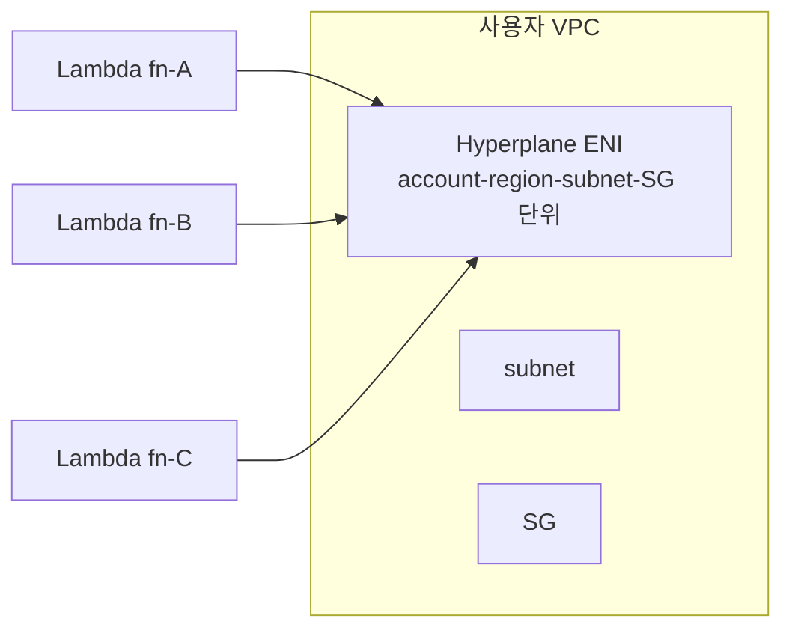

# Lambda VPC + Networking

> default = AWS-managed network (Internet OK, VPC ✗). VPC mode 활성 시 Hyperplane ENI 로 cold start 거의 없음 (2019+). VPC Endpoint 로 NAT 비용 회피.

## 1. 2 모드

| | VPC 모드 OFF (default) | VPC 모드 ON |
| --- | --- | --- |
| Network | AWS-managed (인터넷 OK) | 사용자 VPC + Hyperplane ENI |
| VPC 내부 (RDS/ElastiCache 등) 접근 | ✗ | ✓ |
| 인터넷 (외부 API) 접근 | ✓ (managed NAT) | NAT 또는 VPC Endpoint 필요 |
| Cold start 영향 | 0 | ~ms (Hyperplane 이후) |
| 비용 | 0 | NAT (대량 일 때) |
| 권장 | RDS 등 안 쓸 때 | RDS / private VPC resource 필요 시 |

## 2. VPC 모드 활성

```bash
aws lambda update-function-configuration --function-name bkurs-fn \
  --vpc-config "SubnetIds=subnet-aaa,subnet-bbb,SecurityGroupIds=sg-fn"
```

권장:
- private subnet 2+ AZ (HA)
- 작은 SG (egress 만 필요)
- VPC Endpoint 활용

## 3. Hyperplane ENI (2019+)

이전: Lambda 마다 ENI → cold start 10-60초 (ENI provision).
이후 (Hyperplane): account/region/subnet/SG 단위 shared ENI → cold start ms.



> 사용자가 따로 관리 X. 자동.

## 4. 인터넷 outbound (VPC mode)

private subnet 의 lambda → 인터넷:
1. **NAT Gateway** — 일반적
2. **VPC Endpoint** — AWS service 만 (권장)
3. **IGW + Public subnet** — Lambda 가 public subnet 에 있으면 SG outbound 만으로 안 됨 (Public IP 자동 부여 X)

## 5. VPC Endpoint — NAT 비용 회피

```bash
# Interface Endpoints
for svc in ssm secretsmanager logs ecr.api ecr.dkr s3; do
  if [ "$svc" = "s3" ]; then
    # Gateway endpoint (무료)
    aws ec2 create-vpc-endpoint --vpc-id vpc-xxx \
      --service-name com.amazonaws.ap-northeast-2.s3 \
      --vpc-endpoint-type Gateway \
      --route-table-ids rtb-priv-1 rtb-priv-2
  else
    aws ec2 create-vpc-endpoint --vpc-id vpc-xxx \
      --service-name com.amazonaws.ap-northeast-2.$svc \
      --vpc-endpoint-type Interface \
      --subnet-ids subnet-priv-a subnet-priv-b \
      --security-group-ids sg-endpoint \
      --private-dns-enabled
  fi
done
```

| Service | Type | 비용 |
| --- | --- | --- |
| S3 / DynamoDB | Gateway | 무료 |
| SSM / Secrets Manager / Logs / KMS | Interface | $7/월/AZ |
| ECR | Interface | $7/월/AZ (container image lambda) |
| EventBridge | Interface | $7/월/AZ |

## 6. ENI 한도 / Connection 한도

Subnet 의 IP 사용:
```
Hyperplane ENI 자동 scale up
권장 subnet 크기 = /22 이상 (1000+ IP)
```

Subnet 부족 → Lambda invocation 실패 (ENIThrottledException).

## 7. RDS connection 문제

Lambda 의 RDS:
- 매 invocation 새 connection → connection 폭주
- max_connections 한도 도달
- RDS Proxy 권장

### RDS Proxy
```bash
aws rds create-db-proxy --db-proxy-name bkurs-proxy \
  --engine-family MYSQL \
  --role-arn arn:iam::...:role/rds-proxy \
  --vpc-subnet-ids subnet-... \
  --auth "Description=bkurs,AuthScheme=SECRETS,SecretArn=arn:secret:...,IAMAuth=DISABLED"

aws rds register-db-proxy-targets --db-proxy-name bkurs-proxy \
  --db-cluster-identifiers bkurs-cluster
```

→ Lambda → Proxy → RDS. connection pool managed.

비용: Proxy $0.015/vCPU/h.

## 8. IPv6

Lambda VPC mode 에서 IPv6 지원 (2024+):
```bash
aws lambda update-function-configuration --function-name bkurs-fn \
  --vpc-config "Ipv6AllowedForDualStack=true,SubnetIds=...,SecurityGroupIds=..."
```

## 9. SG egress

Lambda 의 SG egress 만 명시:
```
Egress:
  443 → 0.0.0.0/0 (또는 VPC Endpoint SG)
  3306 → RDS SG
  6379 → ElastiCache SG
```

Ingress 는 의미 없음 (Lambda 는 inbound 안 받음).

## 10. Cross-VPC / Cross-Account

```
PrivateLink: Lambda VPC → 다른 VPC 의 service
Transit Gateway: VPC peering 대체
VPC Peering: 2 VPC 직접
```

## 11. SnapStart + VPC

SnapStart + VPC 모드 — Hyperplane ENI 가 snapshot 시점에 미리 설정 → restore 빠름.

## 12. Cold start in VPC mode (현재)

```
Init phase + (Hyperplane ENI attach): ~50-100ms (이전 10-60s)
```

> 거의 VPC 안 한 것 수준.

## 13. 흔한 함정

| 함정 | 회피 |
| --- | --- |
| Lambda VPC + NAT GW 대량 비용 | VPC Endpoint |
| Subnet IP 부족 → ENIThrottled | 큰 subnet |
| RDS connection 폭주 | RDS Proxy |
| public subnet 에 Lambda → 인터넷 안 됨 | private subnet + NAT/Endpoint |
| SG egress 너무 좁음 → API 호출 ✗ | 443 / 외부 IP 명시 |
| SnapStart + VPC + connection 복원 | runtime hook |

## 14. CDK / Terraform

```typescript
new lambda.Function(this, 'Fn', {
  ...
  vpc: privateVpc,
  vpcSubnets: { subnetType: ec2.SubnetType.PRIVATE_WITH_EGRESS },
  securityGroups: [fnSg],
  allowPublicSubnet: false,
});
```

```hcl
resource "aws_lambda_function" "fn" {
  ...
  vpc_config {
    subnet_ids         = aws_subnet.private[*].id
    security_group_ids = [aws_security_group.fn.id]
  }
}
```

## 15. 다음

- ▶ [[../04-operations/01-observability]]
- ▶ [[../04-operations/02-troubleshooting]]
- ▶ [[../05-security/01-execution-role]]
- ▶ [[../../network/vpc/vpc]]

## 16. 영상 / 자료

| 자료 |
| --- |
| [Hyperplane 발표](https://aws.amazon.com/blogs/compute/announcing-improved-vpc-networking-for-aws-lambda-functions/) |
| [RDS Proxy](https://aws.amazon.com/rds/proxy/) |

## 17. 참고

- [[../lambda]]
- [[../../network/vpc/vpc]]
- [[../../ecs/05-security/02-network-isolation]]
