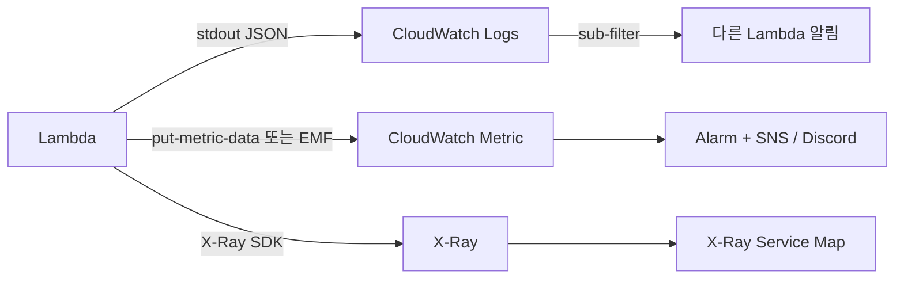

# Lambda Observability

> Log (CloudWatch Logs / EMF) + Metric (CloudWatch) + Trace (X-Ray) + Powertools 통합. structured + correlation.

## 1. 3 pillar



## 2. CloudWatch Logs

자동:
- log group: `/aws/lambda/<function-name>`
- log stream: instance 별 (cold start 마다)
- `print()` / `console.log()` / SLF4J 모두 stdout → 자동

### Retention 설정
```bash
aws logs put-retention-policy --log-group-name /aws/lambda/bkurs-fn --retention-in-days 30
```

### Custom log group
```bash
aws lambda update-function-configuration --function-name bkurs-fn \
  --logging-config "LogFormat=JSON,SystemLogLevel=INFO,ApplicationLogLevel=WARN,LogGroup=/bkurs/lambda/api"
```

→ application log level + system log 분리 + 직접 log group 지정.

## 3. JSON structured logging

### Powertools (Python)
```python
from aws_lambda_powertools import Logger
logger = Logger(service="bkurs-api")

@logger.inject_lambda_context(correlation_id_path="requestContext.requestId")
def handler(event, context):
    logger.info("Order placed", extra={"orderId": 123, "userId": "u-abc"})
    logger.warning("Slow query", extra={"sql": "SELECT...", "took_ms": 2500})
```

→ 자동 cold_start / function_arn / x-correlation-id / 환경.

CloudWatch Logs Insights:
```
fields @timestamp, level, message, orderId, took_ms
| filter level = "ERROR"
| stats count() by message
```

## 4. CloudWatch metric

자동:
- `Invocations` / `Errors` / `Throttles` / `Duration` / `ConcurrentExecutions`

### Custom metric — PutMetricData
```python
import boto3
cw = boto3.client("cloudwatch")
cw.put_metric_data(
    Namespace="Bkurs",
    MetricData=[{
        "MetricName": "OrderProcessed",
        "Dimensions": [{"Name": "Service", "Value": "api"}],
        "Value": 1,
        "Unit": "Count"
    }]
)
```

→ API 호출 = 비용 + latency. 작은 양 OK, 대량은 EMF.

### EMF (Embedded Metric Format) — 권장
```python
from aws_lambda_powertools import Metrics
from aws_lambda_powertools.metrics import MetricUnit

metrics = Metrics(namespace="Bkurs", service="api")

@metrics.log_metrics
def handler(event, context):
    metrics.add_metric(name="OrderProcessed", unit=MetricUnit.Count, value=1)
    metrics.add_metric(name="OrderAmount",    unit=MetricUnit.None,  value=event["amount"])
    metrics.add_dimension(name="Region", value="ap-northeast-2")
```

→ log 한 줄 → CloudWatch metric 자동 추출. PutMetricData 비용 없음.

## 5. X-Ray Tracing

활성:
```bash
aws lambda update-function-configuration --function-name bkurs-fn \
  --tracing-config Mode=Active
```

권한 (Execution Role):
```json
{
  "Effect": "Allow",
  "Action": ["xray:PutTraceSegments","xray:PutTelemetryRecords"],
  "Resource": "*"
}
```

### Powertools Tracer
```python
from aws_lambda_powertools import Tracer
tracer = Tracer(service="bkurs-api")

@tracer.capture_lambda_handler
def handler(event, context):
    tracer.put_annotation(key="orderId", value=event["orderId"])
    tracer.put_metadata(key="event", value=event)
    process(event)

@tracer.capture_method
def process(event):
    # 별도 subsegment
    ...
```

### X-Ray SDK (Boto3 patch)
```python
from aws_xray_sdk.core import patch_all
patch_all()    # boto3 / requests / SQL 모두 자동 trace
```

## 6. Service Map (X-Ray)

```
API GW → Lambda → DDB
                → SNS → Lambda (downstream)
                      → SQS
```

Console — X-Ray Service Map. latency / error rate 시각화.

## 7. Lambda Insights

```bash
aws lambda update-function-configuration --function-name bkurs-fn \
  --layers arn:aws:lambda:ap-northeast-2:580247275435:layer:LambdaInsightsExtension-Arm64:53
```

Execution Role 의 `CloudWatchLambdaInsightsExecutionRolePolicy` attach.

추가 metric:
- `cpu_total_time` — CPU usage
- `memory_utilization` — actual memory
- `tx_bytes` / `rx_bytes` — network
- `tmp_used` — /tmp

→ right-sizing / outlier 분석.

## 8. CloudWatch Application Signals

자동 instrument (Java / Python / Node):
```bash
aws lambda update-function-configuration --function-name bkurs-fn \
  --layers arn:aws:lambda:...:layer:LayerForOTel-Python:1 \
  --environment "Variables={AWS_LAMBDA_EXEC_WRAPPER=/opt/otel-instrument}"
```

→ Application Map 자동 (X-Ray 기반).

## 9. CloudWatch alarm 표준

```bash
# Errors
aws cloudwatch put-metric-alarm --alarm-name lambda-error \
  --metric-name Errors --namespace AWS/Lambda \
  --statistic Sum --period 60 --evaluation-periods 5 \
  --threshold 10 --comparison-operator GreaterThanThreshold \
  --dimensions Name=FunctionName,Value=bkurs-fn

# Duration P99
aws cloudwatch put-metric-alarm --alarm-name lambda-duration \
  --metric-name Duration --namespace AWS/Lambda \
  --extended-statistic p99 --period 60 --evaluation-periods 5 \
  --threshold 5000 --comparison-operator GreaterThanThreshold \
  --dimensions Name=FunctionName,Value=bkurs-fn

# Throttles
aws cloudwatch put-metric-alarm --alarm-name lambda-throttle \
  --metric-name Throttles --namespace AWS/Lambda \
  --statistic Sum --period 60 --evaluation-periods 3 \
  --threshold 1 --comparison-operator GreaterThanThreshold

# DLQ depth
aws cloudwatch put-metric-alarm --alarm-name lambda-dlq \
  --metric-name ApproximateNumberOfMessagesVisible --namespace AWS/SQS \
  --statistic Maximum --period 300 --evaluation-periods 1 \
  --threshold 1 --comparison-operator GreaterThanOrEqualToThreshold \
  --dimensions Name=QueueName,Value=lambda-dlq
```

## 10. CloudWatch Logs Insights query saved

```
# 5xx
fields @timestamp, requestId, method, path, status
| filter ispresent(status) and status >= 500
| sort @timestamp desc | limit 100

# Cold start
fields @timestamp, @initDuration, function_name
| filter ispresent(@initDuration)
| stats avg(@initDuration), max(@initDuration), count() by bin(5m)

# Slow request
fields @timestamp, requestId, took_ms
| filter took_ms > 2000
| sort took_ms desc | limit 50

# 특정 user 추적
fields @timestamp, level, message, userId, orderId
| filter userId = "u-abc"
| sort @timestamp
```

## 11. CloudTrail — control plane audit

```bash
aws cloudtrail lookup-events \
  --lookup-attributes AttributeKey=ResourceName,AttributeValue=bkurs-fn \
  --max-items 30
```

→ 누가 deploy / config 변경 했는지.

## 12. 외부 도구

| 도구 | 강점 |
| --- | --- |
| Datadog Lambda Extension | unified APM |
| New Relic | observability |
| Sentry | exception tracking |
| Lumigo | serverless 특화 trace |
| AWS Distro for OTel | 표준 OpenTelemetry |

## 13. 흔한 함정

| 함정 | 회피 |
| --- | --- |
| Log retention 무한 | 30일 default |
| Powertools 직접 zip → cold start | Layer |
| X-Ray 100% sampling | sampling rule 5-10% |
| PutMetricData 매 invocation → 비용 | EMF |
| Cold start metric 안 봄 | @initDuration query |
| DLQ alarm 없음 | sqs depth alarm |

## 14. 다음

- ▶ [[02-troubleshooting]]
- ▶ [[../05-security/01-execution-role]]
- ▶ [[../../observability/cloudwatch/cloudwatch]]

## 15. 영상 / 자료

| 자료 |
| --- |
| [Powertools 공식](https://docs.powertools.aws.dev) |
| [X-Ray + Lambda](https://docs.aws.amazon.com/lambda/latest/dg/services-xray.html) |
| [Lambda Insights](https://docs.aws.amazon.com/AmazonCloudWatch/latest/monitoring/Lambda-Insights.html) |

## 16. 참고

- [[../lambda]]
- [[../../ecs/04-operations/02-container-insights]]
- [[../03-runtime/01-concurrency-and-scaling]]
