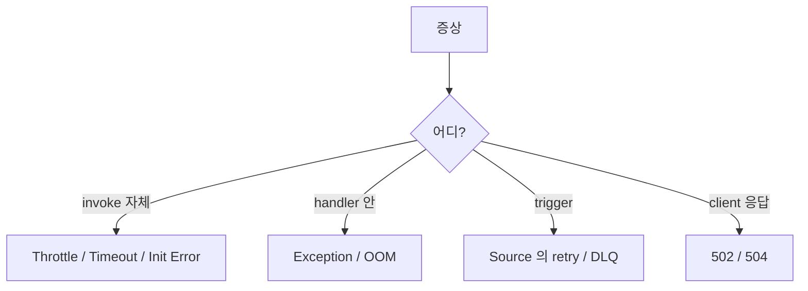

# Lambda Troubleshooting

> Throttle / Timeout / OOM / Cold start / 502 / DLQ / Init error 의 진단 흐름.

## 1. 진단 흐름



## 2. Common Error Codes

| Error | 의미 | 해결 |
| --- | --- | --- |
| `TooManyRequestsException` (429) | Concurrent execution 한도 | Reserved Concurrency / 증액 |
| `Rate Exceeded` (429) | Invocation rate (10 TPS 시작) | account quota 증액 |
| `Task timed out after Ns` | timeout 도달 | timeout ↑ 또는 algorithm 개선 |
| `Runtime exited with error: signal: killed` | OOM | memory ↑ |
| `Process exited before completing request` | unhandled exception | exception trap |
| `Cannot find module '...'` | dependency 누락 | Layer / requirements.txt |
| `Calling the invoke API action failed: ServiceException` | Lambda Service 일시 장애 | retry |
| `502 Bad Gateway` (API GW) | Lambda 응답 형식 / timeout | logs 확인 |
| `Cannot execute binary file` | platform mismatch | arch (arm64/x86) 일치 |

## 3. Throttle 진단

```bash
# CloudWatch metric
aws cloudwatch get-metric-statistics \
  --namespace AWS/Lambda --metric-name Throttles \
  --dimensions Name=FunctionName,Value=bkurs-fn \
  --start-time 2026-05-22T00:00:00Z --end-time 2026-05-22T23:59:59Z \
  --period 300 --statistics Sum

# 현재 account concurrency
aws lambda get-account-settings --query 'AccountLimit.ConcurrentExecutions'

# Reserved concurrency 합산
aws lambda list-functions --query 'Functions[].[FunctionName,ReservedConcurrentExecutions]' --output table
```

해결:
- account quota 증액
- Reserved concurrency 격리
- Provisioned Concurrency (cold start 회피)
- batch size ↑ (SQS poller)

## 4. Timeout

```python
# 진단: 현재 timeout / 평균 duration / p99 duration
aws logs filter-log-events --log-group-name /aws/lambda/bkurs-fn \
  --filter-pattern "Task timed out"
```

해결:
- timeout 늘림 (max 900s)
- 외부 호출 timeout 명시 (boto3 default 60s 등)
- Step Functions 로 분할
- ECS Fargate (15분 초과)

## 5. OOM

```bash
aws logs filter-log-events --log-group-name /aws/lambda/bkurs-fn \
  --filter-pattern "killed"
```

또는 Lambda Insights `memory_utilization`. 해결:
- memory ↑
- 큰 file 은 stream (boto3 `iter_lines`)
- pandas → DuckDB
- Container image (10GB)

## 6. 502 (API GW)

```
client → API GW → Lambda
                  ↓
                  Cold start timeout / Lambda invoke 실패 / response 형식 오류
```

해결:
- API GW 의 timeout 29초 한도
- Provisioned Concurrency
- 응답 JSON 형식 (statusCode + body)

```python
# 올바른 응답
return {
    "statusCode": 200,
    "body": json.dumps({"result": "ok"}),
    "headers": {"Content-Type": "application/json"}
}
```

## 7. ALB 502

ALB target health = "unhealthy" 안 됨 (Lambda target 은 health check X). 502 는 항상 Lambda 에러:
- 응답 형식 (statusCode + statusDescription 필요)
- timeout
- exception

## 8. Cold start

```bash
# Init duration 확인
aws logs filter-log-events --log-group-name /aws/lambda/bkurs-fn \
  --filter-pattern "REPORT" --max-items 20
```

```
REPORT RequestId: xxx Duration: 1500ms Billed Duration: 1500ms Memory Size: 512MB Init Duration: 800ms
```

해결:
- SnapStart (Java)
- Provisioned Concurrency
- 무거운 import / class load 제거
- container image 작게
- arm64

## 9. CrashLoopBackOff (Init error)

Init phase 에서 exception → 10초 안 retry 후 fail:
```
INIT_ERROR Runtime.ImportModuleError: Unable to import module 'app': ...
```

해결:
- requirements.txt + Layer 확인
- env var 누락
- IAM permission 부족 (boto3 client 생성 실패)

## 10. SQS / Kinesis 처리 안 됨

```bash
# 사라지지 않은 message
aws sqs get-queue-attributes --queue-url ... --attribute-names ApproximateNumberOfMessagesVisible

# Lambda invoke 됐는지
aws lambda list-event-source-mappings --function-name bkurs-fn
```

흔한:
- Event Source Mapping 비활성 (Disabled)
- IAM (SQS / Kinesis 권한 부족)
- partial failure 미설정 → 1 fail = 전체 redrive
- visibility timeout < Lambda timeout × 6
- DLQ 도달 (alarm 필요)

## 11. DLQ message 확인

```bash
aws sqs receive-message --queue-url https://sqs.../lambda-dlq \
  --max-number-of-messages 10 --wait-time-seconds 5

# 원본 message + error metadata
```

## 12. X-Ray Service Map

Console — X-Ray → Service map. red node (error) / 느린 edge (latency p99).

## 13. CloudTrail (config change)

```bash
aws cloudtrail lookup-events \
  --lookup-attributes AttributeKey=ResourceName,AttributeValue=bkurs-fn \
  --max-items 20 \
  --query 'Events[].{Time:EventTime,Event:EventName,User:Username}'
```

→ 누가 timeout / memory / version 변경 했는지.

## 14. 환경 차이 (local vs Lambda)

| | Local | Lambda |
| --- | --- | --- |
| Read-only | ✗ | `/var/task` (code) read-only, `/tmp` 만 write |
| Network | 무제한 | VPC mode 시 NAT 필요 |
| /tmp | OS temp | 512 MB ~ 10 GB |
| Environment | dotenv | env config |
| Architecture | local CPU | x86 / arm64 (배포 시 일치) |

> Lambda RIE (Runtime Interface Emulator) 로 local 모사:
```bash
docker run -p 9000:8080 my-lambda-image:v1
curl -XPOST http://localhost:9000/2015-03-31/functions/function/invocations -d '{}'
```

## 15. 흔한 함정 — 다음 turn (이미 봤어도)

| 함정 | 회피 |
| --- | --- |
| `latest` alias 직접 production | published version + alias |
| `LATEST` qualifier 사용 | version 명시 |
| Cold start 무시 → 가끔 timeout | Provisioned Concurrency |
| Idempotency 없음 → 중복 부작용 | Powertools |
| DLQ 보지 않음 | alarm + 주기 review |

## 16. 다음

- ▶ [[../05-security/01-execution-role]]
- ▶ [[../05-security/02-code-signing-and-secrets]]
- ▶ [[../practice/01-first-lambda-zip]]

## 17. 영상 / 자료

| 자료 |
| --- |
| [Lambda 공식 troubleshooting](https://docs.aws.amazon.com/lambda/latest/dg/lambda-troubleshooting.html) |
| [Lambda RIE](https://github.com/aws/aws-lambda-runtime-interface-emulator) |

## 18. 참고

- [[../lambda]]
- [[01-observability]]
- [[../03-runtime/01-concurrency-and-scaling]]
