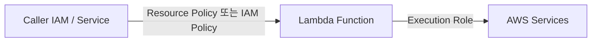

# Lambda Execution Role + Resource Policy

> Execution Role = Lambda 가 AWS API 호출할 때. Resource Policy = 누가 이 Lambda 호출 할 수 있는가.

## 1. 2 종류 정책



| | 의미 |
| --- | --- |
| **Execution Role** | Lambda 가 _다른 service_ 부르는 권한 (S3 / DDB / SNS / etc) |
| **Resource Policy** | Lambda 를 _누가_ 호출 가능 (S3 trigger / API GW / cross-account) |

## 2. Execution Role — minimal

```json
{
  "Version": "2012-10-17",
  "Statement": [
    {
      "Effect": "Allow",
      "Action": ["logs:CreateLogGroup","logs:CreateLogStream","logs:PutLogEvents"],
      "Resource": "arn:aws:logs:ap-northeast-2:123:log-group:/aws/lambda/bkurs-fn:*"
    }
  ]
}
```

AWS managed policy 시작:
- `AWSLambdaBasicExecutionRole` — logs:* 만
- `AWSLambdaVPCAccessExecutionRole` — VPC ENI
- `AWSLambdaSQSQueueExecutionRole` — SQS poll
- `AWSLambdaKinesisExecutionRole` — Kinesis poll
- `AWSLambdaDynamoDBExecutionRole` — DDB Streams
- `AWSXRayDaemonWriteAccess` — X-Ray
- `CloudWatchLambdaInsightsExecutionRolePolicy` — Lambda Insights

## 3. Trust Policy

```json
{
  "Version": "2012-10-17",
  "Statement": [{
    "Effect": "Allow",
    "Principal": { "Service": "lambda.amazonaws.com" },
    "Action": "sts:AssumeRole",
    "Condition": {
      "StringEquals": { "aws:SourceAccount": "123456789012" }
    }
  }]
}
```

> SourceAccount condition — confused deputy 방지.

## 4. Resource Policy (Function Policy)

```bash
# S3 가 호출 허용
aws lambda add-permission --function-name image-resize \
  --statement-id s3-trigger \
  --action lambda:InvokeFunction \
  --principal s3.amazonaws.com \
  --source-arn arn:aws:s3:::bkurs-uploads \
  --source-account 123456789012

# API GW
aws lambda add-permission --function-name api-handler \
  --statement-id apigw \
  --action lambda:InvokeFunction \
  --principal apigateway.amazonaws.com \
  --source-arn "arn:aws:execute-api:ap-northeast-2:123:abc123/*/*"

# Cross-account
aws lambda add-permission --function-name bkurs-fn \
  --statement-id cross-account \
  --action lambda:InvokeFunction \
  --principal 987654321098 \
  --source-arn arn:aws:lambda:ap-northeast-2:987654321098:function:caller

# 확인
aws lambda get-policy --function-name image-resize
```

## 5. SourceArn / SourceAccount 의 중요성

```
✗ 위험: --principal s3.amazonaws.com (모든 account 의 모든 S3 가능)
✓ 안전: --principal s3.amazonaws.com --source-arn arn:aws:s3:::my-bucket \
        --source-account 123456789012
```

> Confused Deputy 공격 차단.

## 6. Least privilege — application

```json
{
  "Effect": "Allow",
  "Action": ["s3:GetObject","s3:PutObject"],
  "Resource": "arn:aws:s3:::bkurs-uploads/*"
}
```

> Wildcard `s3:*` 절대 금지. Resource ARN 한정.

bkurs-be 의 Lambda 예 — image resize:
```json
[
  {
    "Effect": "Allow",
    "Action": "s3:GetObject",
    "Resource": "arn:aws:s3:::bkurs-uploads/raw/*"
  },
  {
    "Effect": "Allow",
    "Action": "s3:PutObject",
    "Resource": "arn:aws:s3:::bkurs-uploads/processed/*"
  },
  {
    "Effect": "Allow",
    "Action": "secretsmanager:GetSecretValue",
    "Resource": "arn:aws:secretsmanager:ap-northeast-2:123:secret:bkurs-be/prod/db-*"
  },
  {
    "Effect": "Allow",
    "Action": ["xray:PutTraceSegments","xray:PutTelemetryRecords"],
    "Resource": "*"
  }
]
```

## 7. ABAC — tag based

```json
{
  "Effect": "Allow",
  "Action": "secretsmanager:GetSecretValue",
  "Resource": "*",
  "Condition": {
    "StringEquals": {
      "aws:ResourceTag/Environment": "${aws:PrincipalTag/Environment}"
    }
  }
}
```

→ Lambda 의 PrincipalTag Environment 가 secret tag 와 같아야.

## 8. Permission Boundary

```bash
aws iam put-role-permissions-boundary \
  --role-name BkursLambdaRole \
  --permissions-boundary arn:aws:iam::123:policy/BkursBoundary
```

→ IAM admin 권한 추가해도 boundary 이상 못 함 (defense in depth).

## 9. Cross-account Lambda invoke

Caller account A → Function in account B:

1. **B 의 Resource Policy** — A 에게 invoke 허용
2. **A 의 IAM** — `lambda:InvokeFunction` on B 의 ARN

```json
# B 의 Function policy
{
  "Effect": "Allow",
  "Principal": { "AWS": "arn:aws:iam::ACCOUNT_A:role/Caller" },
  "Action": "lambda:InvokeFunction",
  "Resource": "arn:aws:lambda:ap-northeast-2:ACCOUNT_B:function:bkurs-fn"
}

# A 의 IAM Role
{
  "Effect": "Allow",
  "Action": "lambda:InvokeFunction",
  "Resource": "arn:aws:lambda:ap-northeast-2:ACCOUNT_B:function:bkurs-fn"
}
```

## 10. KMS — env 암호화

```bash
aws lambda update-function-configuration --function-name bkurs-fn \
  --kms-key-arn arn:aws:kms:...:key/abc
```

Execution Role 에 `kms:Decrypt`:
```json
{
  "Effect": "Allow",
  "Action": "kms:Decrypt",
  "Resource": "arn:aws:kms:...:key/abc",
  "Condition": {
    "StringEquals": { "kms:ViaService": "lambda.ap-northeast-2.amazonaws.com" }
  }
}
```

## 11. Lambda URL — Auth

```bash
aws lambda create-function-url-config --function-name bkurs-fn \
  --auth-type AWS_IAM
```

호출 시 SigV4 + Resource Policy 의 lambda:InvokeFunctionUrl 허용.

```json
{
  "Effect": "Allow",
  "Principal": { "AWS": "arn:aws:iam::123:role/Caller" },
  "Action": "lambda:InvokeFunctionUrl",
  "Resource": "arn:aws:lambda:...:function:bkurs-fn",
  "Condition": {
    "StringEquals": { "lambda:FunctionUrlAuthType": "AWS_IAM" }
  }
}
```

## 12. Lambda Tag

```bash
aws lambda tag-resource --resource arn:aws:lambda:...:function:bkurs-fn \
  --tags Environment=prod,Owner=bkurs-team,CostCenter=engineering
```

→ IAM Condition / Cost Explorer / Resource Group.

## 13. CloudTrail audit

```bash
# 누가 함수 update/delete
aws cloudtrail lookup-events \
  --lookup-attributes AttributeKey=ResourceName,AttributeValue=bkurs-fn \
  --max-items 30 \
  --query 'Events[].[EventTime,EventName,Username]'

# 누가 invoke (data event 활성 시)
aws cloudtrail lookup-events \
  --lookup-attributes AttributeKey=EventName,AttributeValue=Invoke
```

> Invoke audit 은 CloudTrail Data Event 활성 필요 (비용 발생).

## 14. 흔한 함정

| 함정 | 회피 |
| --- | --- |
| `lambda.amazonaws.com` trust 만 — SourceAccount 누락 | confused deputy 차단 |
| Resource: `*` (s3:*) | ARN 한정 |
| Resource Policy add-permission 안 함 → trigger 호출 X | 모든 trigger 에 add-permission |
| Cross-account 한쪽 만 설정 | 양쪽 모두 |
| Function URL public + 민감 | AWS_IAM auth |
| Permission Boundary 없음 | defense in depth |

## 15. 다음

- ▶ [[02-code-signing-and-secrets]]
- ▶ [[../practice/01-first-lambda-zip]]
- ▶ [[../../iam/iam]]

## 16. 영상 / 자료

| 자료 |
| --- |
| [Lambda IAM 공식](https://docs.aws.amazon.com/lambda/latest/dg/lambda-permissions.html) |
| [Resource Policy 공식](https://docs.aws.amazon.com/lambda/latest/dg/access-control-resource-based.html) |

## 17. 참고

- [[../lambda]]
- [[../03-runtime/02-environment-and-layers]]
- [[../../iam/iam]]
