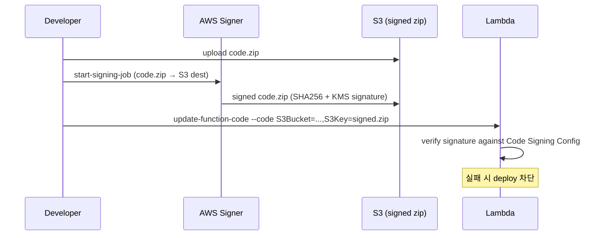

# Lambda Code Signing + Secrets

> Lambda Code Signing (Signer + KMS, SHA256 검증) + Secrets Manager / Parameter Store / KMS.

## 1. Code Signing 개요



## 2. Signing Profile

```bash
aws signer put-signing-profile \
  --profile-name bkurs-prod \
  --platform-id "AWSLambda-SHA384-ECDSA" \
  --signature-validity-period value=12,type=MONTHS
```

## 3. Code Signing Config

```bash
aws lambda create-code-signing-config \
  --allowed-publishers SigningProfileVersionArns=arn:aws:signer:...:/signing-profiles/bkurs-prod/abc \
  --code-signing-policies UntrustedArtifactOnDeployment=Enforce \
  --description "Production code signing"

aws lambda put-function-code-signing-config \
  --function-name bkurs-fn \
  --code-signing-config-arn arn:aws:lambda:...:code-signing-config/csc-xxx
```

| Policy | 의미 |
| --- | --- |
| `Enforce` | unsigned / invalid → deploy 차단 |
| `Warn` | log 만 |

## 4. Signing Job

```bash
aws signer start-signing-job \
  --source 'S3={BucketName=bkurs-build,Key=unsigned.zip,Version=...}' \
  --destination 'S3={BucketName=bkurs-build,Prefix=signed/}' \
  --profile-name bkurs-prod

# Status
aws signer describe-signing-job --job-id xxx
```

Lambda deploy:
```bash
aws lambda update-function-code --function-name bkurs-fn \
  --s3-bucket bkurs-build --s3-key signed/abc.zip
```

## 5. CI/CD 통합

```yaml
# GitHub Actions
- run: zip -r function.zip src
- name: Upload unsigned
  run: aws s3 cp function.zip s3://bkurs-build/unsigned/${{ github.sha }}.zip
- name: Sign
  id: sign
  run: |
    JOB=$(aws signer start-signing-job \
      --source "S3={BucketName=bkurs-build,Key=unsigned/${{ github.sha }}.zip,Version=null}" \
      --destination "S3={BucketName=bkurs-build,Prefix=signed/}" \
      --profile-name bkurs-prod \
      --query 'jobId' --output text)
    aws signer wait successful-signing-job --job-id $JOB
    echo "key=signed/${JOB}.zip" >> $GITHUB_OUTPUT
- name: Deploy
  run: |
    aws lambda update-function-code --function-name bkurs-fn \
      --s3-bucket bkurs-build --s3-key ${{ steps.sign.outputs.key }}
```

## 6. Secrets Management — 3 옵션

| | SSM Parameter Store | Secrets Manager | KMS only |
| --- | --- | --- | --- |
| Free tier | ✓ (Standard) | ✗ | n/a |
| Auto rotation | ✗ | ✓ | n/a |
| Size | 4-8 KB | 64 KB | n/a |
| Per-secret cost | 무료 | $0.40/월 | n/a |
| GetParameter / GetSecretValue | $0.05 / $0.05 per 10K | $0.05 per 10K | n/a |
| 권장 | 일반 config | DB password 자동 rotation | encryption at rest |

## 7. Secrets Manager — Lambda 안에서

```python
import boto3, json
sm = boto3.client("secretsmanager")

# Init phase (cold start 1회)
SECRET = sm.get_secret_value(SecretId="bkurs/prod/db")
DB_CRED = json.loads(SECRET["SecretString"])

def lambda_handler(event, context):
    # DB_CRED 재사용 (warm)
    ...
```

Execution Role:
```json
{
  "Effect": "Allow",
  "Action": "secretsmanager:GetSecretValue",
  "Resource": "arn:aws:secretsmanager:ap-northeast-2:123:secret:bkurs/prod/db-*"
}
```

## 8. AWS Parameters and Secrets Lambda Extension

Layer 추가 → 자동 cache + refresh (cold start 빠름):
```bash
aws lambda update-function-configuration --function-name bkurs-fn \
  --layers arn:aws:lambda:ap-northeast-2:738900069198:layer:AWS-Parameters-and-Secrets-Lambda-Extension-Arm64:11
```

```python
import urllib.request
url = "http://localhost:2773/secretsmanager/get?secretId=bkurs/prod/db"
req = urllib.request.Request(url, headers={"X-Aws-Parameters-Secrets-Token": os.environ["AWS_SESSION_TOKEN"]})
secret = json.loads(urllib.request.urlopen(req).read())
```

장점:
- API call 줄임 (cache)
- 자동 refresh
- IAM Role 활용

## 9. Secret rotation

```bash
aws secretsmanager rotate-secret --secret-id bkurs/prod/db \
  --rotation-lambda-arn arn:aws:lambda:...:function:SecretsManagerRDSPostgreSQLRotationSingleUser \
  --rotation-rules AutomaticallyAfterDays=30
```

→ Lambda 가 30일마다 자동 rotate.

자세히 → [[../../ecs/05-security/03-secret-management]] §4

## 10. KMS — at-rest 암호화

Lambda 가 자동:
- env var (default AWS managed key 또는 custom CMK)
- code in S3 (S3 KMS)
- logs (CloudWatch Logs KMS)

```bash
aws lambda update-function-configuration --function-name bkurs-fn \
  --kms-key-arn arn:aws:kms:...:key/abc
```

## 11. Lambda + Secrets Manager + Powertools cache

```python
from aws_lambda_powertools.utilities.parameters import get_secret, SecretsProvider

provider = SecretsProvider()

def handler(event, context):
    db = provider.get("bkurs/prod/db", max_age=300, transform="json")
    # 300s cache, JSON parse 자동
    conn = connect(db["host"], db["password"])
```

## 12. Hard-coded secret 검출

CI 단계 — secret scanning:
```bash
# trufflehog
docker run -v $(pwd):/src trufflesecurity/trufflehog filesystem /src

# git-secrets (AWS official)
git secrets --install
git secrets --register-aws
```

## 13. 흔한 함정

| 함정 | 회피 |
| --- | --- |
| Secret env 평문 | Secrets Manager + Extension |
| Init phase 안 cache → 매 invoke API call | global scope cache |
| Rotation 후 cache 갱신 안 됨 | TTL + cache invalidation |
| Code signing 없이 prod deploy | Enforce policy |
| Sign profile validity 만료 | rotation |
| CSC 변경 시 기존 version 무효 | grandfathering 정책 |

## 14. 권장 — bkurs-be Lambda

```
1. Code signing — Enforce (production)
2. Secrets Manager — DB password + auto rotation 30일
3. SSM Parameter Store — 일반 config (DB host / region)
4. Lambda Extension (Parameters and Secrets) — cache
5. CMK + envelope encryption
6. Permission Boundary + Resource Policy 한정
7. CloudTrail Data Event (Invoke audit, sensitive function 만)
```

## 15. 다음

- ▶ [[../practice/01-first-lambda-zip]]
- ▶ [[../practice/02-container-image-lambda]]
- ▶ [[../practice/03-event-driven-pipeline]]
- ▶ [[../../iam/iam]]

## 16. 영상 / 자료

| 자료 |
| --- |
| [Lambda Code Signing](https://docs.aws.amazon.com/lambda/latest/dg/configuration-codesigning.html) |
| [AWS Signer](https://docs.aws.amazon.com/signer/) |
| [Parameters and Secrets Extension](https://docs.aws.amazon.com/secretsmanager/latest/userguide/retrieving-secrets_lambda.html) |

## 17. 참고

- [[../lambda]]
- [[01-execution-role]]
- [[../../ecs/05-security/03-secret-management]]
