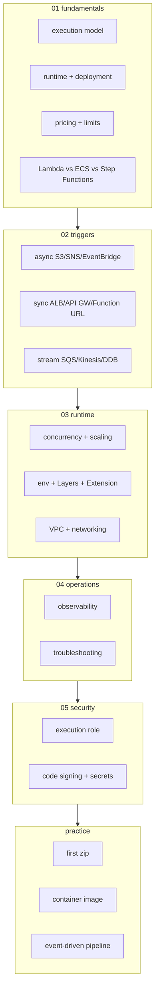
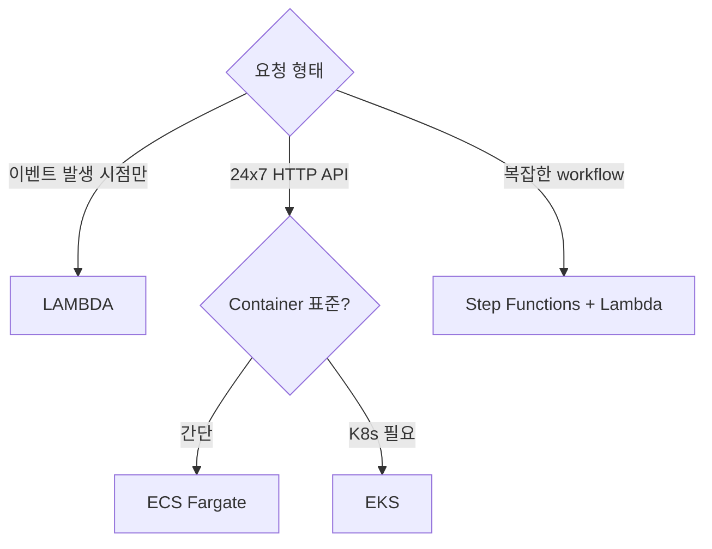

# AWS Lambda — Serverless Function

> **이벤트 트리거 + 함수 실행 + 자동 scaling + 사용량 기반 과금**. Firecracker microVM 위에 함수가 빠르게 시작/종료.

**[[../compute|↑ Compute]]** · **[[../../cloud-aws|↑↑ AWS]]**

---

## 1. 한 줄

```
Trigger (S3 / SNS / SQS / API GW / EventBridge / ALB / Stream / Cron)
   ↓
Lambda Function (Firecracker microVM)
   ↓
~15분 실행 → 자동 종료, 사용한 ms 만 과금
```

> Container 대비: long-running process 운영 부담 없음. Container 만 한 자유는 없음 (15분 한도 / payload 6 MB / etc).

## 2. 학습 roadmap



## 3. Sub-directory index

### [[01-fundamentals/01-execution-model]] — Cold start / Warm / Firecracker
microVM lifecycle, cold vs warm, SnapStart, Init phase.

### [[01-fundamentals/02-runtime-and-deployment]] — Managed runtime / Custom / Container / zip
Node/Python/Java/.NET/Ruby/Go + AL2/AL2023 OS + Lambda Layers + container image (up to 10GB).

### [[01-fundamentals/03-pricing-and-limits]] — Invocation / GB-s / payload / timeout
무료 1M req/월 + $0.20/1M req + $0.0000166667/GB-s. hard limit 표.

### [[01-fundamentals/04-lambda-vs-ecs-vs-stepfn]] — 결정 기준
짧은 / 단순 / 이벤트 → Lambda. 긴 / 복잡 / 다중 → ECS or Step Functions.

### [[02-triggers/01-async-trigger]] — S3 / SNS / EventBridge
비동기 — Lambda 가 retry 2회 + DLQ + Destination.

### [[02-triggers/02-sync-trigger]] — ALB / API Gateway / Function URL
HTTPS endpoint 3 방식 비교.

### [[02-triggers/03-stream-poller]] — SQS / Kinesis / DDB Streams / Kafka
Lambda 가 poll → batch invoke. parallelization factor / Tumbling window.

### [[03-runtime/01-concurrency-and-scaling]] — Reserved / Provisioned / Burst
account 한도 1000, regional burst, cold start 방지.

### [[03-runtime/02-environment-and-layers]] — Env / Layers / Extension
env var 4KB + Layers (재사용 dep) + Extension (sidecar like).

### [[03-runtime/03-vpc-and-networking]] — VPC ENI / NAT / Hyperplane
VPC mode 의 cost / cold start / Hyperplane 개선.

### [[04-operations/01-observability]] — CloudWatch / X-Ray / Powertools
log / metric / trace + AWS Lambda Powertools.

### [[04-operations/02-troubleshooting]] — Throttle / Timeout / OOM / 502
common error + 해결.

### [[05-security/01-execution-role]] — Role + Resource Policy + Tag
Execution Role vs Resource-based Policy.

### [[05-security/02-code-signing-and-secrets]] — Signer / Secrets / KMS
Lambda Code Signing (SHA256 + KMS) + Secrets Manager / Parameter Store.

### [[practice/01-first-lambda-zip]] — Python zip + S3 trigger (20분)

### [[practice/02-container-image-lambda]] — Spring Boot native + container (40분)

### [[practice/03-event-driven-pipeline]] — S3 → Lambda → DynamoDB + Step Functions (60분)

## 4. 핵심 개념 1줄

| 개념 | 의미 |
| --- | --- |
| Function | 1 deployable (handler + runtime) |
| Trigger | 함수를 호출하는 source |
| Invocation | 1회 호출 |
| Cold Start | microVM 부팅 + init code 첫 실행 (~100ms-3s) |
| Warm Invocation | 재사용된 microVM 호출 (~ms) |
| Provisioned Concurrency | 미리 warm 보장 (cold start 없음) |
| Reserved Concurrency | account 한도 내 일부 예약 (throttle 격리) |
| Layer | 공통 dependency / runtime 추가 zip |
| Extension | sidecar like (monitoring / log forward) |
| Destination | success/failure 시 다음 service (SNS/SQS/EventBridge/Lambda) |

## 5. Lambda 가 적합한 곳

✓ **시나리오**
- API Gateway / ALB 의 backend (HTTP)
- S3 이벤트 처리 (image resize, log parse)
- SQS / Kinesis / DDB Streams worker
- EventBridge scheduled / cron
- 사이드 작업 (notification, audit, webhook)
- AWS service 자동화 (IAM 변경 알림 등)

✗ **부적합**
- 15분 이상 작업
- 거대 dependency (zip > 250MB / container 가능 but cold start ↑)
- WebSocket 직접 (API Gateway WebSocket 우회)
- 강력한 GPU
- DB long-lived connection (pool 어려움)

## 6. ECS / EKS / Lambda 비교



자세히 → [[01-fundamentals/04-lambda-vs-ecs-vs-stepfn]]

## 7. 비용 직관 (Lambda vs ECS)

```
Lambda: 1M req × 100ms × 256MB
     = 100,000 GB-s × $0.0000166667
     = $1.67 + invocation $0.20 = $1.87/월

같은 작업을 ECS Fargate 1 task 24x7:
     = 1 vCPU + 2 GB × 730h
     = $36/월
```

→ 트래픽이 sparse 하면 Lambda 가 10~100배 싸다. 24x7 부하 → ECS 가 싸다.

## 8. bkurs-be 활용 시나리오

```
일반 API request    → ECS Fargate (24x7, low latency)
주간 통계 batch     → Lambda + EventBridge cron
S3 image resize    → Lambda (S3 trigger)
notification (SNS) → Lambda
admin webhook      → Lambda + API Gateway
audit log archive  → Lambda + S3 + DDB
```

## 9. 영상 / 자료

| 자료 |
| --- |
| [Lambda Internals — re:Invent](https://www.youtube.com/watch?v=0_jfH6qijVY) |
| [AWS Lambda 공식](https://docs.aws.amazon.com/lambda/) |
| [AWS Serverless Land](https://serverlessland.com) |
| [Lambda Powertools](https://docs.powertools.aws.dev) |

## 10. 관련 hub

- [[../compute]]
- [[../ecs/ecs]] — long-running 대안
- [[../eks/eks]] — K8s 대안
- [[../../messaging/sqs/sqs]] — trigger
- [[../../messaging/sns/sns]] — trigger
- [[../../messaging/eventbridge/eventbridge]]
- [[../../iam/iam]]
