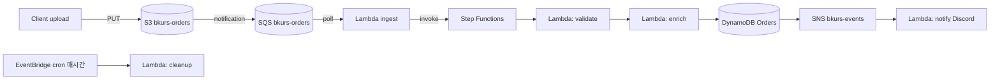

# 실습 3 — Event-driven Pipeline

> 목표: S3 upload → SQS → Lambda → Step Functions (validate → enrich → DDB save → SNS) + EventBridge. 60분.

## 구성



## 1. DynamoDB Table

```bash
ACCT=$(aws sts get-caller-identity --query Account --output text)

aws dynamodb create-table --table-name bkurs-orders \
  --attribute-definitions AttributeName=orderId,AttributeType=S \
  --key-schema AttributeName=orderId,KeyType=HASH \
  --billing-mode PAY_PER_REQUEST \
  --stream-specification StreamEnabled=true,StreamViewType=NEW_AND_OLD_IMAGES
```

## 2. S3 + SQS (DLQ + main)

```bash
BUCKET=lab-orders-$ACCT-$(date +%s)
aws s3 mb s3://$BUCKET

aws sqs create-queue --queue-name lab-orders-dlq
DLQ_ARN=$(aws sqs get-queue-attributes --queue-url \
  $(aws sqs get-queue-url --queue-name lab-orders-dlq --query QueueUrl --output text) \
  --attribute-names QueueArn --query 'Attributes.QueueArn' --output text)

aws sqs create-queue --queue-name lab-orders \
  --attributes "{
    \"VisibilityTimeout\":\"180\",
    \"RedrivePolicy\":\"{\\\"deadLetterTargetArn\\\":\\\"$DLQ_ARN\\\",\\\"maxReceiveCount\\\":\\\"3\\\"}\"
  }"

QUEUE_URL=$(aws sqs get-queue-url --queue-name lab-orders --query QueueUrl --output text)
QUEUE_ARN=$(aws sqs get-queue-attributes --queue-url $QUEUE_URL --attribute-names QueueArn --query 'Attributes.QueueArn' --output text)

# S3 → SQS notification 권한
aws sqs set-queue-attributes --queue-url $QUEUE_URL \
  --attributes "{
    \"Policy\":\"{\\\"Version\\\":\\\"2012-10-17\\\",\\\"Statement\\\":[{\\\"Effect\\\":\\\"Allow\\\",\\\"Principal\\\":{\\\"Service\\\":\\\"s3.amazonaws.com\\\"},\\\"Action\\\":\\\"sqs:SendMessage\\\",\\\"Resource\\\":\\\"$QUEUE_ARN\\\",\\\"Condition\\\":{\\\"ArnLike\\\":{\\\"aws:SourceArn\\\":\\\"arn:aws:s3:::$BUCKET\\\"}}}]}\"
  }"

aws s3api put-bucket-notification-configuration --bucket $BUCKET \
  --notification-configuration "{
    \"QueueConfigurations\": [{
      \"QueueArn\": \"$QUEUE_ARN\",
      \"Events\": [\"s3:ObjectCreated:*\"],
      \"Filter\": { \"Key\": { \"FilterRules\": [{ \"Name\": \"prefix\", \"Value\": \"orders/\" }] } }
    }]
  }"
```

## 3. IAM Role

```bash
aws iam create-role --role-name LabPipelineRole \
  --assume-role-policy-document '{"Version":"2012-10-17","Statement":[{"Effect":"Allow","Principal":{"Service":"lambda.amazonaws.com"},"Action":"sts:AssumeRole"}]}'

cat > policy.json <<EOF
{
  "Version": "2012-10-17",
  "Statement": [
    { "Effect": "Allow", "Action": "logs:*", "Resource": "*" },
    { "Effect": "Allow", "Action": ["s3:GetObject"], "Resource": "arn:aws:s3:::$BUCKET/*" },
    { "Effect": "Allow", "Action": ["sqs:ReceiveMessage","sqs:DeleteMessage","sqs:GetQueueAttributes"], "Resource": "$QUEUE_ARN" },
    { "Effect": "Allow", "Action": ["states:StartExecution"], "Resource": "*" },
    { "Effect": "Allow", "Action": ["dynamodb:PutItem","dynamodb:GetItem","dynamodb:UpdateItem","dynamodb:Query"], "Resource": "arn:aws:dynamodb:ap-northeast-2:$ACCT:table/bkurs-orders" },
    { "Effect": "Allow", "Action": ["sns:Publish"], "Resource": "*" },
    { "Effect": "Allow", "Action": ["xray:PutTraceSegments","xray:PutTelemetryRecords"], "Resource": "*" }
  ]
}
EOF

aws iam put-role-policy --role-name LabPipelineRole --policy-name p --policy-document file://policy.json
```

## 4. Step Functions Role

```bash
aws iam create-role --role-name LabSFRole \
  --assume-role-policy-document '{"Version":"2012-10-17","Statement":[{"Effect":"Allow","Principal":{"Service":"states.amazonaws.com"},"Action":"sts:AssumeRole"}]}'

aws iam put-role-policy --role-name LabSFRole --policy-name p --policy-document '{
  "Version": "2012-10-17",
  "Statement": [
    { "Effect": "Allow", "Action": "lambda:InvokeFunction", "Resource": "*" }
  ]
}'
```

## 5. Lambda 3개 (zip)

```python
# ingest.py — SQS → SF 호출
import boto3, json, os
sf = boto3.client("stepfunctions")

def lambda_handler(event, context):
    for record in event["Records"]:
        body = json.loads(record["body"])
        for s3_evt in body.get("Records", []):
            key = s3_evt["s3"]["object"]["key"]
            sf.start_execution(
                stateMachineArn=os.environ["SF_ARN"],
                input=json.dumps({"bucket": s3_evt["s3"]["bucket"]["name"], "key": key})
            )
    return {"statusCode": 200}

# validate.py
import boto3, json
s3 = boto3.client("s3")

def lambda_handler(event, context):
    obj = s3.get_object(Bucket=event["bucket"], Key=event["key"])
    order = json.loads(obj["Body"].read())
    if "orderId" not in order or "amount" not in order:
        raise ValueError("Invalid order")
    return order

# enrich-and-save.py
import boto3
ddb = boto3.client("dynamodb")
sns = boto3.client("sns")

def lambda_handler(event, context):
    ddb.put_item(TableName="bkurs-orders", Item={
        "orderId": {"S": event["orderId"]},
        "amount":  {"N": str(event["amount"])},
        "status":  {"S": "RECEIVED"}
    })
    sns.publish(TopicArn=__import__("os").environ["TOPIC_ARN"],
                Subject=f"Order {event['orderId']}",
                Message=str(event))
    return event
```

각 zip 으로:
```bash
for n in ingest validate enrich-and-save; do
  zip ${n}.zip ${n}.py
done

aws sns create-topic --name bkurs-events
TOPIC_ARN=$(aws sns get-topic-attributes --topic-arn arn:aws:sns:ap-northeast-2:$ACCT:bkurs-events --query 'Attributes.TopicArn' --output text)

aws lambda create-function --function-name lab-validate \
  --runtime python3.12 --architectures arm64 \
  --handler validate.lambda_handler \
  --role arn:aws:iam::$ACCT:role/LabPipelineRole \
  --zip-file fileb://validate.zip \
  --tracing-config Mode=Active

aws lambda create-function --function-name lab-enrich-save \
  --runtime python3.12 --architectures arm64 \
  --handler enrich-and-save.lambda_handler \
  --role arn:aws:iam::$ACCT:role/LabPipelineRole \
  --zip-file fileb://enrich-and-save.zip \
  --environment "Variables={TOPIC_ARN=$TOPIC_ARN}" \
  --tracing-config Mode=Active
```

## 6. Step Functions State Machine

```bash
SF_DEF=$(cat <<EOF
{
  "Comment": "Order pipeline",
  "StartAt": "Validate",
  "States": {
    "Validate": {
      "Type": "Task",
      "Resource": "arn:aws:lambda:ap-northeast-2:$ACCT:function:lab-validate",
      "Retry": [{ "ErrorEquals": ["States.ALL"], "MaxAttempts": 2 }],
      "Catch": [{ "ErrorEquals": ["States.ALL"], "Next": "FailNotify" }],
      "Next": "EnrichSave"
    },
    "EnrichSave": {
      "Type": "Task",
      "Resource": "arn:aws:lambda:ap-northeast-2:$ACCT:function:lab-enrich-save",
      "End": true
    },
    "FailNotify": {
      "Type": "Pass",
      "End": true
    }
  }
}
EOF
)

aws stepfunctions create-state-machine --name lab-order-pipeline \
  --definition "$SF_DEF" \
  --role-arn arn:aws:iam::$ACCT:role/LabSFRole \
  --type STANDARD

SF_ARN=$(aws stepfunctions list-state-machines --query 'stateMachines[?name==`lab-order-pipeline`].stateMachineArn' --output text)
```

## 7. Ingest Lambda + SQS Trigger

```bash
aws lambda create-function --function-name lab-ingest \
  --runtime python3.12 --architectures arm64 \
  --handler ingest.lambda_handler \
  --role arn:aws:iam::$ACCT:role/LabPipelineRole \
  --zip-file fileb://ingest.zip \
  --environment "Variables={SF_ARN=$SF_ARN}" \
  --tracing-config Mode=Active

aws lambda create-event-source-mapping \
  --function-name lab-ingest \
  --event-source-arn $QUEUE_ARN \
  --batch-size 10 \
  --function-response-types ReportBatchItemFailures
```

## 8. EventBridge cron (cleanup)

```bash
# Cleanup Lambda
cat > cleanup.py <<'EOF'
import boto3, datetime
ddb = boto3.client("dynamodb")
def lambda_handler(event, context):
    cutoff = (datetime.datetime.utcnow() - datetime.timedelta(days=30)).isoformat()
    # (예: 30일 이전 order 삭제 — 실습 단순화)
    return {"cutoff": cutoff}
EOF
zip cleanup.zip cleanup.py

aws lambda create-function --function-name lab-cleanup \
  --runtime python3.12 --architectures arm64 \
  --handler cleanup.lambda_handler \
  --role arn:aws:iam::$ACCT:role/LabPipelineRole \
  --zip-file fileb://cleanup.zip

aws events put-rule --name hourly-cleanup \
  --schedule-expression "rate(1 hour)"

aws events put-targets --rule hourly-cleanup \
  --targets "Id=1,Arn=arn:aws:lambda:ap-northeast-2:$ACCT:function:lab-cleanup"

aws lambda add-permission --function-name lab-cleanup \
  --statement-id eb --action lambda:InvokeFunction \
  --principal events.amazonaws.com \
  --source-arn arn:aws:events:ap-northeast-2:$ACCT:rule/hourly-cleanup
```

## 9. 테스트

```bash
# Order 1 upload
echo '{"orderId":"O-1","amount":50000,"userId":"u1"}' > order.json
aws s3 cp order.json s3://$BUCKET/orders/O-1.json

sleep 10

# DDB 확인
aws dynamodb get-item --table-name bkurs-orders \
  --key '{"orderId":{"S":"O-1"}}'

# SF execution
aws stepfunctions list-executions --state-machine-arn $SF_ARN --max-results 5

# CloudWatch logs
aws logs tail /aws/lambda/lab-ingest --follow --since 5m
aws logs tail /aws/lambda/lab-validate --follow --since 5m
aws logs tail /aws/lambda/lab-enrich-save --follow --since 5m
```

## 10. X-Ray Service Map

Console → X-Ray → Service Map:
```
SQS → lab-ingest → SF → lab-validate
                           ↓
                       lab-enrich-save → DDB
                                       → SNS
```

## 11. 부하 시뮬

```bash
for i in $(seq 1 100); do
  echo "{\"orderId\":\"O-$i\",\"amount\":$((RANDOM%100000)),\"userId\":\"u$i\"}" > tmp.json
  aws s3 cp tmp.json s3://$BUCKET/orders/O-$i.json &
done
wait
```

→ 100 message in SQS → ingest batch (10/invoke) → 10 SF executions parallel → DDB 100 item.

## 12. Clean up

```bash
aws lambda delete-event-source-mapping --uuid $(aws lambda list-event-source-mappings --function-name lab-ingest --query 'EventSourceMappings[0].UUID' --output text)
aws events remove-targets --rule hourly-cleanup --ids 1
aws events delete-rule --name hourly-cleanup
aws lambda delete-function --function-name lab-ingest
aws lambda delete-function --function-name lab-validate
aws lambda delete-function --function-name lab-enrich-save
aws lambda delete-function --function-name lab-cleanup
aws stepfunctions delete-state-machine --state-machine-arn $SF_ARN
aws sns delete-topic --topic-arn $TOPIC_ARN
aws dynamodb delete-table --table-name bkurs-orders
aws sqs delete-queue --queue-url $QUEUE_URL
aws sqs delete-queue --queue-url $(aws sqs get-queue-url --queue-name lab-orders-dlq --query QueueUrl --output text)
aws s3 rb s3://$BUCKET --force
aws iam delete-role-policy --role-name LabPipelineRole --policy-name p
aws iam delete-role --role-name LabPipelineRole
aws iam delete-role-policy --role-name LabSFRole --policy-name p
aws iam delete-role --role-name LabSFRole
```

## 13. 학습 포인트

- S3 → SQS → Lambda → Step Functions 흐름
- SQS Redrive + DLQ + maxReceiveCount
- Step Functions Retry / Catch
- DDB PAY_PER_REQUEST (read/write 단위 과금)
- EventBridge cron + Lambda permission
- X-Ray Service Map 으로 전체 trace
- Idempotency 의 중요성 (실전에서는 추가)

## 14. 다음

- ▶ [[../lambda]]
- ▶ [[../../ecs/practice/04-spring-boot-end-to-end]]
- ▶ [[../../messaging/sqs/sqs]]

## 15. 참고

- [[../lambda]]
- [[01-first-lambda-zip]]
- [[02-container-image-lambda]]
- [[../02-triggers/03-stream-poller]]
- [[../04-operations/01-observability]]
