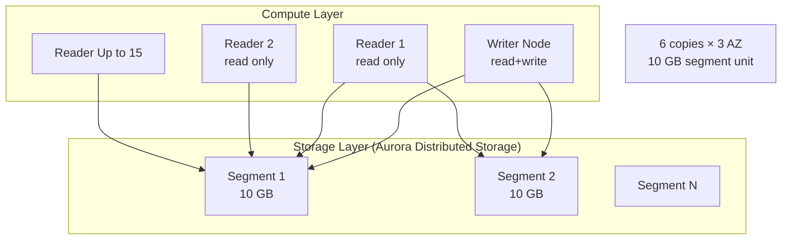
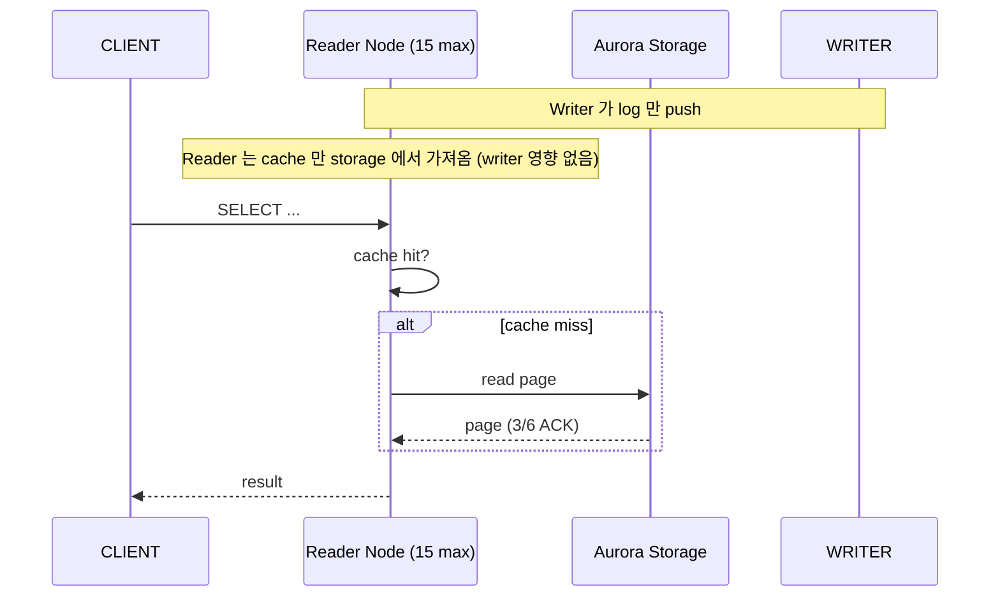
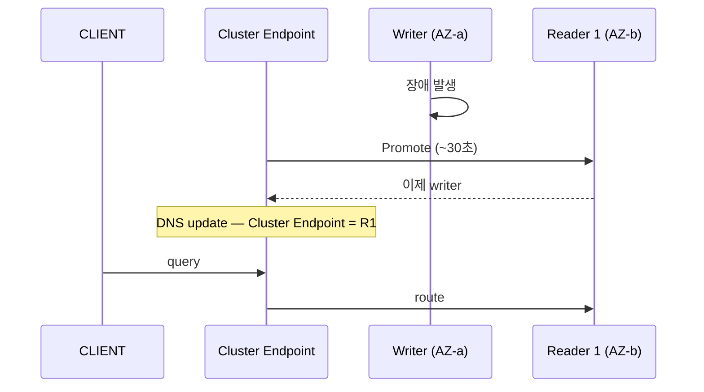

# Aurora Architecture Deep

> Storage 와 Compute 분리. 6-way replication (3 AZ × 2 copy) + 10 GB segment unit + self-healing + replica 15 max.

## 1. 2 Layer



## 2. Storage Layer 의 특징

| 특징 | 의미 |
| --- | --- |
| 10 GB segment | 자동 split / merge |
| 6-way replication | 3 AZ × 2 copy / segment |
| Quorum-based write | 4/6 ACK 후 commit |
| Quorum-based read | 3/6 ACK |
| Self-healing | corruption 자동 detect + repair |
| Auto-scale | 10 GB ~ 128 TB 자동 |
| Continuous backup | S3 에 continuous (PITR 1초 granularity) |
| Encryption at rest | 자동 KMS |

## 3. Write 의 흐름

```mermaid
sequenceDiagram
    participant CLIENT
    participant WRITER as Writer Node
    participant STORAGE as Aurora Storage

    CLIENT->>WRITER: BEGIN; INSERT INTO ...; COMMIT;
    WRITER->>WRITER: Tx log 생성 (mini-transaction)
    WRITER->>STORAGE: log record × 6 replicas (3 AZ)
    Note over STORAGE: 4/6 ACK = quorum
    STORAGE-->>WRITER: ACK
    WRITER-->>CLIENT: commit OK
```

> Aurora 는 **WAL / binlog 대신 log record 만 storage 에 push**. 기존 RDS 보다 IO 80% ↓.

## 4. Reader 의 흐름



## 5. Replica Lag

```
Aurora Replica: < 100ms (보통 < 30ms)
RDS Read Replica (async): seconds
```

Aurora 의 reader = storage 직접 read (replication 자체 없음).

## 6. Failover



| RTO | ~30초 (RDS Multi-AZ 의 1-2분 보다 빠름) |
| RPO | 0 (synchronous storage commit) |

### Failover Priority

```bash
aws rds modify-db-instance --db-instance-identifier bkurs-aurora-reader-1 \
  --promotion-tier 0   # 0 = 가장 먼저 promote (default 1)
```

→ 0-15. 낮을수록 먼저.

## 7. Auto-scale Storage

```
시작: 10 GB
DB 증가:
  10 GB → 11 GB (자동)
  20 GB
  30 GB
  ...
  128 TB (max)
```

> Storage 만 쓴 만큼 과금. Provisioned 안 함.

## 8. Aurora I/O 가격 모델

| Tier | 모델 |
| --- | --- |
| **Aurora Standard** | $0.116/GB·월 + $0.22/M IO request |
| **Aurora I/O-Optimized** | $0.225/GB·월 + IO 무료 |

I/O-Optimized 권장:
- 매월 IO cost > storage cost × 25% 일 때 (IO-Optimized 가 싸짐)
- Predictable cost

```bash
aws rds modify-db-cluster --db-cluster-identifier bkurs-aurora \
  --storage-type aurora-iopt1 --apply-immediately
```

## 9. Aurora Optimized Reads

```
io2 Block Express + r6id / x2idn instance
+ local NVMe cache (1 TB+)
→ Cache miss latency 50% ↓
```

활용: 큰 working set, OLAP + OLTP hybrid.

## 10. Backtrack (MySQL only)

```bash
# DB 전체를 과거 시점으로 되돌리기 (~수초)
aws rds backtrack-db-cluster --db-cluster-identifier bkurs-aurora-mysql \
  --backtrack-to "2026-05-22T15:30:00Z"
```

| 한도 | |
| --- | --- |
| Aurora MySQL 만 | Postgres 안 됨 |
| 최대 72 hours backward | |
| 시간 ~수초 | |
| Cost: $0.012/M change record/hour | |

> Backtrack vs PITR — Backtrack 은 빠르고 새 cluster 불필요. PITR 는 새 cluster.

## 11. Storage Cluster Volume

```bash
# Storage size 확인
aws cloudwatch get-metric-statistics --namespace AWS/RDS \
  --metric-name VolumeBytesUsed \
  --dimensions Name=DBClusterIdentifier,Value=bkurs-aurora \
  --period 86400 --statistics Average
```

## 12. Aurora vs Postgres logical replication

| | Aurora native | Postgres logical replication |
| --- | --- | --- |
| Replication | storage layer (binary) | application layer (logical) |
| Cross-region | Global Database < 1초 | manual replication |
| Lag | < 100ms | varies |
| Cross-version | ✗ | ✓ |
| Schema change | restricted | ✓ |
| Filter | ✗ | ✓ (publication) |

## 13. Cluster vs Instance

```
DB Cluster (logical):
- Writer Endpoint (1)
- Reader Endpoint (load balanced)
- Custom Endpoint (subset)
- Instance Endpoint (각각)

DB Instance (physical):
- 1 writer + N readers
- 각자 별도 EC2-like compute
- 같은 storage 공유 (분산)
```

## 14. Limitless Database (2024+, Aurora Postgres only)

```
Sharded Postgres at petabyte scale
- 자동 shard (data router)
- 표준 SQL (cross-shard query)
- Single endpoint
```

활용: 매우 큰 OLTP (Twitter / GitHub 규모).

## 15. CloudWatch metric

```
AuroraReplicaLag                 (각 reader 의 lag, < 100ms 권장)
AuroraReplicaLagMaximum / Min
VolumeBytesUsed                  (storage size)
VolumeReadIOPs / VolumeWriteIOPs (Aurora storage IO)
BufferCacheHitRatio              (cache hit)
DatabaseConnections              
ServerlessDatabaseCapacity       (Serverless v2 의 ACU)
ACUUtilization                   (Serverless 의 capacity %)
```

## 16. 흔한 함정

| 함정 | 회피 |
| --- | --- |
| Aurora vs RDS 비교 안 함 | high RPS / global = Aurora |
| Storage = Provisioned 가정 | 자동 scale (10 GB → 128 TB) |
| Reader Endpoint 안 활용 → Writer 만 | application 의 read routing |
| I/O 비용 무시 | I/O-Optimized 모드 |
| Backtrack Postgres 시도 | MySQL only |
| Failover Priority 무시 | promotion-tier 명시 |

## 17. 다음

- ▶ [[02-engines-and-versions]]
- ▶ [[03-serverless-v2]]
- ▶ [[../02-operations/01-cluster-and-endpoint]]

## 18. 영상 / 자료

| 자료 |
| --- |
| [Aurora Storage Internals](https://www.youtube.com/watch?v=fOj8c1B5j5w) |
| [Aurora Architecture 공식](https://docs.aws.amazon.com/AmazonRDS/latest/AuroraUserGuide/Aurora.Overview.html) |
| [I/O-Optimized 발표](https://aws.amazon.com/blogs/aws/new-aurora-io-optimized-cluster-configuration-with-up-to-40-cost-savings-for-i-o-intensive-applications/) |

## 19. 참고

- [[../aurora]]
- [[../../rds/01-fundamentals/03-multi-az-and-read-replica]]
