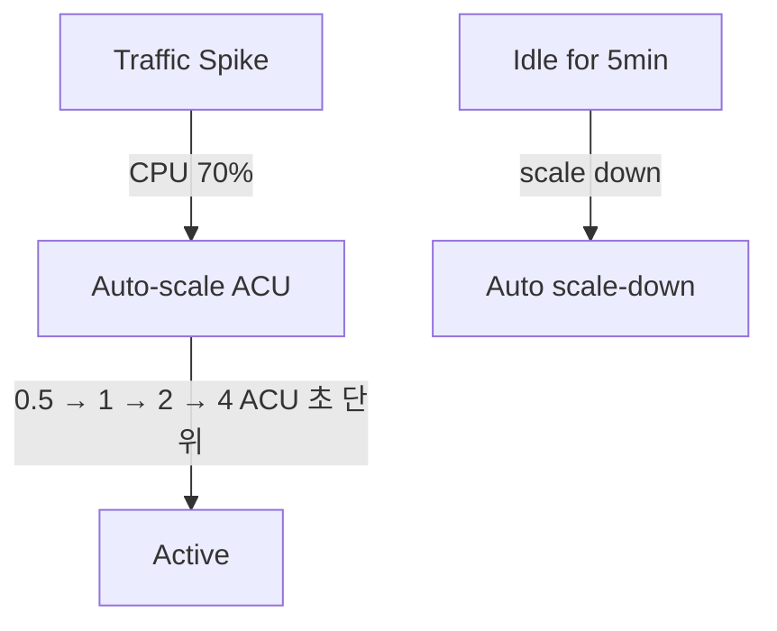
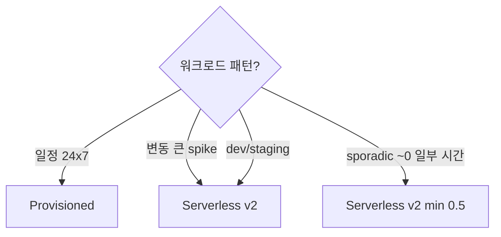

# Aurora Serverless v2

> 0.5 - 256 ACU 자동 scale (초 단위). ACU = 2 GB RAM + 비례 CPU. Provisioned 대안 (변동 큰 workload).

## 1. ACU (Aurora Capacity Unit)

```
1 ACU = 2 GB RAM + 비례 CPU (~2 vCPU 환산)
      = network bandwidth + IO 비례

Min:  0.5 ACU
Max:  256 ACU (~512 GB RAM)
```

## 2. 가격

```
$0.12 / ACU·hour (Aurora Postgres / MySQL)
$0.18 / ACU·hour (Babelfish, Optimized Reads)
```

```
0.5 ACU baseline 24x7:
  0.5 × 730 × $0.12 = $43.8/월

10 ACU peak (1 hour/day):
  추가 9.5 × 30 × $0.12 = $34.2/월

= ~$78/월 (idle + peak)
```

## 3. Cluster 생성 (Serverless v2)

```bash
aws rds create-db-cluster \
  --db-cluster-identifier bkurs-serverless \
  --engine aurora-postgresql \
  --engine-version 16.2 \
  --master-username bkurs_admin \
  --manage-master-user-password \
  --database-name bkurs \
  --serverless-v2-scaling-configuration "MinCapacity=0.5,MaxCapacity=16" \
  --storage-encrypted \
  --vpc-security-group-ids sg-rds \
  --db-subnet-group-name bkurs-db-subnet \
  --backup-retention-period 35 \
  --enable-iam-database-authentication \
  --enable-cloudwatch-logs-exports postgresql \
  --deletion-protection

# Serverless v2 Instance
aws rds create-db-instance \
  --db-instance-identifier bkurs-serverless-writer \
  --db-cluster-identifier bkurs-serverless \
  --engine aurora-postgresql \
  --db-instance-class db.serverless

# Reader 추가 (Provisioned + Serverless 혼합 가능)
aws rds create-db-instance \
  --db-instance-identifier bkurs-serverless-reader-1 \
  --db-cluster-identifier bkurs-serverless \
  --engine aurora-postgresql \
  --db-instance-class db.serverless
```

## 4. ACU 동작



특징:
- 초 단위 scaling (RDS 보다 빠름)
- Smooth transition (downtime 없음)
- min 도달 시 일부 hibernate
- 사용 안 한 ACU 무료

## 5. ACU 측정 metric

```bash
aws cloudwatch get-metric-statistics --namespace AWS/RDS \
  --metric-name ServerlessDatabaseCapacity \
  --dimensions Name=DBClusterIdentifier,Value=bkurs-serverless \
  --period 60 --statistics Average,Maximum
```

| Metric | 의미 |
| --- | --- |
| `ServerlessDatabaseCapacity` | 현재 ACU |
| `ACUUtilization` | ACU 사용률 % |

## 6. Auto-pause (v2 는 없음)

```
v1: 5분 idle → 0 ACU (cold start ~30초)
v2: 항상 min ACU (no cold start)
```

→ v2 가 v1 보다 훨씬 production-ready.

## 7. Provisioned vs Serverless v2 결정



### 비용 break-even
```
db.r6g.large = $0.30/h = 2.5 ACU 등가
→ 24x7 운영 시 Provisioned 가 싸짐 (2.5 ACU baseline 일 때)
→ 변동 클 때 Serverless v2 가 싸짐
```

## 8. Reader 의 Serverless

```bash
# Writer Provisioned + Reader Serverless 혼합
aws rds create-db-instance \
  --db-instance-identifier bkurs-writer-prov \
  --db-cluster-identifier bkurs-mixed \
  --db-instance-class db.r6g.large    # Writer

aws rds create-db-instance \
  --db-instance-identifier bkurs-reader-srv \
  --db-cluster-identifier bkurs-mixed \
  --db-instance-class db.serverless   # Reader 만 Serverless
```

→ Read 부하 spike 만 Serverless 로.

## 9. RDS Proxy 와 결합

```bash
aws rds create-db-proxy --db-proxy-name bkurs-serverless-proxy \
  --engine-family POSTGRESQL \
  --role-arn arn:aws:iam::ACCT:role/rds-proxy-role \
  --vpc-subnet-ids subnet-priv-a subnet-priv-b \
  --auth "Description=bkurs,AuthScheme=SECRETS,SecretArn=arn:secret:..."

aws rds register-db-proxy-targets --db-proxy-name bkurs-serverless-proxy \
  --db-cluster-identifiers bkurs-serverless
```

활용:
- Lambda + Aurora Serverless v2
- Connection pooling (Serverless 의 capacity ↓ 시 connection 한도)
- Failover 빠른 처리

## 10. Lambda + Aurora Serverless v2

```python
import boto3, psycopg2, json

sm = boto3.client("secretsmanager")
DB_PROXY = "bkurs-serverless-proxy.proxy-xxx.ap-northeast-2.rds.amazonaws.com"

def lambda_handler(event, context):
    secret = json.loads(sm.get_secret_value(SecretId="rds!cluster-xxx")["SecretString"])
    conn = psycopg2.connect(
        host=DB_PROXY,
        port=5432,
        user=secret["username"],
        password=secret["password"],
        dbname=secret["dbname"]
    )
    cur = conn.cursor()
    cur.execute("SELECT * FROM users LIMIT 10")
    ...
```

## 11. Serverless v2 의 use cases

✓ **시나리오**
- Variable workload (사용자 traffic 패턴 ↑↓)
- Dev / staging (사용 시간만 충전)
- SaaS multi-tenant (tenant 별 다른 부하)
- Burst-heavy reporting
- 새 startup MVP (cost 절감)
- Microservice (각 service 의 작은 DB)

✗ **부적합**
- Steady high RPS (Provisioned 가 싸다)
- 매우 low cost dev (RDS t4g.micro)
- Predictable workload (Reserved Instance 활용 가능)

## 12. CloudWatch Alarm

```bash
# ACU 80% 사용 (max 근접)
aws cloudwatch put-metric-alarm --alarm-name bkurs-acu-high \
  --metric-name ACUUtilization --namespace AWS/RDS \
  --statistic Average --period 300 --evaluation-periods 3 \
  --threshold 80 --comparison-operator GreaterThanThreshold \
  --dimensions Name=DBClusterIdentifier,Value=bkurs-serverless

# Capacity 도달 (max 도달)
aws cloudwatch put-metric-alarm --alarm-name bkurs-acu-max \
  --metric-name ServerlessDatabaseCapacity --namespace AWS/RDS \
  --statistic Maximum --period 60 --evaluation-periods 5 \
  --threshold 16 --comparison-operator GreaterThanOrEqualToThreshold
```

## 13. Optimized Reads + Serverless

io2 + r6id-equivalent (Serverless 자동) — Aurora Optimized Reads:
```
local NVMe cache (TB scale)
→ random read 50% faster
```

자동 활성 (Aurora Postgres / MySQL).

## 14. 흔한 함정

| 함정 | 회피 |
| --- | --- |
| max ACU 너무 작음 → scale up 못 함 | min 0.5 / max 16+ |
| min 0.5 production → cold response (rare) | min 1 |
| Provisioned + Serverless 혼합 시 instance class 혼동 | db.serverless 명시 |
| RDS Proxy 없이 Lambda + Aurora | proxy 활용 |
| Predictable workload → Serverless | Provisioned 가 저렴 |
| ACU billing 단위 (per second) 인지 못 함 | initial spike billing 보고 검토 |

## 15. 다음

- ▶ [[../02-operations/01-cluster-and-endpoint]]
- ▶ [[../02-operations/02-global-database-and-dr]]
- ▶ [[../practice/01-serverless-v2-cluster]]

## 16. 영상 / 자료

| 자료 |
| --- |
| [Serverless v2 발표](https://aws.amazon.com/blogs/aws/amazon-aurora-serverless-v2-is-generally-available-instant-scaling-for-demanding-workloads/) |
| [ACU 자세히](https://docs.aws.amazon.com/AmazonRDS/latest/AuroraUserGuide/aurora-serverless-v2.how-it-works.html) |

## 17. 참고

- [[../aurora]]
- [[01-architecture-deep]]
- [[../../rds/02-operations/02-performance-and-monitoring]] §RDS Proxy
