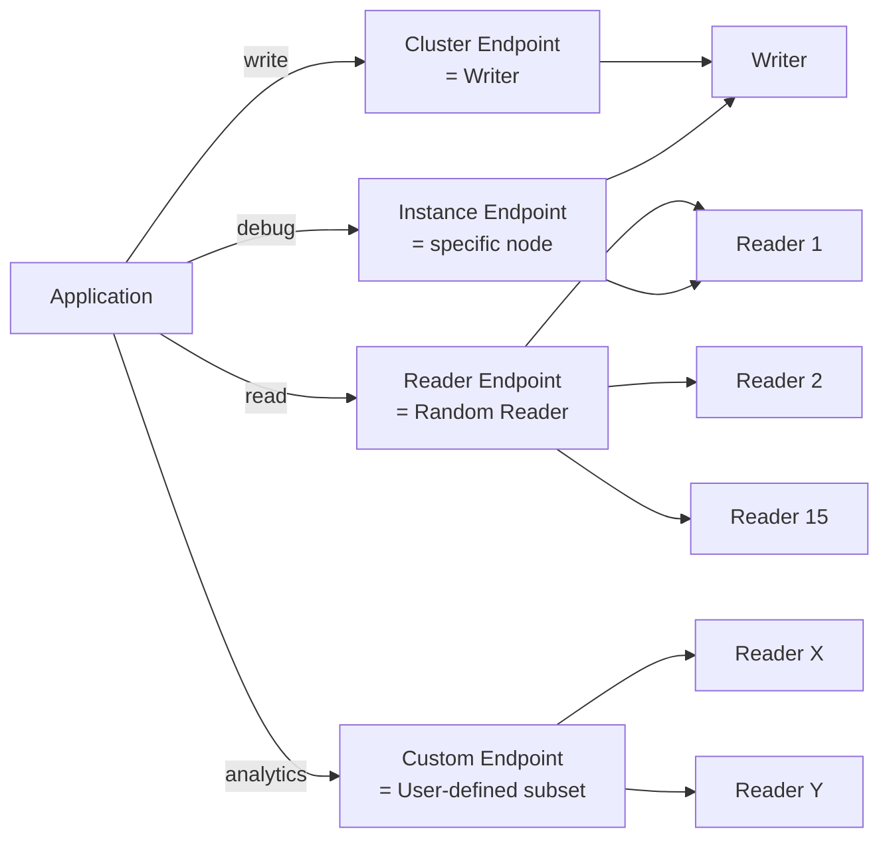

# Aurora Cluster + Endpoints

> 4 endpoint type — Writer (Cluster) / Reader / Custom / Instance. Connection routing + failover + replica promotion priority.

## 1. Endpoint 4 종



## 2. Cluster Endpoint (Writer)

```
bkurs-cluster.cluster-XXXXX.ap-northeast-2.rds.amazonaws.com
```

- 항상 Writer 가리킴
- Failover 시 자동 DNS update (~30초)
- write + read OK (READ_COMMITTED isolation default)

## 3. Reader Endpoint

```
bkurs-cluster.cluster-ro-XXXXX.ap-northeast-2.rds.amazonaws.com
```

- Reader pool 의 random load balance
- DNS-based round-robin (각 connection 마다 random)
- Reader 0개 = Cluster Endpoint 가리킴 (fallback)
- read-only

## 4. Custom Endpoint

```bash
# Static (명시한 instance 만)
aws rds create-db-cluster-endpoint \
  --db-cluster-identifier bkurs-cluster \
  --db-cluster-endpoint-identifier bkurs-analytics \
  --endpoint-type READER \
  --static-members bkurs-aurora-reader-3 bkurs-aurora-reader-4 \
  --tags Key=Purpose,Value=analytics

# Dynamic (exclusion list)
aws rds create-db-cluster-endpoint \
  --db-cluster-identifier bkurs-cluster \
  --db-cluster-endpoint-identifier bkurs-app-readers \
  --endpoint-type READER \
  --excluded-members bkurs-aurora-reader-3 bkurs-aurora-reader-4
```

```
bkurs-analytics.cluster-custom-XXXXX.ap-northeast-2.rds.amazonaws.com
```

활용:
- Analytics workload 만 별도 reader
- Big-instance reader 만 사용 (memory 부족 query)
- Tier 별 isolation

## 5. Instance Endpoint

```
bkurs-aurora-writer.XXXXX.ap-northeast-2.rds.amazonaws.com
bkurs-aurora-reader-1.XXXXX.ap-northeast-2.rds.amazonaws.com
```

- 특정 instance 직접 (load balance 없음)
- 활용: debugging / direct admin
- 권장 사용 X (cluster/reader endpoint 사용)

## 6. Connection 라우팅 — Application

```python
# Spring Boot multi-datasource
spring:
  datasource:
    write:
      url: jdbc:postgresql://bkurs-cluster.cluster-xxx.../bkurs
    read:
      url:  jdbc:postgresql://bkurs-cluster.cluster-ro-xxx.../bkurs

# Routing (Read/Write splitter)
@Transactional(readOnly = true)   # → read DataSource
public List<User> findAll() { ... }

@Transactional                    # → write DataSource
public User save(User user) { ... }
```

또는 ORM 의 read replicas (Django / SQLAlchemy).

## 7. Failover Priority (promotion-tier)

```bash
aws rds modify-db-instance \
  --db-instance-identifier bkurs-aurora-reader-1 \
  --promotion-tier 0    # 0 = 가장 먼저 promote
```

| Tier | 의미 |
| --- | --- |
| 0-15 | 낮을수록 먼저 |
| Default | 1 |
| Same tier | Reader 의 size 가 큰 것 |

→ 강력한 reader 를 tier 0 으로 → 안정적 failover.

## 8. Manual Failover

```bash
# Random reader 가 promote
aws rds failover-db-cluster --db-cluster-identifier bkurs-cluster

# 특정 reader 명시
aws rds failover-db-cluster --db-cluster-identifier bkurs-cluster \
  --target-db-instance-identifier bkurs-aurora-reader-1
```

~30초 안 새 writer.

## 9. DNS Cache 의 trade-off

```
Linux JVM default TTL: 30s
Postgres / MySQL client: connection 시 한번
```

→ Failover 후 application 의 connection cache 가 옛 IP 가리킬 수 있음.

해결:
- Driver 의 connection validation (`SELECT 1`)
- HikariCP / pgBouncer 의 connection age limit
- RDS Proxy (DNS 추상화)

## 10. Instance class mix

```bash
# Writer: db.r6g.xlarge (큰 instance)
# Reader 1, 2: db.r6g.large (보통)
# Reader 3 (analytics): db.r6g.4xlarge (큰)
# Reader 4 (serverless): db.serverless
```

→ Custom Endpoint 로 analytics / serverless 분리.

## 11. Reader 수 조정

```bash
# Add reader
aws rds create-db-instance \
  --db-instance-identifier bkurs-aurora-reader-N \
  --db-cluster-identifier bkurs-cluster \
  --engine aurora-postgresql \
  --db-instance-class db.r6g.large \
  --availability-zone ap-northeast-2c

# Remove
aws rds delete-db-instance \
  --db-instance-identifier bkurs-aurora-reader-N \
  --skip-final-snapshot
```

Application Auto Scaling 으로 자동:
[[../../../compute/auto-scaling/01-fundamentals/02-application-auto-scaling]] §Aurora.

## 12. Instance Endpoint 의 활용

```bash
# Maintenance / direct query
psql -h bkurs-aurora-writer.XXXXX.ap-northeast-2.rds.amazonaws.com \
  -U lab_admin -d bkurs

# Reader 직접 (replica 검증)
psql -h bkurs-aurora-reader-1.XXXXX.ap-northeast-2.rds.amazonaws.com \
  -U lab_admin -d bkurs -c "SELECT pg_is_in_recovery()"
```

## 13. 흔한 함정

| 함정 | 회피 |
| --- | --- |
| Cluster Endpoint 만 사용 → reader 사용 X | Reader Endpoint 활용 |
| Reader 0개 → Reader Endpoint = Writer | Reader 최소 1 |
| Custom Endpoint 의 static member 자동 추가 안 됨 | exclusion 활용 |
| DNS cache → failover 늦음 | RDS Proxy |
| Application 의 read/write 분리 안 함 | ORM 의 read replicas |
| Promotion tier 모두 default | critical reader 를 0 으로 |

## 14. 다음

- ▶ [[02-global-database-and-dr]]
- ▶ [[03-backup-and-blue-green]]
- ▶ [[../practice/01-serverless-v2-cluster]]

## 15. 영상 / 자료

| 자료 |
| --- |
| [Aurora Endpoints](https://docs.aws.amazon.com/AmazonRDS/latest/AuroraUserGuide/Aurora.Overview.Endpoints.html) |
| [Failover](https://docs.aws.amazon.com/AmazonRDS/latest/AuroraUserGuide/Concepts.AuroraHighAvailability.html) |

## 16. 참고

- [[../aurora]]
- [[../01-fundamentals/01-architecture-deep]]
- [[../01-fundamentals/03-serverless-v2]]
