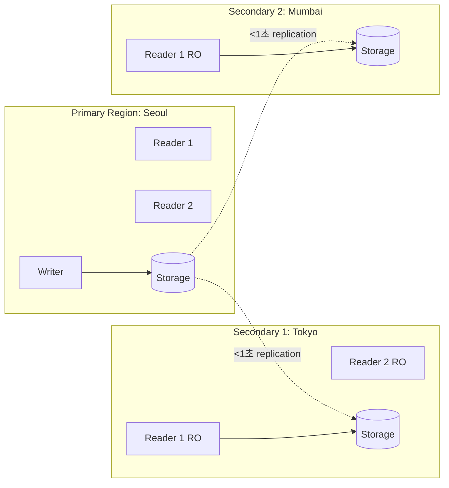

# Aurora Global Database + DR

> Cross-region < 1초 replication + 5 secondary regions + RTO < 1분 + RPO < 5초. Headless secondary + Storage-level replication.

## 1. Global Database 구조



## 2. 특징

| | |
| --- | --- |
| Replication latency | < 1초 (보통 < 250ms) |
| RPO | < 5초 |
| RTO | < 1분 (Failover) |
| Secondary regions | 5 max |
| Secondary writes | ✗ (read-only) |
| Failover | Manual / automatic with Switchover |

> Replication 은 **storage layer** — application 에 영향 없음.

## 3. Global Cluster 생성

```bash
aws rds create-global-cluster \
  --global-cluster-identifier bkurs-global \
  --source-db-cluster-identifier arn:aws:rds:ap-northeast-2:ACCT:cluster:bkurs-aurora-primary
```

기존 cluster 가 primary 가 됨.

## 4. Secondary Cluster 추가

```bash
# Secondary cluster (Tokyo)
aws rds create-db-cluster \
  --db-cluster-identifier bkurs-aurora-tokyo \
  --global-cluster-identifier bkurs-global \
  --engine aurora-postgresql \
  --engine-version 16.2 \
  --storage-encrypted --kms-key-id arn:aws:kms:ap-northeast-1:ACCT:key/abc \
  --region ap-northeast-1

# Instance (Reader)
aws rds create-db-instance \
  --db-instance-identifier bkurs-aurora-tokyo-reader-1 \
  --db-cluster-identifier bkurs-aurora-tokyo \
  --engine aurora-postgresql \
  --db-instance-class db.r6g.large \
  --region ap-northeast-1
```

## 5. Failover 옵션 2

### Managed Planned Failover (계획)
```bash
aws rds switchover-global-cluster \
  --global-cluster-identifier bkurs-global \
  --target-db-cluster-identifier arn:aws:rds:ap-northeast-1:ACCT:cluster:bkurs-aurora-tokyo
```

- Primary 의 write 잠시 중단
- Replication sync 후 Tokyo 가 새 primary
- ~수분
- Application 의 DB endpoint 변경 (DNS / config)

### Unplanned Failover (재난)
```bash
# Tokyo 를 promote (primary 의 응답 없음)
aws rds failover-global-cluster \
  --global-cluster-identifier bkurs-global \
  --target-db-cluster-identifier arn:aws:rds:ap-northeast-1:ACCT:cluster:bkurs-aurora-tokyo \
  --allow-data-loss
```

- 즉시 promote
- 일부 데이터 loss 가능 (RPO 5초)
- Old primary 는 detach

## 6. Failover 후 동작

```
Old Primary (Seoul):
- Detached cluster 가 됨 (standalone)
- 데이터 그대로 (write 가능)
- 새 secondary 로 등록 가능

New Primary (Tokyo):
- 모든 write/read
- 기존 readers 가 read 처리
```

## 7. DR 전략 패턴

### Hot Standby (active-passive)
```
Primary:    All writes + reads (Seoul)
Secondary:  Read-only reporting (Tokyo)
Failover:   Manual switchover (RTO ~1분)
```

### Active-Active (read 분산)
```
Primary:    All writes + Seoul read
Secondary:  Tokyo region 의 사용자 read 만 (latency ↓)
            Tokyo 의 write → Seoul 로 routing
```

### Pilot Light (cold standby — 가장 cost ↓)
```
Primary:    Active
Secondary:  Reader 1 만 (작은 instance)
Failover:   Promote + add readers
```

## 8. Application 의 cross-region routing

### 1) Primary 만 write, 가까운 region 에서 read
```python
def get_user(user_id):
    return secondary_db.query("SELECT ... WHERE id = ?", user_id)

def update_user(user_id, data):
    return primary_db.execute("UPDATE ... SET ... WHERE id = ?", data, user_id)
```

### 2) Smart routing (Route 53 latency)
```bash
# Route 53 의 latency-based routing
db.bkurs.com → bkurs-cluster-ro.cluster-ro-...amazonaws.com (가까운 region)
```

→ User 의 latency 최소화.

## 9. Backup Strategy

```
Primary region:
- Daily snapshot
- 35d retention
- PITR

Secondary region:
- 자동 storage replication
- Snapshot 직접 안 함 (primary 의 snapshot 으로 충분)
- Cross-region 별도 backup 필요 시 AWS Backup
```

> Global Database 의 secondary 자체가 DR — backup 별도 한 layer 더.

## 10. Limitless Database 와 Global Database

```
Limitless: 단일 region 의 sharded scaling
Global:    multi-region replication

→ 같이 사용 가능 (Limitless 의 cross-region)
```

## 11. Cost

```
Each region 의 standalone cluster cost (instance + storage)
+ Cross-region replication DT $0.02/GB
+ Cross-region snapshot copy DT
```

## 12. RPO / RTO 비교

| | Global DB | Read Replica (Aurora) | Manual snapshot copy |
| --- | --- | --- | --- |
| RPO | < 5초 | < 1분 | hours |
| RTO | < 1분 | 수분 | hours |
| Cost | high | mid | low |

## 13. CloudWatch metric

```bash
aws cloudwatch get-metric-statistics --namespace AWS/RDS \
  --metric-name AuroraGlobalDBReplicatedWriteIO \
  --dimensions Name=DBClusterIdentifier,Value=bkurs-aurora-tokyo \
  --period 60 --statistics Sum

aws cloudwatch get-metric-statistics --namespace AWS/RDS \
  --metric-name AuroraGlobalDBReplicationLag \
  --dimensions Name=DBClusterIdentifier,Value=bkurs-aurora-tokyo \
  --period 60 --statistics Maximum
```

| Metric | 의미 |
| --- | --- |
| `AuroraGlobalDBReplicationLag` | secondary 의 lag (ms) |
| `AuroraGlobalDBReplicatedWriteIO` | replicated IO |
| `AuroraGlobalDBDataTransferBytes` | DT 양 |

## 14. 흔한 함정

| 함정 | 회피 |
| --- | --- |
| Secondary 에 write 시도 | read-only 강제 |
| Failover 후 application DNS 안 바꿈 | Route 53 latency-based |
| Cross-region DT 비용 무시 | TimeBasedCanary 점검 |
| Replication lag alarm 없음 | < 5초 threshold |
| Failover 시 data loss 인정 안 함 | RPO 5초 |
| Backup 별도 안 함 (Global DB 만 의존) | AWS Backup 추가 |

## 15. 다음

- ▶ [[03-backup-and-blue-green]]
- ▶ [[../practice/02-global-database]]
- ▶ [[../../../network/route53/route53]]

## 16. 영상 / 자료

| 자료 |
| --- |
| [Global Database](https://aws.amazon.com/rds/aurora/global-database/) |
| [Failover 공식](https://docs.aws.amazon.com/AmazonRDS/latest/AuroraUserGuide/aurora-global-database-failover.html) |

## 17. 참고

- [[../aurora]]
- [[01-cluster-and-endpoint]]
- [[../../rds/02-operations/01-backup-and-pitr]]
