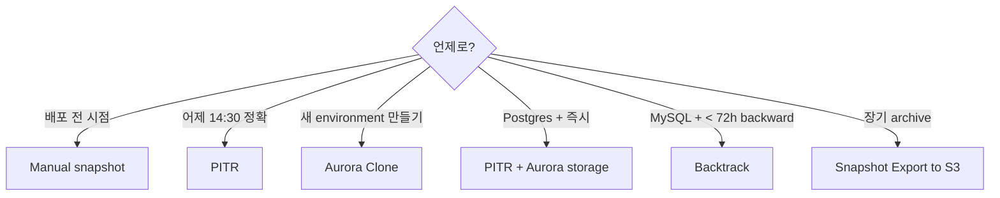

# Aurora Backup + Blue-Green Deployment

> Continuous backup (PITR 1초) + Cluster snapshot + Aurora Clone (zero-copy, instant) + Blue-Green Deployment (zero-downtime upgrade).

## 1. Aurora Backup의 특징

| | Aurora | RDS |
| --- | --- | --- |
| Continuous backup | ✓ (storage level) | ✗ (Tx log every 5분) |
| PITR granularity | 1초 | 1분 |
| Retention | 1-35d | 1-35d |
| Storage cost | Continuous backup 동일 (storage 안) | Tx log 별도 |
| Cross-region copy | ✓ | ✓ |
| Aurora Clone | ✓ (zero-copy) | ✗ |

## 2. PITR Restore

```bash
# 가능 시점
aws rds describe-db-clusters --db-cluster-identifier bkurs-aurora \
  --query 'DBClusters[0].{Earliest:EarliestRestorableTime,Latest:LatestRestorableTime}'

# Restore to point in time (새 cluster)
aws rds restore-db-cluster-to-point-in-time \
  --db-cluster-identifier bkurs-aurora-restored \
  --source-db-cluster-identifier bkurs-aurora \
  --restore-to-time "2026-05-22T15:30:00Z" \
  --restore-type copy-on-write \
  --vpc-security-group-ids sg-rds \
  --db-subnet-group-name bkurs-db-subnet \
  --kms-key-id alias/bkurs-aurora
```

## 3. Snapshot

```bash
# Manual snapshot
aws rds create-db-cluster-snapshot \
  --db-cluster-identifier bkurs-aurora \
  --db-cluster-snapshot-identifier bkurs-aurora-pre-upgrade \
  --tags Key=Reason,Value=pre-upgrade

# Restore from snapshot
aws rds restore-db-cluster-from-snapshot \
  --db-cluster-identifier bkurs-aurora-restored \
  --snapshot-identifier bkurs-aurora-pre-upgrade \
  --engine aurora-postgresql
```

## 4. Aurora Clone — Zero-Copy

```bash
aws rds restore-db-cluster-to-point-in-time \
  --db-cluster-identifier bkurs-aurora-clone \
  --source-db-cluster-identifier bkurs-aurora \
  --restore-type copy-on-write \
  --use-latest-restorable-time
```

특징:
- **Zero-copy** (storage 의 같은 block reference)
- ~수분 안 ready
- Source 의 storage 변경 시 점진적 divergence
- 새 storage 만 추가 (변경된 block 만 새로)
- 같은 region 만

활용:
- Dev / test environment (production data, 변경 자유)
- Schema change test
- Data migration prep
- A/B test

## 5. Continuous backup vs Manual snapshot

| | Continuous | Manual Snapshot |
| --- | --- | --- |
| Trigger | Aurora 자동 (storage level) | 사용자 명시 |
| PITR | ✓ (within retention) | ✗ |
| Retention | 1-35d | 영구 |
| Storage | Aurora storage 안 (별도 X) | 별도 (S3 hidden) |
| Cost | included | $0.021/GB·월 |
| Cross-region copy | ✗ | ✓ |

## 6. AWS Backup 통합

```bash
aws backup create-backup-plan --backup-plan '{
  "BackupPlanName": "bkurs-aurora-daily",
  "Rules": [{
    "RuleName": "daily",
    "TargetBackupVaultName": "bkurs-vault-aps2",
    "ScheduleExpression": "cron(0 18 * * ? *)",
    "Lifecycle": {
      "MoveToColdStorageAfterDays": 30,
      "DeleteAfterDays": 365
    },
    "CopyActions": [{
      "DestinationBackupVaultArn": "arn:aws:backup:ap-northeast-1:ACCT:backup-vault:bkurs-vault-apn1",
      "Lifecycle": { "DeleteAfterDays": 365 }
    }]
  }]
}'
```

## 7. Blue-Green Deployment (Aurora)

```bash
aws rds create-blue-green-deployment \
  --blue-green-deployment-name bkurs-aurora-upgrade \
  --source arn:aws:rds:ap-northeast-2:ACCT:cluster:bkurs-aurora \
  --target-engine-version 17.0 \
  --target-db-cluster-parameter-group-name bkurs-aurora-pg17 \
  --target-db-parameter-group-name bkurs-aurora-pg17-instance \
  --tags Key=Reason,Value=upgrade

# 검증 후 switch
aws rds switchover-blue-green-deployment \
  --blue-green-deployment-identifier bgd-xxx \
  --switchover-timeout 300
```

→ ~수초 downtime. Endpoint 그대로 (cluster level swap).

자세히 → [[../../rds/02-operations/03-migration-and-blue-green]] §Blue-Green

## 8. Snapshot Sharing (cross-account)

```bash
aws rds modify-db-cluster-snapshot-attribute \
  --db-cluster-snapshot-identifier bkurs-aurora-pre-upgrade \
  --attribute-name restore \
  --values-to-add "OTHER_ACCT"

# KMS grant
aws kms create-grant --key-id alias/bkurs-aurora \
  --grantee-principal arn:aws:iam::OTHER_ACCT:role/ImportRole \
  --operations Decrypt CreateGrant DescribeKey
```

## 9. Snapshot Export to S3

```bash
aws rds start-export-task \
  --export-task-identifier bkurs-export-$(date +%s) \
  --source-arn arn:aws:rds:ap-northeast-2:ACCT:cluster-snapshot:bkurs-aurora-pre-upgrade \
  --s3-bucket-name bkurs-snapshot-export \
  --iam-role-arn arn:aws:iam::ACCT:role/snapshot-export-role \
  --kms-key-id alias/bkurs-aurora \
  --export-only "bkurs.public"
```

→ Parquet → Athena query.

## 10. Backtrack (Aurora MySQL 만)

```bash
aws rds backtrack-db-cluster \
  --db-cluster-identifier bkurs-aurora-mysql \
  --backtrack-to "2026-05-22T15:30:00Z"
```

| | Backtrack | PITR |
| --- | --- | --- |
| Engine | MySQL only | Postgres + MySQL |
| 동작 | in-place rewind | new cluster |
| 시간 | ~수초 | ~수분 |
| Window | 72h backward max | 35d (retention) |
| Cost | $0.012/M change record/hour | included |

## 11. Restore options 비교



## 12. RDS Event Notifications

```bash
aws rds create-event-subscription \
  --subscription-name bkurs-aurora-events \
  --sns-topic-arn arn:sns:...:bkurs-rds-events \
  --source-type db-cluster \
  --event-categories "failure" "failover" "backup" "deletion" \
  --source-ids bkurs-aurora
```

## 13. 흔한 함정

| 함정 | 회피 |
| --- | --- |
| Aurora Clone 의 cross-region 시도 | same region only |
| Snapshot 만 보존 → 자동 안 됨 | Continuous + Snapshot 둘 다 |
| Blue-Green + Global Database 시도 | 미지원 (primary cluster 만) |
| Backtrack Postgres 시도 | MySQL only |
| Restore 후 endpoint 변경 안 함 | application config |
| Snapshot export 에 IAM 누락 | snapshot-export-role |

## 14. 권장 — bkurs-be Aurora

```
Continuous backup:        35d retention
Manual snapshot:          weekly (manual)
AWS Backup:               daily + cross-region copy + Vault Lock
Aurora Clone:             dev / staging environment
Blue-Green Deployment:    major version upgrade
Backtrack:                MySQL 의 빠른 rollback
Snapshot Export to S3:    monthly compliance archive
```

## 15. 다음

- ▶ [[../practice/01-serverless-v2-cluster]]
- ▶ [[../practice/02-global-database]]
- ▶ [[../../rds/02-operations/01-backup-and-pitr]]

## 16. 영상 / 자료

| 자료 |
| --- |
| [Aurora Backup](https://docs.aws.amazon.com/AmazonRDS/latest/AuroraUserGuide/Aurora.Managing.Backups.html) |
| [Aurora Clone](https://docs.aws.amazon.com/AmazonRDS/latest/AuroraUserGuide/Aurora.Managing.Clone.html) |

## 17. 참고

- [[../aurora]]
- [[../01-fundamentals/01-architecture-deep]]
- [[../../rds/02-operations/03-migration-and-blue-green]]
