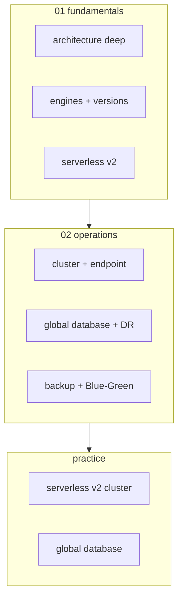
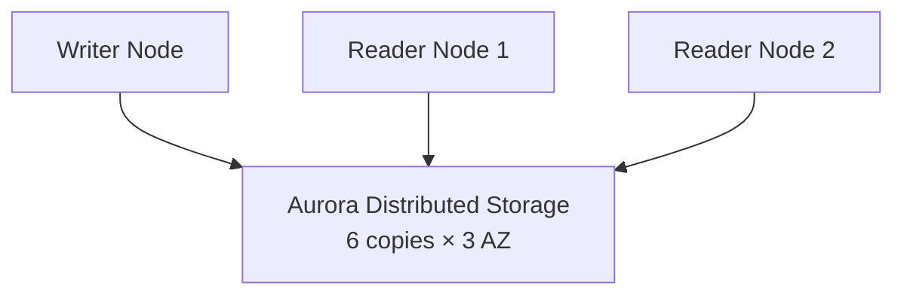
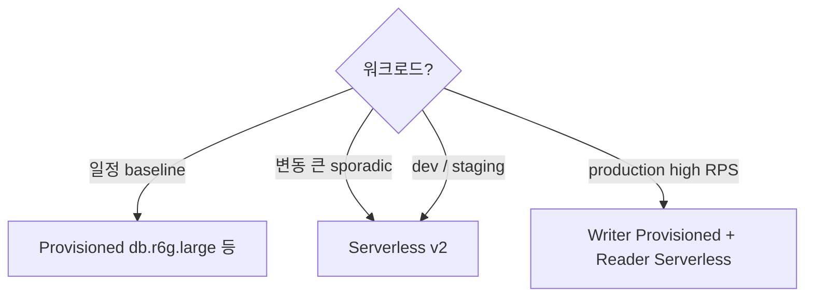
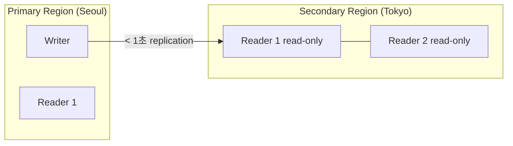

# AWS Aurora — Cloud-native RDB

> AWS 의 RDB engine — Postgres / MySQL 호환 + cloud-native (shared storage, 분산 SSD cluster). RDS 보다 3-5x 성능, Serverless v2, Global Database.

**[[../database|↑ Database]]** · **[[../../cloud-aws|↑↑ AWS]]**

---

## 1. 한 줄

```
Aurora = Cloud-native RDBMS
├─ Storage layer: 분산 SSD (6 copy across 3 AZ, 자동 scale 10 GB→128 TB)
├─ Compute layer: Writer (1) + Readers (15 max)
├─ Engine: Postgres-compatible / MySQL-compatible
├─ Modes: Provisioned / Serverless v2 (0.5 ACU-128 ACU)
├─ HA: Failover ~30초
└─ Global Database: < 1초 cross-region replication
```

## 2. 학습 roadmap



## 3. Sub-directory index

### [[01-fundamentals/01-architecture-deep]] — Shared Storage / 6-way replication / Replica
Storage 가 compute 와 분리. 분산 + 자동 scale.

### [[01-fundamentals/02-engines-and-versions]] — Aurora Postgres / MySQL / Babelfish
호환성 + version + Limitless Database (2024+).

### [[01-fundamentals/03-serverless-v2]] — Serverless v2 (0.5-128 ACU)
fine-grained scale + ACU = 2 GB RAM + proportional CPU.

### [[02-operations/01-cluster-and-endpoint]] — Cluster + Writer/Reader Endpoint
4 endpoint type + Reader load balance + Custom Endpoint.

### [[02-operations/02-global-database-and-dr]] — Global Database / Backtrack / Backup
Cross-region < 1초 + Backtrack (MySQL) + AWS Backup.

### [[02-operations/03-backup-and-blue-green]] — Snapshot + PITR + Blue-Green
Aurora 의 backup 도 cluster level.

### [[practice/01-serverless-v2-cluster]] — Aurora Serverless v2 + RDS Proxy + scaling (60분)

### [[practice/02-global-database]] — Cross-region Global DB + failover 시뮬 (60분)

## 4. RDS vs Aurora

| | RDS Postgres | Aurora Postgres |
| --- | --- | --- |
| Storage | EBS (gp3/io2) | 분산 SSD (Aurora storage) |
| Storage scaling | manual (Storage Auto Scaling) | 자동 (10 GB → 128 TB) |
| Read Replica | 5 max, async | 15 max, < 100ms |
| Failover | 1-2 분 | ~30초 |
| Backup | EBS snapshot | 분산 continuous |
| PITR granularity | 1분 | 1초 |
| Throughput | baseline | 3x (Postgres) / 5x (MySQL) |
| Serverless | ✗ | ✓ (v2) |
| Global DB | manual replica | < 1초 cross-region |
| Backtrack | ✗ | MySQL only |
| Cost | baseline | premium (~20% ↑) |

## 5. Aurora 의 storage 혁신



- Writer 와 Readers 가 **같은 storage 공유**
- Storage 는 자동 scale (10 GB → 128 TB)
- 6-way replication (3 AZ, 각 AZ 2 copy)
- Self-healing (corruption 자동 repair)
- Cluster 안 모든 node 의 storage 동일

## 6. Endpoint 4 종

| Endpoint | 의미 |
| --- | --- |
| **Cluster (Writer)** | 항상 writer 가리킴 (failover 자동) |
| **Reader** | reader pool 의 random load balance |
| **Instance** | 특정 instance 직접 |
| **Custom** | 사용자 정의 subset (e.g. analytics reader) |

## 7. Provisioned vs Serverless v2



### Serverless v2 의 ACU
```
1 ACU = 2 GB RAM + 비례 CPU + 비례 network
0.5 ACU min → 128 ACU max
초 단위 scale
$0.12/ACU·hour
```

## 8. Global Database



- Cross-region replication < 1초
- 5 secondary regions max
- Failover Promote ~1분 (RTO < 1분, RPO < 5초)
- Headless (secondary 의 writer 없음 → primary 만 write)

## 9. bkurs-be 활용

```
Aurora Serverless v2 권장:
- min 0.5 ACU / max 4 ACU (production)
- min 0.5 ACU / max 1 ACU (dev/staging)
- RDS Proxy (Lambda + Aurora)
- Writer + Reader Endpoint 분리
- Multi-AZ 자동 (Aurora default)
- Backup retention 35d
- Secrets Manager managed password + 30d rotation
```

## 10. 가격 시뮬레이션

```
Aurora Postgres + db.r6g.large:
  $0.30/h × 730 = $219/월 (instance)
+ 100 GB storage × $0.116/GB = $11.6/월
+ IO request × $0.22/M = ($X depending on workload)
= ~$230-260/월

Aurora Serverless v2 1 ACU baseline:
  1 ACU × $0.12 × 730 = $87/월 (idle)
  + spike (2-4 ACU) = $50-100 추가
+ Storage = $11.6
= ~$150-250/월

→ Variable workload 시 Serverless 가 적합. Steady high RPS 는 Provisioned.
```

## 11. Aurora 권장 use cases

✓ **시나리오**
- High RPS web/API
- Read-heavy (Reader 15)
- Multi-region (Global Database)
- Variable workload (Serverless v2)
- Microservices share DB
- Analytical workload + OLTP (Aurora Optimized Reads)
- Lambda + DB (RDS Proxy)

✗ **부적합**
- SQL Server / Oracle (RDS 만)
- 작은 < $50/월 (RDS Postgres 가 더 적합)
- 매우 cost-sensitive (Aurora ~20% premium)

## 12. 영상 / 자료

| 자료 |
| --- |
| [Aurora Architecture](https://docs.aws.amazon.com/AmazonRDS/latest/AuroraUserGuide/Aurora.Overview.html) |
| [Aurora 5x faster](https://www.youtube.com/watch?v=HrqIPGE_iwo) |
| [Serverless v2 발표](https://aws.amazon.com/blogs/aws/amazon-aurora-serverless-v2-is-generally-available-instant-scaling-for-demanding-workloads/) |
| [Global Database](https://aws.amazon.com/rds/aurora/global-database/) |

## 13. 관련 hub

- [[../database]]
- [[../rds/rds]] — 전통 RDS
- [[../dynamodb/dynamodb]] — NoSQL
- [[../../security/kms/kms]]
- [[../../security/secrets-manager/secrets-manager]]
