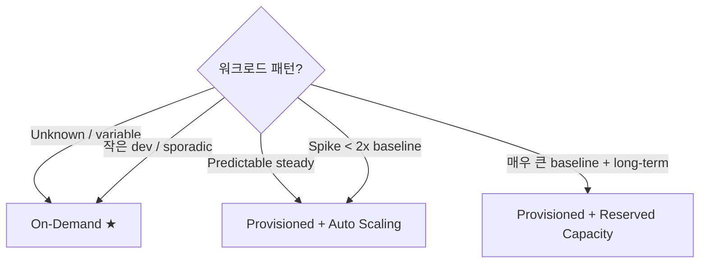

# DynamoDB Capacity + Pricing

> 2 mode — On-Demand (자동) / Provisioned (예약 + Auto Scaling). RCU = read / WCU = write. DAX cache + Reserved capacity.

## 1. 2 Capacity Mode

| | On-Demand | Provisioned |
| --- | --- | --- |
| Trigger | per-request | RCU/WCU 미리 예약 |
| Scaling | 자동 즉시 | Application Auto Scaling |
| Cost | per request | per RCU/WCU·hour |
| 권장 | variable / unknown | predictable |
| Reserved capacity | ✗ | ✓ (1y / 3y, -50%) |

## 2. Pricing — Seoul

### On-Demand
```
Read:    $0.142 / 1M request
Write:   $0.713 / 1M request
Storage: $0.25 / GB·월
Backup:  $0.10 / GB·월 (continuous PITR)
         $0.10 / GB·월 (on-demand backup)
Stream:  $0.02 / 100K read request
```

### Provisioned
```
RCU: $0.000114 / RCU·hour → $0.083/RCU·월
WCU: $0.000571 / WCU·hour → $0.42/WCU·월
Storage: $0.25 / GB·월
```

### Reserved (1y / 3y)
```
1y all upfront:  ~$50/100 RCU·월   (~40% 절감)
3y all upfront:  ~$25/100 RCU·월   (~70% 절감)
```

## 3. RCU / WCU 의 의미

| Unit | 의미 |
| --- | --- |
| 1 RCU | 1 strongly consistent read of 4 KB item / sec |
| | 또는 2 eventually consistent read of 4 KB |
| | 또는 0.5 transactional read |
| 1 WCU | 1 write of 1 KB item / sec |
| | 또는 0.5 transactional write |

### 계산 예
```
GET 8 KB item (strong):  2 RCU 사용
PUT 2 KB item:           2 WCU 사용
Query 의 10 × 4 KB = 40 KB:  10 RCU (strong) 또는 5 RCU (eventual)
```

## 4. On-Demand 의 동작

```
Initial:        4000 req/s (read) / 4000 (write) max — instant
Auto-scale:     30분 내 doubled (8000 → 16000 → ...)
Burst:          몇 분 안 매우 큰 spike OK
No throttle:    rate limit 자체 없음 (account limit 까지)
```

## 5. Provisioned 의 동작

```bash
aws dynamodb update-table --table-name bkurs-orders \
  --provisioned-throughput ReadCapacityUnits=100,WriteCapacityUnits=50
```

→ 100 RCU 보장. 초과 = throttling (ProvisionedThroughputExceededException).

### Application Auto Scaling
```bash
# WCU
aws application-autoscaling register-scalable-target \
  --service-namespace dynamodb \
  --resource-id "table/bkurs-orders" \
  --scalable-dimension dynamodb:table:WriteCapacityUnits \
  --min-capacity 5 --max-capacity 1000

aws application-autoscaling put-scaling-policy \
  --policy-name wcu-target \
  --service-namespace dynamodb \
  --resource-id "table/bkurs-orders" \
  --scalable-dimension dynamodb:table:WriteCapacityUnits \
  --policy-type TargetTrackingScaling \
  --target-tracking-scaling-policy-configuration '{
    "TargetValue": 70.0,
    "PredefinedMetricSpecification": {
      "PredefinedMetricType": "DynamoDBWriteCapacityUtilization"
    },
    "ScaleOutCooldown": 60,
    "ScaleInCooldown": 600
  }'

# RCU 도 동일 (Read)
```

자세히 → [[../../../compute/auto-scaling/01-fundamentals/02-application-auto-scaling]] §DynamoDB.

## 6. Mode 결정



## 7. Switch 가능

```bash
# Provisioned → On-Demand
aws dynamodb update-table --table-name bkurs-orders \
  --billing-mode PAY_PER_REQUEST

# On-Demand → Provisioned
aws dynamodb update-table --table-name bkurs-orders \
  --billing-mode PROVISIONED \
  --provisioned-throughput ReadCapacityUnits=100,WriteCapacityUnits=50
```

| 한도 | 24h 마다 1회 |

## 8. Adaptive Capacity

```
Hot partition 자동 detect
→ instant burst boost (예약 안 한 partition 의 capacity 빌림)
→ 자동 split partition (큰 partition 의 자동 분할)
```

→ 사용자 인지 없이 hot partition 완화.

## 9. Throttling

```
ProvisionedThroughputExceededException → client SDK 자동 retry (exponential backoff)
RequestLimitExceeded → account quota 초과
ItemSizeTooLarge → 400 KB+ item
```

### CloudWatch metric
```
ProvisionedReadCapacityUnits / Write — provisioned
ConsumedReadCapacityUnits / Write     — 사용한
UserErrors                            — 4xx
SystemErrors                          — 5xx
ThrottledRequests                     — throttled
ReturnedItemCount                     — Query / Scan
SuccessfulRequestLatency              — latency
```

## 10. DAX (DynamoDB Accelerator)

```bash
aws dax create-cluster \
  --cluster-name bkurs-dax \
  --node-type dax.t3.medium \
  --replication-factor 3 \
  --iam-role-arn arn:aws:iam::ACCT:role/dax-role \
  --subnet-group-name bkurs-dax-subnet
```

| | |
| --- | --- |
| Read latency | μs (DDB 의 ms 보다 1000x) |
| Write | through (DDB 에 직접) |
| Cache | item cache + query cache |
| TTL | 5min (default) |
| Use | read-heavy, hot data |

가격:
```
dax.r5.large × 3 node = $0.247/h × 3 × 730 = $540/월
```

> 사용자 access pattern 이 hot 일 때만. cold cache 는 의미 없음.

## 11. Reserved Capacity

```bash
aws dynamodb purchase-reserved-capacity-offerings \
  --reserved-capacity-offerings-id xxx \
  --reserved-capacity-units 100
```

| | |
| --- | --- |
| 1y term | 100 RCU = ~$50/월 (40% 절감) |
| 3y term | ~$25/월 (70% 절감) |
| Cancelable | ✗ |

> 3+ 개월 안정 운영 = Reserved 권장.

## 12. 비용 시뮬레이션 — 시나리오 비교

### Sporadic API (10K req/일)
```
On-Demand:
  10K read × 30 / 1M × $0.142 = $0.04/월 + storage 무료 quota
  
Provisioned 5 RCU:
  5 × 0.000114 × 24 × 30 = $0.41/월
  → On-Demand 가 훨씬 싸다
```

### Sustained API (10M req/일)
```
On-Demand:
  10M × 30 / 1M × $0.142 = $42/월
  
Provisioned 1000 RCU (peak):
  1000 × 0.083 = $83/월
  → On-Demand 가 더 싸다 (under-provisioning 시)

Provisioned 500 RCU + Auto Scaling:
  500 × 0.083 = $42/월
  → 비슷
```

> Provisioned 가 압도적인 경우 = baseline + Reserved Capacity 1y/3y.

## 13. Item Compression — 비용 절감

```python
import zlib, json
# Write 시 compress
data = zlib.compress(json.dumps(large_obj).encode())
ddb.put_item(...{"data": {"B": data}})

# Read 시 decompress
data = json.loads(zlib.decompress(item["data"]["B"]))
```

→ Storage / WCU/RCU 절감 (큰 item).

## 14. Account quotas

| | |
| --- | --- |
| Table / region / account | 2500 (soft) |
| Provisioned capacity per region | 40000 RCU / WCU (soft) |
| On-Demand 의 spike capacity | account level limit |
| Concurrent control plane operations | 50 (soft) |
| GSI per table | 20 (soft) |
| LSI per table | 5 |

## 15. 흔한 함정

| 함정 | 회피 |
| --- | --- |
| Provisioned 만 사용 → spike throttle | Auto Scaling + On-Demand |
| On-Demand 의 cost 폭주 | 사용량 모니터 + Reserved |
| RCU 의 strong vs eventual 모름 | eventual = 절반 |
| Strongly consistent read 모든 query | 필요할 때만 |
| Hot partition 인지 못 함 | high cardinality PK |
| DAX cold cache | warm-up |

## 16. 다음

- ▶ [[03-consistency-and-global-tables]]
- ▶ [[../02-access-patterns/01-query-vs-scan]]
- ▶ [[../03-operations/02-backup-and-pitr]]

## 17. 영상 / 자료

| 자료 |
| --- |
| [DynamoDB Pricing](https://aws.amazon.com/dynamodb/pricing/) |
| [Capacity Modes](https://docs.aws.amazon.com/amazondynamodb/latest/developerguide/HowItWorks.ReadWriteCapacityMode.html) |
| [DAX](https://aws.amazon.com/dynamodb/dax/) |

## 18. 참고

- [[../dynamodb]]
- [[01-table-item-key]]
- [[../../../compute/auto-scaling/01-fundamentals/02-application-auto-scaling]]
