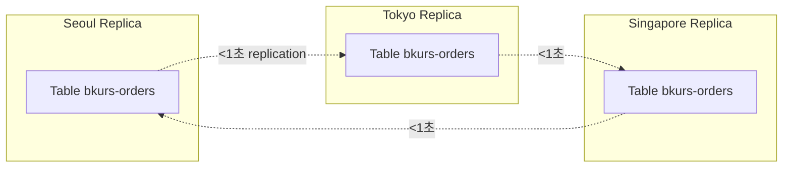

# DynamoDB Consistency + Global Tables

> Strong vs Eventual consistency + Global Tables (active-active multi-region, < 1초 replication).

## 1. Consistency Models

| Model | 의미 | RCU |
| --- | --- | --- |
| **Eventually Consistent** (default) | < 1초 안 일관성 | 0.5 RCU |
| **Strongly Consistent** | 즉시 일관 | 1 RCU |
| **Transactional Read** | ACID across items | 2 RCU |
| **Transactional Write** | ACID | 2 WCU |

## 2. Eventually Consistent (default)

```bash
aws dynamodb get-item --table-name bkurs-orders \
  --key '{"userId":{"S":"alice"},"orderId":{"S":"O-001"}}'
# 빠름, 0.5 RCU
# 직전 write 가 안 보일 수 있음 (< 1초)
```

활용: 일반 read, latency-sensitive.

## 3. Strongly Consistent

```bash
aws dynamodb get-item --table-name bkurs-orders \
  --key '...' \
  --consistent-read
# 1 RCU
# 항상 latest data
```

활용:
- Read-after-write
- Idempotency check
- Critical state read

> Global Tables 의 secondary region 에서 **strong consistent read 불가** (eventual 만).

## 4. Transactional Operations

### Read (across multiple items)
```bash
aws dynamodb transact-get-items --transact-items '[
  {"Get": {"TableName": "users", "Key": {"userId": {"S": "alice"}}}},
  {"Get": {"TableName": "orders", "Key": {"orderId": {"S": "O-001"}}}}
]'
# 2 items × 2 RCU each = 4 RCU
```

### Write (ACID across items)
```bash
aws dynamodb transact-write-items --transact-items '[
  {
    "ConditionCheck": {
      "TableName": "users",
      "Key": {"userId": {"S": "alice"}},
      "ConditionExpression": "balance >= :amount",
      "ExpressionAttributeValues": {":amount": {"N": "50000"}}
    }
  },
  {
    "Update": {
      "TableName": "users",
      "Key": {"userId": {"S": "alice"}},
      "UpdateExpression": "SET balance = balance - :amount",
      "ExpressionAttributeValues": {":amount": {"N": "50000"}}
    }
  },
  {
    "Put": {
      "TableName": "orders",
      "Item": {
        "userId": {"S": "alice"},
        "orderId": {"S": "O-001"},
        "amount": {"N": "50000"}
      }
    }
  }
]'
```

| 한도 | |
| --- | --- |
| Max items / transaction | 100 |
| Max size / transaction | 4 MB |
| Cross-table | ✓ |
| Cross-region (Global Tables) | ✗ (same region 만) |
| RCU/WCU | 2x normal |

## 5. Global Tables — Multi-region Active-Active



특징:
- **Active-Active** (모든 region 에서 write 가능)
- < 1초 cross-region replication
- Last-Writer-Wins 충돌 해결
- Streams 기반 replication

## 6. Global Tables 생성

```bash
aws dynamodb create-table --table-name bkurs-orders \
  --attribute-definitions \
    AttributeName=userId,AttributeType=S \
    AttributeName=orderId,AttributeType=S \
  --key-schema \
    AttributeName=userId,KeyType=HASH \
    AttributeName=orderId,KeyType=RANGE \
  --billing-mode PAY_PER_REQUEST \
  --stream-specification StreamEnabled=true,StreamViewType=NEW_AND_OLD_IMAGES

# Replica 추가 (다른 region)
aws dynamodb update-table --table-name bkurs-orders \
  --replica-updates '[
    { "Create": { "RegionName": "ap-northeast-1" } },
    { "Create": { "RegionName": "ap-southeast-1" } }
  ]'
```

조건:
- **Streams 활성** (NEW_AND_OLD_IMAGES)
- 같은 schema (key, attribute)
- 같은 billing mode
- 같은 KMS key 정책 (region 별 별도 key)

## 7. Conflict Resolution

```
2 region 에서 같은 시점 write → Last-Writer-Wins
→ 마지막 write 의 timestamp 가 큰 것이 이김
```

```python
# Application 안에서
from datetime import datetime, timezone

def safe_update(item):
    item["updated_at"] = datetime.now(timezone.utc).isoformat()
    # Conditional update with version
    ddb.update_item(
        Key={"userId": item["userId"]},
        UpdateExpression="SET ... ",
        ConditionExpression="attribute_not_exists(updated_at) OR updated_at < :ts",
        ExpressionAttributeValues={":ts": item["updated_at"]}
    )
```

## 8. Region Read Routing

```python
import boto3, os

REGION_TO_TABLE = {
    "ap-northeast-2": boto3.resource("dynamodb", region_name="ap-northeast-2").Table("bkurs-orders"),
    "ap-northeast-1": boto3.resource("dynamodb", region_name="ap-northeast-1").Table("bkurs-orders"),
}

def get_table():
    region = os.environ.get("AWS_REGION", "ap-northeast-2")
    return REGION_TO_TABLE[region]

# Lambda 가 deploy 된 region 의 가까운 table 사용
table = get_table()
```

## 9. Global Tables 한도

| | |
| --- | --- |
| Replica regions | 5 max (현재) |
| Replication 추가 시간 | 새 replica = ~수분 |
| Provisioned capacity | each region 별 따로 (Provisioned 시) |
| Throughput consumption | each region 별 |
| Hot partition | per-region |

## 10. Cost — Global Tables

```
Each region 의 standalone cost
+ Replication = WCU × replica 수 (replication 비용은 WCU 차감)

예: 100 WCU / region × 3 region = effectively 300 WCU
→ 비용 3x 예상
```

> On-Demand mode 의 Global Tables 권장 (per-request, 자동 scale).

## 11. CloudWatch metric (per-region)

```bash
aws cloudwatch get-metric-statistics --namespace AWS/DynamoDB \
  --metric-name ReplicationLatency \
  --dimensions Name=TableName,Value=bkurs-orders \
              Name=ReceivingRegion,Value=ap-northeast-1 \
  --period 60 --statistics Maximum
```

| Metric | 의미 |
| --- | --- |
| `ReplicationLatency` | source → destination 시간 (ms) |
| `PendingReplicationCount` | 대기 |

## 12. Backup of Global Tables

```
On-Demand backup: per-region (각 region 별)
PITR: per-region
AWS Backup: per-region
```

> Region 별 별도 backup. 한 region 의 PITR = 그 region 의 data 만.

## 13. Use Cases

✓ **시나리오**
- Global user base (latency ↓)
- Multi-region DR
- Geo-localized data
- Mobile app (사용자 위치 따라)
- Multi-tenant SaaS (regional isolation)

✗ **부적합**
- Strong consistency 필요한 multi-region write
- Real-time financial transactions (single region 이 안전)
- 작은 sporadic workload (cost 폭주)

## 14. Local Secondary Index (LSI) vs Global Tables

| | LSI | Global Tables |
| --- | --- | --- |
| Scope | same table, same region | same table, multiple regions |
| 목적 | alternate SK | multi-region replication |
| Consistency | strong 가능 | eventual only |

→ 둘은 완전 다른 개념.

## 15. 흔한 함정

| 함정 | 회피 |
| --- | --- |
| Global Tables + Strong consistency | secondary region = eventual only |
| Replication 의 last-writer-wins | application 의 version control |
| 모든 region 의 capacity 같다고 가정 | per-region monitoring |
| Streams 비활성 + Global Tables | 활성 |
| Transactional + Global Tables | same region 만 |
| Backup 다른 region 도 함 | per-region 별도 |

## 16. 다음

- ▶ [[../02-access-patterns/01-query-vs-scan]]
- ▶ [[../02-access-patterns/02-secondary-indexes-gsi-lsi]]
- ▶ [[../03-operations/01-streams-and-cdc]]

## 17. 영상 / 자료

| 자료 |
| --- |
| [Consistency](https://docs.aws.amazon.com/amazondynamodb/latest/developerguide/HowItWorks.ReadConsistency.html) |
| [Global Tables](https://docs.aws.amazon.com/amazondynamodb/latest/developerguide/GlobalTables.html) |
| [Transactions](https://docs.aws.amazon.com/amazondynamodb/latest/developerguide/transactions.html) |

## 18. 참고

- [[../dynamodb]]
- [[01-table-item-key]]
- [[02-capacity-and-pricing]]
