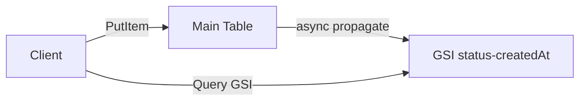
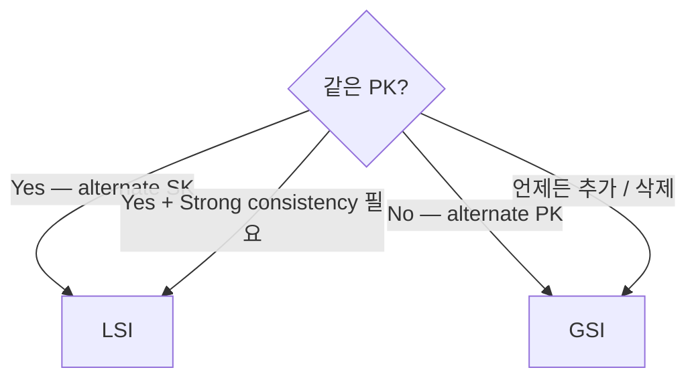

# Secondary Indexes — GSI / LSI

> 다른 access pattern 을 위한 추가 index. GSI (다른 PK) vs LSI (같은 PK + 다른 SK).

## 1. GSI vs LSI

| | GSI (Global Secondary Index) | LSI (Local Secondary Index) |
| --- | --- | --- |
| Partition Key | 다른 PK 가능 | 같은 PK |
| Sort Key | 다른 SK | 다른 SK |
| Consistency | Eventual only | Strong 가능 |
| Capacity | 별도 RCU/WCU | table 의 RCU/WCU 공유 |
| 생성 | 언제든 (24h+) | table 생성 시 만 |
| 삭제 | ✓ | ✗ (table 의 lifecycle) |
| 한도 | 20 per table | 5 per table |
| Item size | 400 KB | 10 GB (per PK) |
| 권장 | 일반 ★ | sparse + strong consistency |

## 2. GSI 정의

```bash
aws dynamodb create-table --table-name bkurs-orders \
  --attribute-definitions \
    AttributeName=userId,AttributeType=S \
    AttributeName=orderId,AttributeType=S \
    AttributeName=status,AttributeType=S \
    AttributeName=createdAt,AttributeType=S \
  --key-schema \
    AttributeName=userId,KeyType=HASH \
    AttributeName=orderId,KeyType=RANGE \
  --global-secondary-indexes '[
    {
      "IndexName": "status-createdAt-index",
      "KeySchema": [
        { "AttributeName": "status", "KeyType": "HASH" },
        { "AttributeName": "createdAt", "KeyType": "RANGE" }
      ],
      "Projection": { "ProjectionType": "ALL" }
    }
  ]' \
  --billing-mode PAY_PER_REQUEST
```

## 3. GSI Projection

| Projection | 의미 |
| --- | --- |
| `KEYS_ONLY` | PK + SK 만 (가장 작음) |
| `INCLUDE` | 명시한 attribute |
| `ALL` | 모든 attribute (가장 큼, expensive) |

```json
"Projection": {
  "ProjectionType": "INCLUDE",
  "NonKeyAttributes": ["amount", "currency"]
}
```

→ **작게 시작 + 필요시 INCLUDE 추가**. ALL 은 storage / WCU 비용 ↑.

## 4. GSI 의 동작



| | |
| --- | --- |
| Replication | Async (Eventual consistency only) |
| Latency | < 1초 보통 |
| RCU / WCU | 별도 (table 과 무관) |
| Hot partition | GSI 별 별도 |

## 5. GSI Query

```bash
aws dynamodb query --table-name bkurs-orders \
  --index-name status-createdAt-index \
  --key-condition-expression "#s = :s AND createdAt BETWEEN :start AND :end" \
  --expression-attribute-names '{"#s":"status"}' \
  --expression-attribute-values '{
    ":s":{"S":"PAID"},
    ":start":{"S":"2026-05-01"},
    ":end":{"S":"2026-05-31"}
  }'
```

> Index name 명시 + GSI 의 schema 따라 key condition.

## 6. Sparse Index

```
GSI: pending-orders-index (PK: status, SK: createdAt)
Projection: status = "PENDING" 만 의 item 이 GSI 에 포함됨

→ 일반 query "전체 pending orders":
   Query GSI 의 PK = "PENDING" → 작은 결과
```

Item 의 `status` attribute 가 PAID 또는 없으면 GSI 에 안 포함 → storage 절감.

## 7. LSI

```bash
aws dynamodb create-table --table-name bkurs-orders \
  --attribute-definitions \
    AttributeName=userId,AttributeType=S \
    AttributeName=orderId,AttributeType=S \
    AttributeName=createdAt,AttributeType=S \
  --key-schema \
    AttributeName=userId,KeyType=HASH \
    AttributeName=orderId,KeyType=RANGE \
  --local-secondary-indexes '[
    {
      "IndexName": "userId-createdAt-index",
      "KeySchema": [
        { "AttributeName": "userId", "KeyType": "HASH" },
        { "AttributeName": "createdAt", "KeyType": "RANGE" }
      ],
      "Projection": { "ProjectionType": "ALL" }
    }
  ]' \
  --billing-mode PAY_PER_REQUEST
```

### LSI 의 사용
```bash
# Same userId, different SK order
aws dynamodb query --table-name bkurs-orders \
  --index-name userId-createdAt-index \
  --key-condition-expression "userId = :uid" \
  --expression-attribute-values '{":uid":{"S":"alice"}}' \
  --scan-index-forward false   # 최신 순
```

## 8. GSI vs LSI 결정



## 9. GSI 추가 / 삭제 (Online)

```bash
# Table 생성 후 GSI 추가
aws dynamodb update-table --table-name bkurs-orders \
  --attribute-definitions \
    AttributeName=customerId,AttributeType=S \
  --global-secondary-index-updates '[
    {
      "Create": {
        "IndexName": "customerId-index",
        "KeySchema": [{ "AttributeName": "customerId", "KeyType": "HASH" }],
        "Projection": { "ProjectionType": "KEYS_ONLY" }
      }
    }
  ]'

# GSI 삭제
aws dynamodb update-table --table-name bkurs-orders \
  --global-secondary-index-updates '[
    { "Delete": { "IndexName": "old-index" } }
  ]'
```

→ 동시에 1개만 update. 큰 table 의 GSI 생성 = 시간 오래 (~수시간-일).

## 10. GSI 비용 시뮬레이션

```
Table 100 GB + GSI ALL projection 100 GB
= 200 GB × $0.25 = $50/월 storage

매 write 가 GSI 도 update:
- Table write 1000 WCU
- GSI write 1000 WCU (same)
- 2x WCU cost

→ GSI 많을수록 비용 ↑
```

## 11. Hot Partition (GSI 별로)

GSI 도 partition 의 hot 가능:
```
GSI PK = "PAID"
→ 모든 paid order 가 1 partition
→ 3500 WCU 도달 → throttle
```

해결:
- Random suffix (write sharding)
- Composite key
- Adaptive Capacity 활용

### Random Suffix
```python
import random
shard = random.randint(0, 9)
item = {
    "userId": "alice",
    "orderId": "O-001",
    "status": f"PAID#{shard}",   # PAID#0 ~ PAID#9
    "createdAt": "..."
}
```

Query 시 각 shard 별 parallel:
```python
for shard in range(10):
    query(status=f"PAID#{shard}")
```

## 12. Inverted Index

```
Main:
  PK: userId, SK: orderId

GSI: orderId-userId-index
  PK: orderId, SK: userId
```

→ "특정 order 의 모든 user" lookup (rare, 일반 X).

## 13. 흔한 함정

| 함정 | 회피 |
| --- | --- |
| GSI 너무 많음 (storage / WCU 폭주) | 필요한 것만 |
| Projection = ALL | INCLUDE 또는 KEYS_ONLY |
| GSI 의 strong consistency | LSI 만 가능 |
| LSI table 생성 후 추가 시도 | table 재생성 |
| GSI Eventual lag | < 1초 보통 |
| Hot GSI partition | random suffix 또는 access pattern 재설계 |

## 14. 다음

- ▶ [[03-transactions-and-batch]]
- ▶ [[../03-operations/01-streams-and-cdc]]
- ▶ [[../practice/01-table-with-gsi]]

## 15. 영상 / 자료

| 자료 |
| --- |
| [GSI](https://docs.aws.amazon.com/amazondynamodb/latest/developerguide/GSI.html) |
| [LSI](https://docs.aws.amazon.com/amazondynamodb/latest/developerguide/LSI.html) |
| [Best Practices for Indexes](https://docs.aws.amazon.com/amazondynamodb/latest/developerguide/bp-indexes-general.html) |

## 16. 참고

- [[../dynamodb]]
- [[01-query-vs-scan]]
- [[../01-fundamentals/01-table-item-key]]
