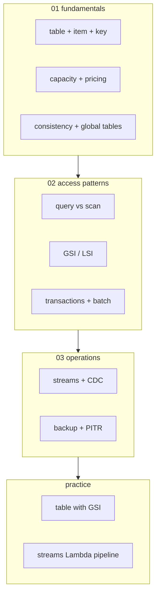
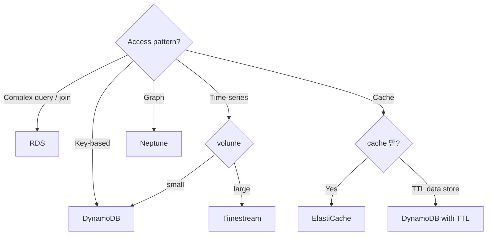

# AWS DynamoDB — Managed NoSQL

> Key-value + Document store. Single-digit ms latency at any scale. Auto-scaling + Global Tables + Streams + Transactions.

**[[../database|↑ Database]]** · **[[../../cloud-aws|↑↑ AWS]]**

---

## 1. 한 줄

```
Managed NoSQL Database
├─ Single-digit ms latency (read/write)
├─ Petabyte scale (auto partition)
├─ Capacity Mode: Provisioned vs On-Demand
├─ Global Tables (multi-region active-active)
├─ Streams (CDC)
└─ DynamoDB Accelerator (DAX) — μs latency cache
```

## 2. 학습 roadmap



## 3. Sub-directory index

### [[01-fundamentals/01-table-item-key]] — Table / Item / Partition Key / Sort Key
schema-less, key design, 400 KB item.

### [[01-fundamentals/02-capacity-and-pricing]] — On-Demand / Provisioned / Reserved
WCU/RCU + Auto Scaling + Reserved capacity.

### [[01-fundamentals/03-consistency-and-global-tables]] — Strong / Eventual / Multi-region
Strong consistency 옵션 + Global Tables (active-active).

### [[02-access-patterns/01-query-vs-scan]] — Query (efficient) vs Scan (full)
Partition Key access pattern + Filter / Projection.

### [[02-access-patterns/02-secondary-indexes-gsi-lsi]] — GSI vs LSI
Global Secondary Index (다른 partition key) / Local SI (같은 PK + 다른 SK).

### [[02-access-patterns/03-transactions-and-batch]] — TransactWriteItems / BatchWriteItem
ACID across multiple items + batch (25 / 100 limit).

### [[03-operations/01-streams-and-cdc]] — DynamoDB Streams + Kinesis + Lambda trigger
24h change log + Lambda processor + CDC.

### [[03-operations/02-backup-and-pitr]] — PITR + On-Demand Backup + AWS Backup
35d PITR + manual backup + cross-region.

### [[practice/01-table-with-gsi]] — Table + GSI + access pattern design (45분)

### [[practice/02-streams-lambda-pipeline]] — Streams → Lambda → 다른 service (60분)

## 4. 핵심 개념

| 개념 | 의미 |
| --- | --- |
| Table | data 묶음 (schema-less items) |
| Item | row equivalent (max 400 KB) |
| Attribute | column equivalent (다양한 type) |
| Partition Key (PK) | hash key — partition 결정 |
| Sort Key (SK) | range key — partition 안 order |
| Primary Key | PK only / PK+SK |
| GSI | 다른 PK / SK 의 index |
| LSI | 같은 PK / 다른 SK |
| Read Capacity Unit (RCU) | 1 strongly consistent read = 4 KB |
| Write Capacity Unit (WCU) | 1 write = 1 KB |
| TTL | item 자동 expire |
| Streams | 24h change log |
| DAX | μs latency cache |

## 5. DynamoDB vs RDS

| | DynamoDB | RDS / Aurora |
| --- | --- | --- |
| Type | NoSQL (key-value/document) | SQL (relational) |
| Schema | schema-less | strict |
| Joins | ✗ (denormalize) | ✓ |
| Transactions | per-table (25 items) | full ACID |
| Query | PK / GSI 만 | SQL flexible |
| Scaling | auto petabyte | 64 TB max per cluster |
| Latency | μs (DAX) ~ ms | ms ~ |
| Cost | per request | per instance + storage |
| 권장 | high RPS, key-based access | complex query / OLAP |

## 6. 가격 모델 — 직관

```
On-Demand:
  Read: $0.142 / 1M request (RCU)
  Write: $0.713 / 1M request (WCU)
  Storage: $0.25/GB·월
  
Provisioned (Auto Scaling):
  RCU: $0.000114/h × 1 = $0.083/월
  WCU: $0.000571/h × 1 = $0.42/월
  Reserved 1y: ~50% off
  
DAX:
  $0.247/h × 3 node = $540/월
```

## 7. 결정 트리



## 8. 적합한 use case

✓ **시나리오**
- Session store
- User profile / preference
- Real-time leaderboard
- IoT sensor data
- Game state
- Shopping cart
- Audit log
- Feature flags
- Rate limiting
- Distributed lock
- TTL data (expiring)

✗ **부적합**
- Complex JOIN / aggregation
- Analytical workload (Athena / Redshift)
- ACID across tables
- 작은 dev DB ($1/월 도 부담)
- Geospatial (PostGIS 가 더 강력)
- Vector / embedding (pgvector / OpenSearch)

## 9. bkurs-be 활용

```
User session:           DynamoDB (TTL 24h)
Rate limiting:          DynamoDB (TTL 1m)
Feature flag:           DynamoDB
Audit log (write-heavy): DynamoDB Streams → Lambda → S3 archive
Distributed lock:        DynamoDB (atomic counter)
Counter / metric:        DynamoDB Atomic Counter
Webhook delivery state:  DynamoDB (TTL 7d, retry tracking)
```

> 일반 user / order data = RDS Postgres. DynamoDB 는 key-value 패턴 만.

## 10. 영상 / 자료

| 자료 |
| --- |
| [DynamoDB 공식](https://docs.aws.amazon.com/amazondynamodb/) |
| [Single-Table Design](https://docs.aws.amazon.com/amazondynamodb/latest/developerguide/bp-modeling-nosql-B.html) |
| [The DynamoDB Book](https://www.dynamodbbook.com/) |
| [Re:Invent — Advanced Design](https://www.youtube.com/watch?v=Q6-qWdsa8a4) |

## 11. 관련 hub

- [[../database]]
- [[../rds/rds]]
- [[../aurora/aurora]]
- [[../../compute/lambda/lambda]]
- [[../../security/kms/kms]]
- [[../../security/iam/iam]]
