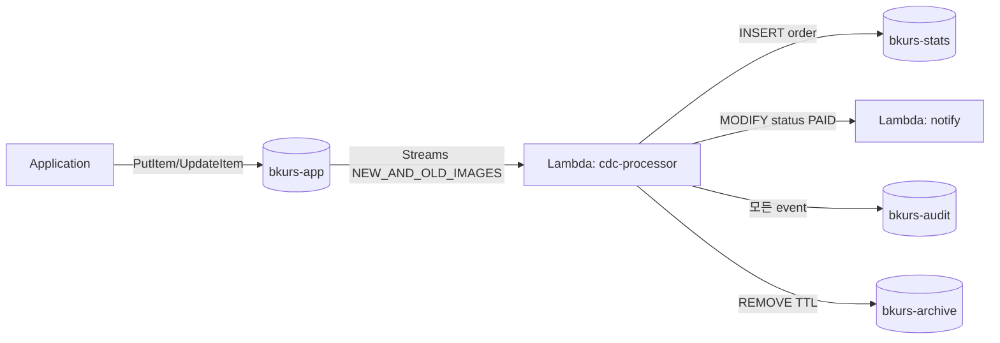

# 실습 2 — Streams + Lambda CDC Pipeline

> 목표: DynamoDB Streams → Lambda (event router) → S3 audit + Aggregation table 갱신 + Idempotency. 60분.

## 구성



## 1. Tables

```bash
ACCT=$(aws sts get-caller-identity --query Account --output text)

# 실습 1 의 bkurs-app 재사용 (Streams 활성됨)
# Aggregation table
aws dynamodb create-table --table-name bkurs-stats \
  --attribute-definitions AttributeName=metricKey,AttributeType=S \
  --key-schema AttributeName=metricKey,KeyType=HASH \
  --billing-mode PAY_PER_REQUEST

# Idempotency table
aws dynamodb create-table --table-name bkurs-idempotency \
  --attribute-definitions AttributeName=id,AttributeType=S \
  --key-schema AttributeName=id,KeyType=HASH \
  --billing-mode PAY_PER_REQUEST \
  --time-to-live-specification "Enabled=true,AttributeName=expireAt"

# S3 audit bucket
BUCKET=lab-cdc-audit-$ACCT-$(date +%s)
aws s3 mb s3://$BUCKET
aws s3api put-public-access-block --bucket $BUCKET \
  --public-access-block-configuration "BlockPublicAcls=true,IgnorePublicAcls=true,BlockPublicPolicy=true,RestrictPublicBuckets=true"
```

## 2. IAM Role for Lambda

```bash
aws iam create-role --role-name lab-cdc-role \
  --assume-role-policy-document '{"Version":"2012-10-17","Statement":[{"Effect":"Allow","Principal":{"Service":"lambda.amazonaws.com"},"Action":"sts:AssumeRole"}]}'

aws iam put-role-policy --role-name lab-cdc-role --policy-name p --policy-document "{
  \"Version\": \"2012-10-17\",
  \"Statement\": [
    { \"Effect\": \"Allow\", \"Action\": \"logs:*\", \"Resource\": \"*\" },
    { \"Effect\": \"Allow\", \"Action\": [
        \"dynamodb:GetRecords\",
        \"dynamodb:GetShardIterator\",
        \"dynamodb:DescribeStream\",
        \"dynamodb:ListStreams\"
      ],
      \"Resource\": \"arn:aws:dynamodb:ap-northeast-2:$ACCT:table/bkurs-app/stream/*\"
    },
    { \"Effect\": \"Allow\", \"Action\": [
        \"dynamodb:UpdateItem\",
        \"dynamodb:PutItem\",
        \"dynamodb:GetItem\"
      ],
      \"Resource\": [
        \"arn:aws:dynamodb:ap-northeast-2:$ACCT:table/bkurs-stats\",
        \"arn:aws:dynamodb:ap-northeast-2:$ACCT:table/bkurs-idempotency\"
      ]
    },
    { \"Effect\": \"Allow\", \"Action\": \"s3:PutObject\", \"Resource\": \"arn:aws:s3:::$BUCKET/*\" },
    { \"Effect\": \"Allow\", \"Action\": \"xray:PutTraceSegments\", \"Resource\": \"*\" }
  ]
}"
```

## 3. Lambda Code

```python
# cdc_processor.py
import boto3, json, os
from decimal import Decimal
from datetime import datetime, timezone, date
from boto3.dynamodb.types import TypeDeserializer

s3  = boto3.client("s3")
ddb = boto3.resource("dynamodb")
stats_table = ddb.Table("bkurs-stats")
deserializer = TypeDeserializer()

BUCKET = os.environ["BUCKET"]

def deserialize(image):
    if not image:
        return None
    return {k: deserializer.deserialize(v) for k, v in image.items()}

def json_serial(obj):
    if isinstance(obj, Decimal):
        return float(obj)
    if isinstance(obj, datetime) or isinstance(obj, date):
        return obj.isoformat()
    raise TypeError

def lambda_handler(event, context):
    failures = []
    
    for record in event["Records"]:
        try:
            seq = record["dynamodb"]["SequenceNumber"]
            event_name = record["eventName"]
            keys = deserialize(record["dynamodb"]["Keys"])
            new = deserialize(record["dynamodb"].get("NewImage"))
            old = deserialize(record["dynamodb"].get("OldImage"))
            ts = datetime.now(timezone.utc).isoformat()
            
            # 1. Audit log → S3 (모든 event)
            audit = {
                "sequenceNumber": seq,
                "eventName": event_name,
                "timestamp": ts,
                "keys": keys,
                "old": old,
                "new": new,
                "userIdentity": record.get("userIdentity")
            }
            s3.put_object(
                Bucket=BUCKET,
                Key=f"audit/{date.today().isoformat()}/{seq}.json",
                Body=json.dumps(audit, default=json_serial, ensure_ascii=False).encode()
            )
            
            # 2. Order aggregation
            if event_name == "INSERT" and new and new.get("type") == "Order":
                user_id = new["userId"]
                amount = float(new["amount"])
                stats_table.update_item(
                    Key={"metricKey": f"USER#{user_id}#TOTAL_ORDERS"},
                    UpdateExpression="ADD #c :one",
                    ExpressionAttributeNames={"#c": "count"},
                    ExpressionAttributeValues={":one": Decimal("1")}
                )
                stats_table.update_item(
                    Key={"metricKey": f"USER#{user_id}#TOTAL_AMOUNT"},
                    UpdateExpression="ADD #a :amt",
                    ExpressionAttributeNames={"#a": "amount"},
                    ExpressionAttributeValues={":amt": Decimal(str(amount))}
                )
                # Daily metric
                day = ts[:10]
                stats_table.update_item(
                    Key={"metricKey": f"DAY#{day}#ORDERS"},
                    UpdateExpression="ADD #c :one",
                    ExpressionAttributeNames={"#c": "count"},
                    ExpressionAttributeValues={":one": Decimal("1")}
                )
            
            # 3. Status transition notification
            if event_name == "MODIFY" and new and old:
                old_status = old.get("status")
                new_status = new.get("status")
                if old_status == "PENDING" and new_status == "PAID":
                    print(f"NOTIFY: Order {new.get('orderId')} PAID by {new.get('userId')}")
                    # In production: SNS publish 또는 SES email
            
            # 4. TTL delete archive (REMOVE + userIdentity.dynamodb)
            if event_name == "REMOVE" and old:
                user_identity = record.get("userIdentity", {})
                if user_identity.get("type") == "Service" and \
                   user_identity.get("principalId") == "dynamodb.amazonaws.com":
                    print(f"TTL ARCHIVE: {old}")
        
        except Exception as e:
            print(f"Failed: {e}")
            failures.append({"itemIdentifier": record["dynamodb"]["SequenceNumber"]})
    
    return {"batchItemFailures": failures}
```

```bash
mkdir cdc-pkg
pip install --platform manylinux2014_aarch64 --only-binary=:all: --target cdc-pkg boto3
cp cdc_processor.py cdc-pkg/
cd cdc-pkg && zip -r ../cdc.zip . && cd ..

aws lambda create-function --function-name lab-cdc-processor \
  --runtime python3.12 --architectures arm64 \
  --handler cdc_processor.lambda_handler \
  --role arn:aws:iam::$ACCT:role/lab-cdc-role \
  --zip-file fileb://cdc.zip \
  --memory-size 512 --timeout 60 \
  --environment "Variables={BUCKET=$BUCKET}" \
  --tracing-config Mode=Active

aws logs put-retention-policy --log-group-name /aws/lambda/lab-cdc-processor --retention-in-days 7
```

## 4. Stream Event Source Mapping

```bash
STREAM_ARN=$(aws dynamodb describe-table --table-name bkurs-app \
  --query 'Table.LatestStreamArn' --output text)
echo $STREAM_ARN

aws lambda create-event-source-mapping \
  --function-name lab-cdc-processor \
  --event-source-arn $STREAM_ARN \
  --starting-position LATEST \
  --batch-size 100 \
  --maximum-batching-window-in-seconds 5 \
  --parallelization-factor 10 \
  --function-response-types ReportBatchItemFailures \
  --maximum-retry-attempts 3 \
  --bisect-batch-on-function-error
```

## 5. Generate events

```python
# generate_events.py
import boto3, random
from datetime import datetime, timezone
from decimal import Decimal

ddb = boto3.resource("dynamodb")
table = ddb.Table("bkurs-app")

# Create 20 orders
for i in range(200, 220):
    user = random.choice(["alice", "bob", "charlie"])
    ts = datetime.now(timezone.utc).isoformat()
    table.put_item(Item={
        "PK": f"USER#{user}",
        "SK": f"ORDER#{ts}#O-{i}",
        "type": "Order",
        "orderId": f"O-{i}",
        "userId": user,
        "amount": Decimal(str(random.randint(5000, 100000))),
        "status": "PENDING",
        "createdAt": ts
    })

# Update some to PAID
for i in range(200, 210):
    user = random.choice(["alice", "bob", "charlie"])
    response = table.query(
        KeyConditionExpression="PK = :pk AND contains(SK, :id)",
        FilterExpression="orderId = :oid",
        ExpressionAttributeValues={":pk": f"USER#{user}", ":id": f"O-{i}", ":oid": f"O-{i}"},
        Limit=1
    )
    if response["Items"]:
        item = response["Items"][0]
        table.update_item(
            Key={"PK": item["PK"], "SK": item["SK"]},
            UpdateExpression="SET #s = :paid",
            ExpressionAttributeNames={"#s": "status"},
            ExpressionAttributeValues={":paid": "PAID"}
        )

print("Generated 20 orders, 10 PAID")
```

```bash
python generate_events.py

# Wait + check
sleep 30
aws logs tail /aws/lambda/lab-cdc-processor --since 5m
```

## 6. 결과 확인

```bash
# S3 audit
aws s3 ls s3://$BUCKET/audit/$(date -u +%Y-%m-%d)/ --recursive
aws s3 cp s3://$BUCKET/audit/$(date -u +%Y-%m-%d)/<seq>.json - | jq .

# Aggregation
aws dynamodb scan --table-name bkurs-stats \
  --filter-expression "begins_with(metricKey, :p)" \
  --expression-attribute-values '{":p":{"S":"USER#alice#"}}' \
  --query 'Items[*]'

# Lambda metric
aws cloudwatch get-metric-statistics --namespace AWS/Lambda \
  --metric-name Invocations \
  --dimensions Name=FunctionName,Value=lab-cdc-processor \
  --period 60 --statistics Sum \
  --start-time $(date -u -v -1H +"%Y-%m-%dT%H:%M:%SZ") \
  --end-time $(date -u +"%Y-%m-%dT%H:%M:%SZ")
```

## 7. CloudWatch Alarm — Stream Lag

```bash
aws cloudwatch put-metric-alarm --alarm-name lab-cdc-lag \
  --metric-name IteratorAge --namespace AWS/Lambda \
  --statistic Maximum --period 60 --evaluation-periods 3 \
  --threshold 60000 --comparison-operator GreaterThanThreshold \
  --dimensions Name=FunctionName,Value=lab-cdc-processor
```

## 8. TTL test (REMOVE event)

```bash
# Activate TTL on bkurs-app
aws dynamodb update-time-to-live --table-name bkurs-app \
  --time-to-live-specification "Enabled=true,AttributeName=expireAt"

# Insert item with short TTL (1분 후)
TS=$(date -u -v +1M +%s)
aws dynamodb put-item --table-name bkurs-app --item "{
  \"PK\": {\"S\": \"SESSION#temp\"},
  \"SK\": {\"S\": \"DATA\"},
  \"type\": {\"S\": \"Session\"},
  \"expireAt\": {\"N\": \"$TS\"}
}"

# 1-48시간 후 TTL delete → Lambda REMOVE event 로 archive
```

## 9. X-Ray Service Map

Console → X-Ray → Service Map → DDB → Lambda → S3 / DDB stats.

## 10. Idempotency 활용 (Powertools)

```python
from aws_lambda_powertools.utilities.idempotency import (
    DynamoDBPersistenceLayer, idempotent_function
)

persistence = DynamoDBPersistenceLayer(table_name="bkurs-idempotency")

@idempotent_function(persistence_store=persistence, data_keyword_argument="record")
def process_record(record):
    # SequenceNumber-based idempotency
    ...
```

## 11. Clean up

```bash
# Event Source Mapping
EVT_ID=$(aws lambda list-event-source-mappings --function-name lab-cdc-processor \
  --query 'EventSourceMappings[0].UUID' --output text)
aws lambda delete-event-source-mapping --uuid $EVT_ID

aws lambda delete-function --function-name lab-cdc-processor

aws dynamodb delete-table --table-name bkurs-stats
aws dynamodb delete-table --table-name bkurs-idempotency
# bkurs-app 은 실습 1 의 cleanup 에서

aws s3 rm s3://$BUCKET --recursive
aws s3 rb s3://$BUCKET

aws iam delete-role-policy --role-name lab-cdc-role --policy-name p
aws iam delete-role --role-name lab-cdc-role
```

## 12. 학습 포인트

- DynamoDB Streams 의 NEW_AND_OLD_IMAGES
- Lambda Event Source Mapping (parallelization-factor 10)
- Partial failure (ReportBatchItemFailures)
- INSERT / MODIFY / REMOVE 의 각각 처리
- TTL delete 의 userIdentity = dynamodb.amazonaws.com 식별
- Aggregation Table 패턴 (count, sum, daily metric)
- Audit Log 패턴 (S3 archive)
- TypeDeserializer (DDB low-level format → Python)
- Idempotency (Powertools)

## 13. 다음

- ▶ [[../dynamodb]]
- ▶ [[../../../network/vpc/vpc]]

## 14. 참고

- [[../dynamodb]]
- [[01-table-with-gsi]]
- [[../03-operations/01-streams-and-cdc]]
- [[../../../compute/lambda/02-triggers/03-stream-poller]]
