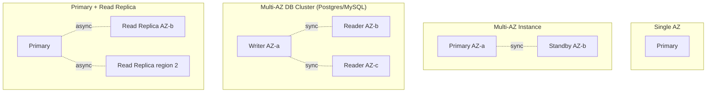
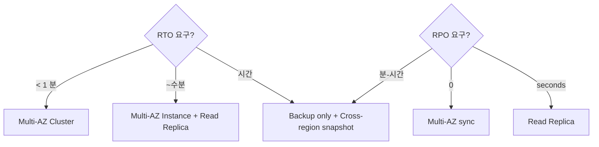

# RDS Multi-AZ + Read Replica

> Multi-AZ (synchronous standby, failover ~수분) + Multi-AZ DB Cluster (1 writer + 2 readable standbys, failover ~35초) + Read Replica (async, read scaling).

## 1. Topology 비교



## 2. 비교 표

| | Single AZ | Multi-AZ (Instance) | Multi-AZ DB Cluster | Read Replica |
| --- | --- | --- | --- | --- |
| Standby 수 | 0 | 1 (read 불가) | 2 (read 가능) | 5 max |
| Replication | n/a | synchronous | synchronous | asynchronous |
| Read 가능 | primary 만 | primary 만 | primary + 2 readers | primary + replica |
| Failover 시간 | n/a | 1-2 분 | < 35초 | promote ~수분 |
| Cost | 1x | 2x | 3x | 1x + replica |
| Engine | 모두 | 모두 | Postgres / MySQL | 모두 |
| 권장 | dev | production | high availability prod | read scaling |

## 3. Multi-AZ Instance (synchronous standby)

```bash
# 활성
aws rds modify-db-instance \
  --db-instance-identifier bkurs-prod \
  --multi-az \
  --apply-immediately

# 또는 create 시
aws rds create-db-instance --multi-az ...
```

### 동작
- Standby = same region, 다른 AZ
- Synchronous replication
- Standby = **read 불가** (failover 만)
- Failover 자동 (1-2분) + DNS 자동 변경
- Snapshot from standby (primary 부하 ↓)

### 비용
2x storage + 2x instance compute.

## 4. Multi-AZ DB Cluster (2022+, Postgres / MySQL)

```bash
aws rds create-db-cluster \
  --db-cluster-identifier bkurs-cluster \
  --engine postgres \
  --engine-version 16.2 \
  --db-cluster-instance-class db.r6g.large \
  --allocated-storage 100 \
  --storage-type io1 --iops 3000 \
  --master-username bkurs_admin \
  --manage-master-user-password \
  --multi-az \
  --vpc-security-group-ids sg-rds
```

### 특징
- 1 writer + 2 readable standbys (3 AZ)
- Standby 들이 **read 처리 가능**
- Failover ~35초
- io1 / io2 만 (gp3 안 됨, 현재)

### Endpoint
- Cluster endpoint (writer)
- Reader endpoint (자동 load balance)
- Instance endpoint (각 individual)

### 비용
3x instance + io1 storage premium. **production critical 만**.

## 5. Read Replica (async)

```bash
aws rds create-db-instance-read-replica \
  --db-instance-identifier bkurs-replica-1 \
  --source-db-instance-identifier bkurs-prod \
  --db-instance-class db.t4g.medium \
  --availability-zone ap-northeast-2c
```

### 특징
- Async replication (lag ms-seconds)
- Up to 5 replicas per primary
- Cross-region 가능
- Read-only (application 이 명시적 routing)
- Promote = independent DB

### Cross-region Replica
```bash
aws rds create-db-instance-read-replica \
  --db-instance-identifier bkurs-replica-tokyo \
  --source-db-instance-identifier arn:aws:rds:ap-northeast-2:ACCT:db:bkurs-prod \
  --availability-zone ap-northeast-1a \
  --source-region ap-northeast-2
```

### Promote
```bash
aws rds promote-read-replica --db-instance-identifier bkurs-replica-1
```

→ replica 가 independent DB. Replication 중단.

## 6. ReplicaLag

```bash
aws cloudwatch get-metric-statistics --namespace AWS/RDS \
  --metric-name ReplicaLag \
  --dimensions Name=DBInstanceIdentifier,Value=bkurs-replica-1 \
  --period 60 --statistics Maximum
```

Typical:
```
같은 region: < 1 second
Cross-region:  1-10 seconds (network latency)
큰 write load: 10+ seconds
```

## 7. Read Routing

```python
# Application layer
class DBRouter:
    write_url = "postgres://primary.../bkurs"
    read_url  = "postgres://replica.../bkurs"
    
    def write(self, sql):
        return self.write_conn.execute(sql)
    
    def read(self, sql):
        return self.read_conn.execute(sql)
```

또는 ORM (Django / SQLAlchemy 의 read_replicas).

## 8. Failover 시뮬

### Multi-AZ Instance
```bash
# Manual failover
aws rds reboot-db-instance --db-instance-identifier bkurs-prod \
  --force-failover

# 자동 — primary AZ 실패 시
```

### Multi-AZ DB Cluster
```bash
aws rds failover-db-cluster --db-cluster-identifier bkurs-cluster \
  --target-db-instance-identifier bkurs-cluster-reader-1
```

→ 약 35초.

### Read Replica 의 promote
```bash
aws rds promote-read-replica --db-instance-identifier bkurs-replica-1
```

→ 약 수분. Replication 중단.

## 9. RTO / RPO

| | Multi-AZ Instance | Multi-AZ Cluster | Read Replica Promote |
| --- | --- | --- | --- |
| RTO | 1-2 분 | < 35초 | 수분 |
| RPO | 0 (sync) | 0 (sync) | seconds (async) |

## 10. DR strategy 비교



## 11. 권장 — bkurs-be

```
Production:
- Multi-AZ Instance (db.t4g.medium, postgres 16, gp3)
- 1 Read Replica (cross-AZ, analytics 만)
- 35d PITR + cross-region snapshot daily

Critical (예: payment):
- Multi-AZ DB Cluster (3-node)
- + Cross-region Read Replica (DR)
```

## 12. Read Replica + Read Routing 패턴

```python
# Spring Boot
spring.datasource.primary.url=jdbc:postgresql://primary.../bkurs
spring.datasource.replica.url=jdbc:postgresql://replica.../bkurs

@Transactional(readOnly = true)
public List<Order> findAll() {
    return jdbcTemplate.query(...);  # replica
}

@Transactional
public Order save(Order order) {
    return ...;  # primary
}
```

## 13. 흔한 함정

| 함정 | 회피 |
| --- | --- |
| Multi-AZ standby read 가능 가정 | DB Cluster 만 가능 |
| Read Replica = HA 가정 (async) | Multi-AZ 가 HA |
| Replica Lag 무시 | alarm + read-after-write 시 primary |
| Failover 후 DNS cache | TTL 짧게 |
| Cross-region replica 의 DT 비용 | 필요한 곳만 |
| Multi-AZ DB Cluster + gp3 | io1 만 지원 (현재) |

## 14. 다음

- ▶ [[../02-operations/01-backup-and-pitr]]
- ▶ [[../02-operations/02-performance-and-monitoring]]
- ▶ [[../03-security/01-network-and-iam]]

## 15. 영상 / 자료

| 자료 |
| --- |
| [Multi-AZ DB Cluster 발표](https://aws.amazon.com/blogs/aws/new-amazon-rds-multi-az-with-two-readable-standby-instances/) |
| [Read Replica](https://docs.aws.amazon.com/AmazonRDS/latest/UserGuide/USER_ReadRepl.html) |
| [Failover](https://docs.aws.amazon.com/AmazonRDS/latest/UserGuide/Concepts.MultiAZ.html) |

## 16. 참고

- [[../rds]]
- [[01-engine-and-versions]]
- [[02-instance-classes-and-pricing]]
- [[../../aurora/aurora]] — Aurora 의 storage layer 가 더 진보
