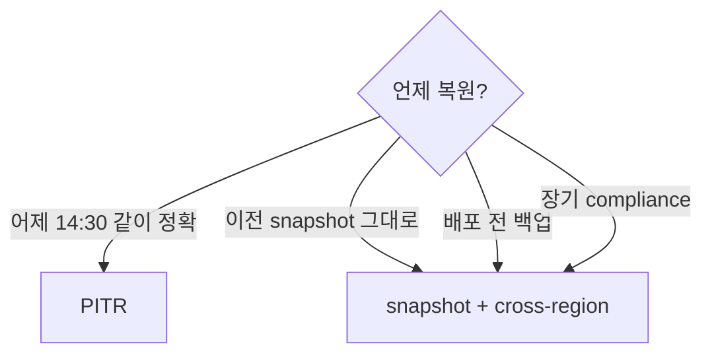

# RDS Backup + PITR

> Automated Backup (35d 보존, PITR minute-level) + Manual Snapshot (영구) + Cross-region copy + Restore.

## 1. 2 종류

| | Automated Backup | Manual Snapshot |
| --- | --- | --- |
| Trigger | daily + Tx log 5분 | 사용자 명시 |
| Retention | 1-35d | 영구 |
| PITR | ✓ (minute-level) | ✗ |
| Delete (DB delete 시) | 자동 | 명시 안 함 |
| Cross-region copy | ✓ | ✓ |
| Storage | $0.095/GB·월 | $0.095/GB·월 |
| Free quota | DB size 만큼 | 별도 quota 없음 |

## 2. Automated Backup 활성

```bash
aws rds modify-db-instance \
  --db-instance-identifier bkurs-prod \
  --backup-retention-period 35 \
  --preferred-backup-window "18:00-19:00" \
  --copy-tags-to-snapshot \
  --apply-immediately
```

| 옵션 | 의미 |
| --- | --- |
| `backup-retention-period` | 0-35d (0 = disable) |
| `preferred-backup-window` | UTC, daily 30분 window |
| `copy-tags-to-snapshot` | tag 전파 |

## 3. PITR — Point-In-Time Recovery

```bash
# PITR 가능 시간 범위 확인
aws rds describe-db-instances --db-instance-identifier bkurs-prod \
  --query 'DBInstances[0].{Earliest:LatestRestorableTime,Latest:LatestRestorableTime}'

# Restore to point in time
aws rds restore-db-instance-to-point-in-time \
  --source-db-instance-identifier bkurs-prod \
  --target-db-instance-identifier bkurs-prod-restored \
  --restore-time "2026-05-22T15:30:00Z" \
  --db-instance-class db.t4g.medium \
  --multi-az \
  --no-publicly-accessible
```

| 한도 |
| --- |
| Granularity: 1분 |
| 보존 기간 안 (1-35d) |
| 새 instance 만 (overwrite 안 됨) |

## 4. Manual Snapshot

```bash
# 즉시 snapshot
aws rds create-db-snapshot \
  --db-instance-identifier bkurs-prod \
  --db-snapshot-identifier bkurs-prod-pre-upgrade \
  --tags Key=Reason,Value=pre-upgrade

# Aurora Cluster snapshot
aws rds create-db-cluster-snapshot \
  --db-cluster-identifier bkurs-cluster \
  --db-cluster-snapshot-identifier bkurs-cluster-pre-upgrade
```

## 5. Restore from Snapshot

```bash
aws rds restore-db-instance-from-db-snapshot \
  --db-instance-identifier bkurs-restored \
  --db-snapshot-identifier bkurs-prod-pre-upgrade \
  --db-instance-class db.t4g.medium \
  --multi-az \
  --vpc-security-group-ids sg-rds \
  --db-subnet-group-name bkurs-db-subnet \
  --no-publicly-accessible
```

## 6. Cross-region Snapshot Copy

```bash
# Manual
aws rds copy-db-snapshot \
  --source-db-snapshot-identifier arn:aws:rds:ap-northeast-2:ACCT:snapshot:bkurs-prod-pre-upgrade \
  --target-db-snapshot-identifier bkurs-prod-pre-upgrade-tokyo \
  --kms-key-id alias/bkurs-rds-dr \
  --region ap-northeast-1

# Automated (EventBridge cron + Lambda)
aws events put-rule --name rds-daily-snapshot \
  --schedule-expression "cron(0 18 * * ? *)"
# Lambda 가 snapshot + cross-region copy
```

또는 AWS Backup 활용 (multi-service 통일).

## 7. AWS Backup 통합

```bash
aws backup create-backup-plan --backup-plan '{
  "BackupPlanName": "bkurs-rds-daily",
  "Rules": [{
    "RuleName": "daily",
    "TargetBackupVaultName": "bkurs-vault-aps2",
    "ScheduleExpression": "cron(0 18 * * ? *)",
    "StartWindowMinutes": 60,
    "CompletionWindowMinutes": 240,
    "Lifecycle": {
      "MoveToColdStorageAfterDays": 30,
      "DeleteAfterDays": 365
    },
    "CopyActions": [{
      "DestinationBackupVaultArn": "arn:aws:backup:ap-northeast-1:ACCT:backup-vault:bkurs-vault-apn1",
      "Lifecycle": { "DeleteAfterDays": 365 }
    }]
  }]
}'
```

→ RDS / EFS / EBS / DynamoDB unified backup.

## 8. Backup Storage Cost

```
Free quota: DB allocated storage 크기만큼
초과: $0.095/GB·월

예: 100 GB DB, 35d 보존
- Free 100 GB 안에서 (changed block)
- 보통 무료
```

## 9. Backup Window 의 영향

```
Backup window 시작 → I/O suspend ~수초 (Single AZ)
→ Multi-AZ standby 에서 snapshot → primary 영향 없음
```

> Multi-AZ + backup window = production 표준.

## 10. Final Snapshot

```bash
# DB delete 시
aws rds delete-db-instance --db-instance-identifier bkurs-prod \
  --final-db-snapshot-identifier bkurs-prod-final-$(date +%Y%m%d)

# Skip (테스트 환경)
aws rds delete-db-instance --db-instance-identifier bkurs-test \
  --skip-final-snapshot \
  --delete-automated-backups
```

> production 은 항상 `--final-db-snapshot-identifier` 명시.

## 11. Restore options

```bash
# Original parameter group 와 동일
--db-parameter-group-name bkurs-pg16

# Original option group
--option-group-name bkurs-options

# Subnet group
--db-subnet-group-name bkurs-db-subnet

# Different instance class
--db-instance-class db.r6g.large

# Multi-AZ
--multi-az
```

## 12. Snapshot Share (cross-account)

```bash
aws rds modify-db-snapshot-attribute \
  --db-snapshot-identifier bkurs-prod-pre-upgrade \
  --attribute-name restore \
  --values-to-add "OTHER_ACCT"

# KMS key share (encrypted snapshot)
aws kms create-grant --key-id alias/bkurs-rds \
  --grantee-principal arn:aws:iam::OTHER_ACCT:role/ImportRole \
  --operations Decrypt CreateGrant DescribeKey
```

## 13. Snapshot Export to S3

```bash
aws rds start-export-task \
  --export-task-identifier bkurs-prod-export-$(date +%s) \
  --source-arn arn:aws:rds:ap-northeast-2:ACCT:snapshot:bkurs-prod-pre-upgrade \
  --s3-bucket-name bkurs-snapshot-export \
  --iam-role-arn arn:aws:iam::ACCT:role/snapshot-export-role \
  --kms-key-id alias/bkurs-rds \
  --export-only "bkurs.public" "bkurs.audit"
```

→ Parquet → Athena query 가능.

## 14. PITR vs Snapshot 결정



## 15. 흔한 함정

| 함정 | 회피 |
| --- | --- |
| backup-retention-period 0 → backup 없음 | 7+ days |
| Final snapshot skip → DB 영구 손실 | 항상 명시 |
| Cross-region copy 안 함 → DR 없음 | AWS Backup CopyActions |
| Restore = overwrite 가정 | 새 instance |
| Snapshot 만 deleting (DB 삭제 후 30 days) | Final Snapshot 또는 retain |
| PITR LatestRestorableTime 모름 | 매 5분 (DB 활동 시) |

## 16. CloudWatch metric

```bash
aws cloudwatch get-metric-statistics --namespace AWS/RDS \
  --metric-name SnapshotStorageUsed \
  --dimensions Name=DBInstanceIdentifier,Value=bkurs-prod \
  --period 86400 --statistics Average
```

| Metric | 의미 |
| --- | --- |
| `SnapshotStorageUsed` | snapshot 크기 |
| `BackupRetentionPeriodStorageUsed` | automated backup |
| `TotalBackupStorageBilled` | 청구 storage |

## 17. 다음

- ▶ [[02-performance-and-monitoring]]
- ▶ [[03-migration-and-blue-green]]
- ▶ [[../03-security/02-encryption-and-secrets]]

## 18. 영상 / 자료

| 자료 |
| --- |
| [Backup 공식](https://docs.aws.amazon.com/AmazonRDS/latest/UserGuide/USER_WorkingWithAutomatedBackups.html) |
| [PITR](https://docs.aws.amazon.com/AmazonRDS/latest/UserGuide/USER_PIT.html) |
| [Snapshot Export](https://docs.aws.amazon.com/AmazonRDS/latest/UserGuide/USER_ExportSnapshot.html) |

## 19. 참고

- [[../rds]]
- [[../01-fundamentals/03-multi-az-and-read-replica]]
