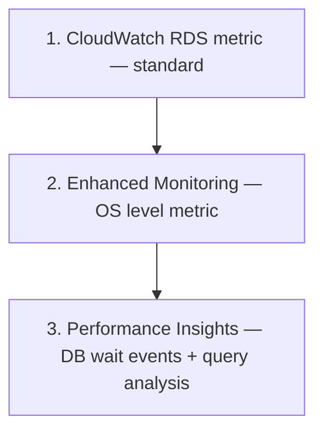

# RDS Performance + Monitoring

> Performance Insights (DB level wait events) + Enhanced Monitoring (OS level metric) + Slow Query log + CloudWatch standard.

## 1. 3 layer



## 2. CloudWatch standard metric

자동:
```
CPUUtilization
DatabaseConnections
FreeableMemory
FreeStorageSpace
ReadIOPS / WriteIOPS / ReadLatency / WriteLatency
ReadThroughput / WriteThroughput
ReplicaLag
DiskQueueDepth
BurstBalance (gp2)
EBSByteBalance% / EBSIOBalance%
NetworkReceiveThroughput / NetworkTransmitThroughput
```

```bash
aws cloudwatch get-metric-statistics --namespace AWS/RDS \
  --metric-name CPUUtilization \
  --dimensions Name=DBInstanceIdentifier,Value=bkurs-prod \
  --period 60 --statistics Average \
  --start-time $(date -u -v -1H +"%Y-%m-%dT%H:%M:%SZ") --end-time $(date -u +"%Y-%m-%dT%H:%M:%SZ")
```

## 3. Enhanced Monitoring (OS level)

```bash
aws rds modify-db-instance \
  --db-instance-identifier bkurs-prod \
  --monitoring-interval 60 \
  --monitoring-role-arn arn:aws:iam::ACCT:role/rds-monitoring \
  --apply-immediately
```

| Interval | 비용 |
| --- | --- |
| 1s | $0.30/instance·월 |
| 5s | $0.06 |
| 15s | $0.02 |
| 30s | $0.01 |
| 60s | $0.005 (free quota 안) |

→ Production = 60s 권장.

추가 metric:
- per-process / per-thread CPU
- per-filesystem space
- per-disk IO
- swap
- process list

CloudWatch Logs Insights:
```
fields @timestamp, processList
| filter @logStream like /rdsosmetrics/
| sort @timestamp desc
| limit 20
```

## 4. Performance Insights

```bash
aws rds modify-db-instance \
  --db-instance-identifier bkurs-prod \
  --enable-performance-insights \
  --performance-insights-retention-period 7 \
  --performance-insights-kms-key-id alias/bkurs-rds \
  --apply-immediately
```

| Retention | $ |
| --- | --- |
| 7d | 무료 |
| 1m-24m | $0.02/vCPU·일 |

## 5. Performance Insights — Console

핵심 보기:
- **DB Load (avg active session)** — overload 시 vCPU 보다 큼
- **Wait events** — what is the bottleneck?
  - `CPU` — compute bound
  - `IO:DataFileRead` — random read (cache miss)
  - `IO:XactSync` — Tx commit (WAL)
  - `Lock` — concurrent write contention
  - `Client:ClientRead` — slow client
- **Top SQL** — 가장 부하 query
- **Top Hosts / Users / Databases**

## 6. Wait event 진단

| Wait Event | 의미 | 해결 |
| --- | --- | --- |
| CPU | CPU bound | scale up |
| IO:DataFileRead | cache miss | shared_buffers ↑ / replica |
| IO:XactSync | commit 느림 | io2 / Aurora |
| Lock:transactionid | row lock | query 짧게 |
| Lock:relation | DDL | maintenance window |
| LWLock | internal | PostgreSQL version 갱신 |

## 7. Slow Query log

### Postgres (`log_min_duration_statement`)
```bash
aws rds modify-db-parameter-group --db-parameter-group-name bkurs-pg16 \
  --parameters "ParameterName=log_min_duration_statement,ParameterValue=1000,ApplyMethod=immediate" \
               "ParameterName=log_statement,ParameterValue=mod,ApplyMethod=immediate" \
               "ParameterName=log_temp_files,ParameterValue=0,ApplyMethod=immediate"

# Logs export to CloudWatch
aws rds modify-db-instance --db-instance-identifier bkurs-prod \
  --cloudwatch-logs-export-configuration "EnableLogTypes=postgresql,upgrade"
```

### MySQL (`slow_query_log`)
```
slow_query_log = 1
long_query_time = 1
log_slow_admin_statements = 1
log_queries_not_using_indexes = 1
```

### CloudWatch Logs Insights query

```
fields @timestamp, duration_ms, query
| filter @logStream like /postgresql/
| filter duration_ms > 2000
| sort duration_ms desc
| limit 20
```

## 8. Alarm 표준

```bash
# CPU 80%
aws cloudwatch put-metric-alarm --alarm-name bkurs-rds-cpu \
  --metric-name CPUUtilization --namespace AWS/RDS \
  --statistic Average --period 300 --evaluation-periods 3 \
  --threshold 80 --comparison-operator GreaterThanThreshold \
  --dimensions Name=DBInstanceIdentifier,Value=bkurs-prod

# Free storage 20%
aws cloudwatch put-metric-alarm --alarm-name bkurs-rds-storage \
  --metric-name FreeStorageSpace --namespace AWS/RDS \
  --statistic Average --period 300 --evaluation-periods 2 \
  --threshold 21474836480 --comparison-operator LessThanThreshold \
  --dimensions Name=DBInstanceIdentifier,Value=bkurs-prod

# Replica Lag > 60s
aws cloudwatch put-metric-alarm --alarm-name bkurs-rds-replica-lag \
  --metric-name ReplicaLag --namespace AWS/RDS \
  --statistic Maximum --period 60 --evaluation-periods 3 \
  --threshold 60 --comparison-operator GreaterThanThreshold \
  --dimensions Name=DBInstanceIdentifier,Value=bkurs-replica

# DatabaseConnections 80% of max
aws cloudwatch put-metric-alarm --alarm-name bkurs-rds-connections \
  --metric-name DatabaseConnections --namespace AWS/RDS \
  --statistic Average --period 60 --evaluation-periods 5 \
  --threshold 160 --comparison-operator GreaterThanThreshold \
  --dimensions Name=DBInstanceIdentifier,Value=bkurs-prod
```

## 9. Connection 관리

### max_connections
```
db.t4g.medium (4 GB): default 87
db.r6g.large (16 GB): default ~1700
```

권장:
- baseline 200-500
- pool (HikariCP / pgBouncer / RDS Proxy)

### RDS Proxy
```bash
aws rds create-db-proxy --db-proxy-name bkurs-proxy \
  --engine-family POSTGRESQL \
  --role-arn arn:aws:iam::ACCT:role/rds-proxy-role \
  --vpc-subnet-ids subnet-priv-a subnet-priv-b \
  --auth "Description=bkurs,AuthScheme=SECRETS,SecretArn=arn:aws:secretsmanager:...:secret:bkurs-db,IAMAuth=DISABLED"

aws rds register-db-proxy-targets --db-proxy-name bkurs-proxy \
  --db-instance-identifiers bkurs-prod
```

활용:
- Lambda + RDS (connection 폭주 방지)
- 짧은 connection 의 application
- Failover 자동 (~수초)

비용: $0.015/vCPU·hour.

## 10. Performance Insights API

```bash
aws pi get-resource-metrics \
  --service-type RDS \
  --identifier db-XXXXXX \
  --start-time 2026-05-22T15:00:00Z --end-time 2026-05-22T16:00:00Z \
  --metric-queries '[
    { "Metric": "db.load.avg", "GroupBy": { "Group": "db.wait_event" } }
  ]' \
  --period-in-seconds 60
```

## 11. RDS Optimized Reads

io2 Block Express + r6id / x2idn instance:
```
local NVMe cache (Optimized Reads tier)
→ random read latency 50% ↓
→ Aurora 와 비슷한 cache 효과
```

## 12. RDS Optimized Writes

MySQL / MariaDB 만:
```
2x write IOPS, halved cost
double-write buffer 제거 (Hardware-level integrity)
```

## 13. Vacuum / Maintenance (Postgres)

```bash
# Auto-vacuum 의 parameter
"ParameterName=autovacuum_naptime,ParameterValue=60,ApplyMethod=immediate"
"ParameterName=autovacuum_vacuum_scale_factor,ParameterValue=0.1,ApplyMethod=immediate"
"ParameterName=autovacuum_analyze_scale_factor,ParameterValue=0.05,ApplyMethod=immediate"

# Manual VACUUM ANALYZE
psql -h $RDS -U $USER -d bkurs -c "VACUUM ANALYZE;"
```

## 14. 흔한 함정

| 함정 | 회피 |
| --- | --- |
| Performance Insights 비활성 | enable (7d 무료) |
| Enhanced Monitoring 60s+ | 1s 비싸 |
| Slow query log 없음 | log_min_duration_statement |
| RDS Proxy 없이 Lambda + RDS | connection 폭주 |
| Cold cache → Optimized Reads | io2 + r6id |
| Autovacuum 안 함 | parameter 활성 |
| ReplicaLag alarm 없음 | 60s threshold |

## 15. 다음

- ▶ [[03-migration-and-blue-green]]
- ▶ [[../03-security/01-network-and-iam]]
- ▶ [[../practice/01-rds-multi-az-postgres]]

## 16. 영상 / 자료

| 자료 |
| --- |
| [Performance Insights](https://docs.aws.amazon.com/AmazonRDS/latest/UserGuide/USER_PerfInsights.html) |
| [Enhanced Monitoring](https://docs.aws.amazon.com/AmazonRDS/latest/UserGuide/USER_Monitoring.OS.html) |
| [RDS Proxy](https://aws.amazon.com/rds/proxy/) |

## 17. 참고

- [[../rds]]
- [[01-backup-and-pitr]]
