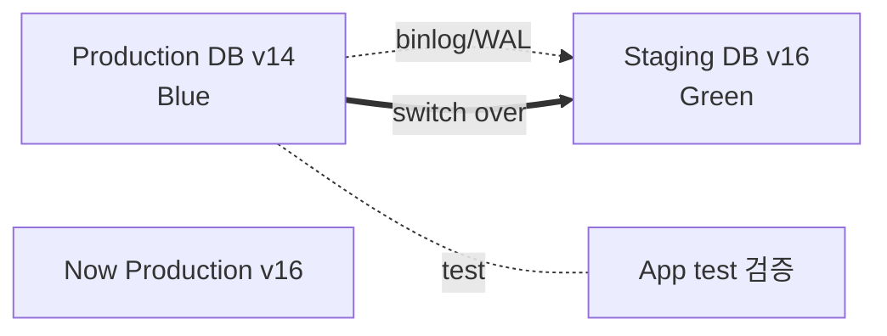

# RDS Migration + Blue-Green Deployment

> AWS DMS (Database Migration Service) + Schema Conversion Tool (SCT) + Blue-Green Deployment (2022+, zero-downtime upgrade).

## 1. Migration 시나리오

| | Source | Target | 도구 |
| --- | --- | --- | --- |
| Lift-and-shift | On-prem Postgres | RDS Postgres | DMS + restore |
| Re-platform | Oracle | RDS Postgres / Aurora | DMS + SCT |
| Re-platform | SQL Server | Aurora MySQL | DMS + SCT (Babelfish) |
| Major version upgrade | RDS Postgres 14 | Postgres 16 | Blue-Green |
| Engine migration | RDS Postgres | Aurora Postgres | DMS 또는 snapshot |
| Cross-region | Seoul | Tokyo | DMS continuous |

## 2. Blue-Green Deployment ★ (2022+)



| 옵션 | 의미 |
| --- | --- |
| Source | Blue (현 production) |
| Target | Green (자동 생성 + replicate) |
| Replication | logical (WAL / binlog) |
| Switch over | ~수초 (DNS + endpoint 변경) |
| Rollback | 5분 안 (snapshot 자동) |

## 3. Blue-Green 활성

```bash
aws rds create-blue-green-deployment \
  --blue-green-deployment-name bkurs-upgrade \
  --source arn:aws:rds:ap-northeast-2:ACCT:db:bkurs-prod \
  --target-engine-version 16.2 \
  --target-db-parameter-group-name bkurs-pg16 \
  --target-db-instance-class db.t4g.medium
```

→ Green DB 자동 생성 + Blue 의 logical replication.

## 4. Switch over

```bash
# 검증 후 switch
aws rds switchover-blue-green-deployment \
  --blue-green-deployment-identifier bgd-xxx \
  --switchover-timeout 300
```

| 동작 | 시간 |
| --- | --- |
| Replication catch up | <30초 |
| Endpoint name swap | <수초 |
| DNS propagation | <60초 |
| 총 downtime | ~수초~30초 |

## 5. Rollback

```bash
# Switch 후 문제 → 5분 안 rollback (별도 명령 아님, Blue 가 standby)
# 5분 후 — 새 Blue-Green 으로 다시
```

Blue 는 switch over 후 5분 동안 사용 가능 (자동 stop). 이후 수동 promote.

## 6. AWS DMS (Database Migration Service)

```bash
# Replication Instance
aws dms create-replication-instance \
  --replication-instance-identifier bkurs-dms \
  --replication-instance-class dms.t3.medium \
  --vpc-security-group-ids sg-dms \
  --replication-subnet-group-identifier bkurs-dms-subnet \
  --multi-az \
  --engine-version 3.5.0

# Endpoint - Source
aws dms create-endpoint \
  --endpoint-identifier bkurs-source \
  --endpoint-type source \
  --engine-name postgres \
  --username bkurs_admin \
  --password $PASSWORD \
  --server-name old-db.example.com \
  --port 5432 \
  --database-name bkurs

# Endpoint - Target
aws dms create-endpoint \
  --endpoint-identifier bkurs-target \
  --endpoint-type target \
  --engine-name postgres \
  --username bkurs_admin \
  --password $PASSWORD \
  --server-name bkurs-prod.xxx.ap-northeast-2.rds.amazonaws.com \
  --port 5432 \
  --database-name bkurs

# Migration Task
aws dms create-replication-task \
  --replication-task-identifier bkurs-migration \
  --source-endpoint-arn arn:dms:...:endpoint:source \
  --target-endpoint-arn arn:dms:...:endpoint:target \
  --replication-instance-arn arn:dms:...:rep:bkurs-dms \
  --migration-type full-load-and-cdc \
  --table-mappings file://mapping.json \
  --replication-task-settings file://settings.json
```

### Migration Type
| | |
| --- | --- |
| `full-load` | 한번 복사 (downtime 필요) |
| `cdc` | continuous replication (changes만) |
| `full-load-and-cdc` | 처음 full + continuous ★ |

### Table Mapping
```json
{
  "rules": [{
    "rule-type": "selection",
    "rule-id": "1",
    "rule-name": "include-public",
    "object-locator": {
      "schema-name": "public",
      "table-name": "%"
    },
    "rule-action": "include"
  }]
}
```

## 7. Schema Conversion Tool (SCT)

```
SCT (desktop app) + Workbench
→ Oracle schema → Postgres schema 자동 변환
→ Stored procedure / function 도 변환
→ Conversion report
→ Babelfish (Aurora MySQL) → SQL Server 호환
```

Babelfish:
```bash
aws rds modify-db-cluster --db-cluster-identifier bkurs \
  --db-cluster-parameter-group-name bkurs-babelfish-params
```

→ SQL Server protocol (TDS) + T-SQL 지원.

## 8. Migration Best Practices

```
1. SCT 로 schema 변환 + report 검토
2. DMS 의 full-load-and-cdc 시작
3. Source 에 read traffic 계속 둠
4. Target 에 read replica 추가 (검증)
5. Application 호환성 테스트
6. Cutover:
   - Source 의 write 잠시 차단
   - DMS 의 last CDC commit 확인
   - Application 의 DB endpoint 변경 (DNS / config)
   - Target 의 write 시작
7. Source 보존 (rollback 용)
```

## 9. AWS Backup 으로 DR / Migration

```bash
aws backup start-copy-job \
  --recovery-point-arn arn:aws:backup:ap-northeast-2:ACCT:recovery-point:xxx \
  --source-backup-vault-name aps2-vault \
  --destination-backup-vault-arn arn:aws:backup:ap-northeast-1:ACCT:backup-vault:apn1-vault \
  --iam-role-arn arn:aws:iam::ACCT:role/AWSBackupDefaultServiceRole
```

## 10. Major version upgrade — 3 방법

| 방법 | downtime | 권장 |
| --- | --- | --- |
| In-place upgrade | 분-수시간 | dev/staging |
| Snapshot + Restore (다른 engine 버전) | 수시간 | small DB |
| **Blue-Green Deployment** | 수초 | ★ production |

## 11. 흔한 함정

| 함정 | 회피 |
| --- | --- |
| In-place major upgrade → app 깨짐 | Blue-Green |
| DMS full-load only → CDC 누락 | full-load-and-cdc |
| SCT 의 stored procedure 변환 누락 | 수동 검토 |
| Cutover 시 source write 잠시 차단 안 함 | 짧은 maintenance window |
| Babelfish 호환성 검증 안 함 | 사전 SCT report |
| DNS TTL 60+ → cutover 늦음 | TTL 짧게 |

## 12. 다음

- ▶ [[../03-security/01-network-and-iam]]
- ▶ [[../03-security/02-encryption-and-secrets]]
- ▶ [[../practice/02-pitr-and-blue-green]]

## 13. 영상 / 자료

| 자료 |
| --- |
| [Blue-Green 발표](https://aws.amazon.com/blogs/aws/new-fully-managed-blue-green-deployments-in-amazon-aurora-and-amazon-rds/) |
| [AWS DMS](https://docs.aws.amazon.com/dms/) |
| [SCT](https://aws.amazon.com/dms/schema-conversion-tool/) |
| [Babelfish](https://aws.amazon.com/rds/aurora/babelfish/) |

## 14. 참고

- [[../rds]]
- [[../01-fundamentals/01-engine-and-versions]]
- [[01-backup-and-pitr]]
