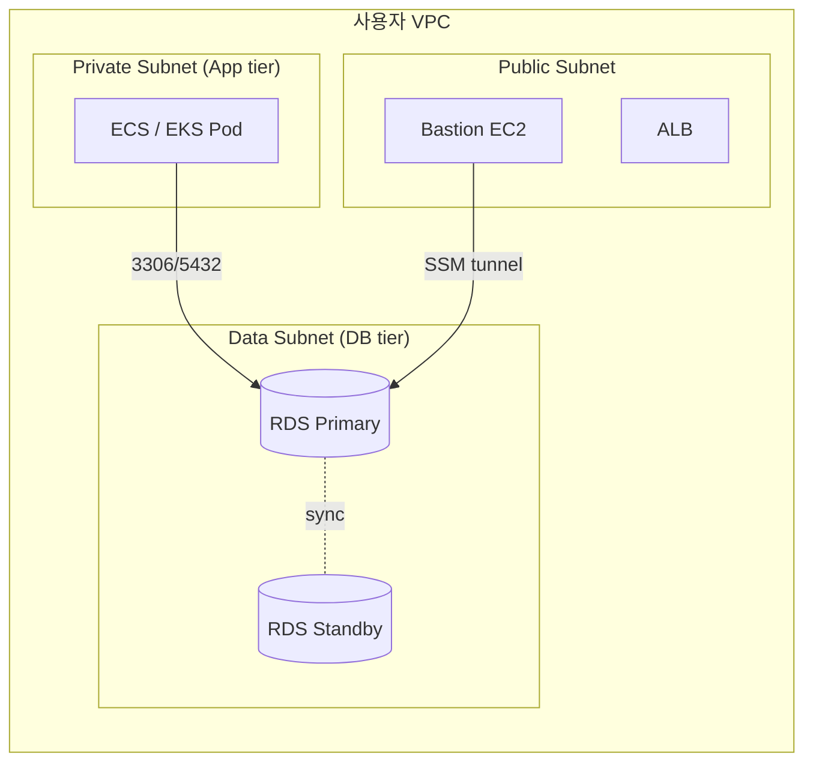

# RDS Network + IAM Authentication

> Private subnet + SG reference + IAM Database Authentication (15분 token, no password). RDS Proxy + SSM tunnel.

## 1. Network 구조



## 2. DB Subnet Group

```bash
aws rds create-db-subnet-group \
  --db-subnet-group-name bkurs-db-subnet \
  --db-subnet-group-description "bkurs production" \
  --subnet-ids subnet-data-a subnet-data-b subnet-data-c
```

| 한도 | |
| --- | --- |
| Subnet | 2+ AZ 필수 (Multi-AZ) |
| Private | 강력 권장 |
| Route Table | NAT / IGW 없음 (data tier) |

## 3. Security Group (Layer 1)

```bash
SG_RDS=$(aws ec2 create-security-group --vpc-id vpc-xxx \
  --group-name bkurs-rds --description "rds" \
  --query GroupId --output text)

# Postgres 5432 from app SG
aws ec2 authorize-security-group-ingress --group-id $SG_RDS \
  --protocol tcp --port 5432 --source-group sg-app

# 또는 MySQL 3306
# aws ec2 authorize-security-group-ingress --group-id $SG_RDS \
#   --protocol tcp --port 3306 --source-group sg-app

# Bastion (Optional, 운영자)
aws ec2 authorize-security-group-ingress --group-id $SG_RDS \
  --protocol tcp --port 5432 --source-group sg-bastion
```

> SG reference 가 best (CIDR 보다 안전).

## 4. NACL (Layer 2)

```bash
# Stateless — Egress / Ingress 모두 명시
aws ec2 create-network-acl --vpc-id vpc-xxx
aws ec2 create-network-acl-entry --network-acl-id acl-xxx \
  --rule-number 100 --protocol tcp --port-range From=5432,To=5432 \
  --cidr-block 10.0.0.0/8 --rule-action allow --ingress

aws ec2 create-network-acl-entry --network-acl-id acl-xxx \
  --rule-number 100 --protocol tcp --port-range From=1024,To=65535 \
  --cidr-block 10.0.0.0/8 --rule-action allow --egress
```

> SG 가 기본, NACL = 차단용 (e.g. 특정 CIDR 명시).

## 5. PubliclyAccessible

```bash
# Production 절대 X
aws rds modify-db-instance --db-instance-identifier bkurs-prod \
  --no-publicly-accessible
```

→ public IP 부여 안 됨 (private subnet 만).

## 6. SSM Session Manager Tunnel (Bastion-less)

```bash
# Bastion 없이 RDS 접근
aws ssm start-session --target $BASTION_INSTANCE_ID \
  --document-name AWS-StartPortForwardingSessionToRemoteHost \
  --parameters "{
    \"host\":[\"bkurs-prod.xxx.ap-northeast-2.rds.amazonaws.com\"],
    \"portNumber\":[\"5432\"],
    \"localPortNumber\":[\"5432\"]
  }"

# 다른 터미널
psql -h 127.0.0.1 -U bkurs_admin -d bkurs
```

자세히 → [[../../../compute/ec2/04-operations/01-ssm-session-manager]] §5

## 7. IAM Database Authentication

```bash
# Enable
aws rds modify-db-instance --db-instance-identifier bkurs-prod \
  --enable-iam-database-authentication --apply-immediately
```

### DB User 의 IAM 매핑 (Postgres)
```sql
-- DB 안에서 (master user 로)
CREATE USER iam_user;
GRANT rds_iam TO iam_user;
GRANT SELECT, INSERT, UPDATE ON ALL TABLES IN SCHEMA public TO iam_user;
```

### IAM Policy (caller)
```json
{
  "Effect": "Allow",
  "Action": "rds-db:connect",
  "Resource": "arn:aws:rds-db:ap-northeast-2:ACCT:dbuser:db-XXXXXX/iam_user"
}
```

### Token 생성 (15분 valid)
```bash
TOKEN=$(aws rds generate-db-auth-token \
  --hostname bkurs-prod.xxx.ap-northeast-2.rds.amazonaws.com \
  --port 5432 --region ap-northeast-2 \
  --username iam_user)

# 사용 (Postgres)
PGPASSWORD=$TOKEN psql -h $RDS -p 5432 -U iam_user -d bkurs

# 또는 Spring Boot
# 매번 token 생성 + datasource refresh
```

## 8. IAM Auth 의 장단

| | 장점 | 단점 |
| --- | --- | --- |
| | password 분실 위험 X | 15분 TTL (refresh 필요) |
| | IAM Role 통합 | per-connection 200/s 한도 |
| | CloudTrail audit | DB 안에 user 가 별도 |
| | rotation 자동 | application 의 token refresh 로직 필요 |

활용:
- Lambda + RDS (Lambda 의 IAM Role 활용)
- IRSA / Pod Identity (EKS)
- 자동화 script

## 9. RDS Proxy + IAM

RDS Proxy 가 IAM Auth 활용 (application 의 token 관리 불필요):
```bash
aws rds create-db-proxy --db-proxy-name bkurs-proxy \
  --auth "Description=bkurs,AuthScheme=SECRETS,SecretArn=arn:secret:...,IAMAuth=REQUIRED"

# Proxy 사용 시 Lambda / EKS pod 의 IAM 만
TOKEN=$(aws rds generate-db-auth-token \
  --hostname bkurs-proxy.proxy-xxx.ap-northeast-2.rds.amazonaws.com \
  --port 5432 --region ap-northeast-2 \
  --username bkurs_app)
```

## 10. SSL/TLS

```bash
# Force SSL (Parameter Group)
aws rds modify-db-parameter-group --db-parameter-group-name bkurs-pg16 \
  --parameters "ParameterName=rds.force_ssl,ParameterValue=1,ApplyMethod=immediate"

# CA bundle
wget https://truststore.pki.rds.amazonaws.com/global/global-bundle.pem

# Postgres
psql -h $RDS "sslmode=verify-full sslrootcert=global-bundle.pem dbname=bkurs user=admin"

# MySQL
mysql -h $RDS --ssl-ca=global-bundle.pem --ssl-mode=VERIFY_IDENTITY
```

## 11. Cross-VPC / Cross-Account

### PrivateLink
RDS Endpoint Service:
```bash
# Source account 에서 endpoint service 만들기
aws ec2 create-vpc-endpoint-service-configuration \
  --network-load-balancer-arns arn:nlb:... \
  --acceptance-required

# Consumer account 에서 endpoint
aws ec2 create-vpc-endpoint --vpc-id vpc-yyy \
  --service-name com.amazonaws.vpce.ap-northeast-2.vpce-svc-xxx \
  --vpc-endpoint-type Interface
```

### Transit Gateway (multi-VPC)
```
VPC-A (App) ←→ Transit Gateway ←→ VPC-B (RDS)
```

## 12. Master Password 의 lifecycle

```bash
# Secrets Manager 자동 (modern)
aws rds modify-db-instance --db-instance-identifier bkurs-prod \
  --manage-master-user-password \
  --master-user-secret-kms-key-id alias/secrets

# 자동 rotation 30일
aws rds describe-db-instances --db-instance-identifier bkurs-prod \
  --query 'DBInstances[0].MasterUserSecret'
```

자세히 → [[02-encryption-and-secrets]]

## 13. 흔한 함정

| 함정 | 회피 |
| --- | --- |
| Public RDS | private subnet + no-publicly-accessible |
| SG CIDR `0.0.0.0/0` | SG reference 만 |
| Bastion 의 SSH 22 inbound | SSM Session Manager |
| SSL 강제 안 함 | `rds.force_ssl=1` |
| Master password env 평문 | Secrets Manager |
| IAM Auth 의 15분 TTL 모름 | refresh 로직 또는 RDS Proxy |

## 14. 다음

- ▶ [[02-encryption-and-secrets]]
- ▶ [[03-audit-and-compliance]]
- ▶ [[../practice/01-rds-multi-az-postgres]]

## 15. 영상 / 자료

| 자료 |
| --- |
| [IAM DB Authentication](https://docs.aws.amazon.com/AmazonRDS/latest/UserGuide/UsingWithRDS.IAMDBAuth.html) |
| [RDS Network](https://docs.aws.amazon.com/AmazonRDS/latest/UserGuide/USER_VPC.html) |

## 16. 참고

- [[../rds]]
- [[../../../iam/iam]]
