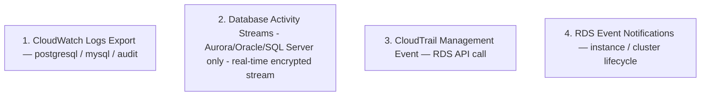

# RDS Audit + Compliance

> pgaudit (Postgres) / MySQL Audit / Database Activity Streams (Aurora Postgres / Oracle / SQL Server) + CloudTrail + HIPAA/PCI compliance.

## 1. Audit Layer



## 2. Postgres pgaudit

```bash
# Parameter Group
"ParameterName=shared_preload_libraries,ParameterValue=pgaudit,ApplyMethod=pending-reboot"
"ParameterName=pgaudit.log,ParameterValue=write,ddl,role,ApplyMethod=immediate"
"ParameterName=pgaudit.log_relation,ParameterValue=1,ApplyMethod=immediate"
"ParameterName=pgaudit.log_statement_once,ParameterValue=1,ApplyMethod=immediate"

# CloudWatch Logs export
aws rds modify-db-instance --db-instance-identifier bkurs-prod \
  --cloudwatch-logs-export-configuration "EnableLogTypes=postgresql,upgrade"

# Install pgaudit (DB 안에서)
psql -h $RDS -U admin -d bkurs -c "CREATE EXTENSION pgaudit;"
```

| pgaudit.log 옵션 |
| --- |
| `read` — SELECT |
| `write` — INSERT/UPDATE/DELETE |
| `ddl` — CREATE/ALTER/DROP |
| `role` — GRANT/REVOKE |
| `function` |
| `misc` — VACUUM/CHECKPOINT |
| `all` |

## 3. CloudWatch Logs Insights query

```
fields @timestamp, @message
| filter @logStream like /postgresql/
| filter @message like /pgaudit/
| filter @message like /DELETE FROM users/
| sort @timestamp desc
| limit 100
```

## 4. MySQL Audit (Server Audit)

```bash
# Parameter Group (MariaDB Audit Plugin)
"ParameterName=server_audit_logging,ParameterValue=1"
"ParameterName=server_audit_events,ParameterValue=CONNECT,QUERY_DDL,QUERY_DML"
"ParameterName=server_audit_excl_users,ParameterValue=rdsadmin"

# Logs export
aws rds modify-db-instance --db-instance-identifier bkurs-mysql \
  --cloudwatch-logs-export-configuration "EnableLogTypes=audit,error,general,slowquery"
```

## 5. Database Activity Streams (Aurora Postgres / Oracle / SQL Server)

```bash
# Start
aws rds start-activity-stream --resource-arn arn:aws:rds:...:cluster:bkurs-aurora \
  --mode async \
  --kms-key-id alias/bkurs-dbas \
  --apply-immediately

# Kinesis Data Stream 자동 생성
aws rds describe-db-clusters --db-cluster-identifier bkurs-aurora \
  --query 'DBClusters[0].ActivityStreamKinesisStreamName'
```

| Mode | 의미 |
| --- | --- |
| `sync` | application 의 query latency 영향 |
| `async` | low overhead (권장) |

| Engine 지원 |
| --- |
| Aurora Postgres |
| Aurora MySQL (2024+) |
| Oracle (BYOL / LI) |
| SQL Server (Enterprise) |
| **RDS Postgres / MySQL — 미지원** (pgaudit 사용) |

## 6. Activity Stream consumer

```python
import boto3, json
from base64 import b64decode
from aws_encryption_sdk import EncryptionSDKClient

kinesis = boto3.client("kinesis")
sdk = EncryptionSDKClient()

# Decrypt
def lambda_handler(event, context):
    for record in event["Records"]:
        payload = b64decode(record["kinesis"]["data"])
        plaintext, _ = sdk.decrypt(source=payload, ...)
        activity = json.loads(plaintext)
        # activity 의 SQL, user, time, etc → S3 / Splunk / SIEM
```

## 7. CloudTrail (Management Event)

자동 — 모든 RDS API call:
```bash
aws cloudtrail lookup-events \
  --lookup-attributes AttributeKey=EventName,AttributeValue=DeleteDBInstance \
  --max-items 20

# Resource 별
aws cloudtrail lookup-events \
  --lookup-attributes AttributeKey=ResourceName,AttributeValue=bkurs-prod \
  --max-items 30
```

| Logged | |
| --- | --- |
| DB instance / cluster lifecycle | CreateDBInstance / Delete / Modify / Reboot |
| Snapshot | Create / Delete / Copy / Share |
| Parameter Group / Option Group | Modify |
| Multi-AZ Failover | FailoverDBCluster |
| Restore | RestoreDB* |

| **Not Logged** | data plane (query, connection) — pgaudit / Activity Streams |

## 8. RDS Event Notifications

```bash
# SNS topic
SNS_ARN=$(aws sns create-topic --name bkurs-rds-events --query 'TopicArn' --output text)

aws rds create-event-subscription \
  --subscription-name bkurs-rds-events \
  --sns-topic-arn $SNS_ARN \
  --source-type db-instance \
  --event-categories "failure" "maintenance" "failover" "backup" "deletion" \
  --source-ids bkurs-prod
```

| Category |
| --- |
| availability — start/stop |
| backup |
| configuration change |
| creation |
| deletion |
| failover |
| failure |
| low storage |
| maintenance |
| notification |
| recovery |
| restoration |

## 9. AWS Config Rules

```bash
# Encryption at rest
aws configservice put-config-rule --config-rule '{
  "ConfigRuleName": "rds-storage-encrypted",
  "Source": { "Owner": "AWS", "SourceIdentifier": "RDS_STORAGE_ENCRYPTED" }
}'

# Public access prohibited
aws configservice put-config-rule --config-rule '{
  "ConfigRuleName": "rds-instance-public-access-check",
  "Source": { "Owner": "AWS", "SourceIdentifier": "RDS_INSTANCE_PUBLIC_ACCESS_CHECK" }
}'

# Multi-AZ
aws configservice put-config-rule --config-rule '{
  "ConfigRuleName": "rds-multi-az-support",
  "Source": { "Owner": "AWS", "SourceIdentifier": "RDS_MULTI_AZ_SUPPORT" }
}'

# Deletion Protection
aws configservice put-config-rule --config-rule '{
  "ConfigRuleName": "rds-deletion-protection",
  "Source": { "Owner": "AWS", "SourceIdentifier": "RDS_INSTANCE_DELETION_PROTECTION_ENABLED" }
}'

# IAM Authentication
aws configservice put-config-rule --config-rule '{
  "ConfigRuleName": "rds-iam-auth",
  "Source": { "Owner": "AWS", "SourceIdentifier": "RDS_IAM_AUTHENTICATION_ENABLED" }
}'

# Logging
aws configservice put-config-rule --config-rule '{
  "ConfigRuleName": "rds-logging-enabled",
  "Source": { "Owner": "AWS", "SourceIdentifier": "RDS_LOGGING_ENABLED" }
}'
```

→ noncompliant 자동 알림.

## 10. Compliance Standards

### HIPAA (의료)
```
[ ] Encryption at rest (KMS)
[ ] Encryption in transit (TLS)
[ ] Deletion Protection
[ ] Automated Backup 35d
[ ] Cross-region snapshot
[ ] pgaudit (모든 write/ddl/role)
[ ] CloudTrail Data Event (RDS data plane 만 가능 — Activity Streams)
[ ] AWS Config rule 6종
[ ] BAA (Business Associate Agreement) AWS 와 체결
```

### PCI DSS
```
[ ] Encryption (KMS + TLS)
[ ] IAM 권한 최소화
[ ] Audit log (pgaudit + 12개월 보존)
[ ] Multi-AZ
[ ] Quarterly vulnerability scan
[ ] Penetration test
```

### KISA / ISMS-P (한국)
```
[ ] 암호화 (개인정보)
[ ] 접근 통제 (IAM + DB user)
[ ] 감사 log (1년+)
[ ] 백업 정책
[ ] 장애 대응 (Multi-AZ + DR)
```

## 11. Security Hub 통합

```bash
aws securityhub enable-security-hub --enable-default-standards
```

자동 표준:
- CIS AWS Foundations
- PCI DSS
- AWS Foundational Security Best Practices

→ RDS finding unified view.

## 12. GuardDuty for RDS

```bash
aws guardduty update-organization-configuration --auto-enable NEW \
  --features '[{"Name":"RDS_LOGIN_EVENTS","Status":"ENABLED"}]'
```

자동 탐지:
- Brute force login
- Unusual access from unfamiliar IP
- Compromised credentials

## 13. 권장 baseline 체크리스트

```
[ ] Encryption at rest (KMS CMK)
[ ] TLS in transit (rds.force_ssl=1)
[ ] Secrets Manager managed password + 30d rotation
[ ] Multi-AZ (production)
[ ] Deletion Protection
[ ] Final Snapshot on delete
[ ] Automated Backup 35d + cross-region (AWS Backup)
[ ] Performance Insights 활성
[ ] Enhanced Monitoring 60s
[ ] CloudWatch Logs export (postgresql / upgrade)
[ ] pgaudit (모든 write/ddl/role)
[ ] RDS Event Notifications → SNS / Discord
[ ] AWS Config rule 6종
[ ] GuardDuty RDS Login Events
[ ] Security Hub
[ ] CloudTrail Management Event
[ ] PubliclyAccessible=false
[ ] SG inbound = sg-app 만
[ ] Subnet Group = private subnet
```

## 14. 흔한 함정

| 함정 | 회피 |
| --- | --- |
| pgaudit 미설치 | shared_preload_libraries + CREATE EXTENSION |
| Activity Streams 만 (cost 무시) | async mode + Kinesis processing 비용 |
| CloudTrail Data Event 미활성 | RDS 는 Management Event 만, data = pgaudit |
| Config rule 없음 | 6종 표준 |
| Event Notification 없음 | SNS / Discord |
| HIPAA BAA 없음 | AWS 와 체결 |

## 15. 다음

- ▶ [[../practice/01-rds-multi-az-postgres]]
- ▶ [[../practice/02-pitr-and-blue-green]]
- ▶ [[../../../security/kms/kms]]

## 16. 영상 / 자료

| 자료 |
| --- |
| [pgaudit](https://docs.aws.amazon.com/AmazonRDS/latest/UserGuide/Appendix.PostgreSQL.CommonDBATasks.pgaudit.html) |
| [Database Activity Streams](https://docs.aws.amazon.com/AmazonRDS/latest/AuroraUserGuide/DBActivityStreams.html) |
| [GuardDuty RDS Protection](https://docs.aws.amazon.com/guardduty/latest/ug/rds-protection.html) |

## 17. 참고

- [[../rds]]
- [[01-network-and-iam]]
- [[02-encryption-and-secrets]]
