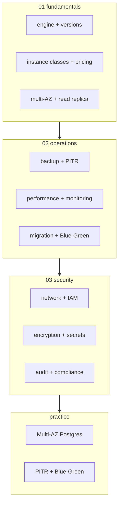
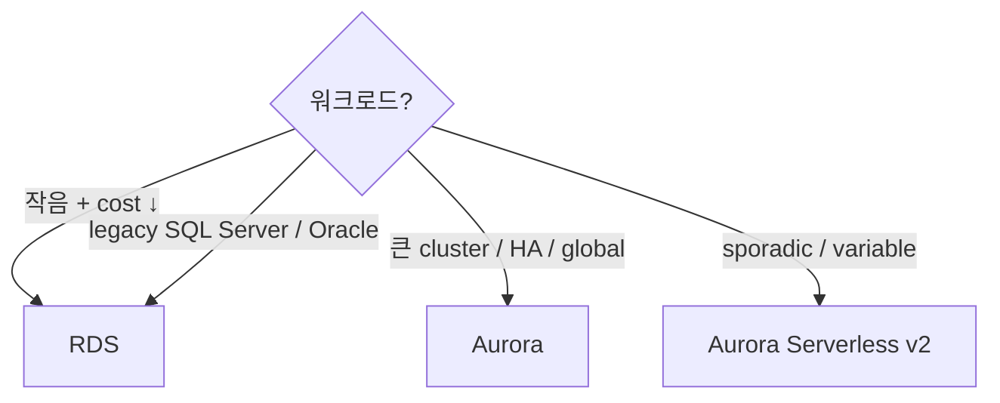

# AWS RDS — Relational Database Service

> Managed Postgres / MySQL / MariaDB / SQL Server / Oracle. Aurora 는 별도 ([[../aurora/aurora]]).

**[[../database|↑ Database]]** · **[[../../cloud-aws|↑↑ AWS]]**

---

## 1. 한 줄

```
Managed RDBMS (Postgres / MySQL / MariaDB / SQL Server / Oracle)
├─ Multi-AZ (synchronous standby — failover ~수분)
├─ Read Replica (async, 5 max, cross-region 가능)
├─ Automated Backup (PITR, 35일 보존)
├─ Snapshot (manual, 보존 무한)
├─ Encryption (KMS) + IAM auth + TLS
└─ Performance Insights + Enhanced Monitoring
```

## 2. 학습 roadmap



## 3. Sub-directory index

### [[01-fundamentals/01-engine-and-versions]] — 5 engines + version 정책
Postgres / MySQL / MariaDB / Oracle / SQL Server + Standard vs Extended Support.

### [[01-fundamentals/02-instance-classes-and-pricing]] — db.t4g / db.m6i / db.r6id / Graviton
ARM64 Graviton, memory-optimized, storage type (gp3/io2).

### [[01-fundamentals/03-multi-az-and-read-replica]] — Multi-AZ vs Multi-AZ Cluster + Read Replica
Standby vs 2-replica (Multi-AZ DB Cluster) + Cross-region Read Replica.

### [[02-operations/01-backup-and-pitr]] — Automated Backup / Snapshot / Point-In-Time Recovery
35d 보존 + minute-level PITR + Cross-region snapshot.

### [[02-operations/02-performance-and-monitoring]] — Performance Insights / Enhanced Monitoring / Slow Query
DB level + OS level + slow query log + CloudWatch.

### [[02-operations/03-migration-and-blue-green]] — DMS / Blue-Green Deployment / SCT
Database Migration Service + Schema Conversion + Blue-Green (2022+).

### [[03-security/01-network-and-iam]] — VPC / SG / IAM Database Authentication
private subnet + SG + IAM token (15분 TTL).

### [[03-security/02-encryption-and-secrets]] — KMS at-rest / TLS in-transit / Secrets Manager rotation
SSE + TLS strict + 30일 password rotation.

### [[03-security/03-audit-and-compliance]] — Audit log / Activity Streams / Compliance
pgaudit / MySQL audit + Database Activity Streams + HIPAA/PCI.

### [[practice/01-rds-multi-az-postgres]] — Multi-AZ Postgres + Read Replica + IAM auth (60분)

### [[practice/02-pitr-and-blue-green]] — PITR 시뮬 + Blue-Green major version upgrade (45분)

## 4. 핵심 개념

| 개념 | 의미 |
| --- | --- |
| DB Instance | EC2 + EBS managed DB |
| DB Cluster (Aurora / Multi-AZ DB Cluster) | 여러 instance share storage |
| Multi-AZ | synchronous standby (failover) |
| Read Replica | async copy (read scaling) |
| Snapshot | manual backup (영구) |
| Automated Backup | PITR + 35d 보존 |
| Parameter Group | DB config (max_connections 등) |
| Option Group | engine 기능 (Oracle TDE 등) |
| Subnet Group | DB subnet (multi-AZ private) |

## 5. 가격 직관 (Seoul, db.t4g.medium 24x7)

```
On-Demand:                     $0.103/h × 730 = $75/월
Multi-AZ:                      $75 × 2 = $150/월
+ gp3 100 GB:                  $11.5/월
+ Backup storage (free quota): 무료
+ DT cross-region replica:     $0.09/GB

Reserved Instance (3y all):    ~$30/월 (~60% 절감)
```

> Aurora Serverless v2 가 작은 workload 에 더 적합 ([[../aurora/aurora]]).

## 6. Engine 선택

| | RDS Postgres | RDS MySQL | Aurora Postgres | Aurora MySQL |
| --- | --- | --- | --- | --- |
| Open source | ✓ | ✓ | ✓ (AWS 변형) | ✓ (AWS 변형) |
| Performance | baseline | baseline | 3x | 5x |
| Storage | gp3 / io2 (EBS) | gp3 / io2 | 분산 (자동 scale) | 분산 |
| Read Replica | 5 max | 5 max | 15 max | 15 max |
| Multi-AZ failover | ~수분 | ~수분 | ~30초 | ~30초 |
| Serverless | ✗ | ✗ | ✓ (v2) | ✓ (v2) |
| Backtrack | ✗ | ✗ | ✓ (MySQL) | ✓ |
| Global DB | Read Replica | Read Replica | ✓ | ✓ |
| Cost | baseline | baseline | premium (~20% ↑) | premium |
| 권장 | small / cost | small / cost | 큰 cluster / HA | high RPS |

## 7. bkurs-be 활용

```
Primary DB:                    RDS Postgres 16 Multi-AZ + db.t4g.medium
Read Replica (optional):       1 read replica for analytics
Backup:                        35d PITR + cross-region snapshot
Secrets:                       Secrets Manager + 30d rotation
Audit:                         pgaudit + CloudTrail Data Event
```

또는 **Aurora Postgres** 권장 (작은 팀 + serverless v2).

## 8. RDS vs Aurora 결정



## 9. 영상 / 자료

| 자료 |
| --- |
| [RDS 공식](https://docs.aws.amazon.com/AmazonRDS/latest/UserGuide/) |
| [RDS Best Practices](https://docs.aws.amazon.com/AmazonRDS/latest/UserGuide/CHAP_BestPractices.html) |
| [Performance Insights](https://docs.aws.amazon.com/AmazonRDS/latest/UserGuide/USER_PerfInsights.html) |

## 10. 관련 hub

- [[../database]]
- [[../aurora/aurora]]
- [[../dynamodb/dynamodb]]
- [[../../security/kms/kms]]
- [[../../security/secrets-manager/secrets-manager]]
- [[../../network/vpc/vpc]]
