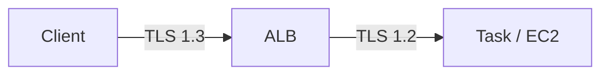

# ALB HTTPS + ACM + mTLS

> ACM (무료 cert) + SNI (multi-domain) + mTLS (2023+) + SSL Policy. End-to-end TLS.

## 1. ACM Certificate (무료, 자동 rotate)

```bash
# Public cert
aws acm request-certificate \
  --domain-name api.bkurs.com \
  --subject-alternative-names *.bkurs.com bkurs.com \
  --validation-method DNS \
  --key-algorithm RSA_2048 \
  --tags Key=Environment,Value=prod

# DNS validation record 확인 + Route 53 자동 추가
CERT_ARN=$(aws acm list-certificates --query "CertificateSummaryList[?DomainName=='api.bkurs.com'].CertificateArn" --output text)

aws acm describe-certificate --certificate-arn $CERT_ARN \
  --query 'Certificate.DomainValidationOptions[*].ResourceRecord'
# Route 53 CNAME 자동 추가 (또는 수동)

aws acm wait certificate-validated --certificate-arn $CERT_ARN
```

| 옵션 | 의미 |
| --- | --- |
| `domain-name` | 주 도메인 |
| `subject-alternative-names` (SAN) | 추가 도메인 (max 10 free, 100 paid) |
| `validation-method` | DNS (권장) / EMAIL |
| `key-algorithm` | RSA_2048 / EC_prime256v1 / EC_secp384r1 |

| 비용 |
| --- |
| Public ACM | 무료 (자동 rotation) |
| Private CA | $400/월 + cert $$ |

## 2. ALB 에 Cert attach

```bash
# Listener 생성 시
aws elbv2 create-listener --load-balancer-arn $ALB_ARN \
  --protocol HTTPS --port 443 \
  --certificates CertificateArn=$CERT_ARN \
  --ssl-policy ELBSecurityPolicy-TLS13-1-2-2021-06 \
  --default-actions Type=forward,TargetGroupArn=$TG_ARN

# 또는 추가 (SNI)
aws elbv2 add-listener-certificates --listener-arn $LISTENER_ARN \
  --certificates CertificateArn=$CERT_ARN_2 CertificateArn=$CERT_ARN_3
```

## 3. SNI (Server Name Indication)

Multi-domain on same ALB:
```
Listener 443:
- bkurs-cert (api.bkurs.com)        ← default
- another-cert (admin.bkurs.com)
- third-cert (static.bkurs.com)
```

→ TLS handshake 의 SNI extension 으로 cert 결정. **하나의 ALB IP / DNS 로 여러 domain HTTPS**.

| 한도 | 25 cert / Listener |

## 4. SSL Policy

```bash
# 최신 (권장)
--ssl-policy ELBSecurityPolicy-TLS13-1-2-2021-06

# TLS 1.2 만
--ssl-policy ELBSecurityPolicy-TLS-1-2-Ext-2018-06

# FIPS (정부)
--ssl-policy ELBSecurityPolicy-TLS13-1-2-FIPS-2023-04
```

| Policy | TLS Version |
| --- | --- |
| `ELBSecurityPolicy-TLS13-1-2-2021-06` ★ | 1.2 + 1.3 |
| `ELBSecurityPolicy-TLS13-1-2-Res-2021-06` | 1.2 + 1.3 restrict |
| `ELBSecurityPolicy-TLS-1-2-2017-01` | 1.2 만 |
| `ELBSecurityPolicy-FS-1-2-Res-2020-10` | PFS + 1.2 |

> production = TLS 1.3 권장 (latency + 보안).

## 5. mTLS (mutual TLS, 2023+)

Client cert 검증:
```bash
# Trust store
aws elbv2 create-trust-store --name bkurs-trust-store \
  --ca-certificates-bundle-s3-bucket bkurs-ca \
  --ca-certificates-bundle-s3-key ca-bundle.pem

# Listener 의 mTLS
aws elbv2 modify-listener --listener-arn $LISTENER_ARN \
  --mutual-authentication '{
    "Mode": "verify",
    "TrustStoreArn": "arn:aws:elasticloadbalancing:...:truststore/...",
    "IgnoreClientCertificateExpiry": false
  }'
```

| Mode | 의미 |
| --- | --- |
| `off` | mTLS off |
| `passthrough` | client cert 정보 header 로 전달, 검증 X |
| `verify` | client cert 검증 (Trust Store 기반) |

활용:
- B2B API (강한 인증)
- IoT device
- Government compliance

## 6. Client cert 의 attribute → backend

```bash
# x-amzn-mtls-clientcert-* headers
x-amzn-mtls-clientcert-leaf
x-amzn-mtls-clientcert-chain
x-amzn-mtls-clientcert-serial-number
x-amzn-mtls-clientcert-issuer
x-amzn-mtls-clientcert-subject
x-amzn-mtls-clientcert-validity
x-amzn-mtls-clientcert
```

→ Backend 가 client identity 확인.

## 7. End-to-End TLS



```bash
# Target Group HTTPS
aws elbv2 create-target-group --name tg-api-https \
  --protocol HTTPS --port 8443 \
  --health-check-protocol HTTPS \
  --vpc-id $VPC_ID --target-type ip
```

→ ALB 와 backend 사이도 TLS (PCI DSS, HIPAA compliance).

## 8. Certificate Rotation (자동)

```
ACM Public cert:
- 만료 60일 전 자동 renewal
- DNS validation 그대로 사용
- ALB / CloudFront / API GW 의 cert 자동 update

ACM Imported cert:
- 수동 갱신 (Let's Encrypt 등)
- 만료 알림 EventBridge
```

## 9. ACM Private CA

```bash
# Private CA (internal services)
aws acm-pca create-certificate-authority \
  --certificate-authority-configuration file://ca-config.json \
  --certificate-authority-type SUBORDINATE \
  --idempotency-token bkurs-ca

# Cert issue
aws acm-pca issue-certificate \
  --certificate-authority-arn arn:acm-pca:...:certificate-authority/... \
  --csr fileb://csr.pem \
  --signing-algorithm SHA256WITHRSA \
  --validity Value=365,Type=DAYS
```

| | Public ACM | Private CA |
| --- | --- | --- |
| Trust | Browser default | 회사 내부 trust |
| Cost | 무료 | $400/월 + cert $0.75 |
| Use | public HTTPS | mTLS / internal mTLS |

## 10. ECR / CloudFront / API GW 의 ACM

```
ALB:           same region (Seoul cert 만)
CloudFront:    us-east-1 만 (global, IAM Cert 도 OK)
API Gateway:   same region
NLB:           ACM cert (TLS listener)
App Runner:    ACM cert
```

→ CloudFront 만 us-east-1 강제.

## 11. ACM Private Key

```
ACM Public cert:
- Private key = ACM 안 (export 불가)
- ALB / CloudFront 만 사용 가능

ACM-PCA 의 cert:
- Private key 사용자 보유 가능 (export 옵션)
- 다른 server / device 활용
```

## 12. SSL Termination 위치

```
1. End-to-End TLS:
   Client -TLS- ALB -TLS- Task
   - Compliance (PCI / HIPAA)
   - ALB 와 Task 둘 다 cert

2. TLS Termination at ALB:
   Client -TLS- ALB -HTTP- Task
   - 표준 ★
   - 내부 traffic 평문 (VPC 안)

3. TLS Pass-through (NLB only):
   Client -TLS- NLB -TLS- Task
   - End-to-end without intermediate decrypt
```

자세히 → [[../../nlb/02-features/01-tls-and-mtls]]

## 13. CloudWatch metric

```
ClientTLSNegotiationErrorCount   (handshake 실패)
TargetTLSNegotiationErrorCount   (backend HTTPS 실패)
SSLNegotiationCount
```

## 14. 흔한 함정

| 함정 | 회피 |
| --- | --- |
| HTTP 80 만 (HTTPS 없음) | HTTPS + redirect |
| TLS 1.0 / 1.1 정책 | TLS 1.3 권장 |
| Cert region 잘못 (CloudFront 의 ap-northeast-2) | us-east-1 |
| Cert 만료 모름 | ACM 자동 + EventBridge |
| SAN 한도 (10 free) | 추가 cert 또는 wildcard |
| mTLS 의 Trust Store CA bundle 잘못 | DER → PEM 변환 |

## 15. CDK 예

```typescript
const cert = acm.Certificate.fromCertificateArn(this, 'Cert',
  'arn:aws:acm:ap-northeast-2:...:certificate/abc');

const listener = alb.addListener('Https', {
  port: 443,
  protocol: elbv2.ApplicationProtocol.HTTPS,
  certificates: [cert],
  sslPolicy: elbv2.SslPolicy.TLS13_RES,
  defaultAction: elbv2.ListenerAction.forward([tg]),
});
```

## 16. 다음

- ▶ [[02-sticky-sessions-and-health-check]]
- ▶ [[03-waf-and-shield]]
- ▶ [[../../route53/route53]]

## 17. 영상 / 자료

| 자료 |
| --- |
| [ACM 공식](https://docs.aws.amazon.com/acm/) |
| [ALB mTLS 발표](https://aws.amazon.com/blogs/networking-and-content-delivery/introducing-mutual-tls-authentication-for-amazon-virtual-private-cloud-application-load-balancer/) |
| [SSL Policy](https://docs.aws.amazon.com/elasticloadbalancing/latest/application/create-https-listener.html#describe-ssl-policies) |

## 18. 참고

- [[../alb]]
- [[../01-fundamentals/01-listener-and-target-group]]
- [[../../route53/route53]]
