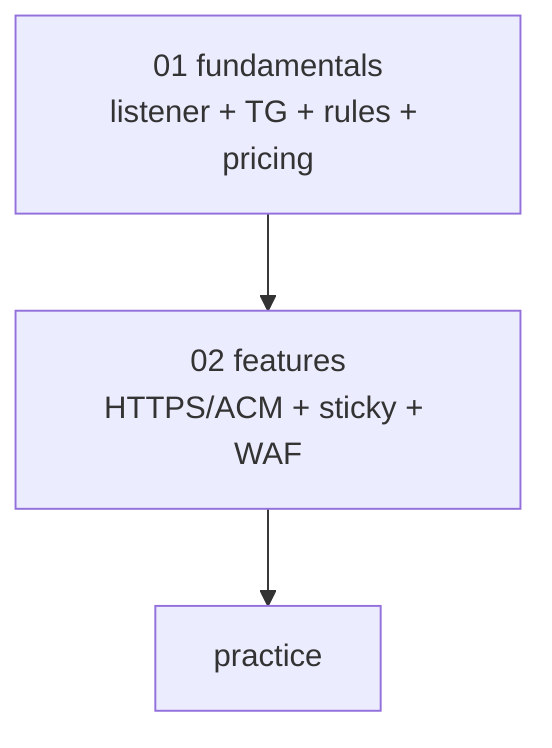

# AWS ALB — Application Load Balancer

> Layer 7 (HTTP/HTTPS/gRPC/WebSocket). Path / header / cookie / host routing. ALB ↔ EC2 / IP / Lambda / ECS / EKS targets.

**[[../network|↑ Network]]** · **[[../../cloud-aws|↑↑ AWS]]**

---

## 1. 한 줄

```
Layer 7 (HTTP/HTTPS/gRPC/WS)
├─ Listener (443 / 80) + Rules (path / header / query / source IP / host)
├─ Target Group (Instance / IP / Lambda / ALB-as-target)
├─ Health Check + Sticky Session
├─ WAF + ACM (TLS) + AWS Shield
└─ X-Ray / Access Log / CloudWatch
```

## 2. 학습 roadmap



## 3. Sub-directory index

- [[01-fundamentals/01-listener-and-target-group]] — Listener / TG / Target Type
- [[01-fundamentals/02-routing-rules-and-conditions]] — Path / Host / Header / Query / Source IP
- [[01-fundamentals/03-pricing-and-limits]] — LCU + Hard limits
- [[02-features/01-https-and-acm]] — TLS / ACM / mTLS / SNI
- [[02-features/02-sticky-sessions-and-health-check]] — Session + Health Check
- [[02-features/03-waf-and-shield]] — WAF + Shield + Access Log
- [[practice/01-alb-multi-target]] — Multi target group
- [[practice/02-blue-green-and-waf]] — Blue-Green + WAF

## 4. ALB vs NLB vs CLB

| | ALB | NLB | CLB (legacy) |
| --- | --- | --- | --- |
| Layer | 7 (HTTP) | 4 (TCP/UDP/TLS) | 4/7 |
| Routing | path/host/header | port | basic |
| WebSocket | ✓ | ✓ | △ |
| gRPC | ✓ | ✗ | ✗ |
| Static IP | ✗ (DNS) | ✓ (EIP) | ✗ |
| TLS | ✓ + mTLS | ✓ pass-through | ✓ |
| Lambda Target | ✓ | ✗ | ✗ |
| Cross-zone | ✓ (free) | $$ | ✓ |
| 가격 | $0.0225/h + LCU | $0.0225/h + NLCU | EOL |
| 권장 | HTTP API | TCP / static IP | EOL |

## 5. bkurs-be ALB 구성

```
ALB: bkurs-prod (internet-facing, 3 AZ)
Listener 443 HTTPS:
- Rule 1: path /api/v1/auth/*  → tg-auth-api
- Rule 2: path /api/v1/study/* → tg-study-api
- Rule 3: path /admin/*         → tg-admin (OIDC auth)
- Rule 4: host static.bkurs.com → redirect to CloudFront
- Default: 404 fixed response

Listener 80 HTTP:
- Default: redirect to 443

Certificate: ACM (api.bkurs.com + *.bkurs.com)
WAF: Common Rules + Rate Limit
Access Log: S3 + Athena
```

## 6. 가격 직관

```
ALB: $0.0225/h ($16.4/월 고정)
+ LCU (Load Balancer Capacity Unit):
  $0.008/LCU·hour
  1 LCU = max(25 new conn/sec, 3000 active conn, 1 GB/h, 1000 rule evaluations/sec)
```

## 7. 영상 / 자료

| 자료 |
| --- |
| [ALB 공식](https://docs.aws.amazon.com/elasticloadbalancing/latest/application/) |

## 8. 관련 hub

- [[../network]]
- [[../nlb/nlb]]
- [[../../compute/ecs/03-service/05-load-balancer-integration]]
- [[../../compute/eks/02-workload/02-service-and-ingress]]
