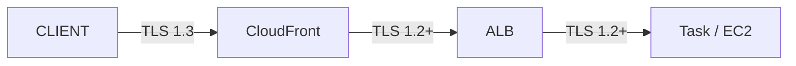

# CloudFront HTTPS + ACM + OAC

> ACM cert (us-east-1 강제) + OAC (2022+, S3 private) vs OAI (legacy) + SNI multi-cert + Custom domain.

## 1. ACM Certificate — us-east-1 강제

```bash
# CloudFront 의 ACM 은 반드시 us-east-1
aws acm request-certificate \
  --domain-name bkurs.com \
  --subject-alternative-names "*.bkurs.com" "www.bkurs.com" \
  --validation-method DNS \
  --region us-east-1 \
  --tags Key=Service,Value=cloudfront

# DNS validation
aws acm describe-certificate --certificate-arn $CERT_ARN --region us-east-1 \
  --query 'Certificate.DomainValidationOptions[0].ResourceRecord'
# Route 53 CNAME 추가 (자동 또는 수동)

aws acm wait certificate-validated --certificate-arn $CERT_ARN --region us-east-1
```

> **CloudFront 의 ACM cert = us-east-1 만**. 다른 region 의 cert 안 됨.

## 2. ALB / API GW 의 cert region

```
CloudFront:        us-east-1 만
ALB / NLB:         same region as resource
API Gateway:       same region as API
App Runner:        same region
```

## 3. Distribution 에 attach

```json
"ViewerCertificate": {
  "ACMCertificateArn": "arn:aws:acm:us-east-1:ACCT:certificate/abc",
  "SSLSupportMethod": "sni-only",
  "MinimumProtocolVersion": "TLSv1.2_2021"
}
```

| Option | 의미 |
| --- | --- |
| `SSLSupportMethod` | `sni-only` (권장) / `vip` ($600/월) |
| `MinimumProtocolVersion` | TLSv1.2_2021 ★ / TLSv1.3 (가능하지만 일부 client 호환성) |

> `vip` mode = 옛 client (SNI 미지원) 대응. 거의 사용 X (extra cost).

## 4. SNI (multi-domain cert)

```json
"Aliases": {
  "Quantity": 3,
  "Items": ["bkurs.com", "www.bkurs.com", "static.bkurs.com"]
}
```

→ 같은 cert SAN 또는 multiple cert.

### Multiple Cert (Wildcard + Specific)

```bash
# Wildcard *.bkurs.com 가 admin.bkurs.com 같은 specific 도 cover
# 또는 cert 마다 별도 (multiple ViewerCertificate 불가능 — 1 distribution 1 cert)
```

> 1 distribution = 1 cert. multi-domain 은 같은 cert 의 SAN.

## 5. OAC (Origin Access Control, 2022+) — S3 private

```bash
OAC_ID=$(aws cloudfront create-origin-access-control \
  --origin-access-control-config '{
    "Name": "bkurs-s3-oac",
    "Description": "S3 access",
    "OriginAccessControlOriginType": "s3",
    "SigningBehavior": "always",
    "SigningProtocol": "sigv4"
  }' --query 'OriginAccessControl.Id' --output text)
```

### Distribution Origin
```json
{
  "Id": "S3-bkurs-static",
  "DomainName": "bkurs-static.s3.ap-northeast-2.amazonaws.com",
  "OriginAccessControlId": "{OAC_ID}",
  "S3OriginConfig": { "OriginAccessIdentity": "" }
}
```

### S3 Bucket Policy
```json
{
  "Version": "2012-10-17",
  "Statement": [{
    "Sid": "AllowCloudFrontOAC",
    "Effect": "Allow",
    "Principal": { "Service": "cloudfront.amazonaws.com" },
    "Action": "s3:GetObject",
    "Resource": "arn:aws:s3:::bkurs-static/*",
    "Condition": {
      "StringEquals": { "AWS:SourceArn": "arn:aws:cloudfront::ACCT:distribution/{DIST_ID}" }
    }
  }]
}
```

→ S3 fully private (BPA on) + CloudFront 만 access.

## 6. OAI (Origin Access Identity, legacy)

```bash
# 옛 방식 — 2022+ deprecated
aws cloudfront create-cloud-front-origin-access-identity \
  --cloud-front-origin-access-identity-config '{
    "CallerReference": "...",
    "Comment": "OAI legacy"
  }'
```

| | OAC | OAI |
| --- | --- | --- |
| Year | 2022+ | 2014 |
| SigV4 | ✓ | ✗ (older SigV2-like) |
| KMS encryption | ✓ | ✗ |
| Dynamic request | ✓ | ✗ |
| 권장 | ★ | EOL |

> OAI → OAC migrate 권장.

## 7. ALB / Custom Origin 의 보안

ALB origin 의 경우 OAC 안 됨. 대신:

### Custom Header (shared secret)
```json
"CustomHeaders": {
  "Items": [
    { "HeaderName": "x-cf-secret", "HeaderValue": "shared-secret-xxx" }
  ]
}
```

### ALB WAF rule
```json
{
  "Name": "RequireCFHeader",
  "Statement": {
    "NotStatement": {
      "Statement": {
        "ByteMatchStatement": {
          "SearchString": "shared-secret-xxx",
          "FieldToMatch": {"SingleHeader": {"Name": "x-cf-secret"}},
          "TextTransformations": [{"Priority": 0, "Type": "NONE"}],
          "PositionalConstraint": "EXACTLY"
        }
      }
    }
  },
  "Action": {"Block": {}}
}
```

→ Direct ALB access 차단 (CloudFront only).

## 8. CloudFront 의 OAC for ALB (2024+)

```bash
aws cloudfront create-origin-access-control \
  --origin-access-control-config '{
    "Name": "bkurs-alb-oac",
    "OriginAccessControlOriginType": "alb",
    "SigningBehavior": "always",
    "SigningProtocol": "sigv4"
  }'
```

→ 2024 부터 ALB 도 OAC 지원 (preview).

## 9. End-to-End TLS



### Origin Protocol Policy
```json
"OriginProtocolPolicy": "https-only"
```

| Policy | 의미 |
| --- | --- |
| `http-only` | HTTP 만 |
| `https-only` | HTTPS 만 ★ |
| `match-viewer` | client 와 같은 protocol |

### Origin SSL Protocols
```json
"OriginSslProtocols": {
  "Items": ["TLSv1.2"]
}
```

## 10. Origin TLS Certificate Verify

```
CloudFront → ALB / Custom Origin 의 cert verify:
- ACM cert: 자동 verify
- Self-signed: ✗ (CloudFront 가 거부)
- Expired: ✗
```

> Origin cert = trusted CA 발급 (ACM 또는 public CA).

## 11. Custom Domain 의 Route 53

```bash
# Route 53 alias (Hosted Zone)
aws route53 change-resource-record-sets --hosted-zone-id $HZ \
  --change-batch "{
    \"Changes\": [{
      \"Action\": \"UPSERT\",
      \"ResourceRecordSet\": {
        \"Name\": \"bkurs.com.\",
        \"Type\": \"A\",
        \"AliasTarget\": {
          \"HostedZoneId\": \"Z2FDTNDATAQYW2\",
          \"DNSName\": \"d123.cloudfront.net\",
          \"EvaluateTargetHealth\": false
        }
      }
    }]
  }"
```

> CloudFront 의 hosted zone ID = `Z2FDTNDATAQYW2` (글로벌 고정).

## 12. HTTP → HTTPS Redirect

```json
"ViewerProtocolPolicy": "redirect-to-https"
```

→ HTTP request 자동 301 redirect to HTTPS. SEO + 보안.

## 13. SSL Policy

```
Modern (default):     TLSv1.2_2021 — TLS 1.2 + 1.3
TLSv1.3_2021:         TLS 1.3 만 (옛 client 호환성 X)
TLSv1.2_2019:         더 wider compat
```

## 14. 인증서 비용

| | |
| --- | --- |
| ACM Public cert | 무료 + 자동 rotation |
| ACM-PCA cert | $400/월 + per-cert |
| Imported cert | 무료 (rotation 사용자) |
| `vip` mode | $600/월 추가 |

## 15. 흔한 함정

| 함정 | 회피 |
| --- | --- |
| ACM cert region (ap-northeast-2) | us-east-1 강제 |
| OAI 사용 (legacy) | OAC migrate |
| S3 Bucket Policy 의 SourceArn 누락 | 필수 |
| `vip` mode 비용 | sni-only ★ |
| ALB 의 direct access (CF 우회) | Custom Header + WAF |
| Origin self-signed cert | trusted CA |

## 16. 다음

- ▶ [[02-functions-and-lambda-edge]]
- ▶ [[03-waf-and-signed-url]]
- ▶ [[../practice/01-static-site-cdn]]

## 17. 영상 / 자료

| 자료 |
| --- |
| [CloudFront HTTPS](https://docs.aws.amazon.com/AmazonCloudFront/latest/DeveloperGuide/using-https.html) |
| [OAC vs OAI](https://docs.aws.amazon.com/AmazonCloudFront/latest/DeveloperGuide/private-content-restricting-access-to-s3.html) |

## 18. 참고

- [[../cloudfront]]
- [[../01-fundamentals/01-distribution-and-origin]]
- [[../../alb/02-features/01-https-and-acm]]
