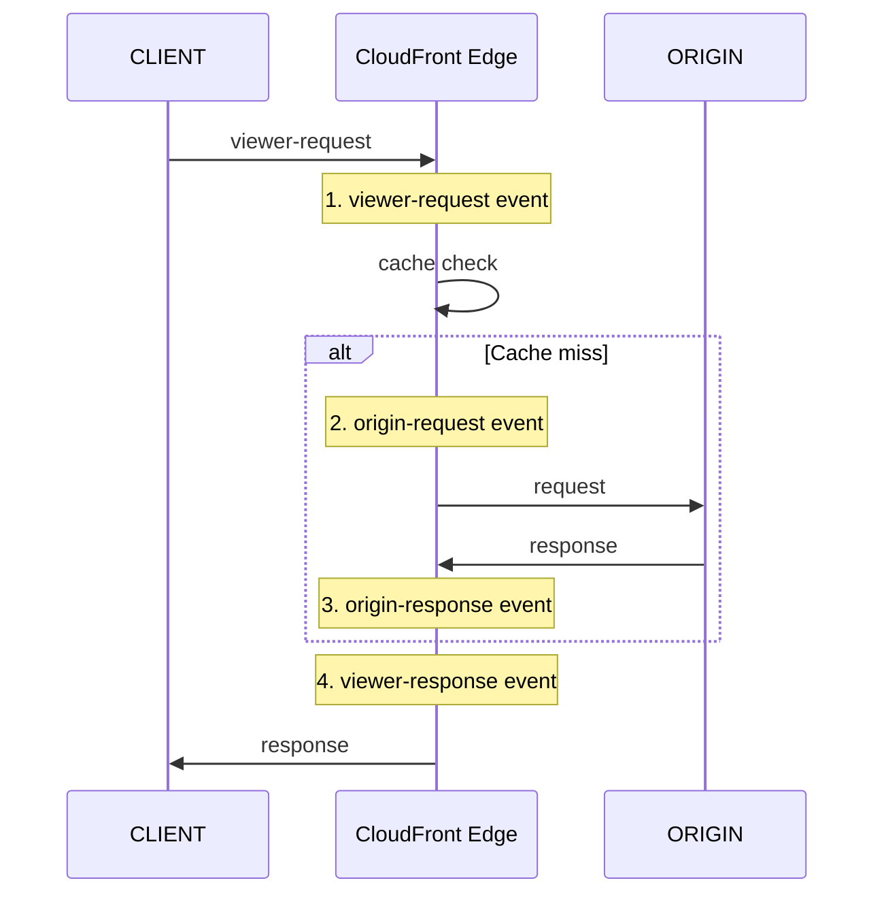

# CloudFront Functions + Lambda@Edge

> Edge computing — Functions (lightweight, 2MB, $0.10/M) vs Lambda@Edge (full Lambda, 128MB+, $0.60/M). 4 event point.

## 1. 4 Event Point



| Event | When |
| --- | --- |
| **viewer-request** | client 요청 받음 (cache check 전) |
| **origin-request** | cache miss → origin 보내기 전 |
| **origin-response** | origin 응답 받은 후 (cache 저장 전) |
| **viewer-response** | client 응답 보내기 전 |

## 2. CloudFront Functions vs Lambda@Edge

| | CloudFront Functions | Lambda@Edge |
| --- | --- | --- |
| Language | JavaScript (ECMAScript 5.1 + ES 2020) | Node.js / Python |
| Execution | < 1ms (sub-ms) | < 5초 (viewer) / < 30초 (origin) |
| Memory | 2 MB | 128 MB - 10 GB |
| Cost | $0.10/M | $0.60/M + $0.0000125/GB-s |
| Location | 모든 Edge POP (600+) | Regional Edge Cache (13) |
| Events | viewer-request / viewer-response | + origin-request / origin-response |
| Network call | ✗ (computational only) | ✓ (HTTP, DDB, etc) |
| File system | ✗ | ✓ (/tmp) |
| 권장 | header / URL / redirect | 복잡 logic / external API |

## 3. CloudFront Functions — JavaScript

```javascript
// header injection / URL rewrite
function handler(event) {
    var request = event.request;
    var headers = request.headers;
    
    // URL rewrite: /old → /new
    if (request.uri === '/old') {
        request.uri = '/new';
    }
    
    // SPA: /any → /index.html (단, 확장자 없는 경우)
    if (!request.uri.includes('.')) {
        request.uri = '/index.html';
    }
    
    // Add custom header
    headers['x-bkurs-region'] = { value: 'ap-northeast-2' };
    
    return request;
}
```

```bash
aws cloudfront create-function --name bkurs-spa-rewrite \
  --function-config '{"Comment":"SPA rewrite","Runtime":"cloudfront-js-2.0"}' \
  --function-code fileb://cf-func.js

aws cloudfront publish-function --name bkurs-spa-rewrite \
  --if-match $ETAG

# Distribution 의 Cache Behavior 에 attach
"FunctionAssociations": {
  "Quantity": 1,
  "Items": [{
    "FunctionARN": "arn:aws:cloudfront::ACCT:function/bkurs-spa-rewrite",
    "EventType": "viewer-request"
  }]
}
```

## 4. CloudFront Functions — 일반 use case

### 1) URL Rewrite
```javascript
function handler(event) {
    var request = event.request;
    if (request.uri.endsWith('/')) {
        request.uri += 'index.html';
    } else if (!request.uri.includes('.')) {
        request.uri += '/index.html';
    }
    return request;
}
```

### 2) Redirect
```javascript
function handler(event) {
    if (event.request.uri.startsWith('/old-path/')) {
        return {
            statusCode: 301,
            statusDescription: 'Moved Permanently',
            headers: {
                'location': { value: event.request.uri.replace('/old-path/', '/new-path/') }
            }
        };
    }
    return event.request;
}
```

### 3) Basic Authentication
```javascript
function handler(event) {
    var authHeader = event.request.headers.authorization;
    var expected = 'Basic ' + 'YWxpY2U6cGFzc3dvcmQ=';  // alice:password (base64)
    
    if (!authHeader || authHeader.value !== expected) {
        return {
            statusCode: 401,
            statusDescription: 'Unauthorized',
            headers: { 'www-authenticate': { value: 'Basic realm="Restricted"' } }
        };
    }
    return event.request;
}
```

### 4) A/B Test (random)
```javascript
function handler(event) {
    var bucket = Math.random() < 0.1 ? 'green' : 'blue';
    event.request.headers['x-bucket'] = { value: bucket };
    return event.request;
}
```

### 5) Geo-based redirect
```javascript
function handler(event) {
    var country = event.request.headers['cloudfront-viewer-country'];
    if (country && country.value !== 'KR') {
        return {
            statusCode: 302,
            headers: {
                'location': { value: 'https://global.bkurs.com' + event.request.uri }
            }
        };
    }
    return event.request;
}
```

## 5. Lambda@Edge — Node.js

```javascript
// viewer-response: Security headers
'use strict';

exports.handler = async (event, context) => {
    const response = event.Records[0].cf.response;
    const headers = response.headers;
    
    headers['strict-transport-security'] = [{ key: 'Strict-Transport-Security', value: 'max-age=63072000; includeSubdomains; preload' }];
    headers['content-security-policy'] = [{ key: 'Content-Security-Policy', value: "default-src 'self'" }];
    headers['x-frame-options'] = [{ key: 'X-Frame-Options', value: 'DENY' }];
    headers['x-content-type-options'] = [{ key: 'X-Content-Type-Options', value: 'nosniff' }];
    headers['referrer-policy'] = [{ key: 'Referrer-Policy', value: 'strict-origin-when-cross-origin' }];
    
    return response;
};
```

```bash
# Lambda function (us-east-1 만)
aws lambda create-function --function-name bkurs-cf-security \
  --runtime nodejs20.x \
  --handler index.handler \
  --role arn:aws:iam::ACCT:role/lambda-edge-role \
  --zip-file fileb://function.zip \
  --region us-east-1

# Publish version (L@E 는 version 만 attach)
aws lambda publish-version --function-name bkurs-cf-security --region us-east-1

# Distribution attach
"LambdaFunctionAssociations": {
  "Quantity": 1,
  "Items": [{
    "LambdaFunctionARN": "arn:aws:lambda:us-east-1:ACCT:function:bkurs-cf-security:1",
    "EventType": "viewer-response"
  }]
}
```

> Lambda@Edge 의 IAM Trust = `lambda.amazonaws.com` + `edgelambda.amazonaws.com` 둘 다.

## 6. Lambda@Edge — Origin Request 활용

```javascript
// origin-request: A/B test based on cookie
exports.handler = async (event) => {
    const request = event.Records[0].cf.request;
    const cookies = parseCookies(request.headers.cookie);
    
    if (cookies['experiment'] === 'green') {
        request.origin = {
            custom: {
                domainName: 'green.bkurs.com',
                port: 443,
                protocol: 'https',
                path: '',
                sslProtocols: ['TLSv1.2'],
                readTimeout: 30,
                keepaliveTimeout: 5,
                customHeaders: {}
            }
        };
        request.headers.host = [{ key: 'host', value: 'green.bkurs.com' }];
    }
    return request;
};

function parseCookies(cookieHeader) {
    if (!cookieHeader) return {};
    return Object.fromEntries(
        cookieHeader[0].value.split(';').map(c => c.trim().split('='))
    );
}
```

→ Edge 에서 origin 변경. A/B test / canary.

## 7. Lambda@Edge — 일반 use case

| Use case | Event |
| --- | --- |
| Security headers | viewer-response |
| URL rewrite (complex) | viewer-request |
| Geo-based redirect (DDB lookup) | viewer-request |
| Image resize on-the-fly | origin-request |
| Custom origin (A/B test) | origin-request |
| Cache key modification | origin-request |
| Response transform (HTML inject) | origin-response |
| Bot detection (DDB / external API) | viewer-request |

## 8. Lambda@Edge 의 한도

| | viewer-event | origin-event |
| --- | --- | --- |
| Memory | 128 MB | 128 MB - 10 GB |
| Timeout | 5초 | 30초 |
| Body size | 40 KB | 1 MB |
| Headers count | 200 | same |
| Header size | 8 KB | 64 KB |
| Network calls | ✗ | ✓ |
| Environment vars | ✗ | ✗ |
| Lambda layers | ✗ | ✗ |
| KMS | ✗ | ✓ |

> Lambda@Edge 의 cold start = Regional Edge Cache 의 첫 호출.

## 9. CloudFront Functions vs Lambda@Edge 결정

```mermaid
flowchart TD
  Q1{logic 복잡도?}
  Q1 -->|simple header/URL/redirect| CF[Functions]
  Q1 -->|external API call| LE[L@E]
  Q1 -->|DDB / S3 lookup| LE
  Q1 -->|image processing| LE
  Q1 -->|response transform| LE_VR[L@E viewer-response]
```

## 10. Logging

```bash
# CloudFront Functions
aws logs tail /aws/cloudfront/function/bkurs-spa-rewrite --follow

# Lambda@Edge (각 region 별 log group)
aws logs tail /aws/lambda/us-east-1.bkurs-cf-security --region us-east-1
# 또는
aws logs tail /aws/lambda/ap-northeast-2.bkurs-cf-security --region ap-northeast-2
```

> Lambda@Edge 의 log = **각 region 의 CloudWatch Logs**. 모니터 어려움.

## 11. Functions Testing

```bash
aws cloudfront test-function --name bkurs-spa-rewrite \
  --event-object file://test-event.json \
  --if-match $ETAG \
  --stage DEVELOPMENT
```

### test-event.json
```json
{
  "version": "1.0",
  "context": {
    "eventType": "viewer-request"
  },
  "viewer": { "ip": "203.0.113.10" },
  "request": {
    "method": "GET",
    "uri": "/about",
    "querystring": {},
    "headers": {
      "host": { "value": "bkurs.com" }
    },
    "cookies": {}
  }
}
```

## 12. 흔한 함정

| 함정 | 회피 |
| --- | --- |
| Functions 에 external API call | L@E 사용 |
| L@E 의 region log scattered | Centralized log forwarding |
| L@E version pinning 빠짐 | published version 만 |
| Cold start 자주 | Provisioned Concurrency (Lambda@Edge 의 PC 옵션) |
| Functions 의 console.log → CloudWatch Logs cost | 적절히 |
| Body 의 40 KB 한도 (viewer-event) | origin-event 사용 |

## 13. 비용 시뮬

```
10M requests / 월:

Functions:
  10M × $0.10/M = $1.0/월

Lambda@Edge:
  10M × $0.60/M = $6
  + Compute (50ms avg × 128MB):
    10M × 0.05 × 0.125 × $0.0000125 = $0.78
  = $6.78/월

→ Functions 가 6x 싸다 (단순 logic 만 가능)
```

## 14. 다음

- ▶ [[03-waf-and-signed-url]]
- ▶ [[../practice/01-static-site-cdn]]
- ▶ [[../practice/02-api-acceleration-and-l-e]]

## 15. 영상 / 자료

| 자료 |
| --- |
| [CloudFront Functions](https://docs.aws.amazon.com/AmazonCloudFront/latest/DeveloperGuide/cloudfront-functions.html) |
| [Lambda@Edge](https://docs.aws.amazon.com/AmazonCloudFront/latest/DeveloperGuide/lambda-at-the-edge.html) |
| [Examples](https://github.com/aws-samples/amazon-cloudfront-functions) |

## 16. 참고

- [[../cloudfront]]
- [[../01-fundamentals/02-cache-behavior-and-policies]]
- [[../../../compute/lambda/lambda]]
