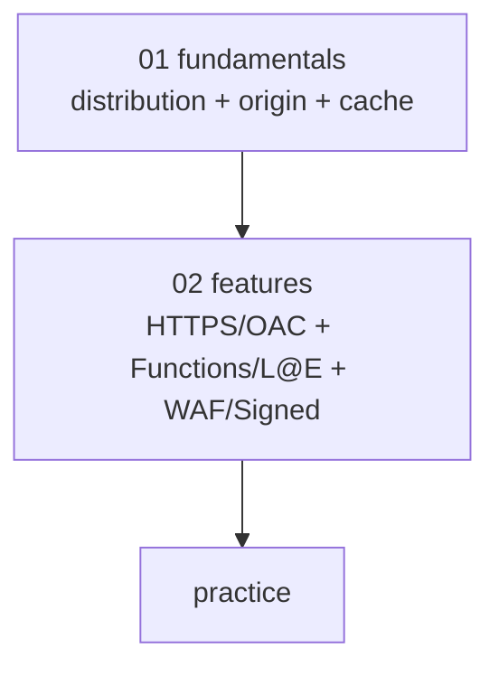

# AWS CloudFront — CDN

> Global CDN — 600+ edge locations. Static + dynamic acceleration. Lambda@Edge + CloudFront Functions + WAF + OAC.

**[[../network|↑ Network]]** · **[[../../cloud-aws|↑↑ AWS]]**

---

## 1. 한 줄

```
Global CDN
├─ 600+ edge locations (전 세계)
├─ Origin: S3 / ALB / NLB / API GW / EC2 / Custom HTTP
├─ Cache Behavior (path-based)
├─ Cache Policy + Origin Request Policy + Response Headers Policy
├─ HTTPS + ACM + Custom Domain (Route 53)
├─ OAC (Origin Access Control) — S3 private
├─ Lambda@Edge / CloudFront Functions — edge computing
├─ WAF + Shield + Signed URL / Cookie
└─ Real-time + Standard Log
```

## 2. 학습 roadmap



## 3. Sub-directory index

- [[01-fundamentals/01-distribution-and-origin]] — Distribution / Origin (S3/ALB/Custom) / Origin Group
- [[01-fundamentals/02-cache-behavior-and-policies]] — Behavior + Cache Policy + Origin Request Policy + Response Headers
- [[01-fundamentals/03-pricing-and-limits]] — Per-region DT + Request + Edge type
- [[02-features/01-https-and-oac]] — TLS + ACM (us-east-1) + OAC vs OAI
- [[02-features/02-functions-and-lambda-edge]] — CloudFront Functions vs Lambda@Edge
- [[02-features/03-waf-and-signed-url]] — WAF + Signed URL / Cookie + Geo restriction
- [[practice/01-static-site-cdn]] — S3 + OAC + ACM + Route 53 (45분)
- [[practice/02-api-acceleration-and-l-e]] — ALB + CF + L@E header injection (60분)

## 4. 핵심 개념

| 개념 | 의미 |
| --- | --- |
| Distribution | CloudFront 의 단위 (1 domain = 1 distribution) |
| Edge Location | 600+ POP (point of presence) |
| Regional Edge Cache | 13 region (edge 의 mid-tier cache) |
| Origin | 원본 (S3 / ALB / NLB / API GW / Custom HTTP) |
| Origin Group | failover (primary + secondary) |
| Behavior | path 의 cache rule (priority 순서) |
| Cache Policy | TTL + cache key (header / cookie / query) |
| Origin Request Policy | origin 으로 보내는 header / cookie / query |
| Response Headers Policy | client 응답 header (CORS / Security) |
| OAC | S3 private 의 OAC (CloudFront 만 access) |
| Lambda@Edge | Lambda at Regional Edge (4 event) |
| CloudFront Functions | lightweight edge JS (viewer-request/response) |

## 5. CloudFront 활용

✓ **시나리오**
- Static site (S3 + CDN)
- Image / video / asset cache
- API acceleration (edge → ALB)
- Live streaming / VOD
- Geographic restriction
- DDoS protection (Shield Standard 자동)
- Custom domain HTTPS (ACM)
- Edge computing (Lambda@Edge / Functions)

✗ **부적합**
- Pure HTTP API (저비용) — ALB 직접
- Long-polling / WebSocket — origin ALB / NLB

## 6. bkurs-be CloudFront 구성

```
Distribution: bkurs-prod
- Aliases: bkurs.com, www.bkurs.com, static.bkurs.com
- Default Behavior (/*): S3 origin + cache 1d
- Behavior /api/*:    ALB origin + no cache (forward auth header)
- Behavior /admin/*:  ALB origin + Lambda@Edge (geo restriction)
- Origin Group: ALB primary + ALB DR fallback
- Cert: ACM us-east-1 (*.bkurs.com)
- WAF: Web ACL (Rate / OWASP)
- OAC: S3 private (BPA)
- Logging: Real-time + Standard → S3
- Price Class: PriceClass_200 (Asia + US + EU)
```

## 7. CloudFront 의 cost benefit

```
Internet DT direct:
  S3 → Internet: $0.114/GB

S3 → CloudFront → Internet:
  S3 → CF:  free
  CF → Internet: $0.085/GB (-25%)

→ 큰 outbound DT 시 CloudFront 가 절감
```

추가:
- Cache hit → origin request 없음 (cost ↓)
- DDoS → Shield Standard 자동
- ACM cert + custom domain
- Global latency ↓ (edge cache)

## 8. 가격 직관

```
Internet Outbound (1 TB/월):
  Asia (Seoul):    $0.140/GB × 1024 = $143
  US/EU:           $0.085/GB × 1024 = $87
  S America:       $0.250/GB

Request:
  HTTPS: $0.0120/10K

Lambda@Edge:
  $0.60/M req + $0.0000125/GB-s

CloudFront Functions:
  $0.10/M (10x 싸진)
```

## 9. 영상 / 자료

| 자료 |
| --- |
| [CloudFront 공식](https://docs.aws.amazon.com/AmazonCloudFront/latest/DeveloperGuide/) |
| [Lambda@Edge](https://docs.aws.amazon.com/AmazonCloudFront/latest/DeveloperGuide/lambda-at-the-edge.html) |
| [CloudFront Functions](https://docs.aws.amazon.com/AmazonCloudFront/latest/DeveloperGuide/cloudfront-functions.html) |

## 10. 관련 hub

- [[../network]]
- [[../alb/alb]]
- [[../route53/route53]]
- [[../../storage/s3/s3]]
- [[../../security/iam/iam]]
- [[../../compute/lambda/lambda]]
