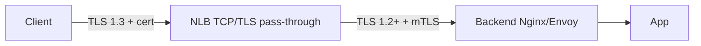

# NLB TLS + mTLS

> TLS Termination (ACM cert) vs TLS Pass-through (end-to-end). ALPN (HTTP/2) + mTLS for application.

## 1. TLS 옵션 3

| Mode | NLB 의 역할 |
| --- | --- |
| **TLS Termination** | NLB 가 decrypt → backend HTTP |
| **TLS Pass-through (TCP listener)** | NLB 가 TCP 만 forward, backend 가 TLS |
| **TLS Re-encrypt** | NLB 가 decrypt + backend 에 새 TLS |

## 2. TLS Termination

```bash
aws elbv2 create-listener --load-balancer-arn $NLB_ARN \
  --protocol TLS --port 443 \
  --certificates CertificateArn=$ACM_CERT \
  --ssl-policy ELBSecurityPolicy-TLS13-1-2-2021-06 \
  --default-actions Type=forward,TargetGroupArn=$TG_HTTP
```

```bash
# Target Group HTTP (NLB → backend HTTP)
aws elbv2 create-target-group --name tg-http \
  --protocol TCP --port 8080 \
  --vpc-id $VPC_ID --target-type ip
```

→ NLB 가 TLS decrypt, backend 는 평문 HTTP. VPC 안 traffic 안전 가정.

## 3. TLS Pass-through (TCP listener)

```bash
aws elbv2 create-listener --load-balancer-arn $NLB_ARN \
  --protocol TCP --port 443 \
  --default-actions Type=forward,TargetGroupArn=$TG_TLS
```

```bash
# Target Group TCP (backend 가 TLS 직접 처리)
aws elbv2 create-target-group --name tg-tls \
  --protocol TCP --port 8443 \
  --vpc-id $VPC_ID --target-type ip \
  --health-check-protocol HTTPS --health-check-path /health
```

→ End-to-end TLS. NLB 는 TCP pass-through. Compliance 권장.

| Use case |
| --- |
| 정부 / 금융 (regulatory) |
| Application 의 mTLS 처리 필요 |
| Cert 가 backend 만 alone |
| SNI / SAN 의 backend 직접 처리 |

## 4. TLS Re-encrypt

```bash
# Listener TLS termination
aws elbv2 create-listener ... --protocol TLS --certificates ...

# Target Group TLS (backend 도 TLS, NLB 가 새 TLS)
aws elbv2 create-target-group --name tg-tls-re \
  --protocol TLS --port 8443 \
  --vpc-id $VPC_ID --target-type ip
```

→ NLB 가 client cert verify → backend 에 NLB 의 cert 로 새 TLS. End-to-end + NLB 의 verify.

## 5. SSL Policy

```bash
aws elbv2 modify-listener --listener-arn $LISTENER_ARN \
  --ssl-policy ELBSecurityPolicy-TLS13-1-2-2021-06
```

| Policy | TLS |
| --- | --- |
| `ELBSecurityPolicy-TLS13-1-2-2021-06` ★ | 1.2 + 1.3 |
| `ELBSecurityPolicy-TLS13-1-2-Res-2021-06` | restrict |
| `ELBSecurityPolicy-TLS-1-2-2017-01` | 1.2 만 |
| `ELBSecurityPolicy-FS-1-2-Res-2020-10` | PFS + 1.2 |
| `ELBSecurityPolicy-TLS13-1-2-FIPS-2023-04` | FIPS (정부) |

## 6. ALPN (HTTP/2 over NLB)

```bash
aws elbv2 modify-listener --listener-arn $LISTENER_ARN \
  --alpn-policy HTTP2Preferred
```

| Policy | 의미 |
| --- | --- |
| `None` | ALPN 안 함 |
| `HTTP1Only` | HTTP/1.1 만 |
| `HTTP2Only` | HTTP/2 만 |
| `HTTP2Optional` | HTTP/2 prefer, HTTP/1.1 fallback |
| `HTTP2Preferred` | HTTP/2 prefer ★ |

→ gRPC over NLB (HTTP/2 필요).

## 7. mTLS — NLB 의 처리

```
NLB 자체 = mTLS feature 없음 (2026 기준)
→ TLS Pass-through 로 backend 가 mTLS 처리

Application:
- Nginx: ssl_verify_client on; ssl_client_certificate ca.crt;
- Envoy: validation.trusted_ca + match_subject_alt_names
- Spring Boot: ssl.client-auth=need + trust-store-path
```

> ALB 는 native mTLS (2023+). NLB 는 TLS pass-through 로 backend mTLS.

## 8. End-to-End TLS pattern



→ Layer 7 (HTTP) 의 backend 에서 mTLS verify. NLB 는 TCP 전달만.

## 9. ACM Cert 활용

```bash
# Public cert (DNS validation)
aws acm request-certificate \
  --domain-name api.bkurs.com \
  --validation-method DNS \
  --key-algorithm RSA_2048

# NLB 의 TLS listener
aws elbv2 create-listener --load-balancer-arn $NLB_ARN \
  --protocol TLS --port 443 \
  --certificates CertificateArn=$CERT
```

## 10. Cert Rotation

```
ACM Public:    자동 rotation (60일 전 renew)
ACM Imported:  사용자 갱신 + manual update
Private CA:    issue + revoke 관리
```

## 11. NLB Access Log (TLS listener)

```bash
aws elbv2 modify-load-balancer-attributes --load-balancer-arn $NLB_ARN \
  --attributes \
    Key=access_logs.s3.enabled,Value=true \
    Key=access_logs.s3.bucket,Value=bkurs-nlb-logs
```

Log format (TLS only):
```
tls 2.0 2026-05-23T10:00:00 net/bkurs-nlb/abc 203.0.113.10:54321 10.0.10.5:8443 ...
client_tls_version  cipher  client_sni  alpn
```

## 12. Connection Termination

```
NLB 의 TCP idle timeout: 350s (변경 불가)
- Client 또는 target 의 keepalive 활용
- TCP_KEEPIDLE = 100s (권장)
- 350s 도달 = NLB 가 connection 종료
```

## 13. PrivateLink + TLS

PrivateLink (VPC Endpoint Service) 활용 시 TLS:
```
Provider NLB:
- TLS Pass-through 권장
- Backend 가 cert 직접
→ Consumer 의 VPC Endpoint 는 traffic 만 pass

Consumer:
- Endpoint URL 의 cert verify
- Provider 의 backend cert 사용
```

자세히 → [[02-privatelink-endpoint-service]]

## 14. mTLS application 예 (Nginx)

```nginx
server {
    listen 8443 ssl;
    server_name api.bkurs.com;
    
    # Server cert
    ssl_certificate /etc/ssl/server.crt;
    ssl_certificate_key /etc/ssl/server.key;
    
    # Client cert verify
    ssl_verify_client on;
    ssl_client_certificate /etc/ssl/ca-bundle.crt;
    ssl_verify_depth 2;
    
    # TLS 1.3
    ssl_protocols TLSv1.3 TLSv1.2;
    ssl_ciphers HIGH:!aNULL:!MD5;
    
    location / {
        # Client cert info → backend header
        proxy_set_header X-SSL-Client-S-DN $ssl_client_s_dn;
        proxy_set_header X-SSL-Client-Verify $ssl_client_verify;
        proxy_pass http://upstream;
    }
}
```

## 15. 흔한 함정

| 함정 | 회피 |
| --- | --- |
| TLS Termination + backend 평문 → VPC 안 평문 | VPC 안 안전 가정 또는 re-encrypt |
| mTLS NLB native 가정 | TLS pass-through + backend 처리 |
| ALPN 없이 gRPC | HTTP2Preferred |
| TCP idle 350s 변경 시도 | 변경 불가 + keepalive |
| Health check HTTP (TLS pass-through 면 HTTPS) | port + protocol 일치 |
| Cert region 잘못 | same region |

## 16. 다음

- ▶ [[02-privatelink-endpoint-service]]
- ▶ [[../practice/01-tcp-load-balance]]
- ▶ [[../practice/02-nlb-to-alb-chain]]

## 17. 영상 / 자료

| 자료 |
| --- |
| [NLB TLS](https://docs.aws.amazon.com/elasticloadbalancing/latest/network/create-tls-listener.html) |
| [ALPN Policy](https://docs.aws.amazon.com/elasticloadbalancing/latest/network/create-tls-listener.html#alpn-policies) |

## 18. 참고

- [[../nlb]]
- [[../01-fundamentals/01-listener-and-target-group]]
- [[../../alb/02-features/01-https-and-acm]]
