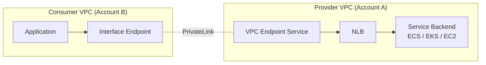

# NLB + PrivateLink Endpoint Service

> NLB 가 PrivateLink 의 Provider — 사용자 service 를 다른 account / VPC 에 안전하게 노출.

## 1. PrivateLink 구조 (Provider 측)



## 2. Endpoint Service 생성

```bash
aws ec2 create-vpc-endpoint-service-configuration \
  --network-load-balancer-arns $NLB_ARN \
  --acceptance-required \
  --supported-ip-address-types ipv4 ipv6 \
  --tag-specifications 'ResourceType=vpc-endpoint-service,Tags=[{Key=Name,Value=bkurs-api-service}]'

SVC_ID=$(aws ec2 describe-vpc-endpoint-service-configurations \
  --filters Name=service-name,Values=com.amazonaws.vpce.* \
  --query 'ServiceConfigurations[?Tags[?Key==`Name`&&Value==`bkurs-api-service`]].ServiceId' --output text)

SVC_NAME=$(aws ec2 describe-vpc-endpoint-service-configurations \
  --service-ids $SVC_ID \
  --query 'ServiceConfigurations[0].ServiceName' --output text)
echo "Endpoint Service: $SVC_NAME"
```

| 옵션 | 의미 |
| --- | --- |
| `network-load-balancer-arns` | NLB ARN (multi-AZ NLB 권장) |
| `acceptance-required` | true = consumer 의 request 를 provider 가 승인 |
| `supported-ip-address-types` | ipv4 / ipv6 |
| `private-dns-name` | custom DNS (옵션) |

## 3. Allowed Principal 등록

```bash
# Consumer account 또는 IAM role allow
aws ec2 modify-vpc-endpoint-service-permissions \
  --service-id $SVC_ID \
  --add-allowed-principals \
    arn:aws:iam::CONSUMER_ACCT_1:root \
    arn:aws:iam::CONSUMER_ACCT_2:role/PrivateLinkConsumer

# 모든 account (open, 신중)
--add-allowed-principals "*"
```

## 4. Consumer 의 Endpoint 생성

```bash
# Consumer account 에서
aws ec2 create-vpc-endpoint --vpc-id $CONSUMER_VPC \
  --service-name $SVC_NAME \
  --vpc-endpoint-type Interface \
  --subnet-ids $SUBNET_A $SUBNET_B $SUBNET_C \
  --security-group-ids $SG_ENDPOINT \
  --private-dns-enabled false   # custom DNS 시 true (cert 필요)

EP_ID=$(aws ec2 describe-vpc-endpoints \
  --filters Name=service-name,Values=$SVC_NAME \
  --query 'VpcEndpoints[0].VpcEndpointId' --output text)
```

## 5. Provider 가 Accept (acceptance-required=true)

```bash
# Provider account
aws ec2 accept-vpc-endpoint-connections --service-id $SVC_ID \
  --vpc-endpoint-ids $EP_ID

# 또는 Reject
aws ec2 reject-vpc-endpoint-connections --service-id $SVC_ID \
  --vpc-endpoint-ids $EP_ID
```

## 6. Consumer 의 access

```bash
# Endpoint DNS (private)
aws ec2 describe-vpc-endpoints --vpc-endpoint-ids $EP_ID \
  --query 'VpcEndpoints[0].DnsEntries[].DnsName'

# 예: vpce-xxx-yyy.ap-northeast-2.vpce.amazonaws.com
# AZ-specific: vpce-xxx-yyy-az1.ap-northeast-2.vpce.amazonaws.com
```

Application:
```python
import requests
url = "https://vpce-xxx-yyy.ap-northeast-2.vpce.amazonaws.com:443/api/v1/data"
response = requests.get(url, verify="bkurs-ca.crt")  # Provider 의 cert
```

## 7. Custom Private DNS (Provider 권장)

```bash
# 1. Domain ownership verify (Route 53)
aws ec2 modify-vpc-endpoint-service-configuration \
  --service-id $SVC_ID \
  --private-dns-name api.bkurs.internal

# 2. TXT record 추가 (verify)
aws route53 change-resource-record-sets ...

# 3. Verify
aws ec2 start-vpc-endpoint-service-private-dns-verification \
  --service-id $SVC_ID
```

→ Consumer 가 일반 DNS (`api.bkurs.internal`) 로 access. Endpoint 는 자동 routing.

## 8. PrivateLink 활용 예

### 1) SaaS service (Datadog, MongoDB Atlas, Snowflake, Confluent)
```
Datadog NLB → Endpoint Service → 사용자 account 의 VPC Endpoint
→ Datadog agent traffic 이 Internet 안 거침
```

### 2) Cross-account internal API
```
Company A 의 internal API → Company B 의 contractor account 가 access
```

### 3) Compliance — Internet 차단
```
Compliance audit: 모든 traffic 이 VPC 내부 또는 PrivateLink
NLB + Endpoint Service = Internet 우회
```

### 4) Multi-region service
```
Region A 의 NLB → 다른 region 의 VPC Endpoint (Cross-region PrivateLink)
```

## 9. Cross-Region PrivateLink (2024+)

```bash
aws ec2 create-vpc-endpoint --vpc-id $VPC_IN_TOKYO \
  --service-name com.amazonaws.vpce.ap-northeast-2.vpce-svc-xxx \
  --vpc-endpoint-type Interface \
  --subnet-ids $SUBNETS_TOKYO \
  --service-region ap-northeast-2
```

→ Cross-region PrivateLink. Multi-region SaaS.

## 10. SG / NACL — Endpoint 측

```bash
# Endpoint SG (Consumer 측)
aws ec2 authorize-security-group-ingress --group-id $SG_ENDPOINT \
  --protocol tcp --port 443 --source-group $SG_CLIENT

# Endpoint Policy
aws ec2 modify-vpc-endpoint --vpc-endpoint-id $EP_ID \
  --policy-document '{
    "Version": "2012-10-17",
    "Statement": [{
      "Effect": "Allow",
      "Principal": "*",
      "Action": "*",
      "Resource": "*"
    }]
  }'
```

## 11. NLB 의 Health Check (PrivateLink 의 backend)

```bash
# NLB 의 Target Group health check
aws elbv2 modify-target-group --target-group-arn $TG_ARN \
  --health-check-protocol HTTPS --health-check-port 8443 \
  --health-check-path /actuator/health \
  --healthy-threshold-count 3 --unhealthy-threshold-count 3
```

→ Consumer 가 보는 endpoint = NLB 의 healthy target.

## 12. State / Connection 관리

```bash
# Endpoint connections
aws ec2 describe-vpc-endpoint-connections --filters \
  Name=service-id,Values=$SVC_ID

# Connection 정보
{
  "ServiceId": "vpce-svc-xxx",
  "VpcEndpointId": "vpce-yyy",
  "VpcEndpointOwner": "CONSUMER_ACCT",
  "VpcEndpointState": "available",
  "CreationTimestamp": "..."
}
```

## 13. Cost

```
Endpoint Service (Provider):  무료
Endpoint (Consumer):          $7/AZ/월 + $0.01/GB
DT cross-region:              $0.02/GB
```

## 14. PrivateLink vs Peering vs TGW

| | PrivateLink | VPC Peering | Transit Gateway |
| --- | --- | --- | --- |
| Granularity | 단일 service | 전체 VPC | hub-spoke |
| Cross-account | ✓ | ✓ | ✓ |
| Cross-region | ✓ (2024+) | ✓ | ✓ |
| Asymmetric | ✓ (one-way) | bidirectional | flexible |
| CIDR overlap | OK | 안 됨 | 안 됨 |
| Auth | acceptance | mutual accept | per-attachment |
| 권장 | SaaS / specific service | dev | 5+ VPC |

→ 특정 service expose 만 = PrivateLink 가장 깔끔.

## 15. 흔한 함정

| 함정 | 회피 |
| --- | --- |
| acceptance-required=false + open principal | 신중 |
| Custom Private DNS verify 안 함 | Route 53 TXT |
| Endpoint Policy `*` (open) | service ARN 한정 |
| NLB Health Check fail → Consumer connection refuse | TG monitor |
| Cross-region 의 cert verify | provider 의 cert 활용 |
| Multi-AZ NLB 권장 (single AZ → consumer Endpoint 일부 AZ down) | 3 AZ |

## 16. 권장 — SaaS service expose

```
1. NLB (3 AZ, TLS pass-through)
2. Backend (ECS / EKS) 의 mTLS verify
3. Endpoint Service (acceptance-required)
4. Allowed principals = customer account ARN
5. Custom Private DNS verify
6. Connection 관리 자동화 (Lambda + EventBridge)
```

## 17. 다음

- ▶ [[../practice/01-tcp-load-balance]]
- ▶ [[../practice/02-nlb-to-alb-chain]]
- ▶ [[../../vpc/02-networking/01-vpc-endpoints-privatelink]]

## 18. 영상 / 자료

| 자료 |
| --- |
| [PrivateLink — Provider](https://docs.aws.amazon.com/vpc/latest/privatelink/create-endpoint-service.html) |
| [Cross-region PrivateLink 발표](https://aws.amazon.com/blogs/networking-and-content-delivery/introducing-amazon-vpc-cross-region-privatelink/) |

## 19. 참고

- [[../nlb]]
- [[01-tls-and-mtls]]
- [[../../vpc/02-networking/01-vpc-endpoints-privatelink]]
