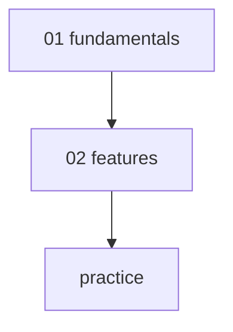

# AWS NLB — Network Load Balancer

> Layer 4 (TCP / UDP / TLS). Static IP (EIP) + 매우 큰 RPS + 낮은 latency. PrivateLink provider.

**[[../network|↑ Network]]** · **[[../../cloud-aws|↑↑ AWS]]**

---

## 1. 한 줄

```
Layer 4 (TCP / UDP / TLS)
├─ Static IP (Elastic IP per AZ)
├─ Source IP 보존 (Target 이 client IP 직접)
├─ 매우 큰 RPS (millions/sec)
├─ 낮은 latency (sub-ms)
├─ TLS pass-through OR termination
└─ PrivateLink provider
```

## 2. ALB vs NLB

| | ALB | NLB |
| --- | --- | --- |
| Layer | 7 (HTTP) | 4 (TCP/UDP/TLS) |
| Routing | path/host/header | port only |
| WebSocket | ✓ | ✓ (pass-through) |
| Static IP | ✗ | ✓ (EIP) |
| TLS Termination | ✓ + mTLS | ✓ |
| TLS Pass-through | ✗ | ✓ |
| Source IP 보존 | X-Forwarded-For | TCP 직접 |
| RPS | LCU 제한 | millions |
| Latency | ~ms | sub-ms (~100μs) |
| Cross-zone | free, default ON | $0.01/GB extra |
| Lambda target | ✓ | ✗ |
| Health Check | HTTP / HTTPS / TCP | TCP / HTTPS |
| PrivateLink | ✗ | ✓ Provider |
| 권장 | HTTP API | TCP service / static IP / PrivateLink |

## 3. 학습 roadmap



## 4. Sub-directory index

- [[01-fundamentals/01-listener-and-target-group]] — TCP/UDP/TLS + Instance/IP target
- [[01-fundamentals/02-static-ip-and-cross-zone]] — EIP + Source IP 보존 + Cross-zone
- [[01-fundamentals/03-pricing-and-limits]] — NLCU + 한도
- [[02-features/01-tls-and-mtls]] — TLS Termination / Pass-through + mTLS
- [[02-features/02-privatelink-endpoint-service]] — PrivateLink Provider
- [[practice/01-tcp-load-balance]] — NLB TCP + Postgres (60분)
- [[practice/02-nlb-to-alb-chain]] — Static IP + ALB chain (45분)

## 5. NLB 의 sub-protocol

| Protocol | Use case |
| --- | --- |
| **TCP** | 일반 (Postgres, Redis, MySQL, Kafka) |
| **UDP** | DNS / Game / VoIP |
| **TLS** | TLS termination (ALB 와 비슷) |
| **TCP_UDP** | 둘 다 (DNS port 53) |

## 6. NLB 의 sub-target

| | |
| --- | --- |
| **Instance** | EC2 (port mapping) |
| **IP** | private IP (Fargate / EKS awsvpc) |
| **ALB** | NLB → ALB chain |

> Lambda target = NLB 안 지원 (ALB 만).

## 7. 사용 시나리오

✓ **시나리오**
- TCP service (Postgres / Redis / MongoDB exposing)
- Static IP 필수 (firewall whitelist)
- Game server (UDP)
- VoIP / DNS
- 초고 throughput (millions RPS)
- PrivateLink provider
- NLB → ALB chain (static IP + L7 routing)

✗ **부적합**
- HTTP API (ALB 가 더 풍부)
- Lambda backend
- L7 routing 필요
- WAF integration (NLB 의 WAF 한도)

## 8. bkurs-be NLB 활용

```
일반 use case 적음. ALB 권장.

특수:
- Postgres / Redis 외부 노출 (회사 외 client) → NLB TCP
- Static IP 필요 (corp firewall whitelist) → NLB + EIP
- PrivateLink (SaaS provider) → NLB
```

## 9. 가격

```
NLB:    $0.0225/h ($16.4/월 fixed)
+ NLCU: $0.006/NLCU·hour
+ Cross-zone DT: $0.01/GB
```

```
1 NLCU = max:
- 800 new TCP connections / sec
- 100K active TCP connections
- 1 GB / hour
- 800 new UDP packets / sec
- 50 new TLS connections / sec
```

> ALB 의 LCU 보다 throughput 단위 높음 (TCP scale).

## 10. 영상 / 자료

| 자료 |
| --- |
| [NLB 공식](https://docs.aws.amazon.com/elasticloadbalancing/latest/network/) |
| [NLB vs ALB](https://aws.amazon.com/elasticloadbalancing/features/#compare) |

## 11. 관련 hub

- [[../network]]
- [[../alb/alb]]
- [[../vpc/02-networking/01-vpc-endpoints-privatelink]]
- [[../../database/rds/03-security/01-network-and-iam]]
