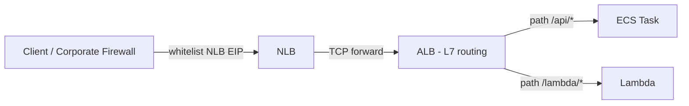

# 실습 2 — NLB → ALB Chain

> 목표: NLB (static IP) → ALB target (L7 routing) → ECS / Lambda. 회사 firewall 의 whitelist IP + ALB 의 path routing 결합. 45분.

## 1. 패턴



활용:
- Static IP (firewall whitelist) 필요 + L7 routing 도 필요
- NLB 의 PrivateLink + ALB 의 풍부한 routing

## 2. ALB 생성 (Inner)

```bash
ACCT=$(aws sts get-caller-identity --query Account --output text)
VPC=$(aws ec2 describe-vpcs --filters Name=isDefault,Values=true --query 'Vpcs[0].VpcId' --output text)
SUBNETS=($(aws ec2 describe-subnets --filters Name=vpc-id,Values=$VPC --query 'Subnets[?MapPublicIpOnLaunch==`true`]|[0:3].SubnetId' --output text))

SG_ALB=$(aws ec2 create-security-group --vpc-id $VPC --group-name lab-chain-alb \
  --description "ALB" --query GroupId --output text)

ALB_ARN=$(aws elbv2 create-load-balancer --name lab-chain-alb \
  --type application --scheme internal \
  --subnets ${SUBNETS[@]} --security-groups $SG_ALB \
  --query 'LoadBalancers[0].LoadBalancerArn' --output text)

ALB_DNS=$(aws elbv2 describe-load-balancers --load-balancer-arns $ALB_ARN \
  --query 'LoadBalancers[0].DNSName' --output text)
```

## 3. ALB 의 Lambda Target

```bash
# Lambda function
cat > lab_app.py <<'EOF'
def lambda_handler(event, context):
    path = event.get("path", "/")
    method = event.get("httpMethod", "")
    return {
        "statusCode": 200,
        "statusDescription": "200 OK",
        "isBase64Encoded": False,
        "headers": {"Content-Type": "application/json"},
        "body": f'{{"path":"{path}","method":"{method}","backend":"lambda"}}'
    }
EOF
zip lab_app.zip lab_app.py

aws iam create-role --role-name lab-chain-fn-role \
  --assume-role-policy-document '{"Version":"2012-10-17","Statement":[{"Effect":"Allow","Principal":{"Service":"lambda.amazonaws.com"},"Action":"sts:AssumeRole"}]}'
aws iam attach-role-policy --role-name lab-chain-fn-role \
  --policy-arn arn:aws:iam::aws:policy/service-role/AWSLambdaBasicExecutionRole

aws lambda create-function --function-name lab-chain-fn \
  --runtime python3.12 --architectures arm64 \
  --handler lab_app.lambda_handler \
  --role arn:aws:iam::$ACCT:role/lab-chain-fn-role \
  --zip-file fileb://lab_app.zip

# ALB Target Group (Lambda)
TG_LAMBDA=$(aws elbv2 create-target-group --name lab-chain-tg-l \
  --target-type lambda --health-check-enabled \
  --query 'TargetGroups[0].TargetGroupArn' --output text)

aws lambda add-permission --function-name lab-chain-fn \
  --statement-id alb --action lambda:InvokeFunction \
  --principal elasticloadbalancing.amazonaws.com \
  --source-arn $TG_LAMBDA

aws elbv2 register-targets --target-group-arn $TG_LAMBDA \
  --targets Id="arn:aws:lambda:ap-northeast-2:$ACCT:function:lab-chain-fn"
```

## 4. ALB Listener + Rules

```bash
ALB_LISTENER=$(aws elbv2 create-listener --load-balancer-arn $ALB_ARN \
  --protocol HTTP --port 80 \
  --default-actions 'Type=fixed-response,FixedResponseConfig={ContentType=text/plain,MessageBody=Default,StatusCode=200}' \
  --query 'Listeners[0].ListenerArn' --output text)

# /api/* → Lambda
aws elbv2 create-rule --listener-arn $ALB_LISTENER --priority 10 \
  --conditions '[{"Field":"path-pattern","PathPatternConfig":{"Values":["/api/*","/lambda/*"]}}]' \
  --actions "Type=forward,TargetGroupArn=$TG_LAMBDA"
```

## 5. NLB Target Group (ALB target)

```bash
TG_ALB=$(aws elbv2 create-target-group --name lab-chain-tg-alb \
  --target-type alb --port 80 --protocol TCP \
  --vpc-id $VPC \
  --health-check-protocol HTTP --health-check-port 80 --health-check-path /healthz \
  --health-check-interval-seconds 30 \
  --query 'TargetGroups[0].TargetGroupArn' --output text)

# Register ALB as target
aws elbv2 register-targets --target-group-arn $TG_ALB \
  --targets Id=$ALB_ARN
```

> NLB-to-ALB 의 health check 는 ALB 의 health endpoint (default: ALB 의 listener 의 first rule).

ALB 에 `/healthz` 의 fixed-response:
```bash
aws elbv2 create-rule --listener-arn $ALB_LISTENER --priority 1 \
  --conditions '[{"Field":"path-pattern","PathPatternConfig":{"Values":["/healthz"]}}]' \
  --actions 'Type=fixed-response,FixedResponseConfig={ContentType=text/plain,MessageBody=OK,StatusCode=200}'
```

## 6. NLB 생성 (외부 진입 + Static IP)

```bash
# EIP per AZ
EIP_A=$(aws ec2 allocate-address --domain vpc --query AllocationId --output text)
EIP_B=$(aws ec2 allocate-address --domain vpc --query AllocationId --output text)
EIP_C=$(aws ec2 allocate-address --domain vpc --query AllocationId --output text)

NLB_ARN=$(aws elbv2 create-load-balancer --name lab-chain-nlb \
  --type network --scheme internet-facing \
  --subnet-mappings \
    "SubnetId=${SUBNETS[0]},AllocationId=$EIP_A" \
    "SubnetId=${SUBNETS[1]},AllocationId=$EIP_B" \
    "SubnetId=${SUBNETS[2]},AllocationId=$EIP_C" \
  --query 'LoadBalancers[0].LoadBalancerArn' --output text)

NLB_DNS=$(aws elbv2 describe-load-balancers --load-balancer-arns $NLB_ARN \
  --query 'LoadBalancers[0].DNSName' --output text)

# NLB Listener TCP 80 → TG (ALB)
aws elbv2 create-listener --load-balancer-arn $NLB_ARN \
  --protocol TCP --port 80 \
  --default-actions Type=forward,TargetGroupArn=$TG_ALB

# Cross-zone enable
aws elbv2 modify-load-balancer-attributes --load-balancer-arn $NLB_ARN \
  --attributes Key=load_balancing.cross_zone.enabled,Value=true
```

## 7. ALB SG — NLB 만 inbound

```bash
# NLB 자체는 SG 없음 — Subnet CIDR (또는 VPC CIDR) 활용
VPC_CIDR=$(aws ec2 describe-vpcs --vpc-ids $VPC --query 'Vpcs[0].CidrBlock' --output text)

aws ec2 authorize-security-group-ingress --group-id $SG_ALB \
  --protocol tcp --port 80 --cidr $VPC_CIDR
```

## 8. 검증

```bash
# Static IP 활용 (회사 firewall 이 whitelist 한다 가정)
EIP_A_IP=$(aws ec2 describe-addresses --allocation-ids $EIP_A --query 'Addresses[0].PublicIp' --output text)

echo "Static IPs (whitelist): $(aws ec2 describe-addresses --allocation-ids $EIP_A $EIP_B $EIP_C --query 'Addresses[].PublicIp' --output text)"

sleep 120  # NLB + ALB ready

# NLB DNS 로
curl http://$NLB_DNS/healthz
# OK

curl http://$NLB_DNS/api/test
# {"path":"/api/test","method":"GET","backend":"lambda"}

curl http://$NLB_DNS/lambda/foo
# {"path":"/lambda/foo","method":"GET","backend":"lambda"}

curl http://$NLB_DNS/unknown
# Default

# Static EIP 직접 (whitelist 시뮬레이션)
curl http://$EIP_A_IP/api/test
# {"path":"/api/test",...}
```

## 9. 추가 — Multi-Rule (실용)

```bash
# /admin/* (NLB → ALB → 별도 처리)
aws elbv2 create-rule --listener-arn $ALB_LISTENER --priority 20 \
  --conditions '[{"Field":"path-pattern","PathPatternConfig":{"Values":["/admin/*"]}}]' \
  --actions 'Type=fixed-response,FixedResponseConfig={ContentType=text/html,MessageBody=<h1>Admin protected</h1>,StatusCode=403}'

curl http://$NLB_DNS/admin/dashboard
# 403
```

## 10. CloudWatch metric

```bash
# NLB metric
aws cloudwatch get-metric-statistics --namespace AWS/NetworkELB \
  --metric-name NewFlowCount \
  --dimensions Name=LoadBalancer,Value=$(echo $NLB_ARN | awk -F'/' '{print "net/"$3"/"$4}') \
  --period 60 --statistics Sum

# ALB metric (다른 namespace)
aws cloudwatch get-metric-statistics --namespace AWS/ApplicationELB \
  --metric-name RequestCount \
  --dimensions Name=LoadBalancer,Value=$(echo $ALB_ARN | awk -F'/' '{print "app/"$3"/"$4}') \
  --period 60 --statistics Sum
```

## 11. Clean up

```bash
# Listener
for L in $(aws elbv2 describe-listeners --load-balancer-arn $NLB_ARN --query 'Listeners[].ListenerArn' --output text); do
  aws elbv2 delete-listener --listener-arn $L
done
for L in $(aws elbv2 describe-listeners --load-balancer-arn $ALB_ARN --query 'Listeners[].ListenerArn' --output text); do
  aws elbv2 delete-listener --listener-arn $L
done

# Load Balancers
aws elbv2 delete-load-balancer --load-balancer-arn $NLB_ARN
aws elbv2 delete-load-balancer --load-balancer-arn $ALB_ARN
sleep 30

# TG
for TG in $TG_LAMBDA $TG_ALB; do
  aws elbv2 delete-target-group --target-group-arn $TG
done

# EIP
for EIP in $EIP_A $EIP_B $EIP_C; do
  aws ec2 release-address --allocation-id $EIP
done

# Lambda + IAM
aws lambda delete-function --function-name lab-chain-fn
aws iam detach-role-policy --role-name lab-chain-fn-role \
  --policy-arn arn:aws:iam::aws:policy/service-role/AWSLambdaBasicExecutionRole
aws iam delete-role --role-name lab-chain-fn-role

# SG
aws ec2 delete-security-group --group-id $SG_ALB
```

## 12. 학습 포인트

- NLB → ALB Chain (Static IP + L7 routing)
- ALB-as-Target (NLB TG type)
- Static EIP whitelist (corporate firewall)
- ALB Health check via NLB (별도 `/healthz`)
- VPC CIDR 로 ALB inbound (NLB IP 가변)
- Lambda Target via ALB

## 13. 활용 use case

```
1. SaaS — Static IP 제공 (customer firewall)
2. Corporate API — whitelist 만 access
3. Compliance — Static IP audit
4. Multi-tenant SaaS — NLB EIP 공유 + ALB 의 routing
5. PrivateLink Provider — NLB 가 backend
```

## 14. 다음

- ▶ [[../nlb]]
- ▶ [[../../cloudfront/cloudfront]]

## 15. 참고

- [[../nlb]]
- [[01-tcp-load-balance]]
- [[../02-features/02-privatelink-endpoint-service]]
